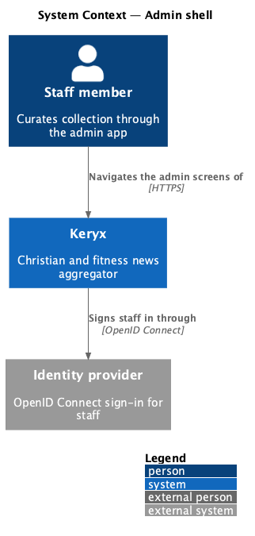
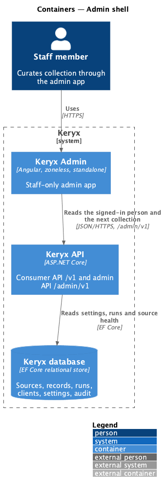
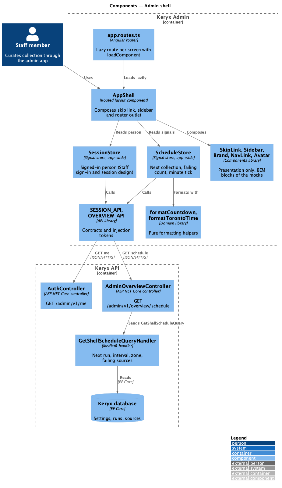
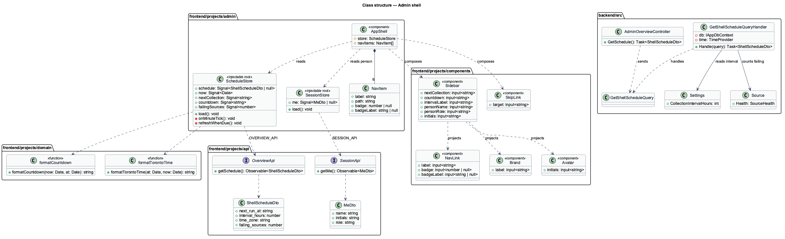
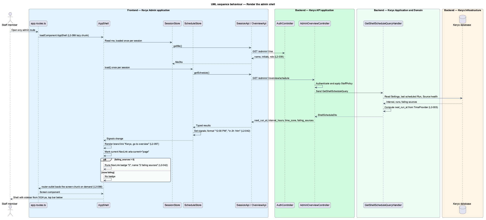
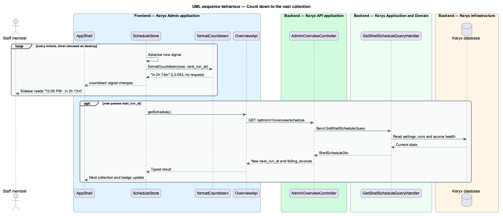

# Admin shell

## Overview

Keryx is a news aggregator for Christian and fitness news, primarily in Toronto and the Greater
Toronto Area. Its only user interface is Keryx Admin, a staff-only Angular application that
watches collection and curates what it brings in. This feature is the frame every admin screen
sits in and the rules that keep that frame small and fast to load.

**admin shell** — layout around every admin screen that gives navigation, the next collection
time and the signed-in person

**next collection** — time of the next scheduled collection run, in Toronto time, with a
countdown to it

**failing source** — source whose last fetch failed; the shell counts them on the Runs link

**initial bundle** — JavaScript and CSS the browser downloads before the first screen renders

**lazy chunk** — bundle the router or a `@defer` block downloads only when its content is first
needed

**mark** — the Keryx symbol: a cross whose right arm lifts into a K, in volt on an ink tile

**wordmark** — the word "keryx" set in Geist ExtraBold beside the mark

The shell shows the Keryx mark and wordmark as one link to Overview, six navigation links
(Overview, Articles, Runs, Sources, API and Settings), the next collection ("12:00 PM · in
2h 14m", "Every 6 hours, Toronto time") and the person's initials, name and role. From 1024 px
the navigation is a sidebar on the left. Below 1024 px the same `sidebar` block becomes a top bar
with the mark, the wordmark and a horizontally scrollable row of the six links; its footer (next
collection and person) is not shown, and staff read the next collection on Overview and Runs and
the person in Settings › Account.

The shell also carries the admin app's loading rules. Each screen, dialog and sign-in screen is
its own lazy chunk; the CDK Dialog, overlay and menu code arrive with the first screen that uses
them; heavy or below-the-fold content is deferred. The initial bundle has a fixed budget that
fails the build when exceeded. The browser tab shows the Keryx mark from
`frontend/public/favicon.ico`.

The countdown advances on the client once a minute without a request. Only when the next
collection time passes does the shell ask the server for the new one.

## Description

The slice runs from the shell layout in the admin app to one admin endpoint, and reuses the
person endpoint of the staff sign-in design (`L2-039`).

**Frontend — `frontend/projects/admin`**

- **`app.routes.ts`** — route table. A parent route loads `AppShell` with `loadComponent`, guarded
  by the staff guards of the Staff sign-in and session design. Its children load `OverviewPage`,
  `ArticlesPage`, `RunsPage`, `SourcesPage`, `ApiPage` and `SettingsPage` with `loadComponent`.
  `SignInPage`, `ForbiddenPage` and `NotFoundPage` are lazy routes outside the shell; the
  wildcard route loads `NotFoundPage`. No screen component is imported eagerly.
- **`app.config.ts`** — composition root. It provides zoneless change detection, the router and
  `HttpClient`, and binds `SESSION_API` to `HttpSessionApi` and `OVERVIEW_API` to
  `HttpOverviewApi`. It imports no CDK module; dialogs and overlays load with the screens that
  open them.
- **`AppShell`** — routed layout component (`app/shell/app-shell.ts`, `.html`, `.scss`). It
  composes `SkipLink`, `App` and `Sidebar` from the components library and projects the
  `router-outlet` into `App`'s `<main id="main" class="app__main">`; it has no markup of its
  own. Until the screens exist it is the placeholder of
  [ADR 0004](../../../adr/0004-shell-placeholder-until-the-admin-shell.md): the frame, the
  lockup and an `Empty` card. It builds the six `NavItem` values and sets `aria-current="page"` on exactly
  one link through `routerLinkActive` with `ariaCurrentWhenActive="page"`. It moves focus to the
  main region when the skip link is activated.
- **`SessionStore`** — app-wide session state owned by the Staff sign-in and session design. The
  shell reads the signed-in person (`me`) from it and issues no request of its own for it.
- **`ScheduleStore`** — the shell's schedule state: an app-wide signal store
  (`providedIn: 'root'`), one of the three app-wide stores `L2-089` allows. It holds `schedule`,
  a `now` signal advanced by one minute-aligned timer, and computed `nextCollection`,
  `countdown`, `intervalLabel` and `failingSources`. When `now` passes `next_run_at` it calls
  `getSchedule()` once. It releases its timer through `DestroyRef`. Overview and Runs read the
  next collection from it rather than requesting it again. When a collection ends, the store
  refreshes on a signal from `CollectionWatcher` (Page states, dialogs and notifications design);
  any other refresh of the failing count is `<TO SUPPLY>`.
- **`NavItem`** — view model of one link: `label`, `path`, `badge` and `badgeLabel`. The Runs
  item carries `badge` = `failing_sources` and `badgeLabel` "2 failing sources" when the count is
  above zero, and no badge otherwise.

**Frontend — `frontend/projects/components`** (presentation only, inputs and outputs, `OnPush`,
one encapsulated BEM stylesheet each, selector prefix `kx-`)

- **`SkipLink`** (`skip-link`) — "Skip to content" link, the first focusable element; it
  targets `#main`.
- **`App`** (`app`, elements `app__main`, `app__content`; with `PageBody`, `page-body`) — the
  frame: a slot for the sidebar and the one `main` landmark, in the default, split and bare
  arrangements of its design-system page.
- **`Sidebar`** (`sidebar`, elements `sidebar__head`, `sidebar__tag`, `sidebar__nav`,
  `sidebar__foot`, `sidebar__caption`, `sidebar__value`, `sidebar__user`,
  `sidebar__user-name`) — navigation frame. It projects the brand and the links, and renders
  the footer only from 1024 px.
- **`Brand`** (`brand`, elements `brand__mark`, `brand__tile`, `brand__strokes`,
  `brand__word`) — the 40-unit mark drawing with four square-ended strokes of width 4.2 in volt
  on an ink tile of radius 10, beside the wordmark. The whole block is one link named
  "Keryx, go to overview". Colours come from the brand tokens only, so the mark is never
  recoloured, stretched or skewed.
- **`NavLink`** (`nav-link`, element `nav-link__badge`) — one navigation link with an icon, a
  visible label and an optional count badge with its own accessible name. The current state is
  styled through `[aria-current="page"]` with a weight change, an icon colour and, from
  1024 px, a bar, so it is not carried by colour alone.
- **`Avatar`** (`avatar`) — the person's initials, hidden from assistive technology because the
  name follows it.

**Frontend — `frontend/projects/domain`**

- **`formatCountdown(now, at)`** — returns "in 2h 14m" style text for the time left; unit-tested
  with a case table and a fake clock.
- **`formatTorontoTime(at, now)`** — formats an instant in Toronto time ("12:00 PM",
  "Today, 6:00 AM").

**Frontend — `frontend/projects/api`**

- **`SessionApi` / `SESSION_API`** — `getMe(): Observable<MeDto>` with `MeDto` `name`,
  `initials`, `role`. The contract is owned by the Staff sign-in and session design.
- **`OverviewApi` / `OVERVIEW_API`** — `getSchedule(): Observable<ShellScheduleDto>` with
  `next_run_at` (ISO 8601 with offset), `interval_hours` (number), `time_zone` (IANA name) and
  `failing_sources` (number). The Overview design adds its own members to the same contract.

**Backend**

- **`AuthController`** — `GET /admin/v1/me` returns `name`, `initials` and `role` (`L2-039`).
- **`AdminOverviewController`** — `GET /admin/v1/overview/schedule` (path `<TO SUPPLY>`; `L2-042`
  names no endpoint). It requires `StaffPolicy`, checks nothing and sends one
  `GetShellScheduleQuery`. Responses carry `Cache-Control: no-store`.
- **`GetShellScheduleQueryHandler`** — reads `Settings.CollectionIntervalHours`, the last
  scheduled `Run` and the `Source` health through `IAppDbContext`, computes `next_run_at` from
  `TimeProvider` with the schedule rule of `L2-005` (owned by the Schedule collection design),
  and counts the sources whose `SourceHealth` is failing.
- **Errors** — `401` and `403` with `code` `not_staff` follow the Staff sign-in and session
  design; the shell shows no error state of its own. When `getSchedule()` fails, the footer
  shows `<TO SUPPLY>` (no mock state exists for it).

**Build and assets**

- **`angular.json` budgets** — `initial` error at 250 kB (warning at 240 kB) and
  `anyComponentStyle` error at 8 kB (warning at 6 kB), both on uncompressed output, which is
  what Angular budgets measure and what `L2-088` states (decision 14 of
  [L2.md](../../../specs/L2.md)). The build fails beyond either; raising one needs a stated
  reason.
- **Deferred content** — the run chart (Overview), the API example panel (API) and the article
  detail panel (Articles) sit in `@defer` blocks owned by their screens' designs.
- **Fonts** — Geist and Geist Mono `woff2` files are bundled from
  `docs/design-system/assets/fonts/` (copied to the app's `foundations/assets/fonts/`),
  declared in the global stylesheet with `@font-face` and `font-display: swap`, served from the
  app's own origin, and only the faces used above the fold are preloaded in `index.html`.
- **Favicon** — `frontend/public/favicon.ico` holds the mark at 16, 24, 32, 48, 64, 128 and
  256 px, generated from `docs/design-system/assets/brand/keryx-mark.svg`. The Angular default
  icon is in neither the repository nor the build output.
- **Repository logo** — the root `README.md` opens with a centred `<picture>` of
  `keryx-logo.svg` and `keryx-logo-dark.svg` with alternative text "Keryx", legible in GitHub's
  light and dark themes.
- **Performance check** — Largest Contentful Paint under 2.5 s and Cumulative Layout Shift
  under 0.1 on a throttled mid-range phone profile when Overview opens cold; the profile's exact
  settings are `<TO SUPPLY>`.

## Requirements

The feature realizes the following level-2 (L2) requirements. Each L2 requirement refines a
level-1 (L1) requirement, cited by identifier. Their acceptance criteria are in
[L2.md](../../../specs/L2.md).

| L2 ID | Refines (L1) | Requirement |
|-------|--------------|-------------|
| `L2-042` | `L1-011` | Admin shell — Every admin screen sits in one shell that gives navigation, the next collection time and who is signed in. |
| `L2-088` | `L1-021` | Initial bundle and lazy loading — The admin app's initial bundle stays within a tight budget; each screen and dialog is loaded only when first needed. |
| `L2-097` | `L1-024` | Logo and favicon — The mark is a cross whose right arm lifts into a K, in volt on an ink tile; the wordmark is "keryx" in Geist ExtraBold. Their source is the Magic Patterns *Keryx Brand* prototype; the files are in `docs/design-system/assets/brand/`. |

## Diagrams

### System context

Staff reach every admin screen through the shell. Keryx signs them in through the identity
provider before the shell renders.

### Containers

Keryx Admin reads the signed-in person and the next collection from the Keryx API, which reads
settings, runs and source health from the Keryx database.

### Components

`AppShell` is loaded lazily by the route table and composes presentation components from the
components library. `SessionStore` and `ScheduleStore` call two contracts, which reach
`AuthController` and `AdminOverviewController`; `ScheduleStore` formats times with domain
helpers.

### Class structure

`AppShell` owns six `NavItem` values and reads `SessionStore` and `ScheduleStore`. The stores
depend on the `SessionApi` and `OverviewApi` contracts; `ScheduleStore` also uses two domain
helpers. On the server,
`GetShellScheduleQueryHandler` reads `Settings` and `Source`.

### Behaviour — render the shell

The route table loads the shell lazily. The two stores read the person and the schedule once, the
shell marks the current link and the Runs badge, and the outlet loads the screen's own chunk.

### Behaviour — count down to the next collection

A minute timer advances the countdown with no request. When the next collection time passes,
the store asks the server once for the new time and the failing-source count.

