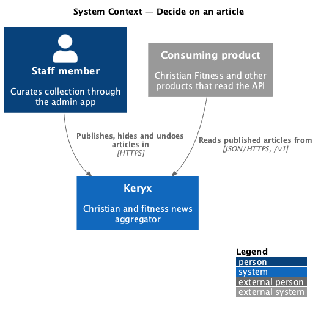
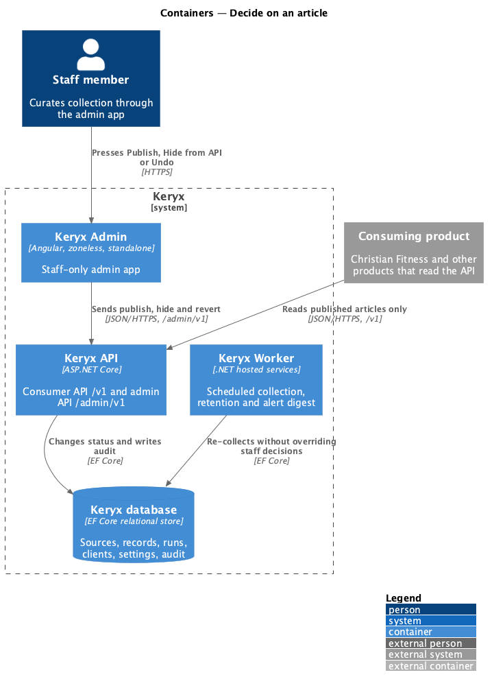
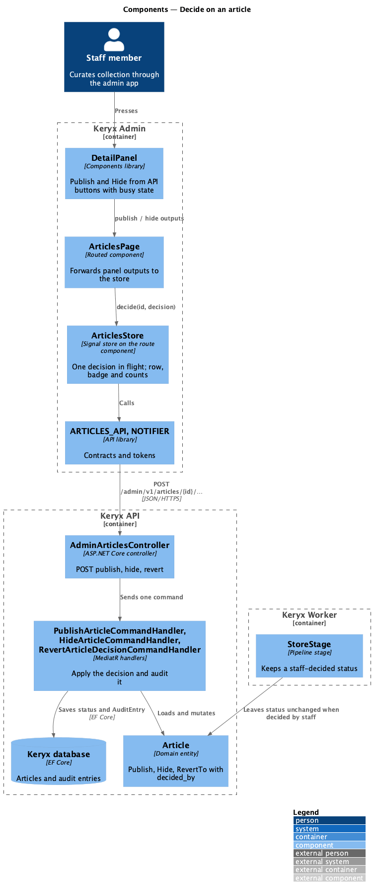
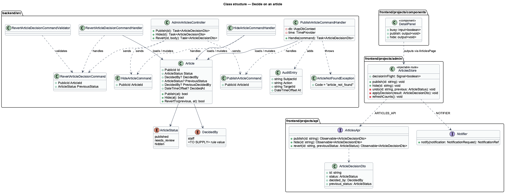
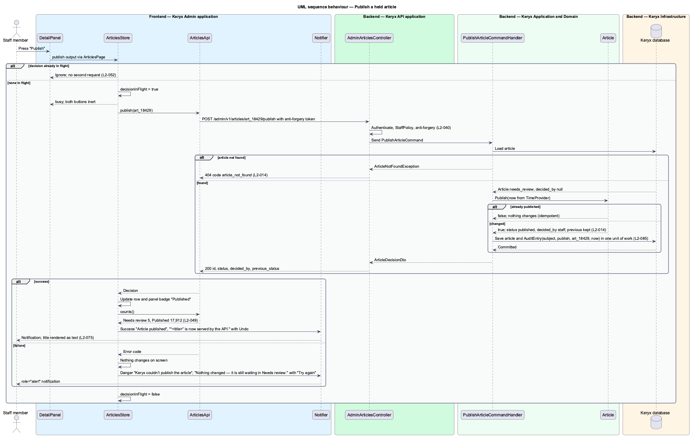
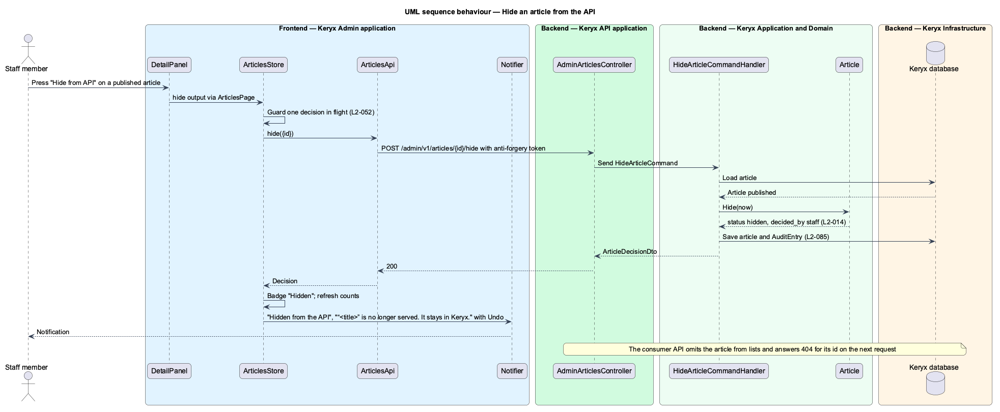
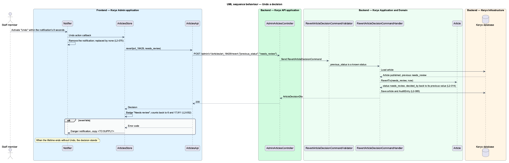
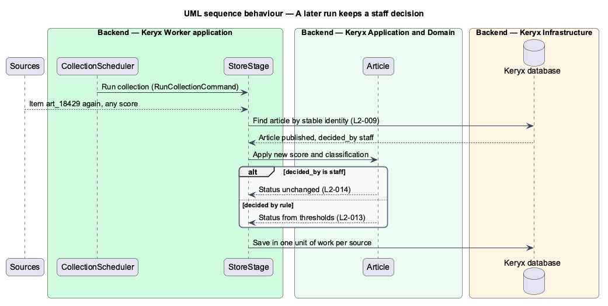

# Decide on an article

## Overview

Keryx sets each collected article's status from its relevance score: at or above the publish
threshold it is published, from the review floor of 0.45 up to the threshold it is held for
review, and below 0.45 it is hidden. Only published articles are served to consuming products
such as Christian Fitness. Staff overrule that rule from the Articles screen of Keryx Admin: they
publish or hide any article whatever its score, and can undo the decision from the notification
that reports it.

**decision** — staff action that sets an article's status to `published` (Publish) or `hidden`
(Hide from API)

**decided_by** — field that records who set an article's current status; `staff` after a
decision

**revert** — request that returns an article to the status it held before a decision, and
`decided_by` to its previous value

**Undo** — the single action of the notification that reports a decision; it sends the revert

A decision is final against the collection rule: when a later run collects the same article
again, with any score, its status stays as staff set it. A decision is idempotent: sending the
same decision again answers `200` and changes nothing. Every decision is recorded for audit.
The detail panel that offers the buttons, the tabs whose counts change and the list are the
Review articles design; this design covers what happens from the button press to the server
and back.

## Description

The slice runs from the detail panel's buttons through the Articles store to three admin
commands, and into the collection pipeline that respects the decision.

**Frontend — `frontend/projects/admin`**

- **`ArticlesPage`** — forwards the `publish` and `hide` outputs of `DetailPanel` to the store.
- **`ArticlesStore`** — screen store of the Review articles design, extended with
  `decisionInFlight` and `publish(id)`, `hide(id)` and a private `undo(id, previousStatus)`.
  While a decision is in flight both actions are ignored, so a second press sends nothing. On
  success it updates the row and the panel badge from the response, re-reads the status counts
  from the server (so "Needs review" falls by one and "Published" rises by one), and raises a
  notification with "Undo" through `NOTIFIER`. On failure nothing changes on screen and it
  raises a danger notification with "Try again", which repeats the same decision. Undo sends the
  revert with the `previous_status` from the decision response; on success the badge and counts
  return to their previous values. The notification copy:

  | Outcome | Kind | Title | Body | Action |
  |---|---|---|---|---|
  | Published | success | "Article published" | "“<title>” is now served by the API." | Undo |
  | Hidden | info (as in mock `with-action.html`) | "Hidden from the API" | "“<title>” is no longer served. It stays in Keryx." | Undo |
  | Publish failed | danger | "Keryx couldn’t publish the article" | "Nothing changed — it is still waiting in Needs review." | Try again |
  | Hide failed | danger | `<TO SUPPLY>` | `<TO SUPPLY>` | Try again |
  | Undo failed | danger | `<TO SUPPLY>` | `<TO SUPPLY>` | `<TO SUPPLY>` |

  The title is bound as text in every notification (`L2-053`, `L2-075`). The body for a publish
  failure of a hidden article ("still waiting in Needs review") is `<TO SUPPLY>`.

**Frontend — `frontend/projects/components`**

- **`DetailPanel`** (`detail-panel`, element `detail-panel__foot`) — renders "Publish"
  (`btn--primary`) and "Hide from API" per status, and takes a `busy` input that shows the
  pressed button's busy state and makes both inert.
- **`Toast`** (`toast`, `toast--success`, `toast--info`, `toast--danger`; elements
  `toast__body`, `__title`, `__text`, `__action`, `__progress`) in a `toast-region` — owned by
  the Page states, dialogs and notifications design, which gives the 8-second lifetime, the
  pause on hover or focus, and `role="status"` or `role="alert"`.

**Frontend — `frontend/projects/api`**

- **`ArticlesApi` / `ARTICLES_API`** — adds `publish(id)`, `hide(id)` and
  `revert(id, previousStatus)`, each returning `ArticleDecisionDto` (`id`, `status`,
  `decided_by`, `previous_status`). The HTTP implementation sends the anti-forgery token the
  Staff sign-in and session design defines.
- **`Notifier` / `NOTIFIER`** — `notify(request)` with kind, title, body and one optional action
  callback.

**Endpoints** (all under `StaffPolicy` with an anti-forgery token; `400` `antiforgery_failed`
without it)

| Endpoint | Body | Response | Errors |
|---|---|---|---|
| `POST /admin/v1/articles/{id}/publish` | — | `200` `ArticleDecisionDto` | `404` `article_not_found` |
| `POST /admin/v1/articles/{id}/hide` | — | `200` `ArticleDecisionDto` | `404` `article_not_found` |
| `POST /admin/v1/articles/{id}/revert` | `previous_status` (`published`, `needs_review`, `hidden`) | `200` `ArticleDecisionDto` | `404` `article_not_found`; `400` for an unknown status (code `<TO SUPPLY>`) |

**Backend — `Keryx.Api` and `Keryx.Application`**

- **`AdminArticlesController`** — `Publish`, `Hide` and `Revert` actions. Each checks nothing
  and sends one command.
- **`PublishArticleCommand`** / **`PublishArticleCommandHandler`** — loads the `Article`
  through `IAppDbContext`, throws `ArticleNotFoundException` when it does not exist, calls
  `Article.Publish(now)` with `now` from `TimeProvider`, and, when the status changed, saves the
  article and an `AuditEntry` (staff subject id, action `article.publish`, target id, time) in
  one unit of work (`L2-085`). An unchanged article writes nothing.
- **`HideArticleCommand`** / **`HideArticleCommandHandler`** — the same with `Article.Hide(now)`
  and action `article.hide`.
- **`RevertArticleDecisionCommand`** / **`RevertArticleDecisionCommandValidator`** /
  **`RevertArticleDecisionCommandHandler`** — the validator accepts only the three statuses. The
  handler calls `Article.RevertTo(previousStatus, now)` and audits `article.revert`. `L2-014`
  limits a revert to "within the same session"; how the server enforces that limit is
  `<TO SUPPLY>`. The audit action names are `<TO SUPPLY>` pending the Audit staff actions
  design.
- **`ArticleNotFoundException`** — `KeryxException` with `code` `article_not_found`, mapped to
  `404` ProblemDetails by `ProblemDetailsMapper`.

**Backend — `Keryx.Domain`**

- **`Article`** — gains `DecidedBy? DecidedBy`, `ArticleStatus? PreviousStatus`,
  `DecidedBy? PreviousDecidedBy` and `DateTimeOffset? DecidedAt`. `Publish` and `Hide` keep the
  prior status and `decided_by` before setting the new status and `decided_by` = `staff`; each
  returns `false` when the article already holds the requested status. `RevertTo` restores the
  given status and the previous `decided_by`.
- **`DecidedBy`** — `staff`, and the value recorded when the collection rule sets the status
  (`<TO SUPPLY>`; `L2-014` names only `staff`).

**Backend — `Keryx.Worker`**

- **`StoreStage`** — when it collects an article that already exists (stable identity,
  `L2-009`) whose `decided_by` is `staff`, it updates the score and leaves the status unchanged
  (`L2-014`). Otherwise the status follows the thresholds of `L2-013`.

**Consumer API effect** — a published article is served by `GET /v1/articles` on the next
request; a hidden article is absent from lists and `GET /v1/articles/{id}` answers `404`. The
Serve articles design owns those endpoints and their caching.

## Requirements

The feature realizes the following level-2 (L2) requirements. Each L2 requirement refines a
level-1 (L1) requirement, cited by identifier. Their acceptance criteria are in
[L2.md](../../../specs/L2.md).

| L2 ID | Refines (L1) | Requirement |
|-------|--------------|-------------|
| `L2-014` | `L1-004` | Staff decisions on an article — Staff can publish or hide any article whatever its score, undo that decision, and a later run never overrides it. |
| `L2-052` | `L1-012` | Publish and hide from the admin app — Staff can publish or hide an article from its panel, and undo the decision from the notification that reports it. |

## Diagrams

### System context

Staff publish and hide articles in Keryx; consuming products read only the published ones.

### Containers

Keryx Admin sends decisions to the Keryx API, which changes the status and writes audit in the
Keryx database. The Keryx Worker re-collects articles without overriding a staff decision, and
consuming products read published articles through `/v1`.

### Components

`DetailPanel` emits the decision, `ArticlesStore` sends it through `ARTICLES_API`, and
`AdminArticlesController` sends one command whose handler mutates `Article`. `StoreStage` in the
worker leaves a staff-decided status unchanged.

### Class structure

Three commands, each with its handler, act on `Article`, which records `decided_by` and the
previous status. Handlers add an `AuditEntry` and throw `ArticleNotFoundException` for an
unknown id.

### Behaviour — publish a held article

The store allows one decision in flight. The handler publishes idempotently and audits a change;
the store updates the badge and counts and offers Undo, or reports a failure with nothing
changed.

### Behaviour — hide an article

Hiding follows the same path with `HideArticleCommand`; the consumer API stops serving the
article on the next request.

### Behaviour — undo a decision

Undo within the notification's 8 seconds sends the revert with the previous status; the badge
and counts return to their previous values.

### Behaviour — a later run keeps the decision

When collection meets the same article again, `StoreStage` keeps a staff-decided status and
applies the thresholds only to articles the rule decided.

