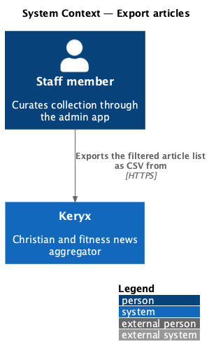
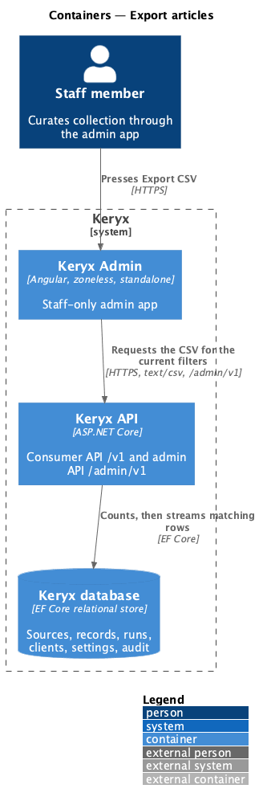
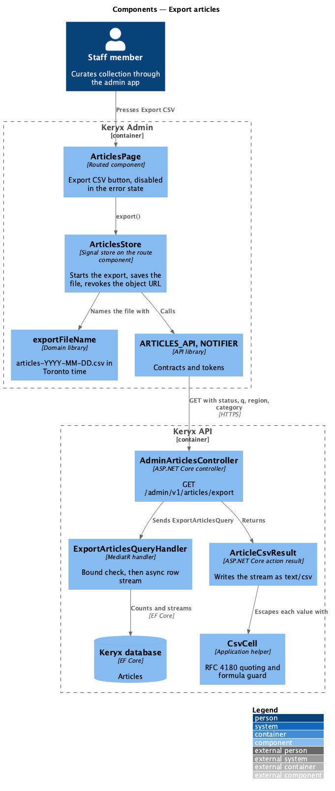
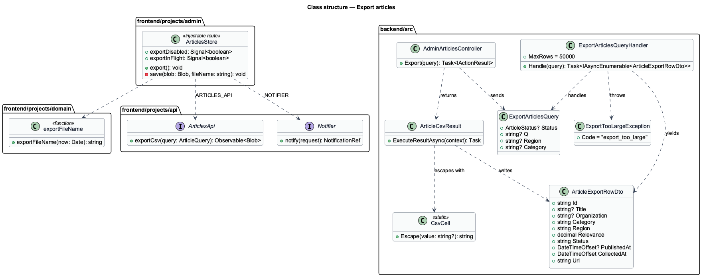
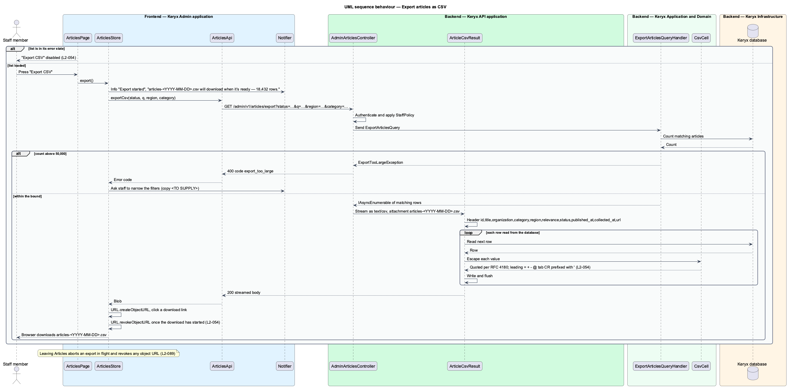

# Export articles

## Overview

The Articles screen of Keryx Admin lists every collected article, narrowed by a status tab, a
text search and Region and Category filters (Review articles design). Export lets staff take the
articles matching those choices out of Keryx as a CSV file, for checks and reporting outside the
admin app.

**export** — CSV file of the articles that match the current tab, search and filters, produced
by the server and downloaded by the browser

**export bound** — maximum of 50,000 rows in one export; a request that matches more is refused

**formula guard** — prefix of a single quote on a cell value that begins with `=`, `+`, `-`, `@`,
tab or carriage return, so a spreadsheet does not run it as a formula

The export is bounded and streamed: the server counts the matches first and refuses the request
with `export_too_large` above 50,000, then writes rows as it reads them, never building the
whole file in memory. Each value is quoted per RFC 4180 and passes the formula guard, because
titles and organization names come from sources and are untrusted. The file holds facts and a
link per article, never a copy of a story. "Export CSV" is disabled while the list is in its
error state.

## Description

The slice runs from the page header's "Export CSV" button through the Articles store to one
streaming admin endpoint.

**Frontend — `frontend/projects/admin`**

- **`ArticlesPage`** — renders "Export CSV" (`Btn`, `btn`) in the `page-header__actions` slot,
  disabled when `exportDisabled` is true: while the list loads, in its error state (`L2-055`), in
  its empty state (no article at all), as the mocks show, and while an export is in flight. With
  no results for the current search it stays enabled, as the `no-results` mock shows.
- **`ArticlesStore`** — screen store of the Review articles design, extended with
  `exportDisabled`, `exportInFlight` and `export()`. `export()` raises the info notification
  "Export started" / "articles-<YYYY-MM-DD>.csv will download when it’s ready — 18,432 rows."
  with the date in Toronto time and the row count from the current `total`. It then calls
  `exportCsv(query)` with the current status, search and filters. On success it creates an
  object URL for the returned `Blob`, starts the download through a temporary anchor with the
  `download` attribute, and revokes the object URL once the download has started. On
  `export_too_large` it raises a warning notification, "Too many articles to export" / "Exports
  stop at 50,000 rows. Narrow the search or filters, then export again." (mock
  `notifications/article-toast/warning.html`). Any other failure raises a danger notification,
  "Keryx couldn’t export the articles" / "Nothing was downloaded." with "Try again" (mock
  `notifications/article-toast/export-failed.html`). The request is cancelled through the store's `DestroyRef` when the page is left
  (`L2-089`).

**Frontend — `frontend/projects/domain`**

- **`exportFileName(now)`** — returns `articles-<YYYY-MM-DD>.csv` with the date in Toronto time;
  unit-tested with a fake clock across midnight UTC.

**Frontend — `frontend/projects/api`**

- **`ArticlesApi` / `ARTICLES_API`** — adds `exportCsv(query, signal): Promise<Blob>`, as the
  contract's other calls; `HttpArticlesApi` requests it with `responseType: 'blob'`.
- **`Notifier` / `NOTIFIER`** — notification contract of the Page states, dialogs and
  notifications design (`toast--info`, mock `notifications/article-toast/info.html`).

**Endpoint** (under `StaffPolicy`, `Cache-Control: no-store`)

| Endpoint | Request | Response | Errors |
|---|---|---|---|
| `GET /admin/v1/articles/export` | `status`, `q` (first 100 characters), `region`, `category`, as for `GET /admin/v1/articles` | `200` `text/csv; charset=utf-8`, `Content-Disposition: attachment; filename=articles-<YYYY-MM-DD>.csv`, streamed; header row `id,title,organization,category,region,relevance,status,published_at,collected_at,url`; at most 50,000 rows | `400` `export_too_large` |

**Backend**

- **`AdminArticlesController.Export`** — checks nothing; sends one `ExportArticlesQuery` and
  returns an `ArticleCsvResult` over the handler's row stream.
- **`ExportArticlesQuery`** / **`ExportArticlesQueryHandler`** — applies the same filter rules as
  `GetAdminArticlesQueryHandler` (literal search, status, region, category, newest first). It
  counts the matches through `IAppDbContext` and throws `ExportTooLargeException` (`code`
  `export_too_large`, `400`) when the count exceeds `MaxRows` = 50,000. Otherwise it returns an
  `IAsyncEnumerable<ArticleExportRowDto>` read with `AsNoTracking`.
- **`ArticleExportRowDto`** — `Id`, `Title`, `Organization`, `Category`, `Region`, `Relevance`
  (two decimals), `Status`, `PublishedAt`, `CollectedAt` and `Url`; times in ISO 8601 in UTC
  (`2025-03-11T12:14:00Z`). A null title, organization or publication time is an empty cell: the
  file holds facts, not the screen's words.
- **`CsvCell`** — static helper in `Keryx.Application`. `Escape(value)` prefixes a value that
  begins with `=`, `+`, `-`, `@`, tab or carriage return with a single quote, doubles embedded
  quotes and wraps every value in quotes per RFC 4180. It has a direct unit test with one case
  per row of its case table.
- **`ArticleCsvResult`** — action result in `Keryx.Api` that writes the header and each row,
  escaped by `CsvCell`, to the response body as it reads them, flushing as it goes.
- **`ExportTooLargeException`** — `KeryxException` mapped to `400` ProblemDetails by
  `ProblemDetailsMapper`.

An export is not an audited staff action: it changes no state, and `L2-085` does not list it.

## Requirements

The feature realizes the following level-2 (L2) requirements. Each L2 requirement refines a
level-1 (L1) requirement, cited by identifier. Their acceptance criteria are in
[L2.md](../../../specs/L2.md).

| L2 ID | Refines (L1) | Requirement |
|-------|--------------|-------------|
| `L2-054` | `L1-012` | Export articles as CSV — Staff can export the articles matching the current tab, search and filters as a CSV file, up to a fixed bound. |

## Diagrams

### System context

Staff export the filtered article list from Keryx. No external system takes part.

### Containers

Keryx Admin requests the CSV for the current filters from the Keryx API, which counts the
matches and then streams rows from the Keryx database.

### Components

`ArticlesStore` names the file with a domain helper and calls `ARTICLES_API`.
`AdminArticlesController` sends one query and returns `ArticleCsvResult`, which escapes each
value with `CsvCell`.

### Class structure

`ExportArticlesQueryHandler` yields `ArticleExportRowDto` values or throws
`ExportTooLargeException`. `ArticleCsvResult` writes the rows through `CsvCell`.

### Behaviour — export articles as CSV

The store announces the export, the server refuses more than 50,000 rows or streams the escaped
rows, and the store saves the file and revokes its object URL. "Export CSV" is disabled while
the list is in its error state.

