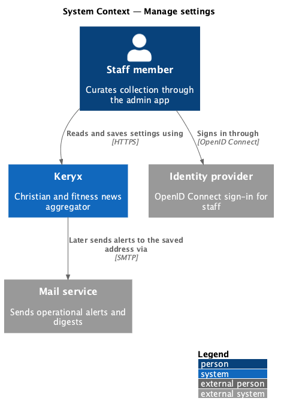
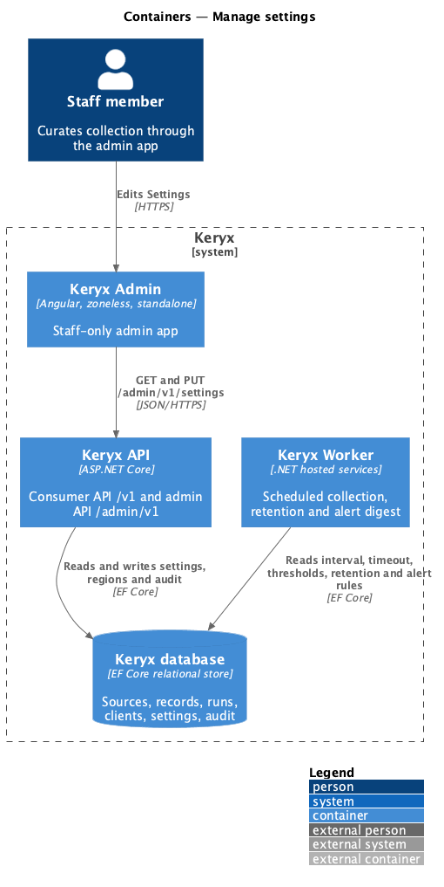
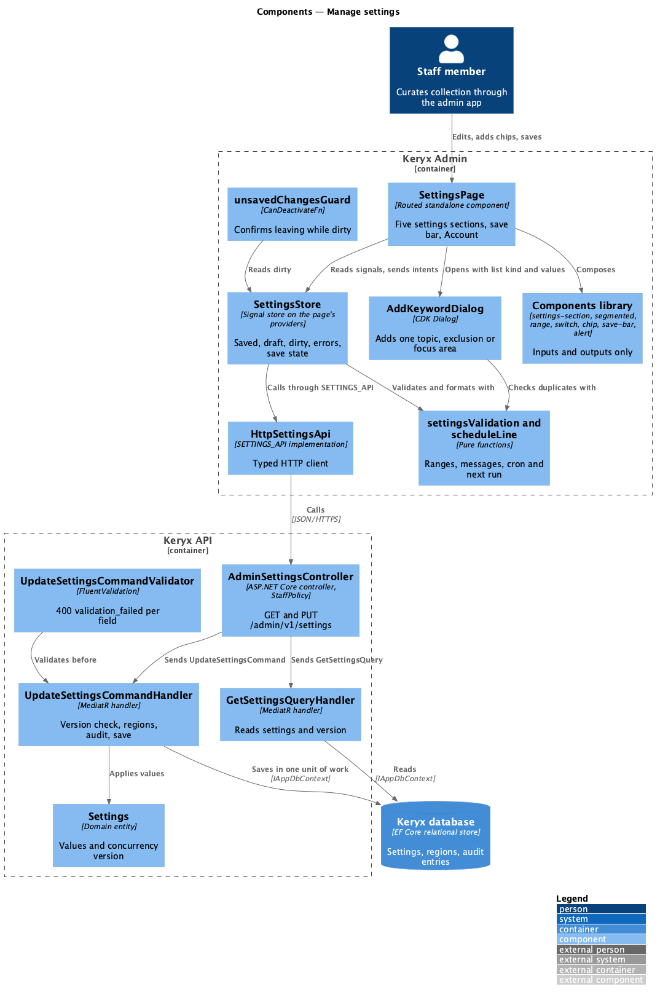
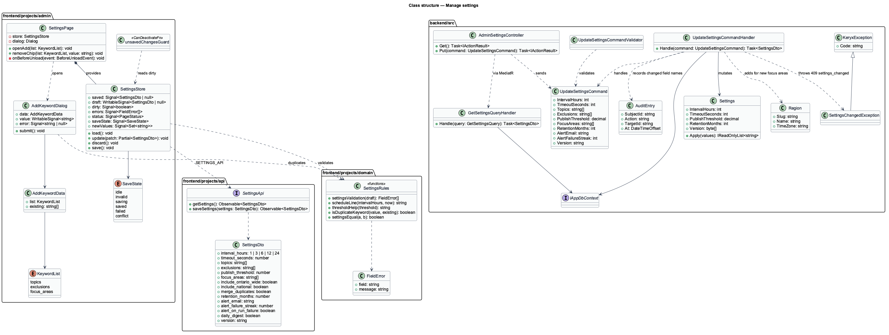
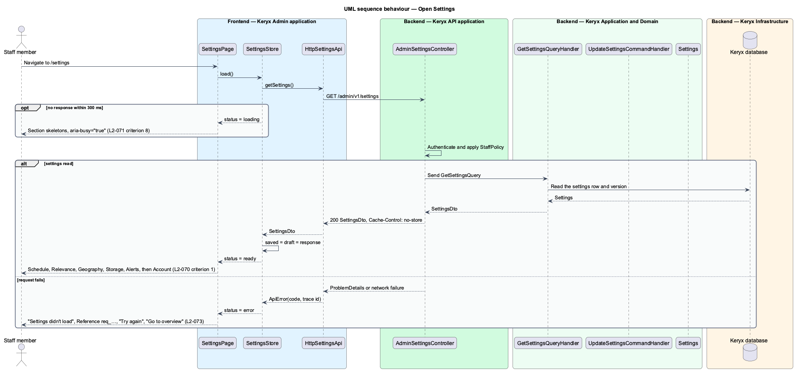
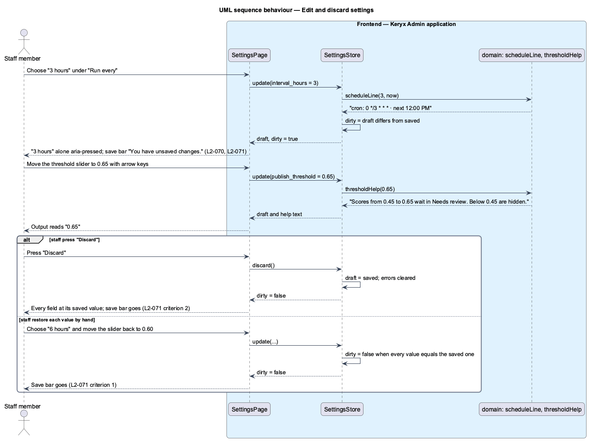
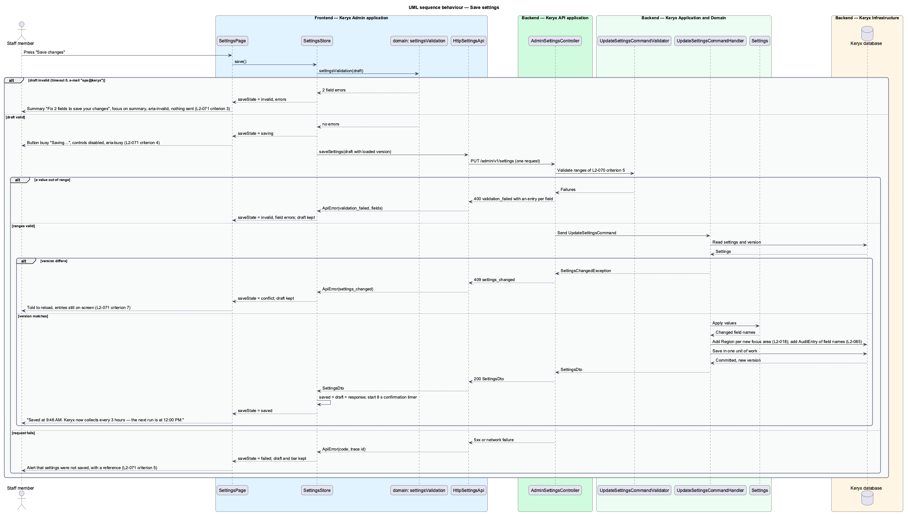
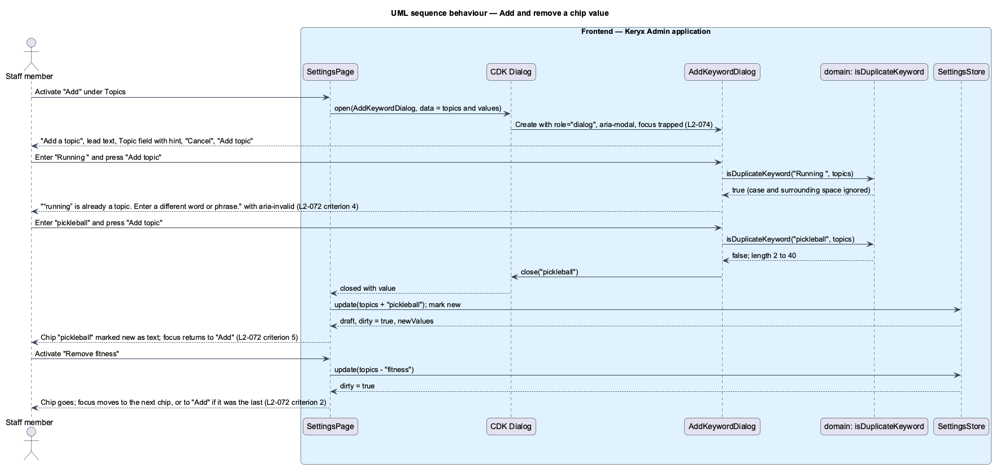
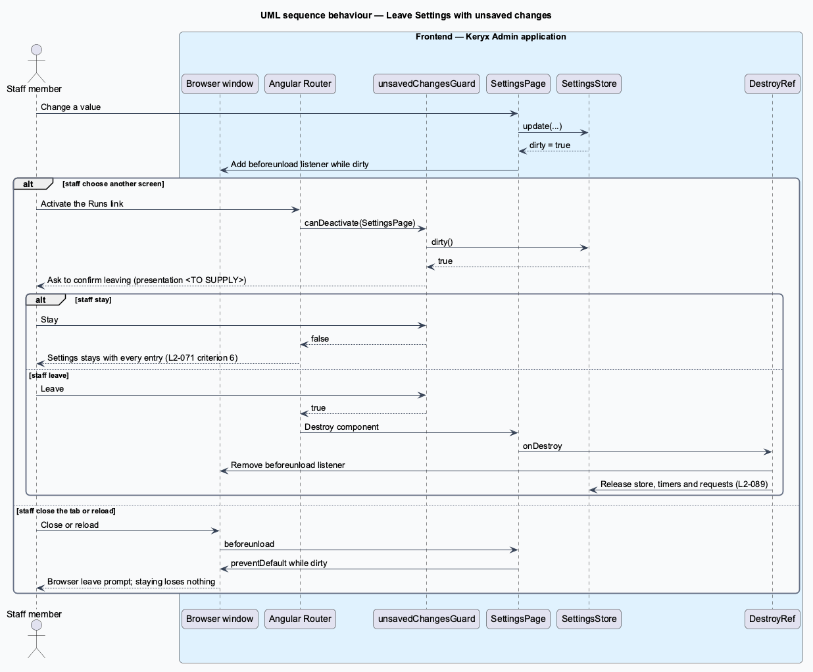

# Manage settings

## Overview

Keryx collects, scores, places, stores and alerts according to a small set of values that staff
control: how often collection runs, how long each source may take, which topics and exclusions
shape relevance, the threshold above which items publish automatically, the focus areas that
come first, how long articles are kept, and who hears about problems. This feature is the
Settings screen of the admin app, where staff read and change those values, and the admin
endpoint that stores them.

Settings change only when staff save them. Every edit stays in the browser as a draft until
"Save changes" is pressed, the difference from the saved values is always visible, and unsaved
work is never lost without a prompt. The screen sits in the admin-app subsystem beside Overview,
Articles, Runs, Sources and API. Settings has no empty state: defaults always exist.

Terms used below:

- **saved settings** — values last read from or written to `GET`/`PUT /admin/v1/settings`
- **draft** — values on screen, which start equal to the saved settings
- **dirty** — state in which at least one draft value differs from its saved value
- **save bar** — bar fixed to the bottom of the viewport that reports the dirty, invalid,
  saving and saved states and holds "Discard" and "Save changes"
- **chip list** — list of short values (topics, exclusions, focus areas), each shown as a chip
  with its own remove button and followed by an "Add" chip
- **settings version** — opaque value served with the saved settings and sent back on `PUT`, so
  a save cannot overwrite a change made elsewhere since the screen loaded

The values feed other features: the interval drives Schedule collection (`L2-005`), the
threshold drives Score and publish (`L2-013`), a new focus area becomes a region (`L2-018`),
the retention period drives Apply retention (`L2-079`), and the alert values drive Send
operational alerts (`L2-077`, `L2-078`).

## Description

The slice runs from the routed Settings page in the Keryx Admin app to the settings row in the
Keryx database, a relational database (PostgreSQL, [ADR 0001](../../../adr/0001-postgresql-and-the-backend-packages.md)) via EF Core.

**Frontend — `admin` app (`frontend/projects/admin`)**

- **`SettingsPage`** — routed page loaded with `loadComponent`. It provides `SettingsStore` in
  its own `providers` and composes five `settings-section` blocks (Schedule, Relevance,
  Geography, Storage, Alerts) inside one `form` with `novalidate`, followed by the Account
  section (`L2-041`, Staff sign-in and session design), which is not part of the form and never
  makes it dirty. The Settings mocks do not yet show the Account section; its markup is
  `<TO SUPPLY>`. It opens `AddKeywordDialog` from each "Add" chip, moves focus after a chip is
  removed (to the next chip, or to "Add" if it was the last), and moves focus to the error
  summary when a save is refused.
- **`SettingsStore`** — screen store held in signals: `saved`, `draft`, `dirty` (computed by
  comparing every field), `errors`, `status` (`loading`, `ready`, `error`), `saveState`
  (`idle`, `invalid`, `saving`, `saved`, `failed`, `conflict`) and `newValues` (chips added
  since the last save). It validates the draft with `settingsValidation` before sending; it
  sends one `PUT` per save; it keeps every entry on failure; it shows the saved confirmation
  for 8 seconds or until the next edit, and releases that timer on destroy.
- **`unsavedChangesGuard`** — `CanDeactivateFn` on the Settings route. When the store is dirty
  it asks the staff member to confirm leaving; choosing to stay cancels the navigation and
  loses nothing. The in-app confirmation has no mock; its presentation is `<TO SUPPLY>` and is
  added to the mocks and the design system before it is built (`L2-098` criterion 5).
- **`beforeunload` listener** — registered by `SettingsPage` while the store is dirty, so closing
  the tab or reloading raises the browser's own leave prompt. It is removed when the store is
  clean and when the page is destroyed.
- **`AddKeywordDialog`** — CDK Dialog opened with the list kind (`topics`, `exclusions`,
  `focus_areas`) and the current values. For Topics its title is "Add a topic", its lead text
  "It is added to the list; nothing changes until you save Settings.", its field label "Topic",
  its hint "A word or short phrase, like “pickleball” or “youth sports”. Items that mention it
  score higher.", and its actions "Cancel" and "Add topic". The titles, labels, hints and
  submit labels for Exclude and Focus areas are `<TO SUPPLY>`: the mocks show only the Topics
  dialog. A duplicate shows "“running” is already a topic. Enter a different word or phrase."
  with `aria-invalid` and adds nothing. A valid value of 2 to 40 characters closes the dialog
  with the value; the page adds it as a chip marked new until the form is saved and returns
  focus to "Add". The chip carries the `chip--new` modifier of the mocks' component kit
  (`assets/ui.css`); no mock page shows it, so its state is added to a mock before it is built.
- **Components library** — `page-header`, `settings-section` (`settings-section__hint`,
  `settings-section__fields`), `segmented` (button variant with `aria-pressed` for "Run
  every"), `field` (`field__label`, `field__help`, `field__error`), `input`, `input-affix`
  (`input-affix__suffix` "seconds", "months", "runs in a row"), `range` (native
  `input type="range"` with `range__value` output), `switch` (native checkbox with
  `role="switch"`), `chip` (`chips` list, `chip__remove` named "Remove <value>", `chip--add`
  named "Add to <list>", `chip--new`), `save-bar` (`save-bar__text`, `--danger`, `--success`), `alert`
  (`alert--danger`, `alert__title`, `alert__list`), `dialog`, `empty`, `skeleton` and `btn`.
  Chip values and every entry render as text, never as HTML (`L2-072` criterion 6).
- **`domain` library** — pure helpers with unit tests: `settingsValidation` (the ranges of
  `L2-070` criterion 5 and the field messages, such as "Timeout per source: enter a timeout
  between 5 and 120 seconds." and "E-mail: enter an address like name@example.com."),
  `scheduleLine` ("cron: 0 */3 * * * · next 12:00 PM" for a chosen interval, aligned to
  midnight Toronto time), `thresholdHelp` ("Scores from 0.45 to 0.65 wait in Needs review.
  Below 0.45 are hidden."), `isDuplicateKeyword` (case and surrounding space ignored) and
  `settingsEqual`. The next-run rule also runs on the server (`L2-005`); both suites share one
  inline case table.
- **`api` library** — `SettingsApi` interface and `SETTINGS_API` token with `getSettings()` and
  `saveSettings(settings, version)`, and the `SettingsDto` type. `HttpSettingsApi` implements it
  and is bound in `app.config.ts`.

**Backend — Keryx API (`backend/src/Keryx.Api`)**

- **`AdminSettingsController`** — `GET` and `PUT /admin/v1/settings` under `StaffPolicy`. It
  checks nothing and sends one MediatR request per endpoint. Responses carry
  `Cache-Control: no-store` (`L2-041`).

**Backend — Keryx Application and Domain**

- **`GetSettingsQuery`** / **`GetSettingsQueryHandler`** — reads the one settings row and its
  version through `IAppDbContext`.
- **`UpdateSettingsCommand`** / **`UpdateSettingsCommandValidator`** /
  **`UpdateSettingsCommandHandler`** — the validator enforces the ranges of `L2-070` criterion
  5 and answers `400` `validation_failed` with an entry per field. The handler compares the
  sent version with the stored one and answers `409` `settings_changed` on a mismatch without
  writing. Otherwise it applies the values to `Settings`, creates a `Region` with zone
  `America/Toronto` and a slug from its name for each new focus area (`L2-018`), stores an
  `AuditEntry` holding the names of the changed fields and not the alert address
  (`L2-085`), and saves in one unit of work. The schedule reads the new interval at its next
  decision (`L2-005` criterion 3).
- **`Settings`** — domain entity holding the values below and a concurrency version.

**Endpoints**

| Method and path | Request | Response | Errors |
|---|---|---|---|
| `GET /admin/v1/settings` | — | `SettingsDto` | `401` `session_expired`, `403` |
| `PUT /admin/v1/settings` | `SettingsDto` with the loaded `version` | `200` `SettingsDto` with the new `version` | `400` `validation_failed` (entry per field), `409` `settings_changed`, `401`, `403` |

`SettingsDto` holds `interval_hours` (1, 3, 6, 12 or 24), `timeout_seconds` (5 to 120),
`topics` (1 to 50), `exclusions` (0 to 50), `publish_threshold` (0.30 to 0.90 in steps of
0.05), `focus_areas` (1 to 50), `include_ontario_wide`, `include_national`,
`merge_duplicates`, `retention_months` (1 to 120), `alert_email` (a valid address of at most
254 characters), `alert_failure_streak` (1 to 20), `alert_on_run_failure`, `daily_digest` and
`version`. Each chip value is 2 to 40 characters and unique ignoring case. The field names are
this design's; the ranges are those of `L2-070`.

**Screen states**

- **Default** — saved values (`pages/settings/default.html`).
- **Dirty** — the save bar reads "You have unsaved changes." with "Discard" and "Save changes"
  (`pages/settings/dirty.html`).
- **Invalid** — nothing is sent; the `alert` summary reads "Fix 2 fields to save your changes",
  each line links to its field, focus moves to the summary, each field shows its message and
  `aria-invalid`, and the bar reads "2 fields need fixing before you can save."
  (`pages/settings/invalid.html`).
- **Submitting** — the form has `aria-busy="true"`, every control is disabled, and the bar reads
  "Saving your changes…" with a busy "Saving…" (`pages/settings/submitting.html`).
- **Saved** — the bar reads "Saved at 9:46 AM. Keryx now collects every 3 hours — the next run is
  at 12:00 PM." with "View runs" for 8 seconds or until the next edit
  (`pages/settings/success.html`).
- **Save failed** — the entries stay, the bar stays, and an alert says the settings were not
  saved, with a reference. **Changed elsewhere** (`409` `settings_changed`) — nothing is
  overwritten and staff are told to reload, with their entries on screen. Neither state is in
  the mocks; their copy and markup are `<TO SUPPLY>`.
- **Loading** and **error** — skeletons after 300 ms (`pages/settings/loading.html`) and
  "Settings didn't load" with the page error state of `L2-073` (`pages/settings/error.html`).
- **Narrow viewports** — below 768 px each section's description stacks above its fields, and
  every control is at least 44 px tall on a touch device.

## Requirements

The feature realizes the following level-2 (L2) requirements. Each L2 requirement refines a
level-1 (L1) requirement, cited by identifier. Their acceptance criteria are in
[L2.md](../../../specs/L2.md).

| L2 ID | Refines (L1) | Requirement |
|-------|--------------|-------------|
| `L2-070` | `L1-016` | Settings form — Settings shows every collection, relevance, geography, storage and alert setting in one form, with each field's bounds and help. |
| `L2-071` | `L1-016` | Saving settings — Settings change only when staff save them; unsaved changes are always visible and are never lost silently. |
| `L2-072` | `L1-016` | Chip lists and the Add a topic dialog — Topics, exclusions and focus areas are edited as chip lists, and a value is added through a dialog. |

## Diagrams

### System context

A staff member changes how Keryx collects through the admin app. The mail service appears
because the alert e-mail set here is where operational alerts are later sent; this feature
sends no mail.

### Containers

The Keryx Admin app reads and writes settings through the admin API. The Keryx Worker reads the
saved values from the Keryx database at its next decision.

### Components

`SettingsPage` provides `SettingsStore`, opens `AddKeywordDialog` and is guarded by
`unsavedChangesGuard`. On the server, `AdminSettingsController` sends `GetSettingsQuery` or
`UpdateSettingsCommand`, whose validator and handler enforce the ranges and the version.

### Class structure

`SettingsStore` holds the saved values and the draft, depends on the `SettingsApi` contract and
on the `settingsValidation` helpers. `UpdateSettingsCommandHandler` mutates the `Settings`
entity, adds `Region` rows and writes an `AuditEntry`.

### Behaviour — open Settings

The page loads the saved settings, shows skeletons when the response takes longer than 300 ms,
and shows the page error state when the request fails.

### Behaviour — edit and discard

Any difference from the saved values shows the save bar. "Discard" restores every saved value,
and the bar goes when the draft equals the saved values again.

### Behaviour — save settings

Client-side validation refuses an invalid draft without a request. A valid draft is sent once
with its version; the server answers with the saved values, `400` `validation_failed`, `409`
`settings_changed` or a failure, and the draft survives every refusal.

### Behaviour — add and remove a chip value

"Add" opens the CDK Dialog; a duplicate is refused inside the dialog, and a new value returns as
a chip marked new. Removing a chip moves focus to its neighbour.

### Behaviour — leave with unsaved changes

Navigating away, closing the tab or reloading while dirty asks for confirmation. Staying keeps
the draft; leaving releases the store with the page.

