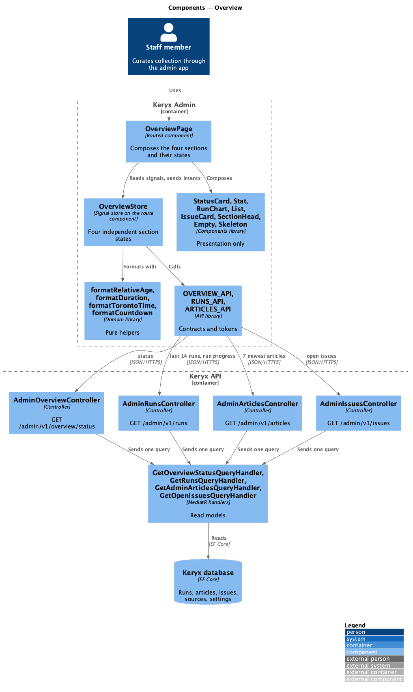
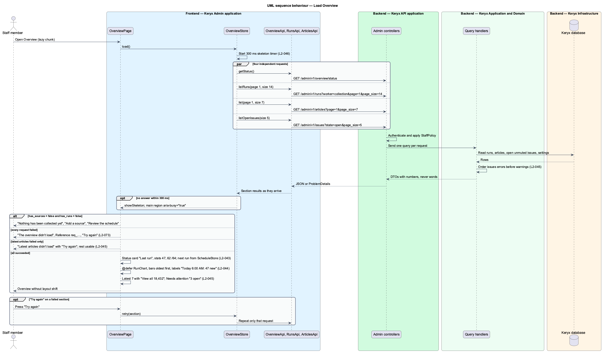

# Overview

## Overview

Keryx collects Christian and fitness news from a catalogue of sources on a schedule, every
6 hours by default, Toronto time. Overview is the first screen of Keryx Admin. It answers four
questions at a glance: did the last run work, what did it bring in, what needs attention, and
when is the next run.

**run** — one execution of the collection worker over every enabled source, recorded with its
outcome and counts

**outcome** — final state of a run: `succeeded`, `completed_with_issues`, `failed`, or `running`
while it is in progress

**status card** — top card of Overview that summarizes the last run, or the current one, with
three stats and the run chart

**run chart** — bar chart of the new-article count of each of the last 14 collection runs,
oldest first

**issue** — problem found during a run, with a severity (error or warning), a kind, a subject
and a streak of consecutive runs; an open issue is one that is neither resolved nor muted

**section** — one independently loaded part of Overview: status, run chart, latest articles or
needs attention

The status card reads "Last run" with an outcome headline such as "Completed with 2 failing
sources", a meta line ("Today, 6:00 AM · took 4m 12s · run_2418") and the stats New articles,
Sources OK and Next run. While a run is in progress it reads "Current run", "Collecting news
now…", shows a progress bar and replaces "Run now" with a disabled "Collecting…", and its counts
update without a reload. Below it, "Latest articles" lists the 7 newest articles of any status
and "Needs attention" lists up to 5 open issues, errors first. Each run, issue and list links to
the screen where it can be acted on.

Each section loads and fails on its own, so one failed request leaves the rest of the page
usable. Overview has designed loading, empty and error states. The "Run now" action and its
notifications belong to the Run collection now design (`L2-047`); Overview only hosts the
button.

## Description

The slice runs from the routed Overview page to four admin read endpoints.

**Frontend — `frontend/projects/admin`**

- **`OverviewPage`** — routed page loaded with `loadComponent`
  (`pages/overview/overview-page.ts`, `.html`, `.scss`). It provides `OverviewStore` in its own
  `providers`, so the store and its timers are released when the page is left (`L2-089`). It
  composes the page header ("Overview", "Christian fitness news collected across Toronto & the
  GTA."), the status card with the run chart in its history, and the two lists in
  a `layout-rail` that stacks below 1024 px and sits side by side from 1024 px. It renders the
  empty state when the store reports `isEmpty`, and the page error state of `L2-073` when
  `allFailed`.
- **`OverviewStore`** — screen store held in signals. It holds four `Section` values (`status`,
  `chart`, `latest`, `issues`), each with `state` (`idle`, `loading`, `ready`, `error`), `data`,
  `errorCode` and `reference`. `load()` sends the four requests in parallel. A 300 ms timer sets
  `showSkeleton` only when no answer has arrived by then; the main region then carries
  `aria-busy="true"`. `retry(section)` repeats one request. `isEmpty` is true when the status
  reports no source and no run. While `current_run` is set, it polls `RUNS_API.getRun(id)` no
  more often than every 3 seconds, keeps only the latest response and stops when the outcome is
  no longer `running` or the page is destroyed. When the run ends it reloads `status` and
  `chart` and passes the final run to `CollectionWatcher`.
- **`CollectionWatcher`** — app-wide watcher owned by the Page states, dialogs and notifications
  design. It raises the outcome notification of `L2-076` once per run.
- **`ScheduleStore`** — the shell's schedule state (Admin shell design). The Next run stat
  ("12:00 PM", "in 2h 14m") is read from it; Overview issues no request of its own for it.
- **View mapping** — the store maps DTOs to view models: outcome headline ("Completed with
  2 failing sources", "Completed — all sources collected", "Run failed — database unreachable"
  chosen by `failure_code`), meta line, Sources OK ("62 /64"), bars and issue cards. Text from a
  source (titles, organization and subject names) is bound as text, never as HTML.

**Frontend — `frontend/projects/components`** (presentation only, named by mock block)

- **`PageHeader`** (`page-header`) — title, description and the actions slot holding "Run now".
- **`StatusCard`** (`status-card`, elements `status-card__main`, `__summary`, `__icon`,
  `__eyebrow`, `__headline`, `__meta`, `__stats`, `__history`; icon modifiers `--success`,
  `--warning`, `--danger`, `--info`) — the outcome as icon and words; the outcome is in the
  headline text, not in colour alone. It shows `progress` with an accessible value while
  running. Its title, meta line and action wrap; the run id is never broken.
- **`Stat`** (`stat`, in a `stats` row) — label, value, unit ("/64") and sub-line; the three
  stats stay in one row at every viewport class.
- **`RunChart`** (`run-chart`, element `run-chart__bar` with `data-status` `success`,
  `warning`, `failed`, `running`) — one bar per run, oldest first, each labelled
  "Today 6:00 AM: 47 new", "…: failed" or "…: running"; a failed bar is also a 4 px stub, so it
  is marked by more than colour. A bar's height is a `data-value` from 0 to 100 (rounded against
  the run that added the most), with one stylesheet rule per value: the design system's
  `--value` would need a style binding, whose first use pulls Angular's styling instructions
  into the initial bundle. All bars fit inside the card at every viewport class. Journey 14
  makes each bar a link that emits `openRun(runId)` and adds "All runs" (`L2-044` AC4, AC5): the
  Runs screen they open arrives then, as ADR 0006 has each screen's links arrive with it.
- **Not deferred.** The run chart is not in a `@defer` block although `L2-088` AC4 names it:
  measured, the first `@defer` in the app raises the initial total from 254.19 kB to 262.75 kB,
  past the 255 kB budget of AC1, to defer about 1 kB of Overview's own lazy chunk. It costs more
  than it saves, as the Review articles design found for the detail panel.
- **`SectionHead`** (`section-head`, element `section-head__link`) — section title with "View
  all 18,432", "All runs" or the open count ("3 open").
- **`List`** (`list`, elements `list__item`, `__body`, `__title`, `__meta`, `__aside`) — latest
  articles with title, "organization · region · category", relative age and a `Badge` "Review"
  on any that needs review. Long titles wrap inside their item.
- **`IssueCard`** (`issue-card`, elements `issue-card__body`, `__title`, `__source`, `__meta`) —
  one open issue as a link, with severity as an icon and a visually hidden word ("Error: ",
  "Warning: "), its title, its subject and its time or streak ("4 runs in a row · since Mon,
  12:02 PM").
- **`Empty`** (`empty`, modifiers `--card`, `--compact`, `--error`, `--success`) — the empty
  state, the section error ("Latest articles didn't load", "Try again"), the page error, and
  "Nothing needs attention" / "Every source responded in the last run.".
- **`Skeleton`** (`skeleton`) — placeholders in the shape of the final layout; no animation when
  reduced motion is preferred.
- **`Badge`**, **`Btn`**, **`Card`**, **`Progress`** — shared blocks reused as in the mocks.

**Frontend — `frontend/projects/domain`**

- **`formatRelativeAge(at, now)`** — "2h ago", minutes under an hour, hours under a day,
  otherwise days.
- **`formatDuration(ms)`** — "4m 12s".
- **`formatTorontoTime(at, now)`** — "Today, 6:00 AM", "Mon, 12:02 PM" in Toronto time.
- **`formatCountdown(now, at)`** — "in 2h 14m" (Admin shell design).

**Frontend — `frontend/projects/api`**

- **`OverviewApi` / `OVERVIEW_API`** — `getStatus(): Observable<OverviewStatusDto>`.
- **`RunsApi` / `RUNS_API`** — `listRuns(query)` and `getRun(id)`, owned by the View run history
  design, and `listOpenIssues(pageSize)`, beside the `muteIssue(id)` and `unmuteIssue(id)` calls
  of the Mute an issue design.
- **`ArticlesApi` / `ARTICLES_API`** — `list(query)`, owned by the Review articles design.

**Endpoints** (all under `StaffPolicy`, `Cache-Control: no-store`; `401` `session_expired` and
`403` `not_staff` per the Staff sign-in and session design)

| Endpoint | Request | Response | Errors |
|---|---|---|---|
| `GET /admin/v1/overview/status` | — | `last_run` and `current_run` (each `null` or `id`, `started_at`, `finished_at`, `duration_ms`, `outcome`, `failure_code`, `added`, `sources_ok`, `sources_checked`, `sources_total`), `has_sources`, `has_runs`, `next_run_at` (UTC) and `time_zone` | ProblemDetails with trace id |
| `GET /admin/v1/runs` | `worker=collection`, `page=1`, `page_size=14` | page envelope of `RunSummaryDto` (`id`, `started_at`, `outcome`, `added`, …), newest first; the store reverses it to oldest first | View run history design |
| `GET /admin/v1/runs/{id}` | — | `RunDto` with `sources_checked`, `sources_total`, `added` while running | View run history design |
| `GET /admin/v1/articles` | `page=1`, `page_size=7` | `items`, `total`, `page`, `page_size`; `total` gives "View all 18,432" | Review articles design |
| `GET /admin/v1/issues` | `state=open`, `page_size=5` (1 to 50, default 10) | `items` of `id`, `run_id` (the run it last occurred in), `severity`, `kind`, `subject_type`, `subject_id`, `subject_name`, `detail`, `consecutive_runs`, `since`; `total` gives "3 open"; `page_size` | `400` `invalid_filter` (a state other than `open`) or `invalid_page` |

**Backend**

- **`AdminOverviewController`** — `GetStatus` sends one `GetOverviewStatusQuery`.
- **`GetOverviewStatusQueryHandler`** (built as `GetOverviewStatus`) — reads the latest finished
  collection `Run`, the running one if any, and whether any `Source` and any `Run` exist, through
  `IAppDbContext`. It serves counts and durations as numbers and the failure as a `failure_code`:
  `<stage>_failed` when a stage failed (`store_failed` reads "database unreachable"),
  `interrupted` when a restart cut the run short, otherwise `unexpected`. It also serves the next
  run's time from `GetNextRun`, so Overview's Next run stat needs no request of its own; the
  shell's `ScheduleStore` is not built yet, and Overview reads the time from its own status until
  it is. A seeded news query counts as a source.
- **`AdminIssuesController`** / **`GetOpenIssuesQuery`** / **`GetOpenIssuesQueryHandler`** —
  read `RunIssue` rows that are open and not muted, ordered errors before warnings, then the
  longest streak (`consecutive_runs`), then the oldest (`since`), bounded by `page_size` (built as
  `ListOpenIssues`).
- **`AdminRunsController`**, **`AdminArticlesController`** — reused as defined by the View run
  history and Review articles designs.

**Navigation targets** — a bar opens `/runs?run=<id>`; an issue card opens the run it belongs to
in the same tab; "All runs" opens `/runs`; with more than 5 open issues a link opens
`/runs?problems=true`; "View all 18,432" opens `/articles`. "Add a source" opens `/sources`,
where the Add source dialog starts, and "Review the schedule" opens `/settings`. The bars, the
issue cards, "All runs", the problems link and the page error's "Go to runs" open the Runs
screen, so they arrive in journey 14, which builds it (ADR 0006); until then a card is not a
link and the page error offers "Try again" alone.

**Loading** (`L2-046` AC1) — when the first answers take over 300 ms, each section still loading
shows skeletons drawn by its own component (`StatusCard`, `Stats`, `List` and `IssueCard` each
have a loading form), the page body carries `aria-busy="true"` and one status sentence reads
"Loading the overview…". The section headings stay as text: they are known before any answer
and they label their sections, where the mock draws skeleton bars. Each skeleton line sits in
the element it stands for with a no-break space, so it is exactly as tall as the line that
replaces it, and the stats follow the shapes of the real ones (a small value with a sub-line for
Next run). Nothing shifts from SM to XL; at XS the run headline and meta line wrap onto a second
line, which no skeleton can foresee without the text, so the lists below move down by those
lines. A section's slow Try again keeps its own busy button and does not mark the page loading.

**Section errors** (`L2-045` AC5) — a section that fails shows its error in its place with a
"Try again" that repeats its request alone, busy meanwhile, while the others stay shown. Only
Latest articles has a mock (`partial.html`): "Latest articles didn't load", "The run status and
issues are up to date; only this list failed.". The others follow it as stand-ins: "Needs
attention didn't load", "The run status and latest articles are up to date; only this list
failed."; the run status, in place of the status card, "The run status didn't load", "The latest
articles and issues are up to date; only the run status failed.", and its Try again also reads
the chart, which is drawn inside the card; the run chart, inside the card's history, "The run
chart didn't load" with Try again. The page error is shown only when all four have failed, never
while one is still loading. While the status has not loaded, times read in Toronto's zone.

**Retry** — "Try again" repeats all four requests with the button busy, and the page error stays
until every answer is in: the store shows the answers together, so the page never flashes the
error away and back (`L2-073` AC3).

**Issue titles** — the domain helper `issueTitle(kind)` names each kind: `source_not_found`
"Feed returned 404", `source_timeout` "Source timed out", `source_blocked` "Source blocked
Keryx", `source_invalid` "Feed couldn’t be read", `items_held` "Items held for review",
`stage_failed` "A stage failed", `run_skipped` "Scheduled run skipped", and any other kind
"Something needs attention". The mock's "Timed out after 30s" and "6 articles held for review"
need a number the issues endpoint does not serve: the Record runs and issues design keeps it
only inside the `detail` sentence, which is not parsed. A card's time is `issueWhen`: "Today,
6:01 AM" for a new issue, and for a streak "4 runs in a row · since Mon, 12:02 PM", by weekday
alone up to six calendar days back in the zone the status names, and in full beyond.

## Requirements

The feature realizes the following level-2 (L2) requirements. Each L2 requirement refines a
level-1 (L1) requirement, cited by identifier. Their acceptance criteria are in
[L2.md](../../../specs/L2.md).

| L2 ID | Refines (L1) | Requirement |
|-------|--------------|-------------|
| `L2-043` | `L1-011` | Overview status card — The top of Overview tells staff at a glance how the last run went, or how the current one is going, and when the next one is. |
| `L2-044` | `L1-011` | Overview run chart — Overview shows the new-article count of each of the last 14 collection runs so staff can spot a drop or a failure. |
| `L2-045` | `L1-011` | Overview latest articles and needs attention — Overview lists the newest articles and the open issues that need staff attention, each linking to where it can be acted on. |
| `L2-046` | `L1-011` | Overview loading, empty and error — Overview has designed loading, empty and error states. |

## Diagrams

### System context

Staff read Overview in Keryx, which collects from the sources on a schedule.

### Containers

Keryx Admin reads status, runs, latest articles and open issues from the Keryx API. The Keryx
Worker records the runs, their progress and their issues in the Keryx database.

### Components

`OverviewPage` composes library components and reads `OverviewStore`, which calls four contracts.
Each contract reaches one admin controller that sends one query to its handler.

### Class structure

`OverviewStore` owns four `Section` values, depends on four API contracts, and reads
`ScheduleStore` and `CollectionWatcher`. On the server, `GetOverviewStatusQueryHandler` reads
`Run` and `RunIssue`.

### Behaviour — load Overview

The store sends four requests in parallel and shows skeletons only after 300 ms. The page then
shows the empty state, the page error, a section error, or the full Overview.

### Behaviour — follow a running collection

While a run is in progress, the store polls it at most every 3 seconds and keeps only the latest
progress. When it ends, the card returns to "Last run" and `CollectionWatcher` reports the
outcome once.

### Behaviour — open a run from Overview

A bar, an issue card, "All runs" or the problems link navigates in the same tab to the Runs
screen, which loads lazily and reads the named run.

