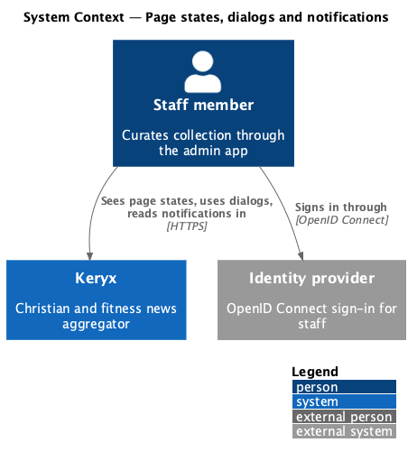
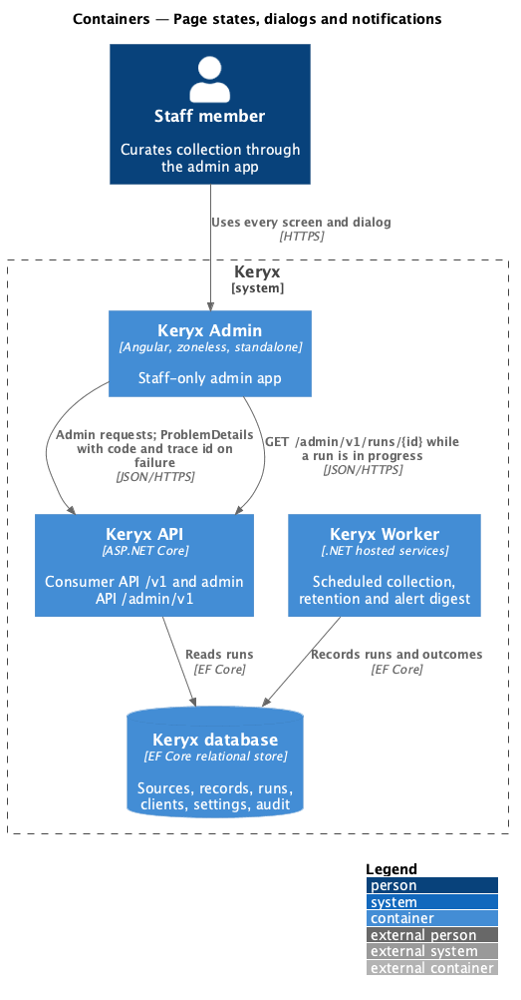
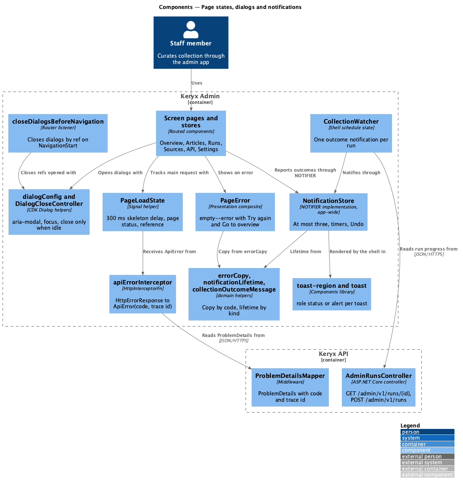
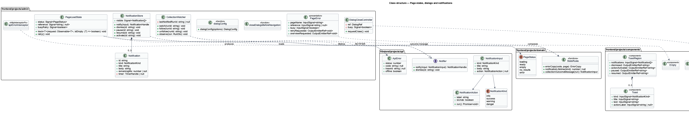
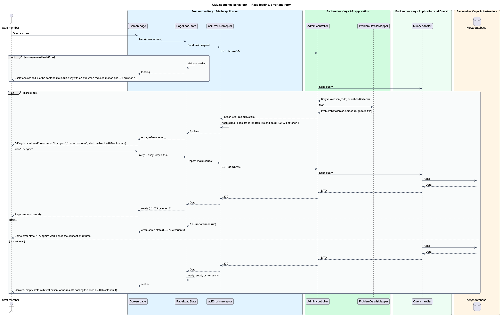
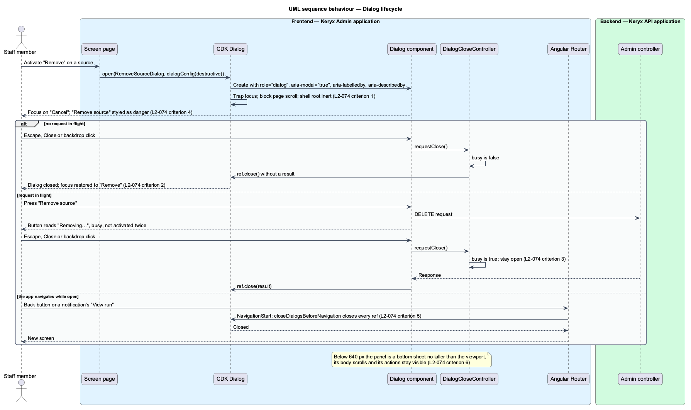
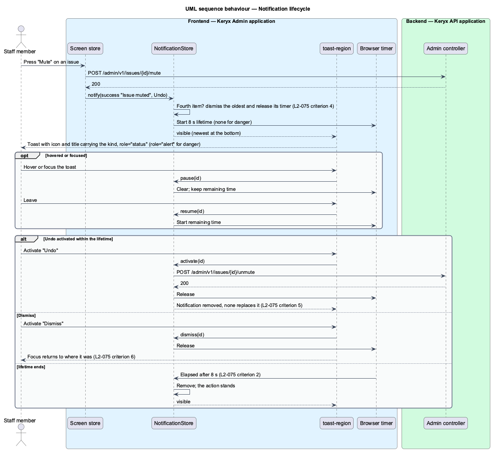
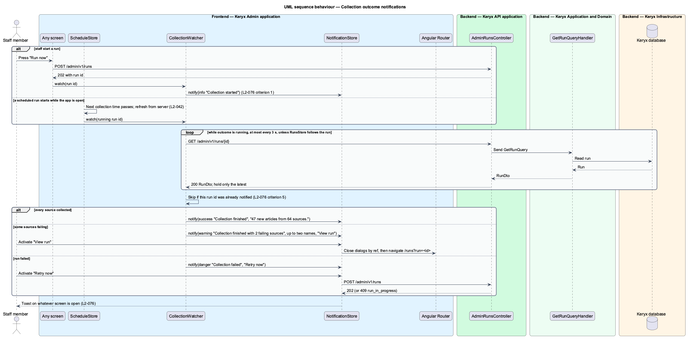

# Page states, dialogs and notifications

## Overview

Every screen of the Keryx admin app waits for data, sometimes finds none, sometimes fails, and
reports the outcome of every action staff take. This feature fixes how those moments look and
behave across all six screens (Overview, Articles, Runs, Sources, API, Settings) and all six
dialogs (Add a source, Edit source, Remove source, New API key, Revoke API key, Add a topic), so
each screen design composes the same parts rather than inventing its own.

The feature has three parts. *Page states* are the shared loading, error, empty and no-results
states of a screen. *Dialog behaviour* is how every CDK Dialog opens, traps focus, refuses to
close while a request is in flight, closes before navigation and becomes a bottom sheet on a
narrow viewport. *Notifications* are the toasts that report an action's outcome, with a tone,
lifetime and announcement fixed by severity; collection outcome notifications tell staff when a
run starts and how it ended, wherever they are in the app.

Terms used below:

- **page state** — one of `loading`, `ready`, `empty`, `no-results` or `error` for a screen's
  main data
- **skeleton** — placeholder shaped like the final content, shown when the first data takes
  longer than 300 ms
- **page error state** — error panel reading "<Page> didn't load" with a reference, "Try again"
  and "Go to overview", inside a shell that stays usable
- **reference** — the failed response's trace id, shown as "Reference req_…" so staff can quote
  it to whoever runs Keryx
- **in-flight request** — request a dialog has sent and not yet received an answer to; while one
  exists the dialog is *busy*
- **notification** — toast with a kind (`info`, `success`, `warning`, `danger`), a title, a body,
  an optional single action and a "Dismiss" button
- **lifetime** — time a notification stays before it dismisses itself: 8 seconds for info,
  success and warning; unlimited for danger
- **Undo** — action on a notification that reverses the action it reports
- **collection outcome** — how a run ended: every source collected, some sources failing, or
  the run failed

## Description

The feature is cross-cutting. It adds shared parts to the `admin` app and its libraries and one
backend mapper; each screen and dialog design uses them.

**Page states — frontend**

- **`apiErrorInterceptor`** — `HttpInterceptorFn` in the `admin` app, registered in
  `app.config.ts`. It turns an `HttpErrorResponse` into an `ApiError` holding the HTTP status,
  the ProblemDetails `code`, the trace id and whether the browser was offline (status `0`). It
  drops the server's `title` and `detail`, so no screen can show them (`L2-073` criterion 5).
  A `401` `session_expired` is handled by the Staff sign-in and session design.
- **`ApiError`** — type in the `api` library that every contract refuses with; a screen branches
  on `code`.
- **`PageLoadState`** — helper in the `admin` app that a screen store creates for its main
  request. It sets `loading` only when no response arrives within 300 ms, sets `ready`, `empty`,
  `no-results` or `error` from the outcome, exposes the reference, and releases its timer through
  `DestroyRef`. It is unit-tested on a fake clock.
- **`errorCopy`** — `domain` helper that chooses the app's own generic copy by error `code`. For
  a main request it returns "<Page> didn't load" and "Keryx couldn't reach its API just now.
  Collection keeps running on schedule; only this screen is affected. Try again, and if it keeps
  failing, send the reference below to whoever runs Keryx." The full code-to-copy table is
  `<TO SUPPLY>` beyond the codes the L2 criteria name.
- **`PageError`** — presentation composite in the `admin` app built from the `empty` component
  (`empty--card empty--error`, `empty__title`, `empty__text`, `empty__ref`, `empty__actions`) and
  `btn`. Its inputs are the page name, the reference and a busy flag; its outputs are
  `retryRequested` and `overviewRequested`. "Try again" is busy while the request repeats; on
  success the page renders normally. An offline failure uses the same state, and "Try again"
  works once the connection returns.
- **Components library** — `skeleton` (`skeleton--text`, `--title`, `--icon`, `--stat`, width
  modifiers; no animation when reduced motion is preferred) and `empty` (`empty--card`,
  `--compact`, `--error`, `--success`). A screen's main region carries `aria-busy="true"` while
  skeletons show, and a visually hidden `role="status"` line ("Loading runs…") announces it. The
  skeleton reserves the final content's size so replacing it causes no layout shift.
- **Empty and no-results** — each screen's empty state says what will appear and offers the
  first action; its no-results state names the filter and offers to clear it. The two are
  separate states with separate copy.

**Dialog behaviour — frontend**

- **CDK Dialog** — every dialog opens through `Dialog` from `@angular/cdk/dialog`, loaded with
  the first screen that uses it, not in `main` (`L2-088`).
- **`dialogConfig`** — `admin` app helper returning the shared `DialogConfig`: `ariaModal: true`,
  `ariaLabelledBy` the title id, `ariaDescribedBy` the lead-text id, `restoreFocus: true`,
  `hasBackdrop: true`, a block scroll strategy so the page behind does not scroll, and
  `disableClose: true` so the CDK closes nothing on its own. A destructive dialog sets
  `autoFocus` to its "Cancel" button; others focus their first field.
- **`DialogCloseController`** — `admin` app helper each dialog component creates with its
  `DialogRef` and its `busy` signal. It listens to Escape, the backdrop click and the Close
  button, and closes the dialog unchanged only when `busy` is false; while busy the dialog stays
  open and the submit button keeps its busy label and ignores a second activation. Its
  subscriptions end with the dialog's `DestroyRef`.
- **`closeDialogsBeforeNavigation`** — listener on router `NavigationStart`, registered in
  `app.config.ts`, that closes every open dialog by its ref before the navigation completes. An
  action that navigates from a dialog closes its own ref first.
- **Inert background** — while a dialog is open, the shell's root element carries `inert`, so
  the page behind is unreachable by pointer, keyboard and assistive technology; the CDK focus
  trap keeps focus inside the dialog.
- **`dialog` component** — `Dialog` in the components library (`components/src/dialog/`), block
  `dialog` with `dialog__panel` (`--sm`), `dialog__head`, `dialog__title`, `dialog__description`,
  `dialog__body`, `dialog__foot` and a Close `icon-btn`. Its output is `closeRequested`, not
  `close`, which is a DOM event name. Below 640 px the panel is a bottom sheet no taller than the
  viewport, its body scrolls inside itself, and its foot with the actions stays visible.
  Application code imports the CDK service under an alias to avoid the clash with this name.
- **Destructive dialogs** — Remove source and Revoke key name their danger button with verb and
  object ("Remove source", "Revoke key") and style it `btn--danger-solid`; focus starts on
  "Cancel".

**Notifications — frontend**

- **`Notifier`** / **`NOTIFIER`** — contract and token in the `api` library: `notify(input)`
  returns a handle, and `dismiss(id)` removes one. Screens and dialogs depend on the token only.
- **`NotificationStore`** — the app-wide implementation, bound to `NOTIFIER` in
  `app.config.ts`; it is one of the three app-wide states `L2-089` allows. It holds at most three
  notifications, newest last. A fourth dismisses the oldest. Info, success and warning start an
  8-second timer that pauses while the toast is hovered or holds focus and resumes afterwards;
  danger has no timer and stays until dismissed or until its action succeeds. Undo runs the
  reversal and removes the notification without raising another; when the lifetime ends the
  action stands. Each timer is released when its notification is dismissed and when the region
  is destroyed.
- **`toast-region`** and **`toast`** — components in the library. `toast-region` is fixed to the
  bottom of the viewport: bottom right and 24 rem wide from 640 px, full width below. Each
  `toast` (`toast--info`, `--success`, `--warning`, `--danger`) shows an icon and a title that
  carry its kind in more than colour, `toast__text`, an optional `toast__action`, a "Dismiss"
  `icon-btn` and, with a lifetime, `toast__progress`. A danger toast has `role="alert"`; the
  others have `role="status"`. The region itself carries no live role, so no live region is
  nested in another. Every title and name from a source renders as text.
- **Focus** — the toast's action and Dismiss follow the page content in the focus order, have
  44 × 44 px targets on touch, and dismissing a focused toast returns focus to the element that
  held it before focus entered the region.
- **`domain` helpers** — `notificationLifetime(kind)` (8000 ms or none) and
  `collectionOutcomeMessage(run)`, which picks the kind, title, body and action for an ended run
  and names up to two failing sources.

**Collection outcome notifications — frontend**

- **`CollectionWatcher`** — part of the shell's schedule state (Admin shell design), app-wide.
  It learns that a run is in progress from "Run now" (Run collection now design), from Overview
  or Runs data, and from the shell's refresh when the next collection time passes. While a run is
  in progress it reads `GET /admin/v1/runs/{id}` no more often than every 3 seconds and holds
  only the latest response; it pauses that read while `RunsStore` follows the same run. When the
  run ends it raises one notification per run, remembering only the last notified run id. It
  makes no request while no run is in progress.
- **Messages** — "Collection started" with "Checking 64 sources. This usually takes about 4
  minutes." (info); "Collection finished" with "47 new articles from 64 sources." (success);
  "Collection finished with 2 failing sources" naming up to two of them, with "View run", which
  closes any dialog by its ref and opens `/runs?run=<id>` (warning); "Collection failed" with
  "Keryx couldn’t reach its database, so nothing was stored. The API is still serving the
  previous run." and "Retry now", which sends `POST /admin/v1/runs` (danger).

**Backend — Keryx API**

- **`ProblemDetailsMapper`** — maps every `KeryxException` and unhandled error to RFC 9457
  ProblemDetails with the `code` extension and the trace id. The trace id travels in an
  extension whose name is `<TO SUPPLY>`; the mocks show its form as `req_c03d5512`. The
  `title` and `detail` are generic and are never shown by the app.
- **Endpoints used** — no endpoint is introduced. The watcher reads `GET /admin/v1/runs/{id}`
  (View run history design); "Retry now" sends `POST /admin/v1/runs`, answered `202` with the
  run id or `409` `run_in_progress` (Run collection now design).

## Requirements

The feature realizes the following level-2 (L2) requirements. Each L2 requirement refines a
level-1 (L1) requirement, cited by identifier. Their acceptance criteria are in
[L2.md](../../../specs/L2.md).

| L2 ID | Refines (L1) | Requirement |
|-------|--------------|-------------|
| `L2-073` | `L1-017` | Page states — Every page has the states its mock coverage table lists. This requirement fixes what the shared ones mean. |
| `L2-074` | `L1-017` | Dialog behaviour — Every dialog is a CDK Dialog that behaves the same way: focus is trapped and restored, it closes only when safe, and it fits every viewport. |
| `L2-075` | `L1-017` | Notifications — Every action reports its outcome through a notification whose tone, lifetime and announcement follow from its severity. |
| `L2-076` | `L1-017` | Collection outcome notifications — Staff are told when a collection starts and how it ended, wherever they are in the admin app. |

## Diagrams

### System context

A staff member sees page states, dialogs and notifications in Keryx. The feature calls no
external system; the identity provider appears because every screen is reached after sign-in.

### Containers

The shared parts live in the Keryx Admin app. The Keryx API supplies the ProblemDetails `code`
and trace id behind each error state, and the run records behind collection outcome
notifications.

### Components

Screen stores use `PageLoadState` and the `apiErrorInterceptor`'s `ApiError`; dialogs use
`dialogConfig` and `DialogCloseController`; actions report through `NOTIFIER` to
`NotificationStore`, which the shell renders in `toast-region`; `CollectionWatcher` reads run
records and reports outcomes through the same store.

### Class structure

`NotificationStore` realizes `Notifier` and owns at most three `Notification` items with their
timers. `PageLoadState` produces a `PageStatus`. `DialogCloseController` wraps a `DialogRef` and
a busy signal.

### Behaviour — page loading, error and retry

Skeletons appear only after 300 ms without data. A failed main request shows the page error
state with the reference; "Try again" repeats the request and is busy meanwhile.

### Behaviour — dialog lifecycle

A dialog opens with focus trapped and the page inert. It closes on Escape, Close or backdrop
only when no request is in flight, restores focus to its opener, and is closed by its ref before
any navigation.

### Behaviour — notification lifecycle

A notification's lifetime follows its kind, pauses on hover or focus, and ends with its timer
released. A fourth notification dismisses the oldest; Undo reverses the action and leaves no
notification behind.

### Behaviour — collection outcome notifications

`CollectionWatcher` follows an in-progress run on any screen and raises one outcome notification
per run, with "View run" or "Retry now" where the outcome calls for it.

