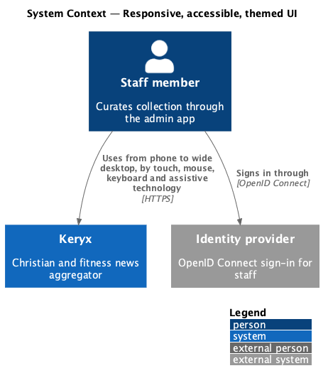
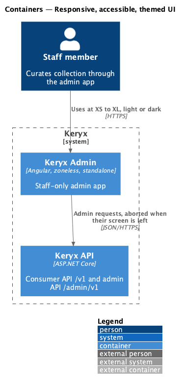
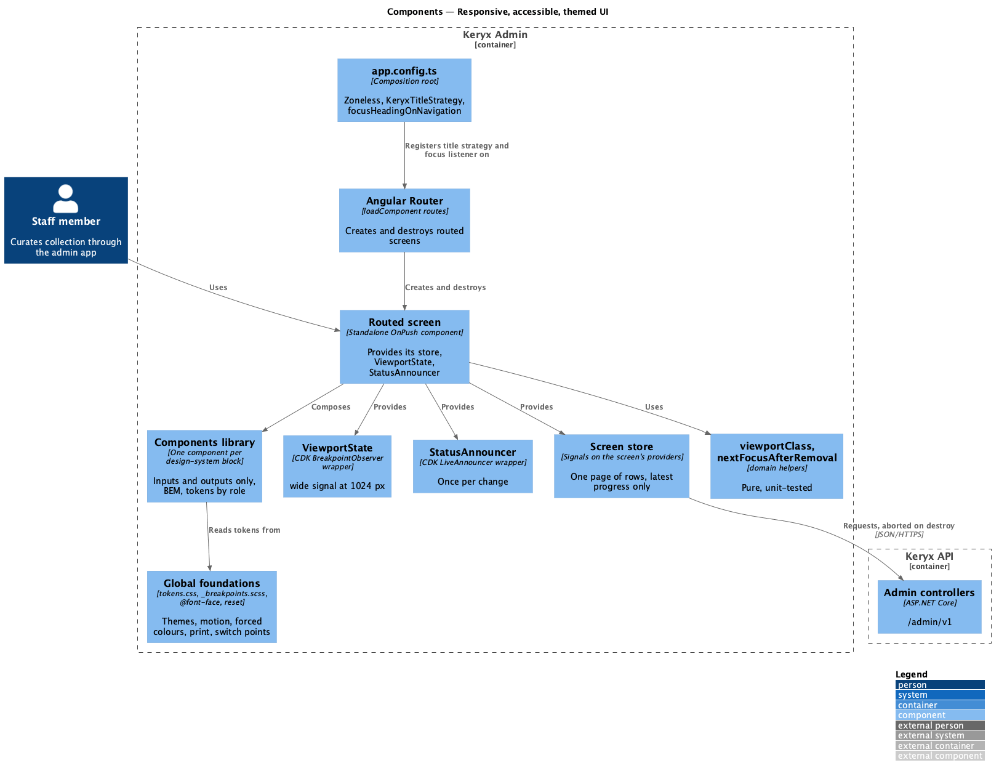
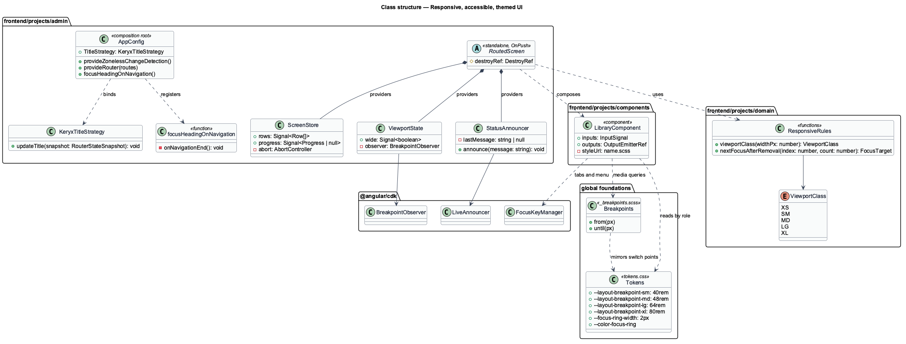
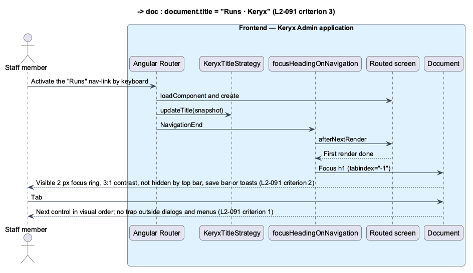
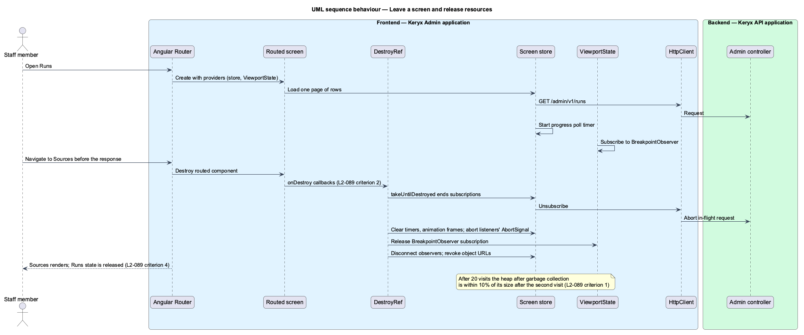
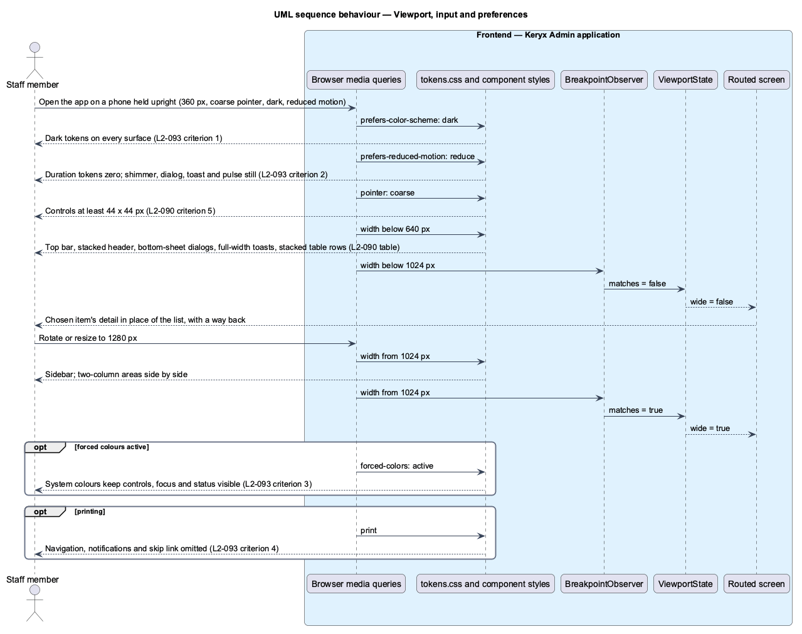
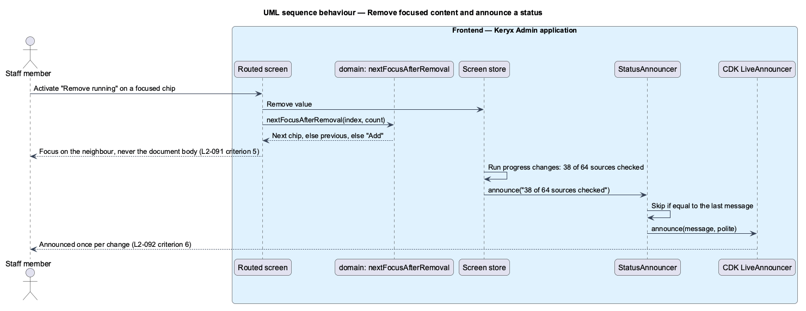

# Responsive, accessible, themed UI

## Overview

The Keryx admin app is used by staff on phones, tablets and desktops, by touch, mouse and
keyboard, with assistive technology, in light and dark themes, and often left open for hours on
a low-power device. This feature holds the cross-cutting rules that make every screen, dialog
and notification work in all of those conditions, and the design-system conformance that keeps
every screen built from one set of components.

The feature has six concerns. *Memory over a long session* keeps the app as smooth after an
hour as at the start: what a screen acquires is released when it is left, and what grows is
bounded. *Responsive layout* fixes what each of five viewport classes shows. *Keyboard and
focus* makes every action reachable by keyboard with a visible focus that lands where expected.
*Semantics and contrast* meets WCAG 2.2 level AA in both themes. *Themes and preferences*
follows the system's colour scheme, reduced-motion, forced-colours and print settings.
*Design-system conformance* builds each component once under its design-system name and
matches every screen to its mocks.

Terms used below:

- **viewport class** — one of five width ranges a requirement is specified and tested at: XS
  (under 576 px), SM (576 px and wider), MD (768 px and wider), LG (992 px and wider) and XL
  (1200 px and wider)
- **switch point** — width at which the design system changes layout: 640 px, 768 px, 1024 px
  and 1280 px, held as the tokens `--layout-breakpoint-sm`, `-md`, `-lg` and `-xl`
- **acquired resource** — subscription, timer, animation frame, event listener, observer,
  `AbortController`, object URL or in-flight request a component or store creates
- **screen store** — signal store holding one screen's state, provided on that screen's routed
  component
- **sweep** — Playwright run kept current but run only when a person asks: heap, responsive,
  visual and accessibility
- **token by role** — design token named for its use (`--color-focus-ring`,
  `--color-fg-muted`), never for its value

Decision 13 of [L2.md](../../../specs/L2.md) keeps the switch points where the mocks put them
and states, in `L2-090`, the layout each viewport class shows. Moving a switch point is a mock
and design-system change.

## Description

The feature is cross-cutting. It adds composition-root providers, global foundations, a few
`admin` app helpers and `domain` helpers, and the rules every screen design follows. It
introduces no backend component and no endpoint.

**Memory over a long session (`L2-089`)**

- **Composition root** — `app.config.ts` calls `provideZonelessChangeDetection()`. Every
  component is standalone and `OnPush`, and state is held in signals.
- **Scoped stores** — each screen store (`ArticlesStore`, `RunsStore`, `SourcesStore`,
  `SettingsStore`, and the Overview and API stores) is provided in its routed component's
  `providers`, never on the route and never in `root`, so it is released when the screen is
  left. Only three states are app-wide: the session (Staff sign-in and session design), the
  `NotificationStore` (Page states, dialogs and notifications design) and the shell's schedule
  state (`ScheduleStore`, Admin shell design).
- **Release on destroy** — every acquired resource is tied to the owner's `DestroyRef`:
  subscriptions through `takeUntilDestroyed`, timers and animation frames cleared in
  `DestroyRef.onDestroy`, listeners added with an `AbortSignal` that is aborted on destroy,
  `ResizeObserver` and `IntersectionObserver` disconnected, object URLs revoked. Unsubscribing an
  `HttpClient` request aborts it, so in-flight requests end with their screen.
- **Bounded growth** — the Articles, Sources and Runs lists hold one page of rows; paging
  replaces the page rather than appending. A progress poll holds only the latest response. The
  `NotificationStore` holds at most three notifications.
- **Heap sweep** — `frontend/e2e/sweeps/heap.spec.ts` (run on request) visits and leaves each
  screen 20 times, collects garbage through the Chrome DevTools Protocol, and checks the heap is
  within 10% of its size after the second visit. A second case pages each list 100 times and
  polls run progress on a fake clock for an hour.

**Responsive layout (`L2-090`)**

The layout each viewport class shows is the table of `L2-090`:

| Class | Width | Navigation | Page header, dialogs, notifications | Tables | Two-column areas |
|---|---|---|---|---|---|
| XS | < 576 px | Top bar | Stacked header; dialogs are bottom sheets; notifications full width | Stacked rows | One column |
| SM | 576–767 px | Top bar | Below 640 px as XS; from 640 px header in a row, centred dialogs, notifications bottom right | Stacked rows | One column |
| MD | 768–991 px | Top bar | As SM from 640 px | Table | One column |
| LG | 992–1199 px | Top bar below 1024 px; sidebar from 1024 px | As MD | Table | Side by side from 1024 px |
| XL | ≥ 1200 px | Sidebar | As MD | Table | Side by side |

- **Global foundations** — `tokens.css` (the design system's `tokens/tokens.css`, copied
  byte for byte to the app's `foundations/tokens/`) holds the switch points as tokens. A Sass partial `_breakpoints.scss` mirrors them as `rem` values, because a
  media query cannot read a custom property; its mixins are named by switch-point width
  (`from(640)`, `until(1024)`), not by class letter, so the token `--layout-breakpoint-sm`
  (640 px) is not confused with the SM class (576 px). Layout changes are CSS media queries in
  each component's own stylesheet; no layout decision is made in TypeScript.
- **Navigation** — the `sidebar` block renders as a sidebar from 1024 px and as a top bar below,
  with the mark, the wordmark and a horizontally scrollable row of the six `nav-link` items,
  each with a visible label (Admin shell design).
- **`ViewportState`** — `admin` app service wrapping the CDK `BreakpointObserver` for the one
  behaviour CSS cannot express: whether a chosen item's detail replaces the list (below
  1024 px, with a way back) or sits beside it. It is provided on the routed component that
  needs it, exposes a `wide` signal and releases its subscription on destroy.
- **Tables** — below 768 px the `table` block stacks its rows as in its mock and keeps explicit
  `role="table"`, `row`, `columnheader` and `cell`, so it is still a table to assistive
  technology.
- **Touch targets** — under `(pointer: coarse)` the tokens raise every control to at least
  44 × 44 px; with a fine pointer controls are 36 px tall as designed.
- **Reflow** — at 320 px or 200% text the content reflows without two-dimensional scrolling;
  `code-panel` is the exception. The viewport meta adds `interactive-widget=resizes-content`,
  and the `dialog` panel is bounded by the dynamic viewport height, so a dialog's focused field
  and actions stay visible in landscape with the on-screen keyboard open.
- **`viewportClass`** — `domain` helper mapping a width to XS, SM, MD, LG or XL, used by the
  responsive sweep. The sweep renders each screen and state at 360, 576, 640, 768, 992, 1024,
  1200, 1280 and 1920 px and checks no horizontal scroll, no clipped or overlapped text, every
  control reachable, and the layout of the table above.

**Keyboard and focus (`L2-091`)**

- **`skip-link`** — first focusable element; moves focus to `main` (Admin shell design).
- **`KeryxTitleStrategy`** — `TitleStrategy` bound in `app.config.ts`; it sets the document
  title to "<Screen> · Keryx" from each route's `title`.
- **`focusHeadingOnNavigation`** — router listener registered in `app.config.ts`. On
  `NavigationEnd` it waits for the new screen's first render (`afterNextRender`) and focuses its
  `h1`, which carries `tabindex="-1"`. Its first use of `afterNextRender` is measured against
  the initial bundle (`L2-088`).
- **Focus indicator** — `:focus-visible` draws an outline of `--focus-ring-width` (2 px) in
  `--color-focus-ring` with `--focus-ring-offset`, at least 3:1 against its surroundings in both
  themes. `scroll-padding` on the scrolling root reserves the heights of the top bar, the sticky
  `save-bar` and the `toast-region`, so a focused element is never hidden by them.
- **Composite widgets** — `tabs`/`tab`, `menu`, `segmented` and `range` follow their WAI-ARIA
  pattern's keyboard map as documented on their design-system page. Tabs and menus use the CDK
  `FocusKeyManager` for roving focus; the slider is a native `input type="range"`.
- **`nextFocusAfterRemoval`** — `domain` helper returning the neighbour to focus when a chip,
  row or notification holding focus is removed (the next item, else the previous, else the
  container's "Add" or heading), so focus never falls to the document body.
- **No traps** — focus is trapped only inside open dialogs and menus; the order follows the
  visual order, and notifications follow the page content.

**Semantics and contrast (`L2-092`)**

- **Structure** — `index.html` sets `lang="en"`; each screen has one `h1`, headings in order,
  and `nav` and `main` landmarks.
- **State attributes** — current page, pressed, selected, invalid, disabled, busy and expanded
  are set as `aria-current`, `aria-pressed`, `aria-selected`, `aria-invalid`, `disabled`,
  `aria-busy` and `aria-expanded`, and each component styles the state through that attribute.
- **Names** — each icon-only control (`icon-btn`, `chip__remove`) has an accessible name;
  decorative icons carry `aria-hidden="true"`. Each `field` has a visible label and associates
  its hint and error through `aria-describedby`; an error says what to do.
- **`StatusAnnouncer`** — `admin` app wrapper over the CDK `LiveAnnouncer` that announces a
  status changing without a page load (run progress, test-fetch result, list counts) at most
  once per change, skipping a message equal to the last one. It is provided with the screen
  that uses it.
- **Contrast** — text is at least 4.5:1 (3:1 at 24 px or 18.66 px bold), and component
  boundaries and state indicators at least 3:1, in both themes. Metadata uses `#656c79` and
  control borders `#8a909b`, the mocks' accessibility departures. Volt is never text on a light
  surface; the tokens offer no such pairing by role.
- **Accessibility sweep** — `@axe-core/playwright` scans every screen and state for WCAG 2.2 A
  and AA in light and in dark (run on request).

**Themes and preferences (`L2-093`)**

- **Colour scheme** — `tokens.css` defines light tokens on `:root` and dark tokens under
  `@media (prefers-color-scheme: dark)` for `:root:not([data-theme="light"])` and under
  `[data-theme="dark"]`. The app follows the system; it sets no `data-theme` itself in this
  version, and the attribute serves the sweeps. Every surface reads its colour by role, so no
  screen has an unthemed surface.
- **Reduced motion** — under `prefers-reduced-motion: reduce` the duration tokens are zero, and
  skeleton shimmer, dialog entry, toast entry and progress pulse do not move; state changes stay
  visible.
- **Forced colours** — under `forced-colors: active` controls, focus indicators and statuses use
  system colours (`CanvasText`, `Highlight`, `ButtonBorder`) and keep a non-colour carrier
  (icon, word or border), so each stays visible and distinguishable.
- **Print** — `@media print` omits the `sidebar` (top bar included), the `toast-region` and the
  `skip-link`.

**Design-system conformance (`L2-098`)**

- **Components library** — each design-system component is implemented once in
  `frontend/projects/components/src/<name>/` under its design-system name, with that page's
  block name, anatomy, variants, states and tokens: `name.ts`, `name.html` and `name.scss`,
  emulated encapsulation, `OnPush`, inputs and outputs only, no app service, token or router,
  and a stylesheet that styles only its own BEM block. Screens compose these components; a
  composite with no design-system equivalent is built from them in the `admin` app.
- **Component catalogue** — `docs/design-system/components/` holds one page per component,
  named after its BEM block, which is also its folder in the library. The component CSS is
  `docs/design-system/assets/components.css`; the mocks import it, so a mock and its
  design-system page render the same rules. Journey 1 built `skip-link`, `app`, `sidebar`,
  `brand` and `empty`.
- **Reuse** — a page or dialog in the `admin` app orchestrates and composes; it draws nothing
  itself. Before writing markup, find the design-system component for it; if the library does
  not have it yet, build it there first.
- **Tokens only** — colours, sizes, radii, shadows, durations and z-indices are read from tokens
  by role; no hex colour or raw duration appears outside the token file.
- **Enforcement** — ESLint enforces the library boundaries with `eslint-plugin-boundaries`
  ([ADR 0003](../../../adr/0003-eslint-boundaries-for-the-dependency-direction.md)): no library
  imports the app, `components` takes only types from `api`, and `components` may not import
  the router or `HttpClient`. angular-eslint enforces the `kx` prefix, a file per type and
  emulated encapsulation. A stylesheet lint for raw hex values and durations is not in the
  toolchain; adding one needs an ADR. These are lint rules, not tests: the repository forbids
  architecture tests.
- **Visual sweep** — Playwright compares each built screen in each state with its mock at 360,
  768 and 1280 px in light and dark (run on request), checking layout, copy, order, states and
  the presence of the mock's BEM class names. A state or component missing from the mocks and
  the design system is added there first, in the same change or an earlier one.

## Requirements

The feature realizes the following level-2 (L2) requirements. Each L2 requirement refines a
level-1 (L1) requirement, cited by identifier. Their acceptance criteria are in
[L2.md](../../../specs/L2.md).

| L2 ID | Refines (L1) | Requirement |
|-------|--------------|-------------|
| `L2-089` | `L1-021` | Memory over a long session — The admin app stays as smooth after an hour on a low-power device as at the start: everything it acquires is released and what grows is bounded. |
| `L2-090` | `L1-022` | Responsive layout — The admin app must work at five viewport classes: extra small (XS, under 576 px), small (SM, 576 px and wider), medium (MD, 768 px and wider), large (LG, 992 px and wider) and extra large (XL, 1200 px and wider). Within them, layout changes at the design system's switch points (640 px, 768 px, 1024 px and 1280 px), so the layout each class must show is: |
| `L2-091` | `L1-022` | Keyboard and focus — Everything in the admin app works with the keyboard alone, with a visible focus that always lands where expected. |
| `L2-092` | `L1-022` | Semantics and contrast — The admin app meets WCAG 2.2 AA in both themes: correct semantics, sufficient contrast, and states exposed to assistive technology. |
| `L2-093` | `L1-022` | Themes and preferences — The admin app follows the system's colour-scheme, reduced-motion and forced-colours preferences. |
| `L2-098` | `L1-024` | Design-system conformance — The admin app is built from the design system: each component is implemented once under its design-system name, and every screen matches its mocks. |

The table `L2-090` refers to is reproduced under Responsive layout in the Description.

## Diagrams

### System context

A staff member uses Keryx on any device and with any input. The feature concerns the admin app
alone and touches no external system beyond the sign-in that precedes every screen.

### Containers

The rules live in the Keryx Admin app. The Keryx API appears because requests a screen starts
are aborted when the screen is left.

### Components

The composition root binds zoneless change detection, `KeryxTitleStrategy` and
`focusHeadingOnNavigation`. Global foundations hold the tokens and breakpoints the components
library reads. Routed screens provide their stores, `ViewportState` and `StatusAnnouncer`, and
release them through `DestroyRef`.

### Class structure

A routed screen owns its store, `ViewportState` and `StatusAnnouncer` through its providers; each
releases its resources through `DestroyRef`. The `domain` helpers `viewportClass` and
`nextFocusAfterRemoval` are pure and unit-tested. Library components depend only on tokens.

### Behaviour — route change, title and focus

On each navigation the title becomes "<Screen> · Keryx" and focus moves to the new screen's
`h1` after its first render.

### Behaviour — leave a screen and release resources

Leaving a screen destroys its routed component; its `DestroyRef` releases the store, timers,
listeners, observers and in-flight requests, so repeated visits keep the heap stable.

### Behaviour — viewport, input and preferences

The browser applies the token media queries for colour scheme, reduced motion, forced colours,
pointer and width; `ViewportState` reports the one behavioural switch at 1024 px.

### Behaviour — remove focused content and announce a status

When content holding focus is removed, focus moves to a neighbour. A status that changes
without a page load is announced once per change.

