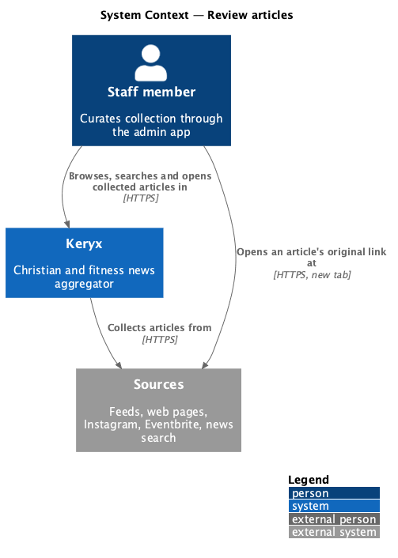
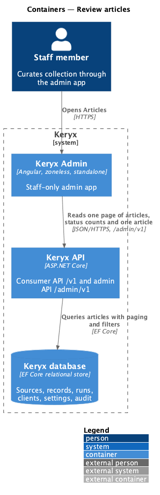
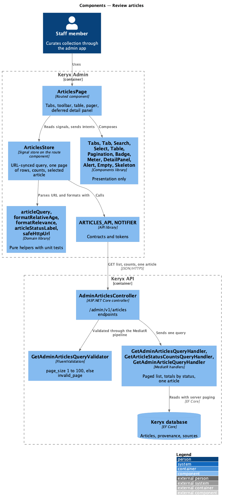
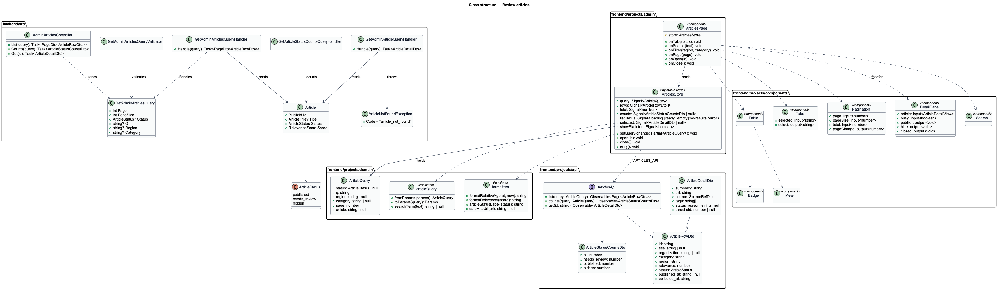
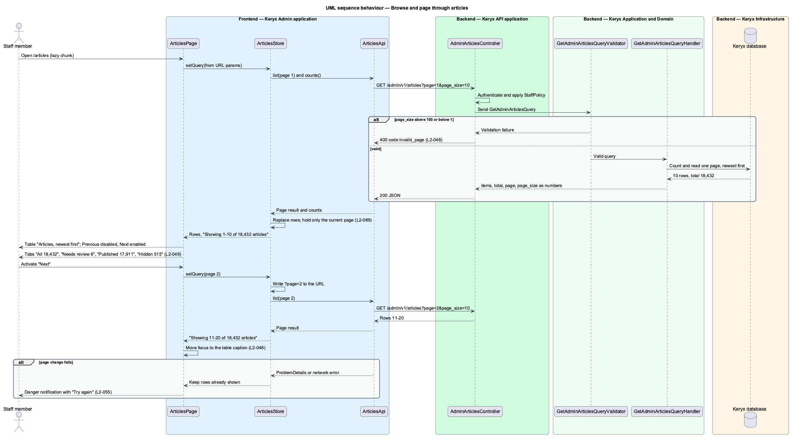
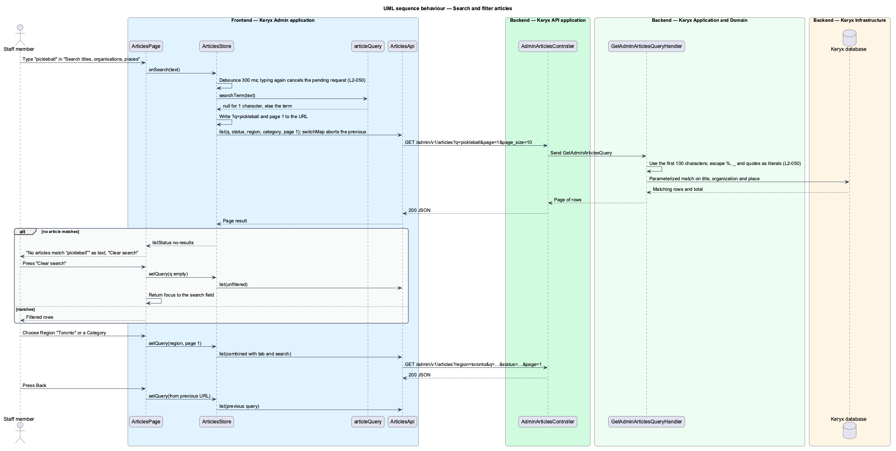
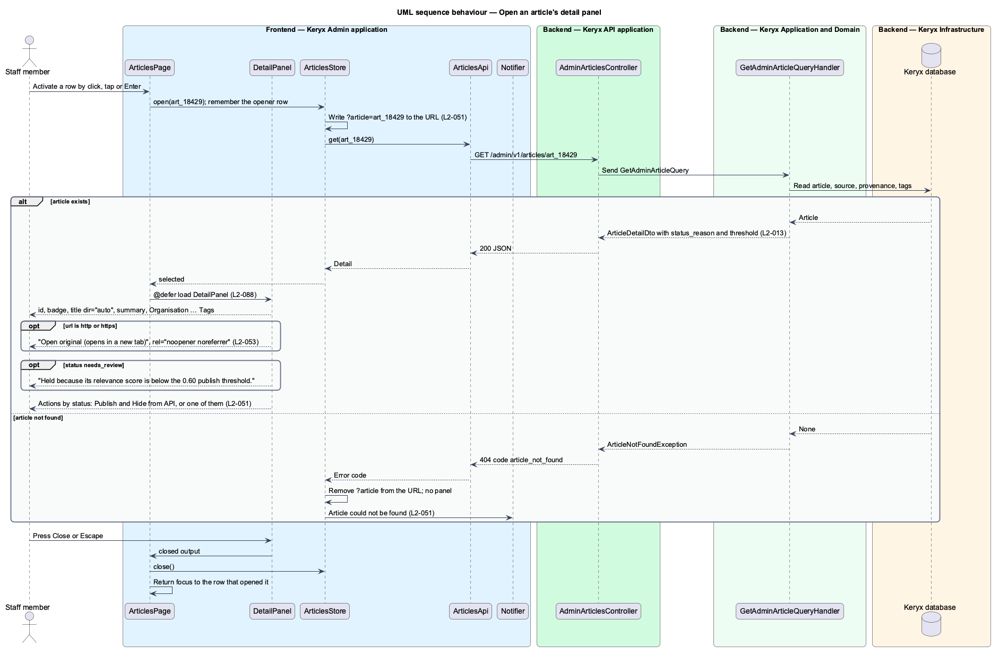
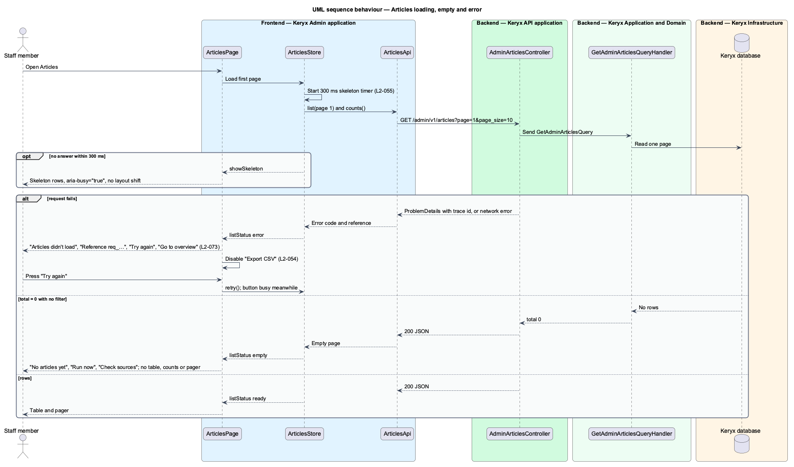

# Review articles

## Overview

Keryx stores every item it collects as an article and gives it a relevance score and a status.
Only published articles are served to consuming products. The Articles screen of Keryx Admin is
where staff browse, search, filter and open everything Keryx has collected, so they can decide
what the API serves. Publishing, hiding and undoing are the Decide on an article design; export
is the Export articles design. Both run on this screen.

**article** — pointer to a story: title, summary of at most 500 characters, canonical link,
organization, category, region, tags, publication and collection times, relevance score and
status; never a copy of the story

**status** — `published`, `needs_review` or `hidden`; shown as "Published", "Needs review" or
"Hidden"

**relevance score** — number from 0.00 to 1.00, to two decimal places, that rates an item for
Christian-fitness and geographic relevance

**held article** — article whose status is `needs_review` because its score is below the
publish threshold in force when it was collected

**status tab** — tab that limits the list to one status and shows the server's total for it

**detail panel** — panel beside or over the list that shows one article's provenance, relevance
and actions

The list is paged by the server, 10 rows per page, newest first, and the browser holds only the
current page. Tabs ("All", "Needs review", "Published", "Hidden"), a text search and Region and
Category selects narrow it. Every choice, the page and the open article are kept in the URL
query, so a reload, a shared link and Back show the same list. Titles, organization names and
other aggregated text are untrusted: they are rendered as text, never as HTML, and a source link
opens only when it is `http` or `https`.

## Description

The slice runs from the routed Articles page to three admin read endpoints.

**Frontend — `frontend/projects/admin`**

- **`ArticlesPage`** — routed page loaded with `loadComponent`
  (`pages/articles/articles-page.ts`, `.html`, `.scss`). It provides `ArticlesStore` in its own
  `providers` (`L2-089`). It composes the page header ("Articles", "Everything Keryx has
  collected. Only published articles are served by the API.", "Export CSV"), the tabs, the
  toolbar, the table with its footer and pager, and the detail panel inside a `@defer` block
  (`L2-088`). With the panel open, `app__main--split` places it beside the table from 1024 px;
  below 1024 px the panel covers the screen with a Close button. It moves focus to the table
  caption after a page change, returns focus to the opener row when the panel closes and to the
  search field after "Clear search".
- **`ArticlesStore`** — screen store held in signals. It derives `ArticleQuery` from the URL and
  writes every change back with `router.navigate` (merged query parameters), so Back restores
  the previous list. It debounces search for 300 ms and cancels the previous request with
  `switchMap`, which aborts it. It holds one page of `rows`, `total`, `counts`, `listStatus`
  (`loading`, `ready`, `empty`, `no-results`, `error`), `selected` and `showSkeleton` (set only
  when no answer arrives within 300 ms). A failed first load sets `error`; a failed page change
  keeps the rows shown and raises a danger notification with "Try again" through `NOTIFIER`.
  An `?article=` id that does not exist leaves the list, opens no panel and raises a
  notification that the article could not be found; its copy is `<TO SUPPLY>`.

**Frontend — `frontend/projects/components`** (presentation only, named by mock block)

- **`PageHeader`** (`page-header`), **`Btn`** (`btn`).
- **`Tabs`** / **`Tab`** (`tabs`, `tab`) — WAI-ARIA tabs: `role="tablist"`, `aria-selected`,
  arrow keys between tabs, Home and End to the first and last. Each tab holds a count `Badge`
  (`badge--count`) with the server's total.
- **`Toolbar`** (`toolbar`), **`Search`** (`search`) with **`Input`** (`input`, `type="search"`,
  placeholder "Search titles, organisations, places"), **`Select`** (`select`, `select--auto`)
  for Region (All regions, Toronto, Mississauga, Brampton, Markham, Vaughan, Oakville, GTA,
  Ontario, Global) and Category (All categories and the six categories).
- **`Table`** (`table`, `table-wrap`; elements `table__primary`, `table__title`, `table__sub`,
  `table__context`, `table__stacked`, `table__muted`, `table__nowrap`, `table__optional`) —
  caption "Articles, newest first"; columns Article (title with `dir="auto"`, "organization ·
  age"), Category, Region, Relevance and Status. The selected row carries
  `aria-selected="true"`. Below 768 px each row is stacked (title, organization and age, then
  status, region and category) and stays a table to assistive technology.
- **`TableFooter`** (`table-footer`) and **`Pagination`** (`pagination`) — "Showing 1–10 of
  18,432 articles", "Previous" and "Next", each disabled at its end.
- **`Badge`** (`badge`, `badge--dot`, `badge--success`, `badge--warning`) — status as a word,
  never colour alone.
- **`Meter`** (`meter`, `meter--success`, `meter--warning`) — relevance bar with the value
  "0.94"; the bar is hidden from assistive technology and the number is read.
- **`DetailPanel`** (`detail-panel`, elements `detail-panel__head`, `__body`, `__title`,
  `__summary`, `__link`, `__foot`) — the id (`art_18429`), status badge, title, summary, "Open
  original (opens in a new tab)" with `target="_blank"` and `rel="noopener noreferrer"` (plain
  text when the URL is not `http` or `https`), and a `dl` of Organisation, Source, Category,
  Region, Published, Collected, Relevance and Tags (all tags, wrapping). It shows an `Alert`
  (`alert--warning`) "Held because its relevance score is below the 0.60 publish threshold."
  for a held article, with the threshold from the article. Its actions follow the status:
  "Publish" and "Hide from API" when held, "Hide from API" when published, "Publish" when
  hidden. It emits `publish`, `hide` and `closed`; Escape and the `icon-btn` Close emit
  `closed`.
- **`Empty`** (`empty`, `empty--card`, `--compact`, `--error`; elements `empty__title`,
  `__text`, `__actions`, `__ref`) — empty ("No articles yet", "Run now", "Check sources"),
  no-results ("No articles match “pickleball”", "Try a different word, or clear the search to see
  all 18,432 articles.", "Clear search") and error ("Articles didn't load", "Reference
  req_…", "Try again", "Go to overview"). The search term is bound as text.
- **`Skeleton`** (`skeleton`, `skeleton--text`, `--pill`) — skeleton rows in the table's shape.

**Frontend — `frontend/projects/domain`** (pure, unit-tested)

- **`articleQuery`** — `fromParams`, `toParams` and `searchTerm`. `searchTerm` returns `null`
  for a term of 1 character, so no search is sent; the page returns to 1 when the tab, search or
  a filter changes.
- **`formatRelativeAge(at, now)`** — minutes under an hour, hours under a day, otherwise days
  with a thousands separator ("1,204d ago").
- **`formatRelevance(score)`** — two decimals ("0.94").
- **`articleStatusLabel(status)`** — "Published", "Needs review", "Hidden"; a null title reads
  "Untitled post" and a null organization reads "Unknown".
- **`safeHttpUrl(url)`** — returns the URL only when its scheme is `http` or `https`.

**Frontend — `frontend/projects/api`**

- **`ArticlesApi` / `ARTICLES_API`** — `list(query)`, `counts(query)` and `get(id)`; the Decide
  on an article and Export articles designs add their members. `HttpArticlesApi` implements it
  and is bound in `app.config.ts`.
- **`Notifier` / `NOTIFIER`** — notification contract of the Page states, dialogs and
  notifications design.

**Endpoints** (all under `StaffPolicy`, `Cache-Control: no-store`; JSON in `snake_case`)

| Endpoint | Request | Response | Errors |
|---|---|---|---|
| `GET /admin/v1/articles` | `page` (from 1), `page_size` (1 to 100, default 10; the screen sends 10), `status` (`published`, `needs_review`, `hidden`), `q`, `region` (slug), `category` (slug) | `items` of `id`, `title`, `organization`, `category`, `region`, `relevance`, `status`, `published_at`, `collected_at`; `total`, `page`, `page_size` as numbers | `400` `invalid_page`; `400` `invalid_filter` for an unknown status, region or category |
| `GET /admin/v1/articles/counts` | none | `all`, `needs_review`, `published`, `hidden` as numbers: the whole totals | — |
| `GET /admin/v1/articles/{id}` | — | the row fields plus `summary`, `url`, `source` (`id`, `name`), `tags`, `status_reason` (`below_publish_threshold` for a held article), `threshold`, `decided_by` | `404` `article_not_found` |

**Backend**

- **`AdminArticlesController`** — `List`, `Counts` and `Get`; each checks nothing and sends one
  MediatR request.
- **`GetAdminArticlesQuery`** / **`GetAdminArticlesQueryValidator`** /
  **`GetAdminArticlesQueryHandler`** — the validator refuses `page_size` above 100 or below 1
  with `code` `invalid_page`, as it does a `page` below 1 or either value that is not a whole
  number. The handler trims `q` to its first 100 characters and matches it as literal text,
  without regard to case, against the title, the organization name and the place: the region's
  name and the place of the article's event. The term is a parameter of a containment test,
  never a `LIKE` pattern, so `%`, `_` and quotes match only themselves. It filters by status,
  region and category, orders by `CollectedAt` descending then id ("newest" is newest collected,
  since staff review what Keryx gathered), counts the total and reads one page.
- **`GetArticleStatusCountsQuery`** / **`GetArticleStatusCountsQueryHandler`** — counts articles
  per status in one grouped query. The counts are the whole totals and do not follow the search
  or filters, as the no-results mock shows "All 18,432" beside a search that matched nothing.
- **`GetAdminArticleQuery`** / **`GetAdminArticleQueryHandler`** — reads one `Article` with its
  `Provenance`, source and tags, and throws `ArticleNotFoundException` (`code`
  `article_not_found`, `404`) when the id does not exist.
- **Domain types** — `Article`, `ArticleStatus`, `RelevanceScore`, `PublicId`, `Region`,
  `Category` and `Provenance` as defined by the Store records design.

## Requirements

The feature realizes the following level-2 (L2) requirements. Each L2 requirement refines a
level-1 (L1) requirement, cited by identifier. Their acceptance criteria are in
[L2.md](../../../specs/L2.md).

| L2 ID | Refines (L1) | Requirement |
|-------|--------------|-------------|
| `L2-048` | `L1-012` | Articles list — Staff can browse every collected article in a server-paged table, newest first, holding one page in the browser at a time. |
| `L2-049` | `L1-012` | Article status tabs — The Articles list is split by status into tabs whose counts are the server's totals. |
| `L2-050` | `L1-012` | Article search and filters — Staff can narrow the Articles list by a text search, a region and a category, kept in the URL with the status tab. |
| `L2-051` | `L1-012` | Article detail panel — Activating an article opens a panel with its provenance, relevance and actions, without leaving the list. |
| `L2-053` | `L1-012` | Untrusted and extreme article text — Article text came from a source, so it is rendered as text, never as HTML, and the layout holds for hostile, right-to-left and very long values. |
| `L2-055` | `L1-012` | Articles loading, empty and error — Articles has designed loading, empty and error states. |

## Diagrams

### System context

Staff browse the articles Keryx collected from its sources, and open an article's original
link at its source in a new tab.

### Containers

Keryx Admin reads one page of articles, the status counts and one article from the Keryx API,
which queries the Keryx database with server paging.

### Components

`ArticlesPage` composes library components and reads `ArticlesStore`, which parses the URL with
domain helpers and calls `ARTICLES_API`. `AdminArticlesController` sends one query per request;
the validator guards the page size.

### Class structure

`ArticlesStore` holds an `ArticleQuery` and depends on `ArticlesApi`. `DetailPanel`, `Tabs` and
`Pagination` take inputs and emit outputs only. On the server, three handlers read `Article`,
and `GetAdminArticleQueryHandler` throws `ArticleNotFoundException`.

### Behaviour — browse and page

The first page and the counts load from the server; "Next" replaces the rows with the next page
and moves focus to the caption. A failed page change keeps the rows already shown.

### Behaviour — search and filter

Search waits 300 ms and cancels the pending request when typing resumes. The server treats the
term as literal text; no matches show the no-results state with "Clear search".

### Behaviour — open the detail panel

Activating a row names the article in the URL and loads the deferred panel. An unknown id opens
no panel and raises a notification; closing the panel returns focus to the row.

### Behaviour — loading, empty and error

Skeleton rows appear only after 300 ms. A failed first load shows the page error with a
reference and disables "Export CSV"; no articles at all shows the empty state.

