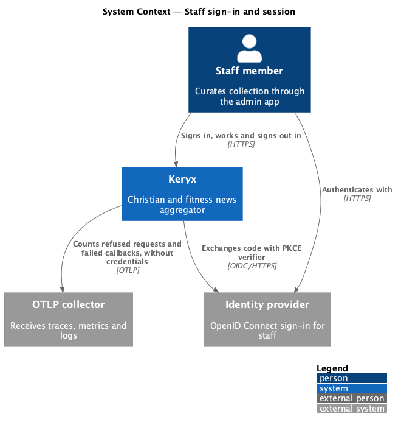
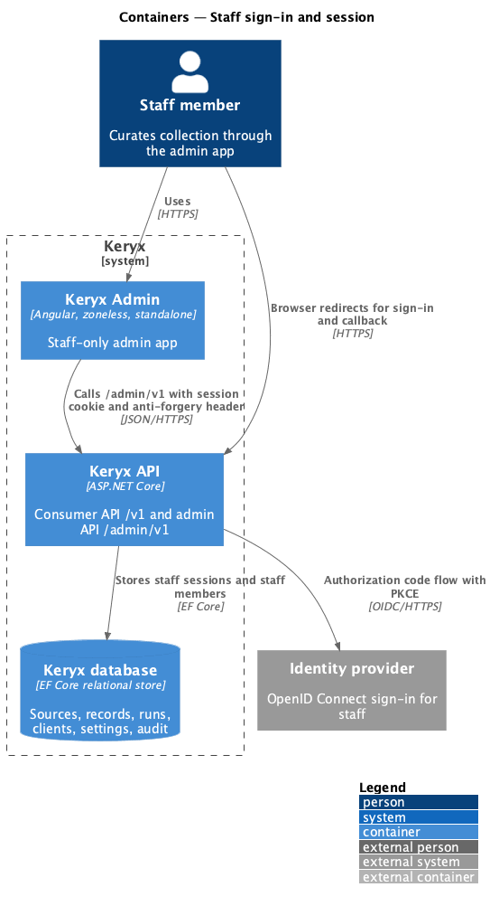
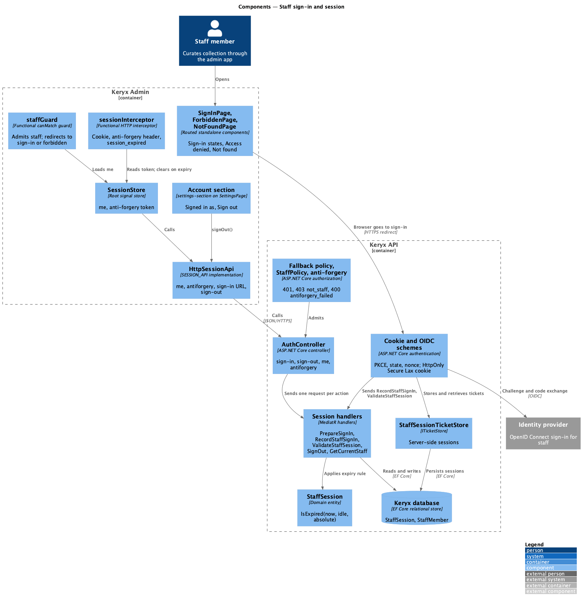
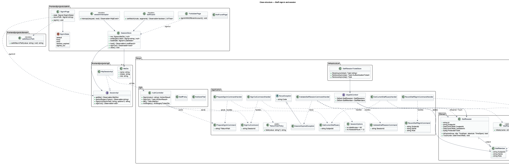
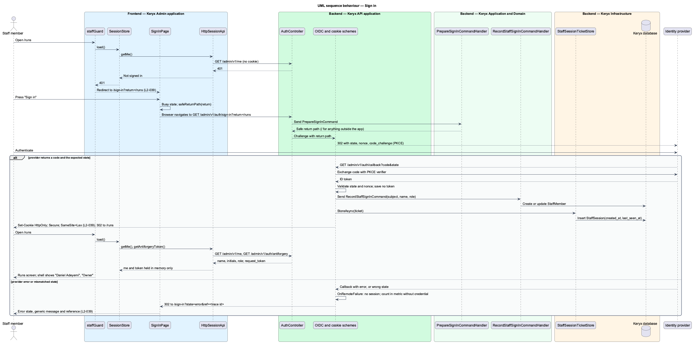
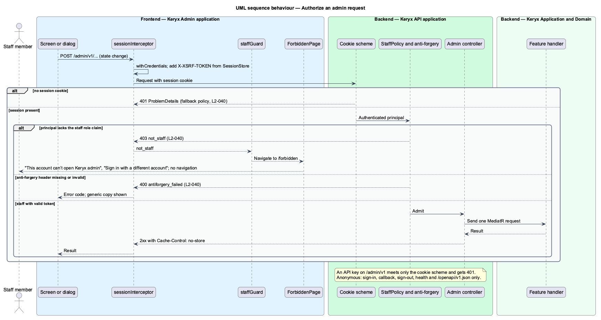
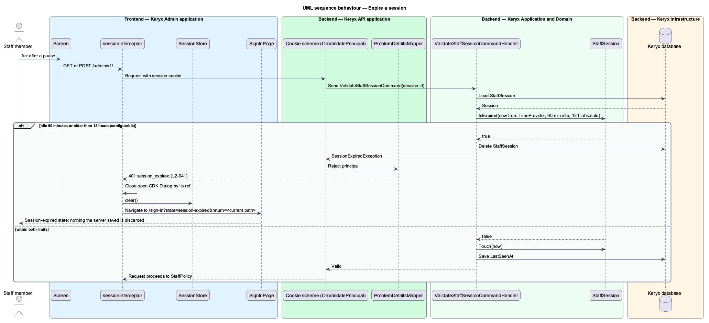
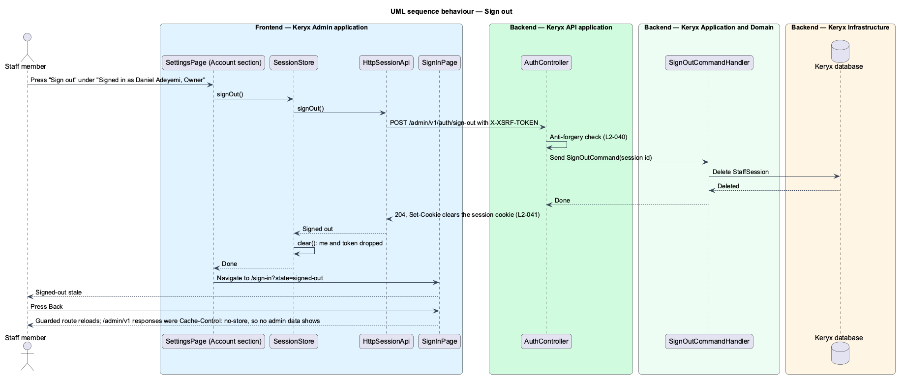
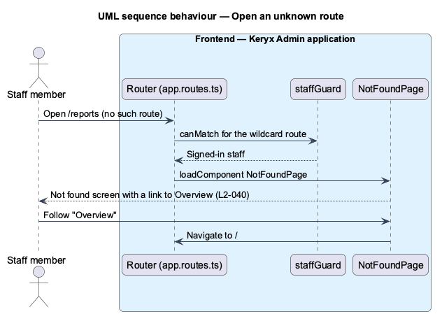

# Staff sign-in and session

## Overview

Keryx is a news aggregator for Christian and fitness news, events and organizations, first in
Toronto and the Greater Toronto Area. Staff curate what Keryx collects through the Keryx Admin
application, which calls the admin API under `/admin/v1`. This feature decides who may use that
application and those endpoints: it signs staff in, refuses everyone else, keeps a session for a
bounded time, and signs staff out.

**identity provider** — the organization's OpenID Connect service that authenticates people and
asserts their claims; Keryx stores no staff password

**OpenID Connect (OIDC) authorization code flow with PKCE** — sign-in in which the browser
returns from the identity provider with a one-time code that the Keryx API exchanges for the
person's identity, bound to the request by `state`, `nonce` and a Proof Key for Code Exchange
(PKCE) challenge

**staff** — signed-in person whose identity carries the configured staff role claim; Keryx has
one staff role

**staff session** — server-side record of one sign-in, referred to by an `HttpOnly` cookie, with
its creation time and last activity

**idle limit** — longest time a session may go without a request, 60 minutes by default

**absolute limit** — longest time a session may live from sign-in, 12 hours by default

**anti-forgery token** — per-session secret the admin app sends in a request header on every
state-changing admin request, so another site cannot forge one

**return path** — admin app route the person asked for before signing in, kept only when it is a
path inside the app

A person who opens any admin route without a session is sent to the Sign in screen. "Sign in"
takes the browser to the identity provider; on return, the Keryx API checks `state`, `nonce` and
the PKCE verifier, creates a staff session, sets its cookie and sends the browser to the return
path, or to Overview. A provider error or a mismatched `state` creates no session and shows the
Sign in screen's error state with a generic message and a reference.

Every endpoint requires authentication unless it is explicitly anonymous. The only anonymous
endpoints are sign-in, the sign-in callback, sign-out, health and the OpenAPI document. A person
the provider authenticates who lacks the staff role claim receives `403` `not_staff` from every
`/admin/v1` endpoint, and the admin app shows the Access denied screen. A state-changing admin
request without a valid anti-forgery token receives `400` `antiforgery_failed`.

A session ends after 60 minutes idle or 12 hours from sign-in, both configurable. The next request
then receives `401` `session_expired`, and the admin app shows the Sign in screen in its
session-expired state and keeps the return path. Staff sign out from the Account section of
Settings, which is reachable at every viewport. Admin responses carry `Cache-Control: no-store`,
so Back after sign-out shows no admin data.

The feature sits in the `admin-app` subsystem. The admin-shell feature hosts the routes this
feature guards and shows the person this feature serves; the manage-settings feature hosts the
Account section on the Settings page.

## Description

The slice runs from the admin app's routes and HTTP pipeline through the Keryx API's
authentication to the identity provider and the relational database (PostgreSQL, [ADR 0001](../../../adr/0001-postgresql-and-the-backend-packages.md)) via
EF Core.

**Admin app (`frontend/projects/admin`)**

- **`app.routes.ts`** — the shell route and its six children carry `staffGuard` (`canMatch`).
  `/sign-in` loads `SignInPage` and `/forbidden` loads `ForbiddenPage`, both outside the shell and
  without the guard. The wildcard route loads `NotFoundPage` for a signed-in person. Every route
  uses `loadComponent`.
- **`staffGuard`** — functional guard. It asks `SessionStore` to load the person once. On success
  it admits the route; on `401` it redirects to `/sign-in?return=<path>`; on `403` `not_staff` it
  redirects to `/forbidden`.
- **`sessionInterceptor`** — functional `HttpInterceptor` on every admin API request. It sends
  the cookie (`withCredentials`) and, for `POST`, `PUT`, `PATCH` and `DELETE`, adds the
  anti-forgery header from `SessionStore`. On `401` with `code` `session_expired` it closes any
  open CDK Dialog by its ref, clears `SessionStore`, and navigates to
  `/sign-in?state=session-expired&return=<current path>` (L2-041). It retries nothing and discards
  nothing the server has saved.
- **`SessionStore`** — app-wide store (`providedIn: 'root'`), shared by the shell, Settings and
  the guard. It holds `me` (`name`, `initials`, `role`), the anti-forgery request token in
  memory, and the load state. `clear()` drops both. It never writes a token to `localStorage`,
  `sessionStorage` or the URL (L2-039).
- **`SignInPage`** — routed page with the states `default`, `busy`, `error`, `session-expired` and
  `signed-out`, chosen from the query string. "Sign in" shows its busy state and sets
  `window.location` to the sign-in URL from `SessionApi.signInUrl(returnPath)`. The error state
  shows a generic message and "Reference req_…" from the `ref` query value. Its markup and copy
  are `<TO SUPPLY>`: the mocks `pages/sign-in/default.html`, `busy.html`, `error.html`,
  `session-expired.html` and `signed-out.html` are referenced by L2-039 and L2-041 but are not in
  `docs/mocks/`.
- **`ForbiddenPage`** — Access denied screen, with no navigation: the heading "This account can’t
  open Keryx admin" and the action "Sign in with a different account", which signs out and then
  starts sign-in with the OIDC `prompt=select_account` parameter. Whether the identity provider
  honours `prompt=select_account` is `<TO SUPPLY>`. Markup `<TO SUPPLY>`
  (`pages/forbidden/default.html` is not in `docs/mocks/`).
- **`NotFoundPage`** — Not found screen with a link to Overview. Markup `<TO SUPPLY>`
  (`pages/not-found/default.html` is not in `docs/mocks/`).
- **Account section** — a `settings-section` on `SettingsPage` (manage-settings feature),
  outside the settings form, reading "Signed in as" with the person's `avatar`, name and role and
  the button "Sign out". "Sign out" calls `SessionApi.signOut()`, then clears `SessionStore` and
  navigates to `/sign-in?state=signed-out`. Its markup is `<TO SUPPLY>`: L2-041 names the Account
  section of `pages/settings/default.html`, which holds no such section.

**Domain library (`frontend/projects/domain`)**

- **`safeReturnPath(value)`** — pure rule: returns the value when it is a path inside the app (it
  starts with a single `/`, has no scheme, host, `//` or `\`, and is not a sign-in route), and
  `/` (Overview) otherwise (L2-039). It has a unit test per row of its case table; the backend
  `ReturnPathPolicy` tests use the same inline table.

**API library (`frontend/projects/api`)**

- **`SESSION_API`** / **`SessionApi`** — `getMe(): Observable<MeDto>`,
  `getAntiforgeryToken(): Observable<string>`, `signInUrl(returnPath, options): string` and
  `signOut(): Observable<void>`. `HttpSessionApi` implements it; `app.config.ts` binds it.
  `MeDto` holds `name`, `initials` and `role`.

**Components library (`frontend/projects/components`)** — `btn`, `alert`, `avatar`, `empty`,
`settings-section`. The Sign in, Access denied and Not found screens compose these until their
mocks name other blocks.

**Keryx API (`Keryx.Api`)**

- **Authentication schemes** — a cookie scheme for staff sessions and an OpenID Connect scheme
  for the challenge. The OIDC scheme uses the authorization code flow with PKCE (`UsePkce`),
  validates `state` and `nonce`, saves no token in the session (`SaveTokens = false`), and reads
  the authority, client id, client secret and staff role claim from configuration (L2-096). The
  `/v1` controllers do not accept this scheme.
- **Session cookie** — `HttpOnly`, `Secure`, `SameSite=Lax`, holding only the session id; the
  session's identity lives server-side through `StaffSessionTicketStore`. The cookie scheme never
  redirects an API call: an unauthenticated admin call receives `401` ProblemDetails. The `code`
  for a request with no session at all is `<TO SUPPLY>` (L2-040 names none).
- **Fallback policy** — every endpoint requires an authenticated user unless it carries
  `[AllowAnonymous]`. Only sign-in, the callback, sign-out, health (`/health/live`,
  `/health/ready`) and `/openapi/v1.json` carry it (L2-040). `GET /admin/v1/auth/antiforgery`
  requires an authenticated session but not `StaffPolicy`, so a person on the Access denied
  screen can still sign out.
- **`StaffPolicy`** — required by every `/admin/v1` controller: an authenticated staff session
  whose identity carries the staff role claim. A failure gives `403` `not_staff`.
- **Anti-forgery** — `IAntiforgery` validates the `X-XSRF-TOKEN` header on every `POST`, `PUT`,
  `PATCH` and `DELETE` under `/admin/v1`, sign-out included. A failure gives `400`
  `antiforgery_failed`. The admin app reads the request token from
  `GET /admin/v1/auth/antiforgery` and holds it in memory, because the admin app and the API are
  on different origins (L2-082) and the app cannot read the API's cookies. Whether they share an
  origin in deployment is `<TO SUPPLY>`; a shared origin would allow the cookie-to-header
  pattern instead.
- **`AuthController`** — `GET /admin/v1/auth/sign-in?return=<path>` (anonymous) sends
  `PrepareSignInCommand` and returns an OIDC challenge carrying the checked return path; the
  callback path `/admin/v1/auth/callback` (anonymous) is handled by the OIDC middleware;
  `POST /admin/v1/auth/sign-out` (anonymous, anti-forgery checked) sends `SignOutCommand`;
  `GET /admin/v1/me` (staff) sends `GetCurrentStaffQuery`; `GET /admin/v1/auth/antiforgery`
  (authenticated) returns `request_token`.
- **OIDC events** — `OnTicketReceived` sends `RecordStaffSignInCommand` with the subject id, name
  and role from the provider's claims, and sends the browser to the admin origin plus the return
  path. `OnRemoteFailure` (a provider error or a mismatched `state`) creates no session, counts
  the failure in a metric without the credential (L2-085), and redirects to
  `/sign-in?state=error&ref=<trace id>`.
- **`NoStoreFilter`** — sets `Cache-Control: no-store` on every `/admin/v1` response (L2-041,
  L2-082).

**Keryx Application and Domain**

- **`PrepareSignInCommand`** / handler — applies `ReturnPathPolicy` and returns the safe return
  path.
- **`RecordStaffSignInCommand`** / handler — creates or updates the `StaffMember` with
  `SubjectId`, `Name` and `Role`; no other claim, e-mail address included, is stored or logged.
- **`GetCurrentStaffQuery`** / handler — reads the `StaffMember` of the session's subject and
  returns `MeDto` with `name`, `initials` (from `StaffName.Initials`) and `role`.
- **`SignOutCommand`** / handler — deletes the `StaffSession`; the controller then clears the
  cookie. Whether sign-out also ends the identity provider's own session (RP-initiated logout) is
  `<TO SUPPLY>`.
- **`StaffSession`** (`Keryx.Domain`) — `Id`, `SubjectId`, `CreatedAt`, `LastSeenAt` and the
  protected ticket. `IsExpired(now, idleLimit, absoluteLimit)` is true when `now − LastSeenAt` is
  at least the idle limit or `now − CreatedAt` is at least the absolute limit. It has a unit test
  per row of its case table, driven by `FakeTimeProvider`.
- **`ValidateStaffSessionCommand`** / handler — sent by the cookie scheme's
  `OnValidatePrincipal` on each request. It loads the session, applies `IsExpired` with now from
  `TimeProvider`, and either refreshes `LastSeenAt` or deletes the session and raises
  `SessionExpiredException` (`401` `session_expired`). How often `LastSeenAt` is written is
  `<TO SUPPLY>`.
- **`SessionOptions`** — `IdleMinutes` (60) and `AbsoluteHours` (12), documented in
  `tools/deploy/` (L2-096); key names `<TO SUPPLY>`.
- **`StaffMember`** (`Keryx.Domain`) — `SubjectId`, `Name` and `Role`, and nothing else.

**Keryx Infrastructure**

- **`StaffSessionTicketStore`** — `ITicketStore` that keeps each session in the database, so
  sign-out and expiry end it on the server. The ticket is protected with ASP.NET Core Data
  Protection, whose keys are shared across API instances (L2-084).
- **OIDC configuration** — binds the identity provider settings; the client secret comes from the
  environment or a secret store.

**Endpoints**

| Method and path | Access | Response | Errors (`code`) |
|---|---|---|---|
| `GET /admin/v1/auth/sign-in?return=<path>` | anonymous | `302` to the identity provider with `state`, `nonce`, `code_challenge` | — |
| `GET /admin/v1/auth/callback` | anonymous | `302` to the return path, or to `/sign-in?state=error&ref=…` | — |
| `POST /admin/v1/auth/sign-out` | anonymous, anti-forgery | `204`, session deleted, cookie cleared | `400` `antiforgery_failed` |
| `GET /admin/v1/auth/antiforgery` | authenticated | `200` `request_token` | `401` |
| `GET /admin/v1/me` | `StaffPolicy` | `200` `name`, `initials`, `role` | `401`, `401` `session_expired`, `403` `not_staff` |
| any other `/admin/v1` | `StaffPolicy` | — | `401`, `401` `session_expired`, `403` `not_staff`, `400` `antiforgery_failed` on state changes |

## Requirements

The feature realizes the following level-2 (L2) requirements. Each L2 requirement refines a
level-1 (L1) requirement, cited by identifier. Their acceptance criteria are in
[L2.md](../../../specs/L2.md).

| L2 ID | Refines (L1) | Requirement |
|-------|--------------|-------------|
| `L2-039` | `L1-010` | Staff sign-in — Staff sign in through the organization's identity provider with OpenID Connect (authorization code flow with PKCE). Keryx stores no staff password. Mocks: `pages/sign-in/default.html`, `busy.html`, `error.html`. |
| `L2-040` | `L1-010` | Staff authorization — Only staff can use the admin endpoints and the admin app; every endpoint requires authentication unless it is explicitly anonymous. |
| `L2-041` | `L1-010` | Session lifetime and sign-out — A staff session ends after a bounded idle time and a bounded total lifetime, and staff can sign out from every viewport; after either, no admin data stays reachable in the browser. |

## Diagrams

### System context

Staff sign in to Keryx through the organization's identity provider. Keryx stores no staff
password and keeps only the person's subject id, name and role.

### Containers

The Keryx Admin application sends the browser to the Keryx API to sign in. The API runs the OIDC
exchange with the identity provider, keeps sessions in the Keryx database, and serves the
admin endpoints under the staff policy.

### Components

On the frontend, the guard, the interceptor and `SessionStore` decide which screen to show. On
the backend, the authentication schemes, `StaffPolicy` and anti-forgery run before
`AuthController` and every admin controller.

### Class structure

`StaffSession` holds the expiry rule and `StaffMember` the person. The handlers read and write
them through `IAppDbContext`; the frontend `SessionStore` depends on the `SessionApi` contract.

### Behaviour — sign in

The guard sends a person without a session to Sign in. The API runs the authorization code flow
with PKCE, checks `state` and `nonce`, creates the session, and returns the browser to the safe
return path. A provider error or mismatched `state` shows the error state.

### Behaviour — authorize an admin request

Each admin request passes the fallback policy, the session check, `StaffPolicy` and, for a state
change, the anti-forgery check. A person without the staff role sees Access denied.

### Behaviour — expire a session

A session idle for 60 minutes or older than 12 hours is deleted on its next request, which
receives `401` `session_expired`. The admin app shows the session-expired state and keeps the
return path.

### Behaviour — sign out

"Sign out" in Settings › Account ends the session on the server, clears the cookie and shows the
signed-out state. `Cache-Control: no-store` keeps Back from showing admin data.

### Behaviour — open an unknown route

A signed-in person who opens a route that does not exist sees the Not found screen with a link to
Overview.

