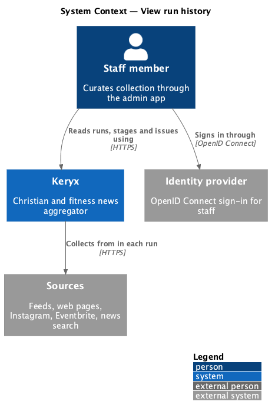
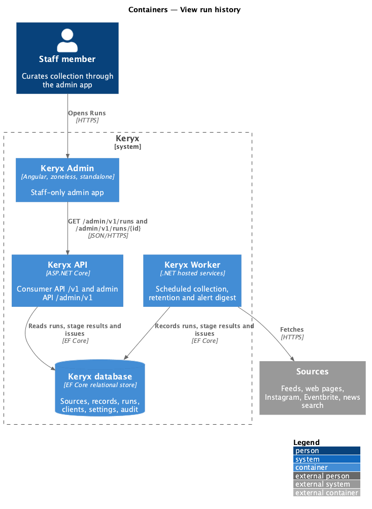
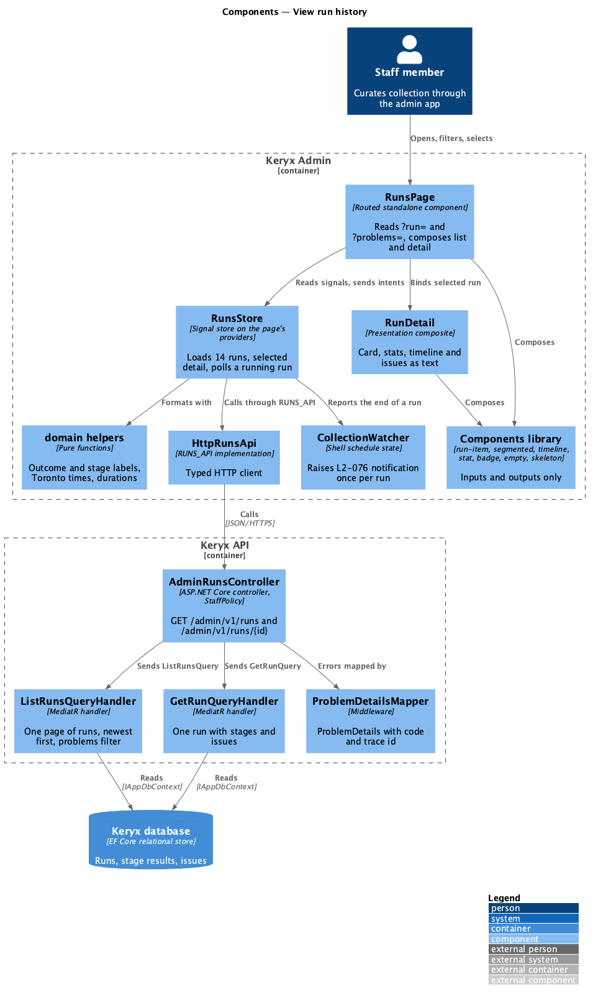
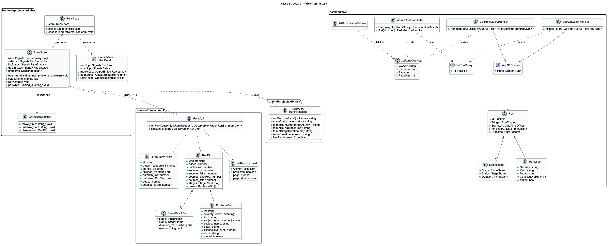
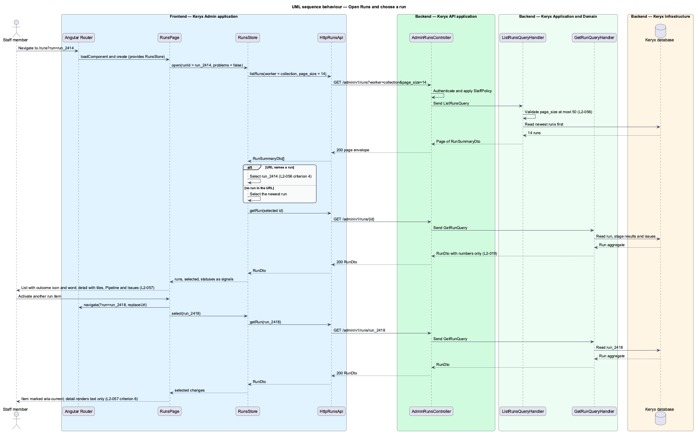
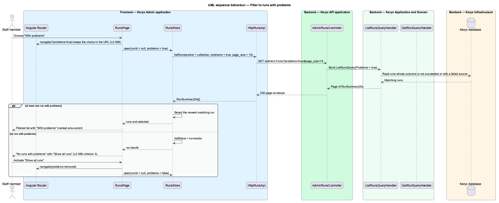
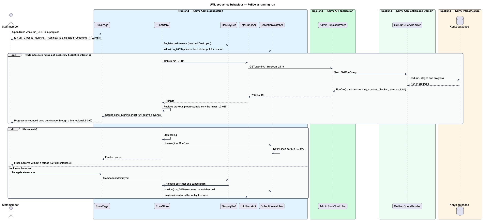
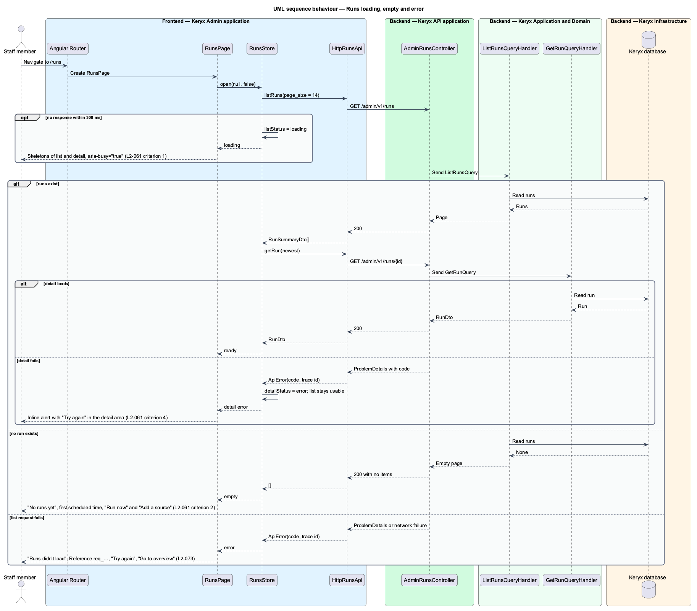

# View run history

## Overview

Keryx collects Christian and fitness news from its sources in runs. A *run* is one pass of a
worker; a *collection run* is one pass of the collection pipeline over every source, through
six fixed stages (fetch, parse, classify, deduplicate, store, publish). The collection worker
records every run with its trigger, its times, its outcome, the result of each stage and the
issues it raised (`L2-019`, `L2-020`). This feature is the Runs screen of the admin app, where
staff read that record.

The screen answers four questions for a staff member: which recent runs worked, which had
problems, what happened at each stage of one run, and what is happening now while a run is in
progress. It sits in the admin-app subsystem beside Overview, Articles, Sources, API and
Settings, and it reads only the admin API under `/admin/v1`. Starting a run (Run collection
now), retrying failed sources (Retry failed sources) and muting an issue (Mute an issue) are
buttons hosted on this screen; their behaviour belongs to those designs.

Terms used below:

- **outcome** — final state of a run: `succeeded`, `completed_with_issues`, `failed`, or
  `running` while it is in progress
- **run with problems** — run whose outcome is not `succeeded` or that had at least one failed
  source
- **stage result** — status, duration and counts of one pipeline stage within one run
- **issue** — problem found during a run, with a severity, a kind, a subject (a source or a
  stage), a short detail and a streak of consecutive runs
- **selected run** — run whose detail the screen shows, named in the URL as `?run=<id>`
- **progress poll** — repeated read of a running run's detail while the screen is open

The screen shows the 14 most recent collection runs, newest first (Decision 10 of
[L2.md](../../../specs/L2.md)). Older runs stay in the database until retention removes them,
and the endpoint stays paged.

## Description

The slice runs from the routed Runs page in the Keryx Admin app to the run records in the
Keryx database, a relational database (PostgreSQL, [ADR 0001](../../../adr/0001-postgresql-and-the-backend-packages.md)) via EF Core.

**Frontend — `admin` app (`frontend/projects/admin`)**

- **`RunsPage`** — routed page loaded with `loadComponent`. It reads `?run=` and `?problems=`
  from the route, hands them to `RunsStore`, composes the list and the detail, and writes the
  selection and the tab back to the URL. It provides `RunsStore` in its own `providers`, so
  the store and its timers are released when the page is left (`L2-089`).
- **`RunsStore`** — screen store held in signals. It loads one page of 14 runs, selects the
  named run or the newest, loads the selected run's detail, and holds `listStatus` and
  `detailStatus` (`loading`, `ready`, `empty`, `no-results`, `error`). While the selected run
  is `running` it polls its detail no more often than every 3 seconds, keeps only the latest
  response, stops when the outcome is no longer `running`, and stops when its `DestroyRef`
  fires. In-flight requests are cancelled on destroy, which aborts them. While it follows a run
  it tells `CollectionWatcher`, which pauses its own poll for that run until the page is
  destroyed, so the run is read by one poll at a time. On the end of a run it
  passes the final run to `CollectionWatcher` (Page states, dialogs and notifications design),
  which raises the outcome notification of `L2-076` once per run.
- **`RunDetail`** — presentation composite in the `admin` app with no design-system
  equivalent. It is built from library components: a `card` with `card__title-row`, a `badge`
  for the outcome, `card__meta` ("run_2418 · Schedule · took 4m 12s"), a `stats stats--4
  stats--ruled` group of four `stat` tiles, a `timeline` of six `timeline__step` items and a
  `list` of issues (`issue__detail`, `issue__streak`). It renders every summary and detail as
  text, never as HTML (`L2-057` criterion 6).
- **Components library** (`frontend/projects/components/src/<name>/`) — `page-header`,
  `segmented` (link variant with `aria-current` for "All runs" and "With problems"), `list`,
  `run-item` (outcome icon, a visually hidden outcome word, `list__title`, `list__meta`,
  `run-item__flag` "2 failed"), `card`, `badge`, `stat`, `timeline` (`data-state` of `ok`,
  `warn`, `failed`, `running`, `skipped`), `alert`, `empty` (`empty--card`, `empty--compact`,
  `empty--success`, `empty--error`), `skeleton` and `btn`. Each is OnPush, standalone, with
  inputs and outputs only.
- **`domain` library** — pure helpers with unit tests: `runOutcomeLabel` ("Succeeded",
  "Completed with issues", "Failed", "Running"), `stageStatusLabel` ("Done", "Done with
  warnings", "Failed", "Not run"), `stageName` (Fetch sources, Parse & extract, Classify
  relevance, Deduplicate, Store, Publish to API), `formatRunStart` ("Today, 6:00 AM",
  "Yesterday, 12:00 PM", "Mon, Mar 9, 6:00 PM" in Toronto time against a supplied now),
  `formatRunDuration` ("4m 12s"), `formatStageDuration` ("2:48"), `stageSummary` ("62 of 64
  sources fetched · 2 failed"), `issueStreakLabel` ("Failing 4 runs in a row"), `hasProblems`
  and `formatCountdown` for the header line.
- **`api` library** — `RunsApi` interface and `RUNS_API` token, with `listRuns(query)`,
  `getRun(id)` and DTO types `RunSummaryDto`, `RunDto`, `StageResultDto`, `RunIssueDto`.
  `HttpRunsApi` implements it and is bound in `app.config.ts`.
- **Header line** — "Scheduled every 6 hours · next at 12:00 PM (in 2h 14m)" is read from the
  shell's schedule state (`ScheduleStore`, Admin shell design); the Runs page issues no request
  of its own for it. While a run is in progress the line reads "A collection is running now ·
  started 9:46 AM by Daniel Adeyemi" and "Run now" is a disabled, busy "Collecting…"
  (`L2-058` criterion 4).

**Backend — Keryx API (`backend/src/Keryx.Api`)**

- **`AdminRunsController`** — exposes the two reads below under `StaffPolicy`. It checks
  nothing and sends one MediatR request per endpoint.
- **`ProblemDetailsMapper`** — maps a `KeryxException` to ProblemDetails with its `code`
  extension and the trace id shown as "Reference req_…" (`L2-073`).

**Backend — Keryx Application and Domain**

- **`ListRunsQuery`** / **`ListRunsQueryHandler`** / **`ListRunsQueryValidator`** — reads one
  page of runs for a worker, newest first, optionally only runs with problems. The validator
  bounds `page_size` to at most 50 (`L2-056` criterion 6); whether a larger value is rejected
  or clamped is `<TO SUPPLY>`.
- **`GetRunQuery`** / **`GetRunQueryHandler`** — reads one run with its stage results and its
  issues through `IAppDbContext`.
- **`Run`**, **`RunOutcome`**, **`RunTrigger`**, **`StageResult`**, **`StageName`**,
  **`StageStatus`**, **`RunIssue`** — domain types recorded by the Record runs and issues
  design. `RunIssue.Detail` is already bounded to 300 characters and stripped of query
  strings, credentials, internal host names and IP addresses when stored (`L2-020`).

**Endpoints**

| Method and path | Request | Response | Errors |
|---|---|---|---|
| `GET /admin/v1/runs` | `worker` (default `collection`), `problems=true`, `page`, `page_size` (at most 50; the screen sends 14) | Page envelope (`items`, `total`, `page`, `page_size`, as the articles list) with `items` of `RunSummaryDto`: `id`, `trigger`, `started_at`, `finished_at`, `duration_ms`, `outcome`, `added`, `sources_failed`; newest first; `page_size` defaults to 10; `problems=true` keeps runs that failed or completed with issues | `401` `session_expired`, `403`, `400` `invalid_page` (page or page size) or `invalid_filter` (worker or problems) |
| `GET /admin/v1/runs/{id}` | — | `RunDto`: the fields of `L2-019` (`worker`, `trigger`, `started_at`, `finished_at`, `duration_ms`, `outcome`, `added`, `updated`, `unchanged`, `duplicates`, `held`, `off_topic`, `rejected`, `sources_ok`, `sources_failed`, and while running `sources_checked` and `sources_total`), `stages` (`StageResultDto`: `stage`, `status`, `duration_ms`, stage counts, generic `reason`) and `issues` (`RunIssueDto`: `id`, `severity`, `kind`, `subject_type`, `subject_id`, `subject_name`, `detail`, `consecutive_runs`, `since`, `muted`) | `404` (code `run_not_found`), `401`, `403` |

Every count, duration and score is a number; the admin app formats them. The exact names of the
stage count fields and of the page envelope's paging fields are `<TO SUPPLY>` and follow the
Record runs and issues design and the API contract design. Whether the issue title ("Feed
returned 404", "Timed out after 30s") is served or derived from `kind` by a domain helper is
`<TO SUPPLY>`. The name of the staff member who started a manual run, shown in the running
header, is not among the `L2-019` fields; its source is `<TO SUPPLY>`.

**How it is built** (journey 14)

- The header line comes from `ScheduleStore`, which is provided on the shell's route with the
  `OVERVIEW_API` it reads, as the session's stores are (ADR 0005), rather than in `root`: the
  app binds nothing in `app.config.ts` that the sign-in screen does not need. It reads
  `GET /admin/v1/overview/schedule` the first time a screen asks and keeps it for the visit; when
  it fails, the header leaves the line out and the list is still shown, its times in Toronto's
  zone. Asking again when the next collection time passes (`L2-042` AC6) arrives with the shell's
  own schedule footer.
- "Run now" and its disabled "Collecting…" (`L2-058` AC4) arrive with journey 15, "Staff starts a
  collection now", as does following a run live (`L2-058` AC2, AC3); "Retry failed sources" and
  "Mute" arrive with journeys 16 and 20, which give them behaviour.
- `formatRunDuration` is the Overview design's `formatDuration`, whose seconds now read with two
  digits ("4m 03s") as both mocks show; `formatRunStart` is the Articles design's
  `formatCollectedAt`, which reads the same.

**Screen states**

- **Loading** — when the first response takes longer than 300 ms, skeletons of the list and
  of the detail are shown with `aria-busy="true"` (`pages/runs/loading.html`).
- **Empty** — with no run, an `empty--card` reads "No runs yet", names the first scheduled
  time, and offers "Run now" and "Add a source" (`pages/runs/empty.html`).
- **Error** — when the list request fails, the page error state of `L2-073` reads "Runs didn't
  load" with "Try again" and "Go to overview" (`pages/runs/error.html`).
- **No results** — under "With problems", with no run with problems, an `empty--compact
  empty--success` reads "No runs with problems" and offers "Show all runs"
  (`pages/runs/no-results.html`).
- **Detail error** — when the list loaded and the selected run's detail fails, the list stays
  usable and the detail area shows an inline `alert` with "Try again" (`L2-061` criterion 4).
  The mocks hold no state for this; its markup is `<TO SUPPLY>` as a mock state before it is
  built.
- **Narrow viewports** — below 1024 px the detail sits below or in place of the list with a
  way back to the list, and nothing scrolls horizontally (`L2-056` criterion 7). The tiles sit
  in two rows of two below 640 px and in one row of four from 640 px (`L2-057` criterion 7).
  The way-back control is not in the mocks; its markup is `<TO SUPPLY>`.

## Requirements

The feature realizes the following level-2 (L2) requirements. Each L2 requirement refines a
level-1 (L1) requirement, cited by identifier. Their acceptance criteria are in
[L2.md](../../../specs/L2.md).

| L2 ID | Refines (L1) | Requirement |
|-------|--------------|-------------|
| `L2-056` | `L1-013` | Runs list — Runs lists the most recent collection runs with their outcome and counts, and can be narrowed to runs that had problems. |
| `L2-057` | `L1-013` | Run detail — Choosing a run shows its counts, each pipeline stage's result and the issues it raised. |
| `L2-058` | `L1-013` | Running run — A run in progress is shown live on Runs, with progress polled at a bounded rate that stops when the run ends or the screen is left. |
| `L2-061` | `L1-013` | Runs loading, empty and error — Runs has designed loading, empty and error states. |

## Diagrams

### System context

A staff member reads run history through Keryx. The sources appear because the runs being read
are passes over them; the screen itself makes no call to a source.

### Containers

The Keryx Admin app calls the admin API, which reads the runs the Keryx Worker recorded in the
Keryx database.

### Components

`RunsPage` provides `RunsStore`, which reads through the `RUNS_API` contract. On the server,
`AdminRunsController` sends `ListRunsQuery` and `GetRunQuery` to their handlers, which read
through `IAppDbContext`.

### Class structure

`RunsStore` depends on the `RunsApi` contract and on `CollectionWatcher`, and holds the DTOs in
signals. The handlers depend on `IAppDbContext` and project the `Run` aggregate, which owns its
`StageResult` and `RunIssue` items, into DTOs.

### Behaviour — open Runs and choose a run

Opening Runs loads the 14 most recent runs, selects the run named in the URL or the newest, and
loads its detail. Choosing another run marks it `aria-current` and names it in the URL.

### Behaviour — filter to runs with problems

The "With problems" tab is kept in the URL as `?problems=true` and sent to the endpoint. With no
match the no-results state offers the way back to all runs.

### Behaviour — follow a running run

While the selected run is `running`, `RunsStore` polls its detail at most every 3 seconds and
keeps only the latest response. Polling stops when the run ends or when the page is left.

### Behaviour — loading, empty and error

A response slower than 300 ms shows skeletons first. A failed list shows the page error state;
a failed detail shows an inline error while the list stays usable.

