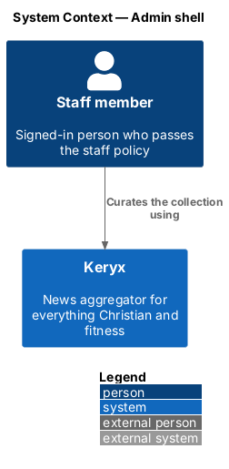
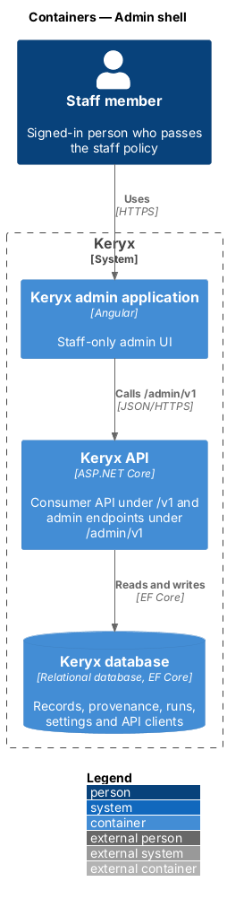
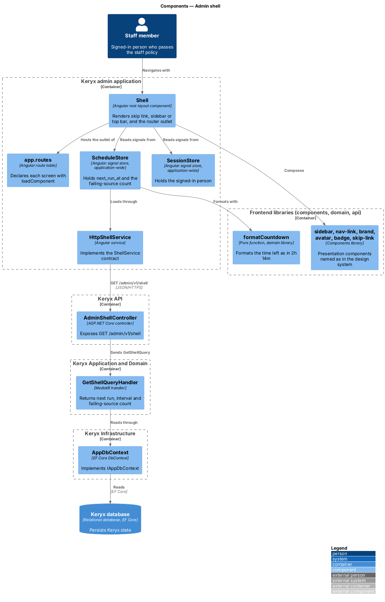
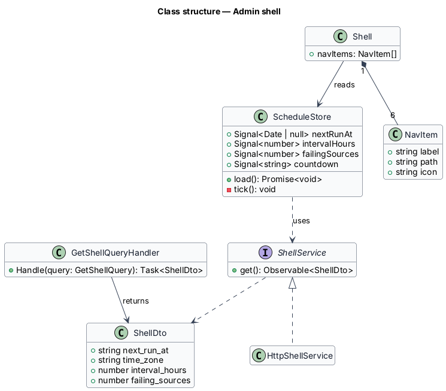
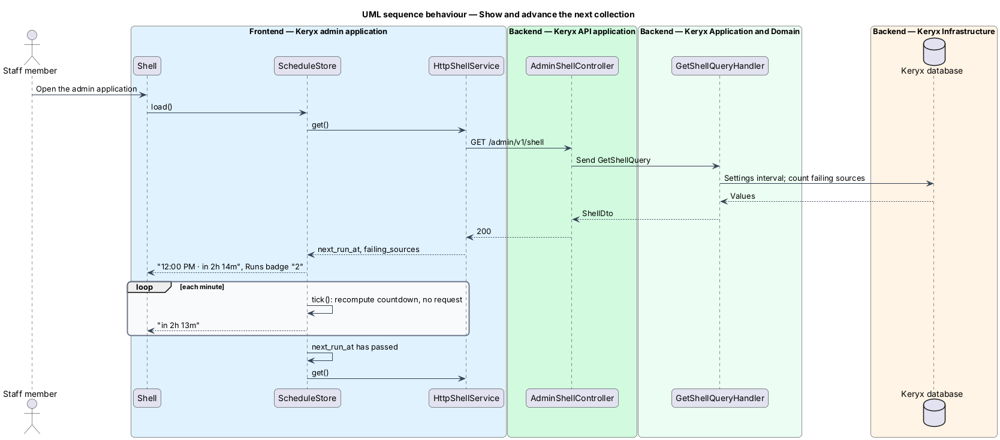

# Admin shell

## Overview

The admin application is strictly an admin UI for staff. The *shell* is the frame around each screen: the Keryx mark and wordmark, navigation to Overview, Articles, Runs, Sources, API and Settings, the time of the next collection, and the initials, name and role of the signed-in person.

The shell is the only part of the application in the initial bundle. Each navigation target loads on demand. The shell shows a countdown to the next collection that advances each minute without a request, and asks the server for the new time only when the current one passes.

> **shell** — persistent frame of the admin application: brand, navigation, schedule and account

## Description

The slice is the root layout component, the lazy route table and one application-wide store for the schedule and the failing-source count.

- **`Shell`** — Angular root layout component in the Keryx admin application. Renders the skip link, the navigation and the router outlet. The first Tab press lands on "Skip to content", which moves focus to the main region. From 1024 px the navigation is a sidebar; below, a top bar with a scrollable row of the six labelled links.
- **`app.routes`** — Angular route table in the Keryx admin application. Declares each screen with `loadComponent`, so no screen is part of the initial bundle. The router marks exactly one link with `aria-current="page"`, which the `nav-link` component styles by more than colour.
- **`ScheduleStore`** — Angular signal store, application-wide in the Keryx admin application. Holds `next_run_at`, the interval and the failing-source count. One timer per minute recomputes the countdown from the clock; when `next_run_at` passes, the store reloads. The timer is released when the shell is destroyed.
- **`SessionStore`** — Angular signal store, application-wide in the Keryx admin application. Holds the signed-in person.
- **`HttpShellService`** — Angular service in the Keryx admin application. Implements the ShellService contract.
- **`sidebar, nav-link, brand, avatar, badge, skip-link`** — Components library in the frontend libraries. Presentation components named as in the design system. The Runs link carries a `badge` whose accessible name is "2 failing sources" when sources fail, and no badge otherwise.
- **`formatCountdown`** — Pure function, domain library in the frontend libraries. Formats the time left as in 2h 14m.
- **`AdminShellController`** — ASP.NET Core controller in the Keryx API. Exposes GET /admin/v1/shell.
- **`GetShellQueryHandler`** — MediatR handler in the Application and Domain layers. Returns `next_run_at` in UTC with zone `America/Toronto`, `interval_hours` and `failing_sources` as numbers.
- **`AppDbContext`** — EF Core DbContext in the Infrastructure layer. Implements IAppDbContext.
- **`ShellDto`** — `next_run_at`, `time_zone`, `interval_hours` and `failing_sources`.

## Requirements

The feature realizes the following level-2 (L2) requirements. Each L2 requirement refines a level-1 (L1) requirement, cited by identifier. The acceptance criteria of each requirement are in [`docs/specs/L2.md`](../../../specs/L2.md).

| L2 ID | Refines (L1) | Requirement |
|-------|--------------|-------------|
| [`L2-042`](../../../specs/L2.md#l2-042-admin-shell) | `L1-011` | **Admin shell.** The requirement is defined by its 6 acceptance criteria. |

## Diagrams

### System context

A staff member curates the collection through Keryx.

### Containers

The staff member uses the Keryx admin application. The Keryx admin application calls the Keryx API at `/admin/v1`. The Keryx API reads and writes the Keryx database.

### Components

`Shell` composes library components from `ScheduleStore` and `SessionStore`. `ScheduleStore` loads through `HttpShellService` from `GetShellQueryHandler` and formats with `formatCountdown`.

### Class structure

`ScheduleStore` derives the countdown signal from `nextRunAt` and a minute tick. `ShellService` is the contract bound in `app.config.ts`.

### Behaviour — show and advance the next collection

The store asks the server once, then advances the countdown locally each minute and reloads only when the collection time passes (`L2-042`).

