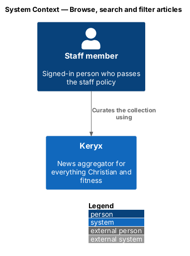
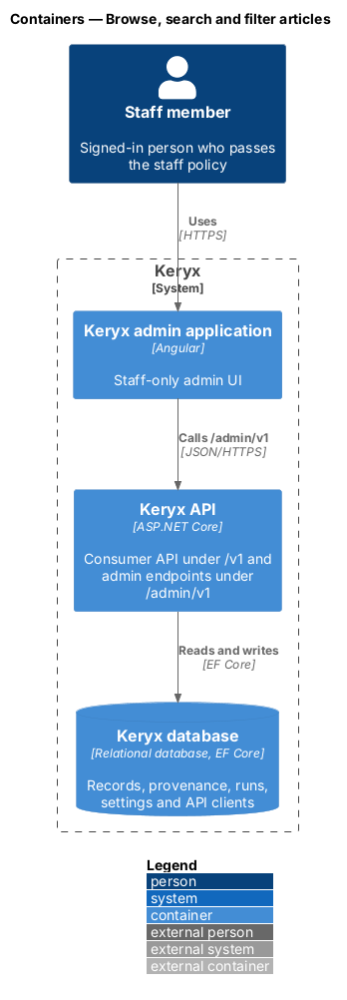
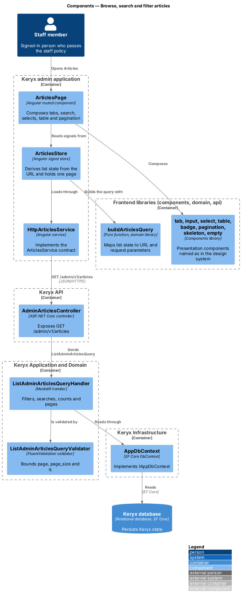
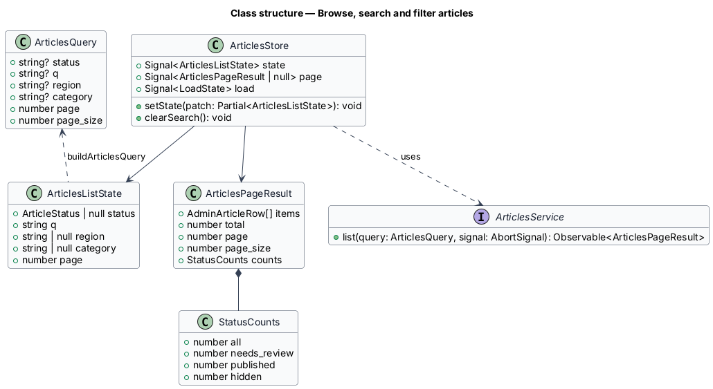
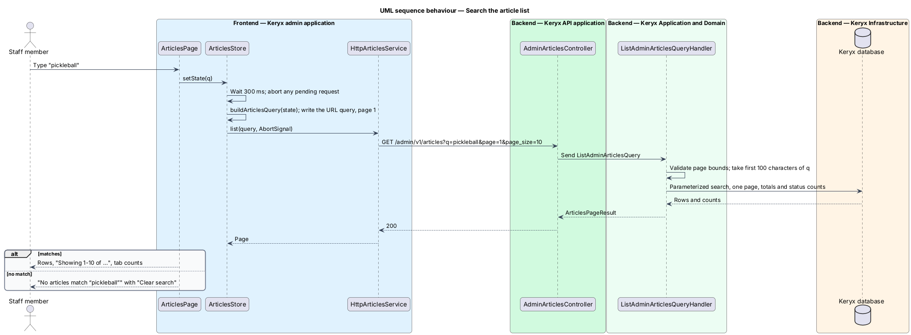

# Browse, search and filter articles

## Overview

The Articles screen lists everything Keryx has collected, newest first, whatever its status. Staff narrow the list with four status tabs, a search field, a Region select and a Category select, and page through it 10 rows at a time.

The server pages, filters and counts. The browser holds one page of rows. The tab counts are the real totals from the server, not counts of the rows shown. Tab, search, filters and page live in the URL query, so a reload, a shared link and the Back button show the same list.

> **list state** — status tab, search term, region, category and page number that together select one page of articles

## Description

The slice is one routed page, one store whose input is the URL, a pure query builder, and one paged admin endpoint.

- **`ArticlesPage`** — Angular routed component in the Keryx admin application. Composes tabs, search, selects, table and pagination. Tabs follow the WAI-ARIA tabs pattern. Below 768 px each article is a stacked row. It shows skeleton rows after 300 ms, the empty state when nothing has ever been collected, the no-results state "No articles match “pickleball”" with "Clear search", and the page error state.
- **`ArticlesStore`** — Angular signal store in the Keryx admin application. Derives list state from the URL and holds one page. It waits 300 ms after the last keystroke before searching, sends no search for a term of 1 character, and aborts the pending request when the state changes or the screen is left. After a page change it moves focus to the table caption. A page change that fails keeps the rows shown and raises a danger notification.
- **`buildArticlesQuery`** — Pure function, domain library in the frontend libraries. Maps list state to URL and request parameters and back. A change of tab, search or filter returns the page to 1. It has unit tests for each case.
- **`HttpArticlesService`** — Angular service in the Keryx admin application. Implements the ArticlesService contract.
- **`tab, input, select, table, badge, pagination, skeleton, empty`** — Components library in the frontend libraries. Presentation components named as in the design system.
- **`AdminArticlesController`** — ASP.NET Core controller in the Keryx API. Exposes GET /admin/v1/articles.
- **`ListAdminArticlesQueryHandler`** — MediatR handler in the Application and Domain layers. Filters by status, region and category, searches titles, organizations and places with the term as a literal parameter (the first 100 characters; `%` and `_` are escaped), and returns `items`, `total`, `page`, `page_size` and the four status counts as numbers.
- **`ListAdminArticlesQueryValidator`** — FluentValidation validator in the Application and Domain layers. Bounds `page_size` to 1 to 100 and refuses anything else with `invalid_page`.
- **`AppDbContext`** — EF Core DbContext in the Infrastructure layer. Implements IAppDbContext.
- **`AdminArticleRowDto`** — `id`, `title` or `null`, `organization` or `null`, `collected_at`, `category`, `region`, `score` and `status`.
- **`StatusCountsDto`** — `all`, `needs_review`, `published` and `hidden`.

## Requirements

The feature realizes the following level-2 (L2) requirements. Each L2 requirement refines a level-1 (L1) requirement, cited by identifier. The acceptance criteria of each requirement are in [`docs/specs/L2.md`](../../../specs/L2.md).

| L2 ID | Refines (L1) | Requirement |
|-------|--------------|-------------|
| [`L2-048`](../../../specs/L2.md#l2-048-articles-list) | `L1-012` | **Articles list.** The requirement is defined by its 6 acceptance criteria. |
| [`L2-049`](../../../specs/L2.md#l2-049-article-status-tabs) | `L1-012` | **Article status tabs.** The requirement is defined by its 4 acceptance criteria. |
| [`L2-050`](../../../specs/L2.md#l2-050-article-search-and-filters) | `L1-012` | **Article search and filters.** The requirement is defined by its 6 acceptance criteria. |
| [`L2-055`](../../../specs/L2.md#l2-055-articles-loading-empty-and-error) | `L1-012` | **Articles loading, empty and error.** The requirement is defined by its 4 acceptance criteria. |

## Diagrams

### System context

A staff member curates the collection through Keryx.

### Containers

The staff member uses the Keryx admin application. The Keryx admin application calls the Keryx API at `/admin/v1`. The Keryx API reads and writes the Keryx database.

### Components

`ArticlesPage` renders from `ArticlesStore`, which builds its request with `buildArticlesQuery` and loads through `HttpArticlesService`. `ListAdminArticlesQueryHandler` answers with one page and the counts.

### Class structure

`ArticlesListState` is the single input of the store. `buildArticlesQuery` converts it to `ArticlesQuery`; the response is an `ArticlesPageResult`.

### Behaviour — search the article list

Typing is debounced for 300 ms and a newer term cancels the pending request (`L2-050`). The handler treats the term as literal text and returns the page with the real totals (`L2-049`).

