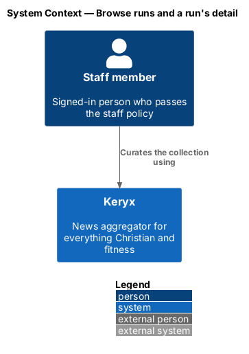
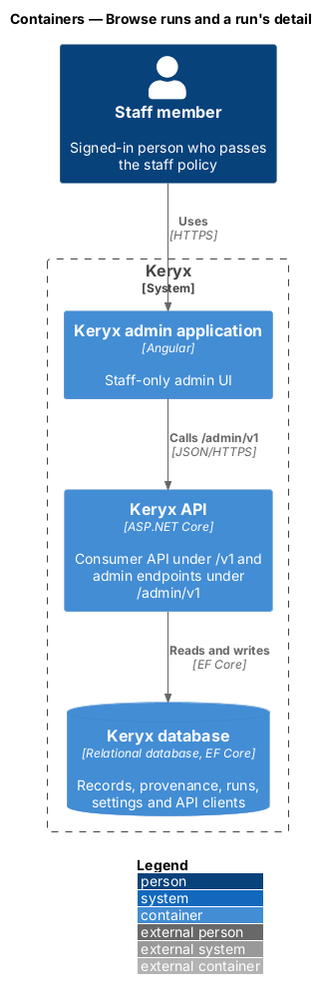
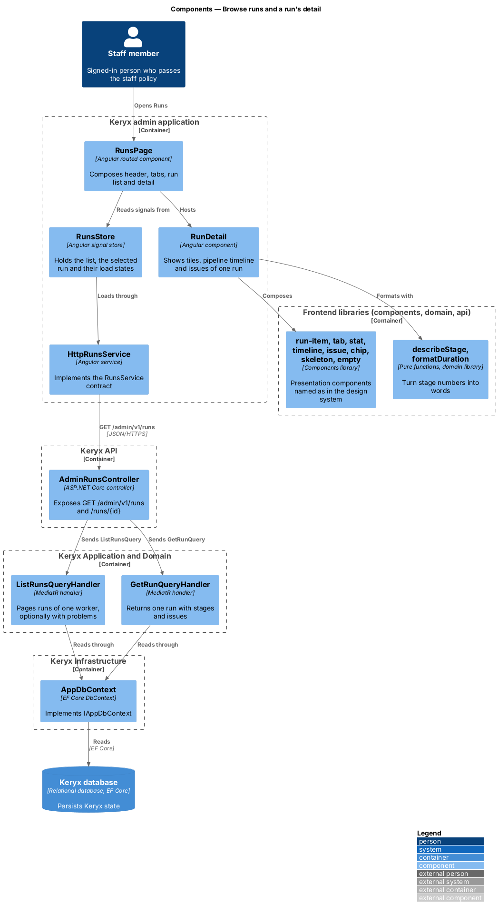
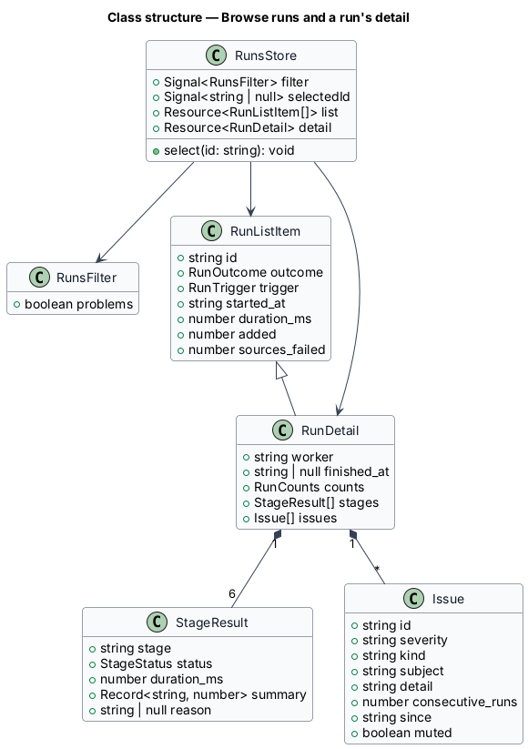
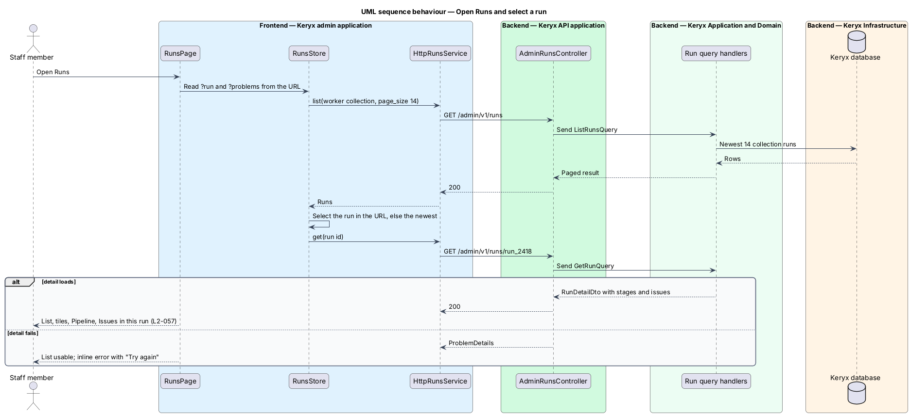

# Browse runs and a run's detail

## Overview

The Runs screen is the history of collection. A list shows the 14 most recent collection runs, newest first, each with its outcome as an icon and a word. Selecting a run shows its detail: when it ran and how it ended, four count tiles, the six pipeline stages with status, duration and summary, and the issues it raised.

A "With problems" tab narrows the list to runs that did not succeed or that had a failed source. The selected run and the tab live in the URL. With no run named in the URL, the newest run is selected.

## Description

The slice is one routed page with a list and a detail area, one store, and two admin endpoints. The endpoint is paged; the screen shows the first 14.

- **`RunsPage`** — Angular routed component in the Keryx admin application. Composes header, tabs, run list and detail. The selected `run-item` carries `aria-current`. Below 1024 px the detail replaces the list with a way back. It shows skeletons after 300 ms, "No runs yet" with "Run now" and "Add a source", the no-results state for "With problems", and the page error state.
- **`RunDetail`** — Angular component in the Keryx admin application. Shows tiles, pipeline timeline and issues of one run. A failed stage reads "Failed" with a generic reason and later stages read "Not run"; the publish stage of a failed run reads "Skipped — API still serving previous run". Each issue offers "Mute" and, for a source issue, "Edit source". Stage summaries and issue details are bound as text.
- **`RunsStore`** — Angular signal store in the Keryx admin application. Holds the list, the selected run and their load states separately, so a detail that fails to load shows an inline error with "Try again" while the list stays usable.
- **`HttpRunsService`** — Angular service in the Keryx admin application. Implements the RunsService contract.
- **`run-item, tab, stat, timeline, issue, chip, skeleton, empty`** — Components library in the frontend libraries. Presentation components named as in the design system.
- **`describeStage, formatDuration`** — Pure functions, domain library in the frontend libraries. Turn stage numbers into words: "Done with warnings", "2:48", "62 of 64 sources fetched · 2 failed".
- **`AdminRunsController`** — ASP.NET Core controller in the Keryx API. Exposes GET /admin/v1/runs and /runs/{id}.
- **`ListRunsQueryHandler`** — MediatR handler in the Application and Domain layers. Pages runs with a `page_size` of at most 50, accepts `worker` (default `collection`) and `problems=true`, and orders newest first.
- **`GetRunQueryHandler`** — MediatR handler in the Application and Domain layers. Returns one run with stages and issues.
- **`AppDbContext`** — EF Core DbContext in the Infrastructure layer. Implements IAppDbContext.
- **`RunListItemDto`** — `id`, `outcome`, `trigger`, `started_at`, `duration_ms`, `added` and `sources_failed`.
- **`RunDetailDto`** — the run record of L2-019 with `stages` (six `StageResultDto`) and `issues`.

## Requirements

The feature realizes the following level-2 (L2) requirements. Each L2 requirement refines a level-1 (L1) requirement, cited by identifier. The acceptance criteria of each requirement are in [`docs/specs/L2.md`](../../../specs/L2.md).

| L2 ID | Refines (L1) | Requirement |
|-------|--------------|-------------|
| [`L2-056`](../../../specs/L2.md#l2-056-runs-list) | `L1-013` | **Runs list.** The requirement is defined by its 7 acceptance criteria. |
| [`L2-057`](../../../specs/L2.md#l2-057-run-detail) | `L1-013` | **Run detail.** The requirement is defined by its 6 acceptance criteria. |
| [`L2-061`](../../../specs/L2.md#l2-061-runs-loading-empty-and-error) | `L1-013` | **Runs loading, empty and error.** The requirement is defined by its 4 acceptance criteria. |

## Diagrams

### System context

A staff member curates the collection through Keryx.

### Containers

The staff member uses the Keryx admin application. The Keryx admin application calls the Keryx API at `/admin/v1`. The Keryx API reads and writes the Keryx database.

### Components

`RunsPage` and `RunDetail` read `RunsStore`, which loads the list and the selected run through `HttpRunsService`. `AdminRunsController` sends `ListRunsQuery` and `GetRunQuery`.

### Class structure

`RunDetailDto` owns six `StageResultDto` and its `IssueDto` list. `RunsStore` keeps the list and the detail as separate resources.

### Behaviour — open Runs and select a run

The list loads first and the newest run is selected unless the URL names one (`L2-056`). The detail loads on its own and fails on its own (`L2-061`).

