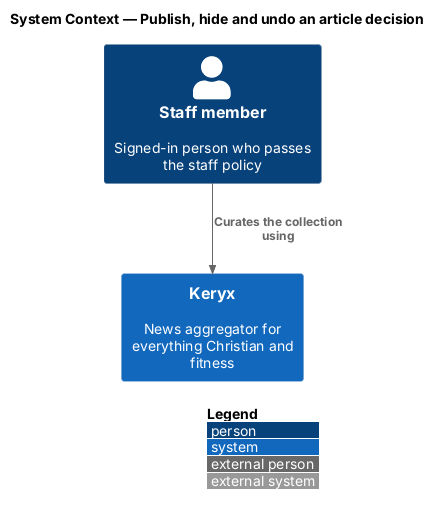
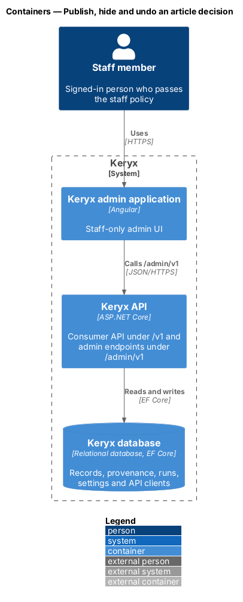
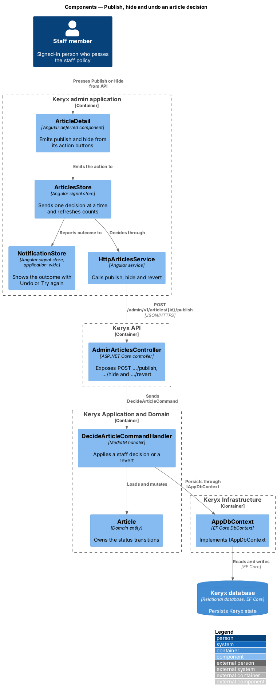
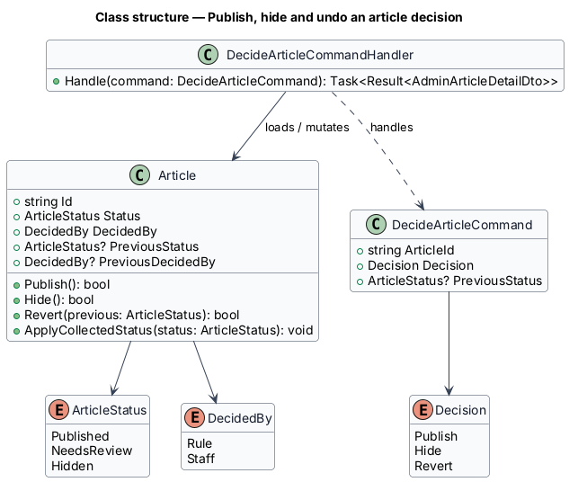
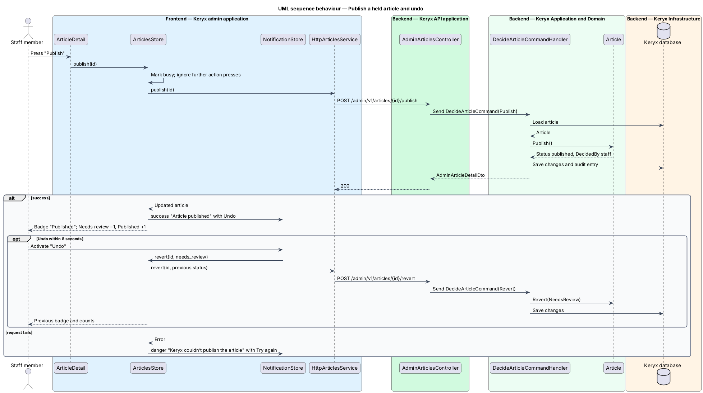

# Publish, hide and undo an article decision

## Overview

Keryx sets the status of an article from its score, and a staff member can overrule it. "Publish" makes a held or hidden article served by the consumer API on the next request. "Hide from API" removes a published or held article from the API; it stays in Keryx.

A staff decision is final for collection: a later run that collects the article again, with any score, leaves its status unchanged. A decision can be reverted within the session through the "Undo" action of its notification, which returns the article to its previous status. Each decision is idempotent.

> **decided by** — marker on an article that says whether its status came from the rule or from staff

## Description

The slice is three state transitions on `Article`, three admin endpoints, and the panel actions with their notifications.

- **`ArticleDetail`** — Angular deferred component in the Keryx admin application. Emits publish and hide from its action buttons.
- **`ArticlesStore`** — Angular signal store in the Keryx admin application. Sends one decision at a time: while a decision request is in flight, pressing either action button sends nothing. On success it updates the badge and the tab counts; on failure nothing changes on screen.
- **`NotificationStore`** — Angular signal store, application-wide in the Keryx admin application. Shows "Article published" or "Hidden from the API" with "Undo" for 8 seconds, and on failure the danger notification "Keryx couldn’t publish the article" with "Try again". The title in the body is rendered as text.
- **`HttpArticlesService`** — Angular service in the Keryx admin application. Calls publish, hide and revert.
- **`AdminArticlesController`** — ASP.NET Core controller in the Keryx API. Exposes POST …/publish, …/hide and …/revert.
- **`DecideArticleCommandHandler`** — MediatR handler in the Application and Domain layers. Applies a staff decision or a revert. An article already in the requested status answers `200` and changes nothing. An unknown id answers `404` with `code` `article_not_found`. A success writes an audit entry.
- **`Article`** — Domain entity in the Application and Domain layers. Owns the status transitions. `Publish` and `Hide` set `DecidedBy` to `Staff`; `Revert` restores the previous status and the previous `DecidedBy`. The `store` stage skips the status of an article whose `DecidedBy` is `Staff`.
- **`AppDbContext`** — EF Core DbContext in the Infrastructure layer. Implements IAppDbContext.
- **`DecideArticleCommand`** — MediatR request carrying the article id, the decision (`Publish`, `Hide`, `Revert`) and, for a revert, the previous status.
- **`DecidedBy`** — enumeration `Rule`, `Staff`.

## Requirements

The feature realizes the following level-2 (L2) requirements. Each L2 requirement refines a level-1 (L1) requirement, cited by identifier. The acceptance criteria of each requirement are in [`docs/specs/L2.md`](../../../specs/L2.md).

| L2 ID | Refines (L1) | Requirement |
|-------|--------------|-------------|
| [`L2-014`](../../../specs/L2.md#l2-014-staff-decisions-on-an-article) | `L1-004` | **Staff decisions on an article.** The requirement is defined by its 6 acceptance criteria. |
| [`L2-052`](../../../specs/L2.md#l2-052-publish-and-hide-from-the-admin-app) | `L1-012` | **Publish and hide from the admin app.** The requirement is defined by its 5 acceptance criteria. |

## Diagrams

### System context

A staff member curates the collection through Keryx.

### Containers

The staff member uses the Keryx admin application. The Keryx admin application calls the Keryx API at `/admin/v1`. The Keryx API reads and writes the Keryx database.

### Components

`ArticleDetail` emits the action; `ArticlesStore` sends it through `HttpArticlesService` and reports through `NotificationStore`. `DecideArticleCommandHandler` calls the transition on `Article`.

### Class structure

`Article` holds the current and previous decision state; `DecideArticleCommandHandler` maps a `Decision` to one of its three methods.

### Behaviour — publish a held article and undo

The handler applies the transition and marks the article decided by staff (`L2-014`). "Undo" sends a revert with the previous status while the notification lives (`L2-052`).

