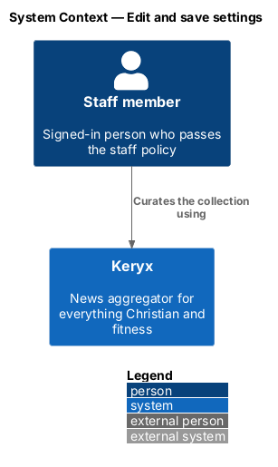
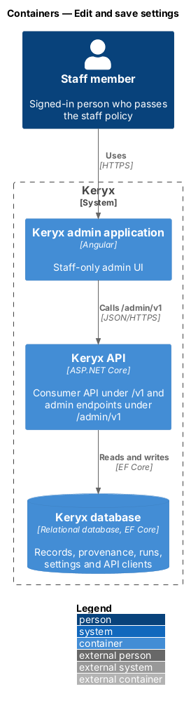
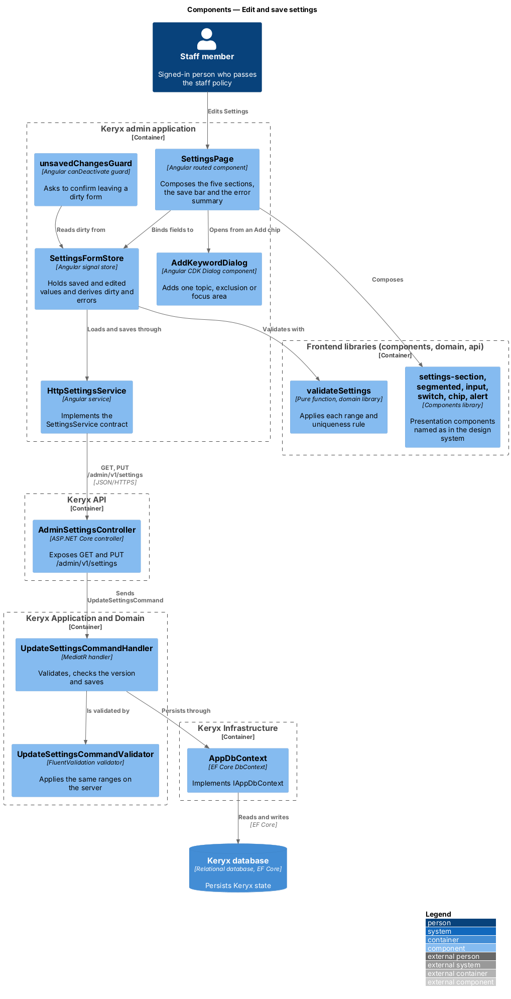
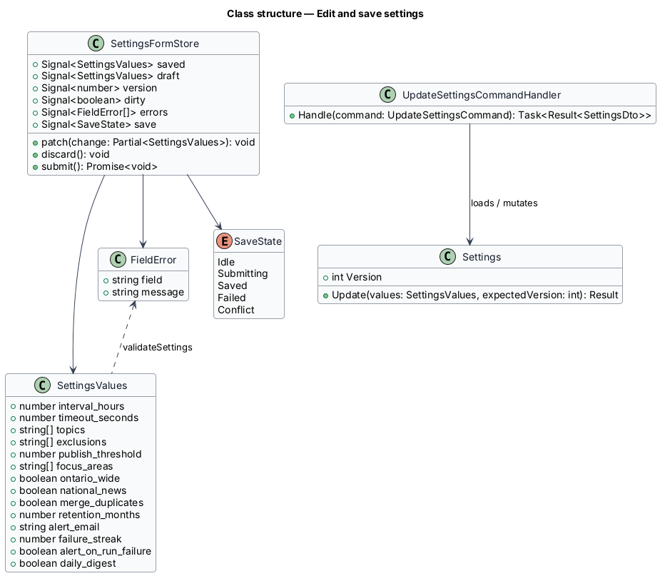
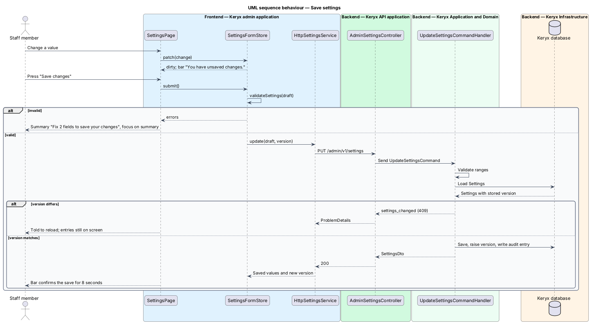
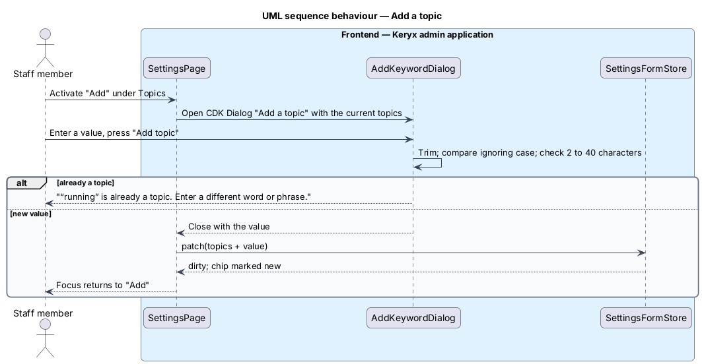

# Edit and save settings

## Overview

Settings is where staff change how Keryx collects, scores, places, stores and alerts. The form has five sections: Schedule, Relevance, Geography, Storage and Alerts. An Account section follows the form; it is not part of the form and never makes it dirty.

Nothing changes until the staff member saves. When a value differs from the saved one, a bar fixed to the bottom of the viewport offers "Discard" and "Save changes". Invalid values are listed in an error summary that links to each field. Leaving the screen with unsaved changes asks for confirmation.

Topics, exclusions and focus areas are lists of *chips*. A value is added in a dialog, never inline. Two people can edit settings at once: the save carries the version that was loaded, and the server refuses a stale version rather than overwrite.

> **dirty** — state of the form in which at least one value differs from the saved value

> **settings version** — number the server raises on each save, used to detect a concurrent change

## Description

The slice is one routed page with a form store, one dialog, shared validation rules in the `domain` library, and `GET` and `PUT /admin/v1/settings`.

- **`SettingsPage`** — Angular routed component in the Keryx admin application. Composes the five sections, the save bar and the error summary. On an invalid save it sends nothing, moves focus to the summary "Fix 2 fields to save your changes", marks each field with `aria-invalid` and its own message, and clears no entry. Each switch is a native checkbox with `role="switch"`. The threshold slider reads its value and the bands it produces.
- **`SettingsFormStore`** — Angular signal store in the Keryx admin application. Holds saved and edited values and derives `dirty` and `errors` by comparing them. "Discard" restores the saved values. While a save is in flight the fields cannot be changed and one request is sent. After a success the bar confirms the save for 8 seconds or until the next edit. A failure keeps the changes and shows an alert with a reference.
- **`AddKeywordDialog`** — Angular CDK Dialog component in the Keryx admin application. Adds one topic, exclusion or focus area. It is titled for the list it serves, refuses a value already in the list ignoring case and surrounding space, and on success returns the value; the chip appears marked new and focus returns to "Add".
- **`unsavedChangesGuard`** — Angular canDeactivate guard in the Keryx admin application. Asks to confirm leaving a dirty form on navigation; a `beforeunload` listener covers closing the tab and reloading and is removed when the page is destroyed.
- **`validateSettings`** — Pure function, domain library in the frontend libraries. Applies each rule: interval one of 1, 3, 6, 12, 24; timeout 5 to 120 seconds; threshold 0.30 to 0.90 in steps of 0.05; 1 to 50 topics, 0 to 50 exclusions and 1 to 50 focus areas, each 2 to 40 characters and unique ignoring case; retention 1 to 120 months; an e-mail address of at most 254 characters; failure streak 1 to 20. The backend validator runs the same case table.
- **`settings-section, segmented, input, switch, chip, alert`** — Components library in the frontend libraries. Presentation components named as in the design system. Removing a `chip` moves focus to the next chip, or to "Add" when it was the last.
- **`HttpSettingsService`** — Angular service in the Keryx admin application. Implements the SettingsService contract.
- **`AdminSettingsController`** — ASP.NET Core controller in the Keryx API. Exposes GET and PUT /admin/v1/settings.
- **`UpdateSettingsCommandHandler`** — MediatR handler in the Application and Domain layers. Validates, compares the version in the request with the stored one, and saves. A stale version answers `409` with `code` `settings_changed` and overwrites nothing. A new focus area becomes a region. A success writes an audit entry that names the changed fields.
- **`UpdateSettingsCommandValidator`** — FluentValidation validator in the Application and Domain layers. Applies the same ranges on the server.
- **`AppDbContext`** — EF Core DbContext in the Infrastructure layer. Implements IAppDbContext.
- **`Settings`** — aggregate with `Version` and the schedule, relevance, geography, storage and alert values; defaults always exist, so Settings has no empty state.
- **`SettingsDto`** — the values with `version`, served by `GET` and sent back by `PUT`.

## Requirements

The feature realizes the following level-2 (L2) requirements. Each L2 requirement refines a level-1 (L1) requirement, cited by identifier. The acceptance criteria of each requirement are in [`docs/specs/L2.md`](../../../specs/L2.md).

| L2 ID | Refines (L1) | Requirement |
|-------|--------------|-------------|
| [`L2-070`](../../../specs/L2.md#l2-070-settings-form) | `L1-016` | **Settings form.** The requirement is defined by its 6 acceptance criteria. |
| [`L2-071`](../../../specs/L2.md#l2-071-saving-settings) | `L1-016` | **Saving settings.** The requirement is defined by its 8 acceptance criteria. |
| [`L2-072`](../../../specs/L2.md#l2-072-chip-lists-and-the-add-a-topic-dialog) | `L1-016` | **Chip lists and the Add a topic dialog.** The requirement is defined by its 6 acceptance criteria. |

## Diagrams

### System context

A staff member curates the collection through Keryx.

### Containers

The staff member uses the Keryx admin application. The Keryx admin application calls the Keryx API at `/admin/v1`. The Keryx API reads and writes the Keryx database.

### Components

`SettingsPage` binds to `SettingsFormStore`, which validates with `validateSettings` and saves through `HttpSettingsService`. `UpdateSettingsCommandHandler` runs the server validator and the version check.

### Class structure

`SettingsFormStore` compares `saved` with `draft` to derive `dirty`. `Settings` carries the `Version` the handler checks.

### Behaviour — save settings

Client validation stops an invalid save before any request (`L2-071`). The server repeats the validation (`L2-070`) and refuses a stale version with `settings_changed`.

### Behaviour — add a topic

The value is added to the draft only; nothing reaches the server until Settings is saved (`L2-072`).

