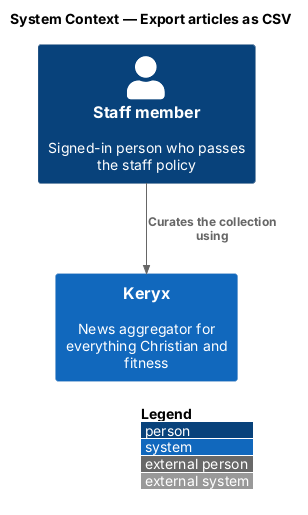
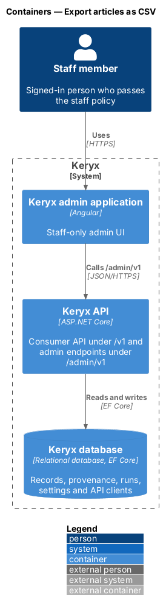
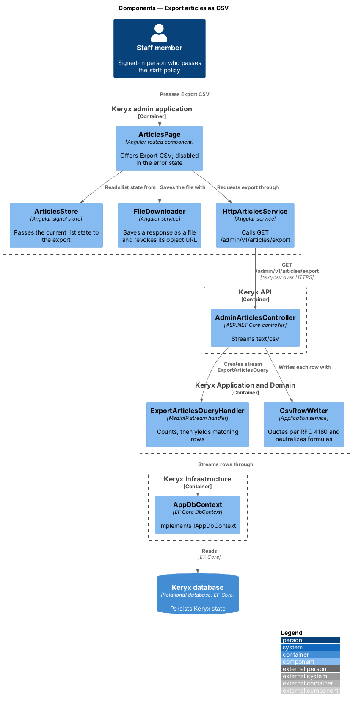
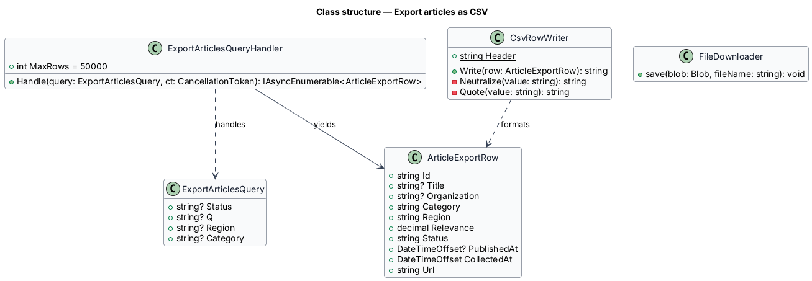
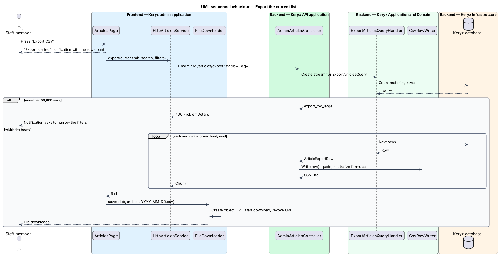

# Export articles as CSV

## Overview

A staff member takes the current article list out of Keryx as a CSV file with "Export CSV". The export holds the rows that match the current tab, search and filters, up to 50,000 rows. A larger selection is refused, and the notification asks the staff member to narrow the filters.

The file opens in spreadsheet programs, and its cells hold text that came from sources. A cell that begins with `=`, `+`, `-`, `@`, tab or carriage return is prefixed with a single quote, so a spreadsheet does not run it as a formula.

## Description

The slice is a streamed endpoint and a download helper. The server never holds the whole export in memory, and the browser releases the object URL once the download has started.

- **`ArticlesPage`** — Angular routed component in the Keryx admin application. Offers "Export CSV" and raises the info notification "Export started" with the row count. The button is disabled when the list is in its error state.
- **`ArticlesStore`** — Angular signal store in the Keryx admin application. Passes the current list state to the export.
- **`FileDownloader`** — Angular service in the Keryx admin application. Saves a response as `articles-<YYYY-MM-DD>.csv` through an object URL and revokes the URL once the download has started.
- **`HttpArticlesService`** — Angular service in the Keryx admin application. Calls GET /admin/v1/articles/export.
- **`AdminArticlesController`** — ASP.NET Core controller in the Keryx API. Streams text/csv.
- **`ExportArticlesQueryHandler`** — MediatR stream handler in the Application and Domain layers. Counts the matching rows first and refuses more than 50,000 with `400` and `code` `export_too_large`. It then yields rows as an asynchronous stream read with a forward-only cursor.
- **`CsvRowWriter`** — Application service in the Application and Domain layers. Writes the columns id, title, organization, category, region, relevance, status, published_at, collected_at and url. It quotes each value per RFC 4180 and prefixes a value that begins with `=`, `+`, `-`, `@`, tab or carriage return with a single quote.
- **`AppDbContext`** — EF Core DbContext in the Infrastructure layer. Implements IAppDbContext.
- **`ExportArticlesQuery`** — MediatR stream request carrying the same filters as the list query, without paging.

## Requirements

The feature realizes the following level-2 (L2) requirements. Each L2 requirement refines a level-1 (L1) requirement, cited by identifier. The acceptance criteria of each requirement are in [`docs/specs/L2.md`](../../../specs/L2.md).

| L2 ID | Refines (L1) | Requirement |
|-------|--------------|-------------|
| [`L2-054`](../../../specs/L2.md#l2-054-export-articles-as-csv) | `L1-012` | **Export articles as CSV.** The requirement is defined by its 6 acceptance criteria. |

## Diagrams

### System context

A staff member curates the collection through Keryx.

### Containers

The staff member uses the Keryx admin application. The Keryx admin application calls the Keryx API at `/admin/v1`. The Keryx API reads and writes the Keryx database.

### Components

`ArticlesPage` starts the export with the state from `ArticlesStore`; `FileDownloader` saves the stream. `ExportArticlesQueryHandler` yields rows that `CsvRowWriter` formats.

### Class structure

`ExportArticlesQueryHandler` realizes a MediatR stream handler of `ArticleExportRow`; `CsvRowWriter` turns each row into one line.

### Behaviour — export the current list

The handler refuses an export over 50,000 rows before any row is written, then streams (`L2-054`).

