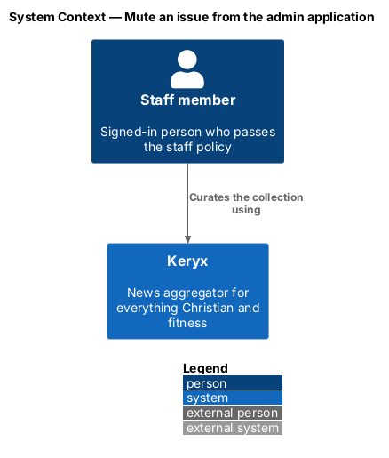
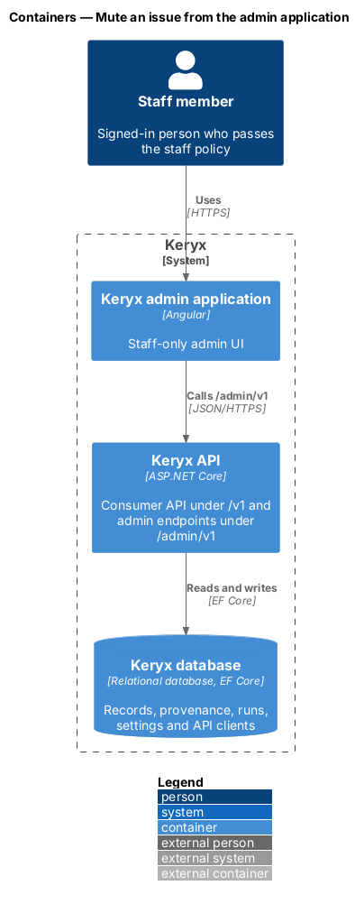
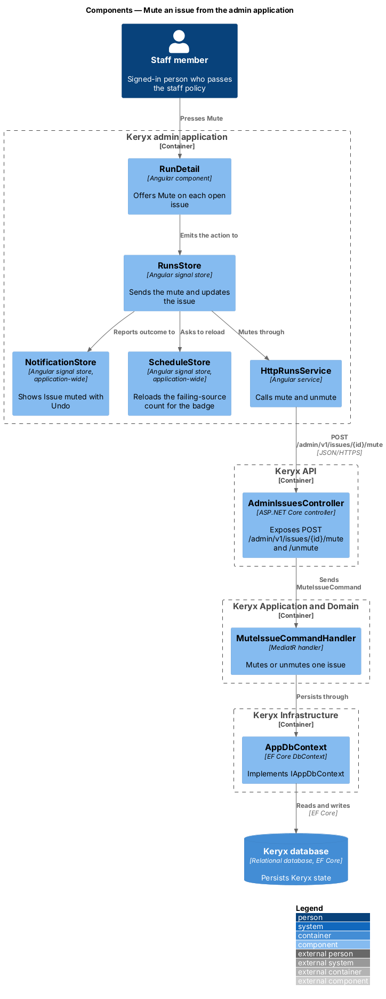
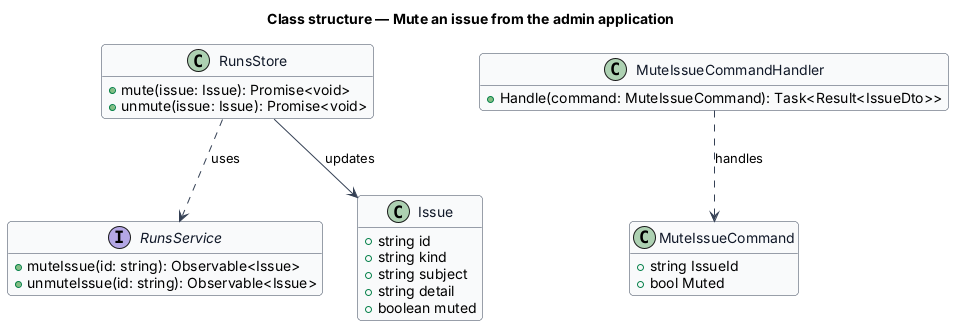
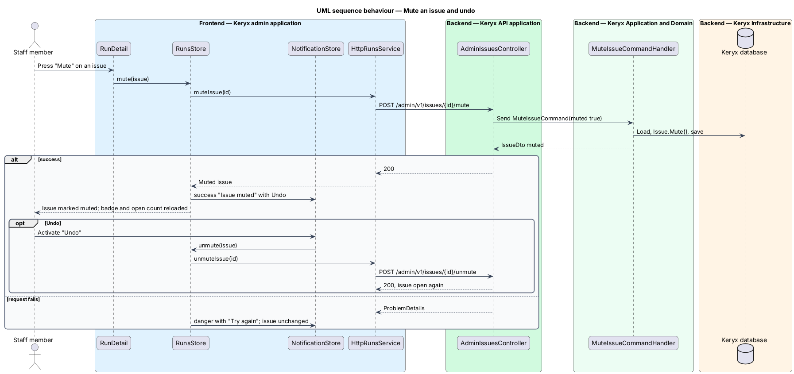

# Mute an issue from the admin application

## Overview

An issue that staff already know about keeps raising alerts and keeps counting as open. *Muting* silences one issue: one kind of problem on one source. A muted issue raises no alert and is not counted as open, so Overview's "Needs attention" and the Runs badge in the navigation no longer count it. It stays listed on its run, marked muted.

Muting is reversible. The success notification carries "Undo", which opens the issue again. The server rule, and the way a mute clears itself when the source recovers, are designed in [Record runs and issues](../../collection/record-runs-and-issues/README.md).

## Description

The slice is the admin-application side of muting: the action on an issue, the notification, and the refresh of the two counts.

- **`RunDetail`** — Angular component in the Keryx admin application. Offers Mute on each open issue.
- **`RunsStore`** — Angular signal store in the Keryx admin application. Sends the mute and updates the issue in the selected run on success. On failure the issue is unchanged and a danger notification offers "Try again".
- **`NotificationStore`** — Angular signal store, application-wide in the Keryx admin application. Shows "Issue muted" and "“Timed out after 30s” no longer raises alerts for Covenant Cycling Collective." with "Undo"; the issue title and the source name are rendered as text.
- **`ScheduleStore`** — Angular signal store, application-wide in the Keryx admin application. Reloads the failing-source count for the badge.
- **`HttpRunsService`** — Angular service in the Keryx admin application. Calls mute and unmute.
- **`AdminIssuesController`** — ASP.NET Core controller in the Keryx API. Exposes POST /admin/v1/issues/{id}/mute and /unmute.
- **`MuteIssueCommandHandler`** — MediatR handler in the Application and Domain layers. Mutes or unmutes one issue.
- **`AppDbContext`** — EF Core DbContext in the Infrastructure layer. Implements IAppDbContext.
- **`MuteIssueCommand`** — MediatR request carrying the issue id and the wanted muted state.

## Requirements

The feature realizes the following level-2 (L2) requirements. Each L2 requirement refines a level-1 (L1) requirement, cited by identifier. The acceptance criteria of each requirement are in [`docs/specs/L2.md`](../../../specs/L2.md).

| L2 ID | Refines (L1) | Requirement |
|-------|--------------|-------------|
| [`L2-060`](../../../specs/L2.md#l2-060-mute-an-issue-from-the-admin-app) | `L1-013` | **Mute an issue from the admin app.** The requirement is defined by its 3 acceptance criteria. |

## Diagrams

### System context

A staff member curates the collection through Keryx.

### Containers

The staff member uses the Keryx admin application. The Keryx admin application calls the Keryx API at `/admin/v1`. The Keryx API reads and writes the Keryx database.

### Components

`RunDetail` emits the action to `RunsStore`, which calls `HttpRunsService`, reports through `NotificationStore` and asks `ScheduleStore` to reload the badge count.

### Class structure

`RunsStore.mute` and `unmute` call the two methods of the `RunsService` contract; the handler toggles `Issue.Muted`.

### Behaviour — mute an issue and undo

A successful mute updates the issue, the notification offers "Undo", and the open counts are reloaded (`L2-060`).

