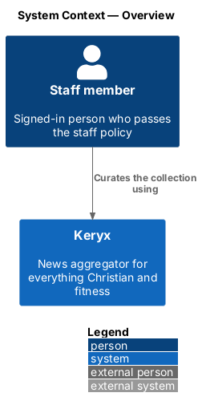
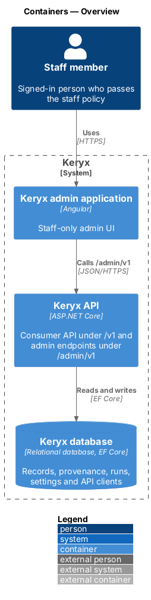
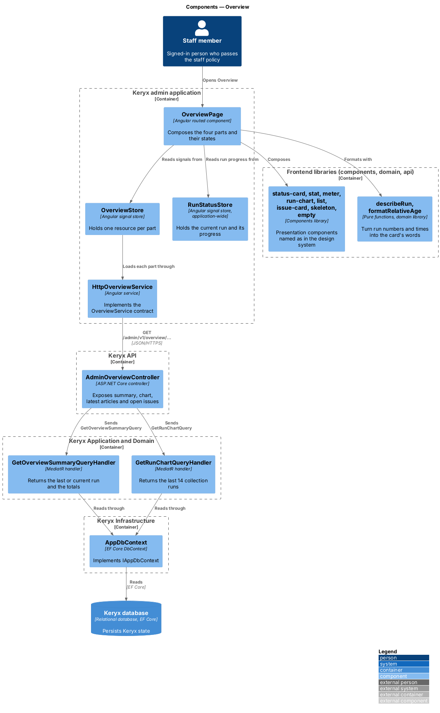
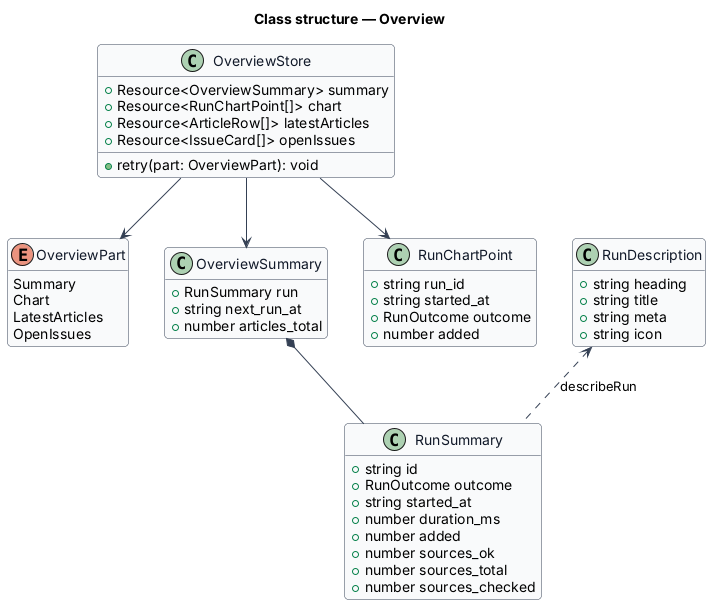
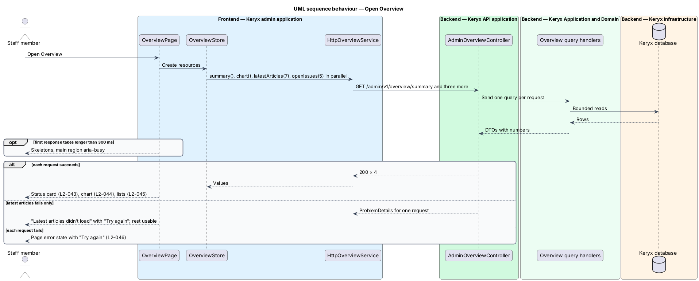

# Overview

## Overview

Overview answers four questions at a glance: did the last run work, what did it bring in, what needs attention, and when is the next one. It is the first screen after sign-in.

The screen has four parts. The *status card* states the last or current run in words and an icon, with three stats. The *run chart* shows new articles for the last 14 runs. "Latest articles" lists the 7 newest of any status. "Needs attention" lists up to 5 open issues, errors first.

Each part loads independently, so a failure of one leaves the others usable. While a run is in progress the card shows progress that updates without a reload.

## Description

The slice is one routed page, one store with a resource per part, and one aggregate endpoint per part. Each number arrives as a number; the page formats times in Toronto time.

- **`OverviewPage`** — Angular routed component in the Keryx admin application. Composes the four parts and their states. It shows skeletons in the shape of the final layout when the first response takes longer than 300 ms, the empty state "Nothing has been collected yet" when no source and no run exist, and the page error state when each request fails.
- **`OverviewStore`** — Angular signal store in the Keryx admin application. Holds one resource per part, so "Latest articles didn't load" appears in its own section with "Try again" while the rest of the page works. It is provided on `OverviewPage`.
- **`RunStatusStore`** — Angular signal store, application-wide in the Keryx admin application. Holds the current run and its progress.
- **`HttpOverviewService`** — Angular service in the Keryx admin application. Implements the OverviewService contract.
- **`status-card, stat, meter, run-chart, list, issue-card, skeleton, empty`** — Components library in the frontend libraries. Presentation components named as in the design system. The `run-chart` gives each bar an accessible label ("Today 6:00 AM: 47 new"), marks a failed or running bar without relying on colour, and emits the run a bar stands for; it is loaded with `@defer`.
- **`describeRun, formatRelativeAge`** — Pure functions, domain library in the frontend libraries. Turn run numbers and times into the card's words: "Completed with 2 failing sources", "Today, 6:00 AM · took 4m 12s · run_2418", "2h ago". The outcome is words and an icon, never colour alone.
- **`AdminOverviewController`** — ASP.NET Core controller in the Keryx API. Exposes summary, chart, latest articles and open issues.
- **`GetOverviewSummaryQueryHandler`** — MediatR handler in the Application and Domain layers. Returns the last or current run and the totals.
- **`GetRunChartQueryHandler`** — MediatR handler in the Application and Domain layers. Returns the last 14 collection runs, oldest first, or fewer when fewer exist, each with its start, outcome and `added`.
- **`AppDbContext`** — EF Core DbContext in the Infrastructure layer. Implements IAppDbContext.
- **`OverviewSummaryDto`** — the last or current run (`id`, `outcome`, `started_at`, `duration_ms`, `added`, `sources_ok`, `sources_total`, `sources_checked`), `next_run_at` and `articles_total`.
- **`RunChartPointDto`** — `run_id`, `started_at`, `outcome` and `added`.

Activating a bar or an issue card opens that run on the Runs screen in the same tab; "All runs" and "View all 18,432" open Runs and Articles (L2-044, L2-045).

## Requirements

The feature realizes the following level-2 (L2) requirements. Each L2 requirement refines a level-1 (L1) requirement, cited by identifier. The acceptance criteria of each requirement are in [`docs/specs/L2.md`](../../../specs/L2.md).

| L2 ID | Refines (L1) | Requirement |
|-------|--------------|-------------|
| [`L2-043`](../../../specs/L2.md#l2-043-overview-status-card) | `L1-011` | **Overview status card.** The requirement is defined by its 6 acceptance criteria. |
| [`L2-044`](../../../specs/L2.md#l2-044-overview-run-chart) | `L1-011` | **Overview run chart.** The requirement is defined by its 5 acceptance criteria. |
| [`L2-045`](../../../specs/L2.md#l2-045-overview-latest-articles-and-needs-attention) | `L1-011` | **Overview latest articles and needs attention.** The requirement is defined by its 6 acceptance criteria. |
| [`L2-046`](../../../specs/L2.md#l2-046-overview-loading-empty-and-error) | `L1-011` | **Overview loading, empty and error.** The requirement is defined by its 3 acceptance criteria. |

## Diagrams

### System context

A staff member curates the collection through Keryx.

### Containers

The staff member uses the Keryx admin application. The Keryx admin application calls the Keryx API at `/admin/v1`. The Keryx API reads and writes the Keryx database.

### Components

`OverviewPage` reads `OverviewStore` and `RunStatusStore` and composes library components. `HttpOverviewService` calls `AdminOverviewController`, which sends one query per part.

### Class structure

`OverviewStore` exposes four independent resources. `describeRun` maps an `OverviewSummary` to a `RunDescription`.

### Behaviour — open Overview

The four requests run in parallel and each resolves on its own (`L2-045`). Skeletons appear only when the first response takes longer than 300 ms (`L2-046`).

