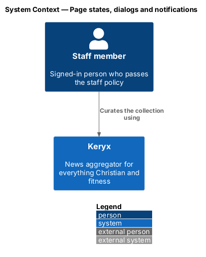
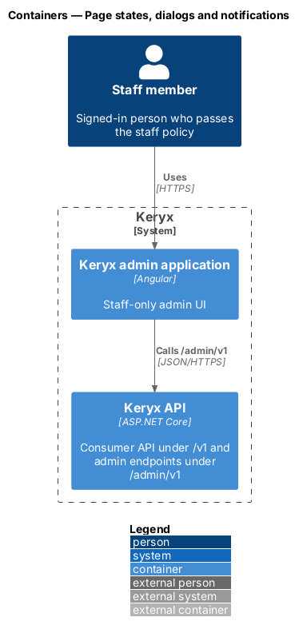
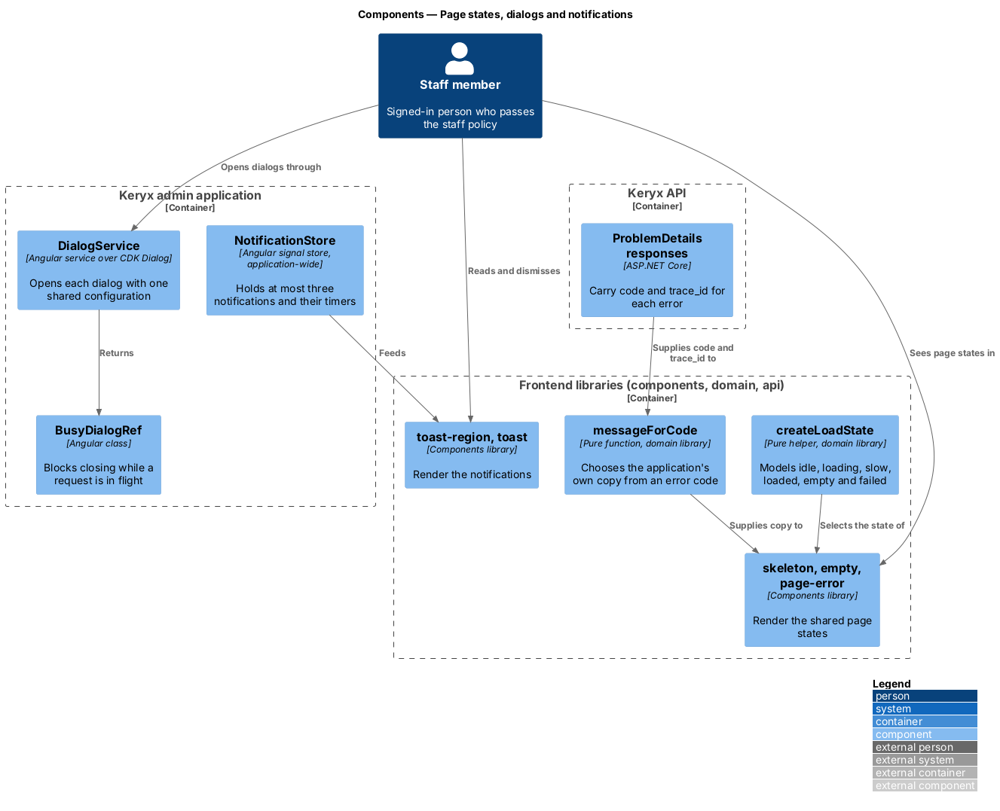
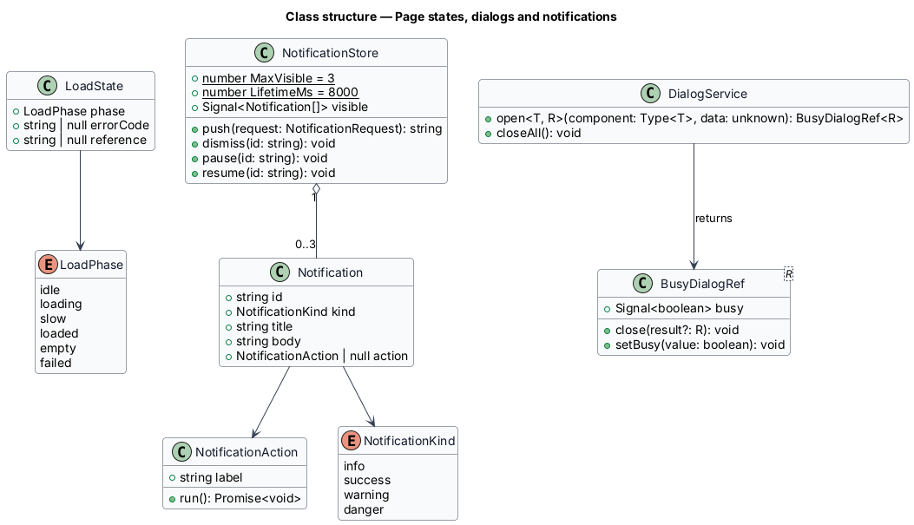
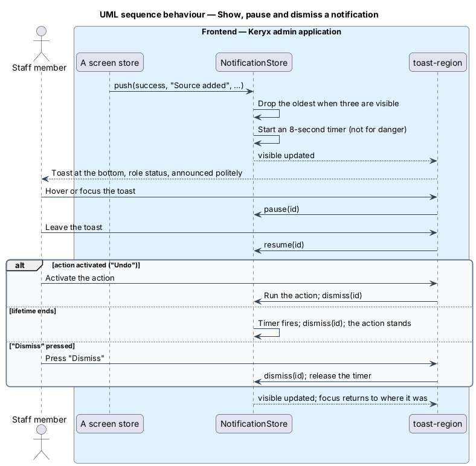

# Page states, dialogs and notifications

## Overview

Each screen and dialog of the admin application shows a designed state for loading, empty, error, no results, invalid input, busy and success, and each action reports its outcome. This feature fixes the three behaviours that the screens share, so that each screen composes them instead of inventing its own.

*Page states* cover loading skeletons, the page error state, and the difference between empty and no results. *Dialog behaviour* covers focus, closing, in-flight requests and the bottom sheet on narrow viewports. *Notifications* cover kinds, lifetimes, stacking and "Undo".

> **empty state** — state of a page with nothing to show because nothing exists yet

> **no-results state** — state of a page in which a filter matches nothing

> **notification** — short message in a region fixed to the bottom of the viewport that reports the outcome of an action

## Description

The slice is three small pieces of shared application code and the library components they drive. Each holds its many-case logic in a store or a helper with unit tests.

- **`createLoadState`** — Pure helper, domain library in the frontend libraries. Models idle, loading, slow, loaded, empty and failed. `slow` begins 300 ms after loading starts, so a fast response shows no skeleton. The main region carries `aria-busy="true"` while loading, and a skeleton does not animate under reduced motion.
- **`messageForCode`** — Pure function, domain library in the frontend libraries. Chooses the application's own generic copy from an error `code`; the server's `title` and `detail` are never shown. The response's `trace_id` appears as "Reference req_…".
- **`skeleton, empty, page-error`** — Components library in the frontend libraries. Render the shared page states. The page error state reads "&lt;Page> didn't load" with the sentence about collection, the reference, "Try again" and "Go to overview"; the shell stays usable. An offline failure uses the same state.
- **`DialogService`** — Angular service over CDK Dialog in the Keryx admin application. Opens each dialog as a CDK Dialog with `role="dialog"`, `aria-modal="true"`, a name from its title and a description from its lead text, a focus trap, an inert non-scrolling page behind, and focus restored to the opener on close. Below 640 px the panel is a bottom sheet no taller than the viewport with its actions always visible. It closes an open dialog by its ref before a navigation.
- **`BusyDialogRef`** — Angular class in the Keryx admin application. Blocks Escape, the Close button and the backdrop while a request is in flight, and keeps the submit button from a second activation. A destructive dialog starts focus on "Cancel".
- **`NotificationStore`** — Angular signal store, application-wide in the Keryx admin application. Holds at most three notifications, newest at the bottom; a fourth dismisses the oldest. Info, success and warning dismiss after 8 seconds, pausing while hovered or focused, and are announced with `role="status"`. Danger stays until dismissed or its action succeeds and is announced with `role="alert"`. Each timer is released when its notification is dismissed or the region is destroyed. "Undo" reverses the action at any point in the lifetime.
- **`toast-region, toast`** — Components library in the frontend libraries. Render the notifications bottom right, 24 rem wide from 640 px and full width below, with an icon and a title that carry the kind in more than colour, one optional action and "Dismiss". Text from a source is bound as text. Dismissing returns focus to where it was.
- **`ProblemDetails responses`** — ASP.NET Core in the Keryx API. Carry code and trace_id for each error.
- **`LoadState`** — discriminated union `idle`, `loading`, `slow`, `loaded`, `empty`, `failed` with the error code and reference.
- **`Notification`** — `id`, `kind`, `title`, `body`, optional `action` and the timer handle.

No editing happens inline on any page: adding or editing a source, a key or a chip value opens a dialog (L2-074).

## Requirements

The feature realizes the following level-2 (L2) requirements. Each L2 requirement refines a level-1 (L1) requirement, cited by identifier. The acceptance criteria of each requirement are in [`docs/specs/L2.md`](../../../specs/L2.md).

| L2 ID | Refines (L1) | Requirement |
|-------|--------------|-------------|
| [`L2-073`](../../../specs/L2.md#l2-073-page-states) | `L1-017` | **Page states.** Every page has the states its mock coverage table lists. This requirement fixes what the shared ones mean. |
| [`L2-074`](../../../specs/L2.md#l2-074-dialog-behaviour) | `L1-017` | **Dialog behaviour.** The requirement is defined by its 7 acceptance criteria. |
| [`L2-075`](../../../specs/L2.md#l2-075-notifications) | `L1-017` | **Notifications.** The requirement is defined by its 8 acceptance criteria. |

## Diagrams

### System context

A staff member curates the collection through Keryx.

### Containers

The staff member uses the Keryx admin application. The Keryx admin application calls the Keryx API at `/admin/v1`.

### Components

Screen stores build on `createLoadState` and `messageForCode` and render `skeleton`, `empty` and `page-error`. Dialogs open through `DialogService` with a `BusyDialogRef`. Outcomes go to `NotificationStore`, rendered by `toast-region`.

### Class structure

`LoadState` and `Notification` are the two data shapes. `NotificationStore` bounds its list to `MaxVisible` and owns each timer.

### Behaviour — show, pause and dismiss a notification

The store owns the 8-second timer, pauses it on hover or focus, and never auto-dismisses a danger notification (`L2-075`).

