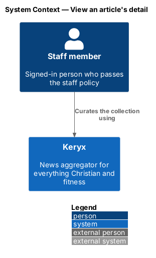
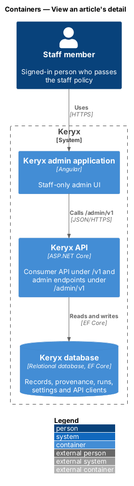
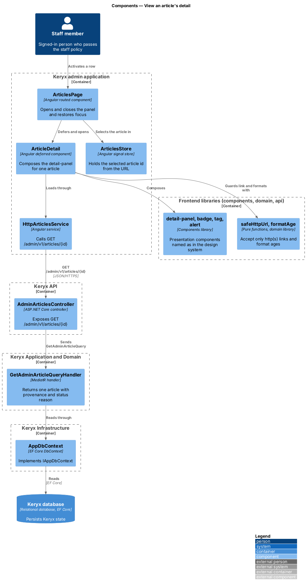
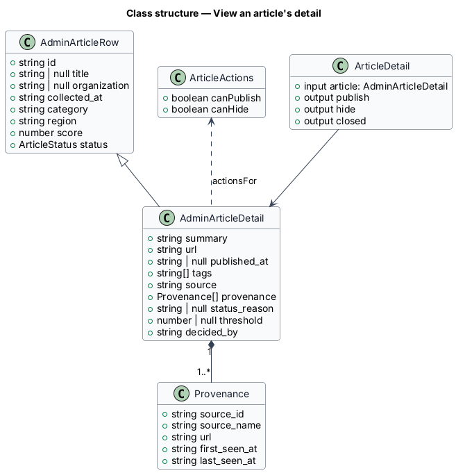
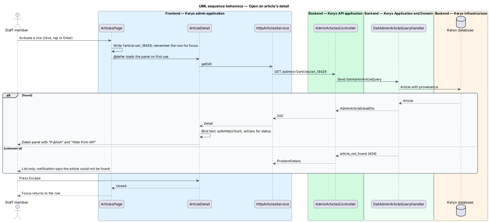

# View an article's detail

## Overview

Activating a row on the Articles screen opens the *detail panel* for that article. The panel shows the id, the status, the title, the summary, a link to the original, and the organisation, source, category, region, published and collected times, relevance and tags. For a held article it says why it was held.

Everything in the panel came from a source, so it is untrusted. Each value is rendered as text, never as HTML. "Open original" is a link only when the URL is `http` or `https`, and it opens in a new tab with `rel="noopener noreferrer"`. Extreme values wrap inside the panel: a title of 300 characters, an organization name of 120, 30 tags, right-to-left text.

## Description

The slice is a deferred panel component fed by the article id in the URL, and one admin endpoint that returns an article with its provenance.

- **`ArticlesPage`** — Angular routed component in the Keryx admin application. Opens the panel on click, tap or Enter and writes `?article=art_…` to the URL. From 1024 px the panel sits beside the usable table; below, it covers the screen with a Close button. Close or Escape returns focus to the row that opened the panel. An id in the URL that does not exist opens no panel and raises a notification.
- **`ArticleDetail`** — Angular deferred component in the Keryx admin application. Composes the `detail-panel` for one article. A held article shows "Held because its relevance score is below the 0.60 publish threshold." with the threshold in force when it was collected, and the actions "Publish" and "Hide from API"; a published article offers only "Hide from API" and a hidden one only "Publish". Titles carry `dir="auto"`.
- **`ArticlesStore`** — Angular signal store in the Keryx admin application. Holds the selected article id from the URL.
- **`HttpArticlesService`** — Angular service in the Keryx admin application. Calls GET /admin/v1/articles/{id}.
- **`detail-panel, badge, tag, alert`** — Components library in the frontend libraries. Presentation components named as in the design system.
- **`safeHttpUrl, formatAge`** — Pure functions, domain library in the frontend libraries. `safeHttpUrl` returns a URL only when its scheme is `http` or `https`; otherwise "Open original" renders as text. `formatAge` gives minutes under an hour, hours under a day, and days otherwise ("1,204d ago").
- **`AdminArticlesController`** — ASP.NET Core controller in the Keryx API. Exposes GET /admin/v1/articles/{id}.
- **`GetAdminArticleQueryHandler`** — MediatR handler in the Application and Domain layers. Returns one article with its provenance entries, `status_reason` and `threshold`. An unknown or malformed id answers `404` with `code` `article_not_found`.
- **`AppDbContext`** — EF Core DbContext in the Infrastructure layer. Implements IAppDbContext.
- **`AdminArticleDetailDto`** — the row fields plus `summary`, `url`, `published_at`, `tags`, `source`, `provenance`, `status_reason`, `threshold` and `decided_by`.

## Requirements

The feature realizes the following level-2 (L2) requirements. Each L2 requirement refines a level-1 (L1) requirement, cited by identifier. The acceptance criteria of each requirement are in [`docs/specs/L2.md`](../../../specs/L2.md).

| L2 ID | Refines (L1) | Requirement |
|-------|--------------|-------------|
| [`L2-051`](../../../specs/L2.md#l2-051-article-detail-panel) | `L1-012` | **Article detail panel.** The requirement is defined by its 7 acceptance criteria. |
| [`L2-053`](../../../specs/L2.md#l2-053-untrusted-and-extreme-article-text) | `L1-012` | **Untrusted and extreme article text.** The requirement is defined by its 7 acceptance criteria. |

## Diagrams

### System context

A staff member curates the collection through Keryx.

### Containers

The staff member uses the Keryx admin application. The Keryx admin application calls the Keryx API at `/admin/v1`. The Keryx API reads and writes the Keryx database.

### Components

`ArticlesPage` defers `ArticleDetail`, which loads through `HttpArticlesService` and renders library components with values passed through `safeHttpUrl` and `formatAge`.

### Class structure

`AdminArticleDetail` extends the row with provenance and the reason it was held. `ArticleActions` derives the available actions from the status.

### Behaviour — open an article's detail

The panel's code loads on first use, the article id goes to the URL (`L2-051`), and each source value is bound as text (`L2-053`).

