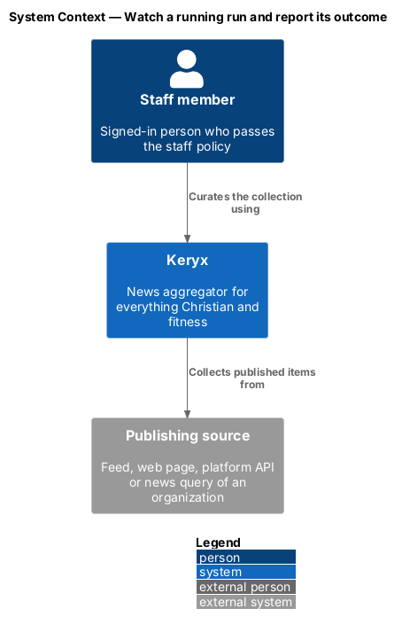
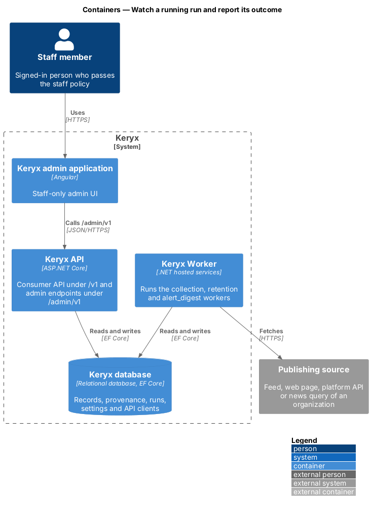
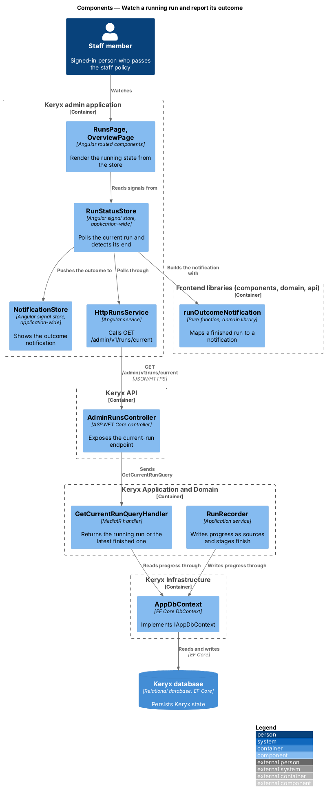
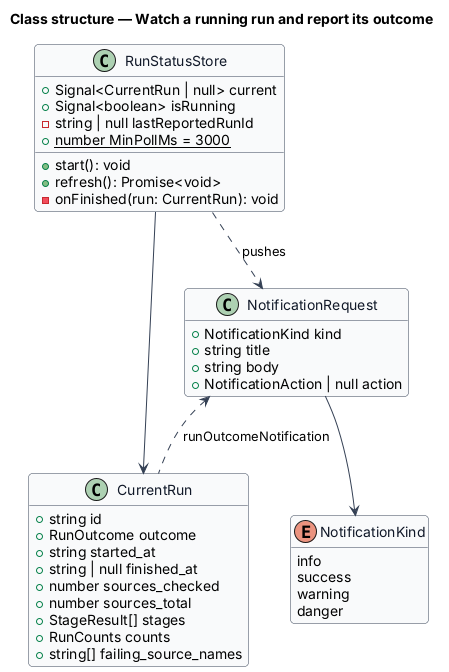
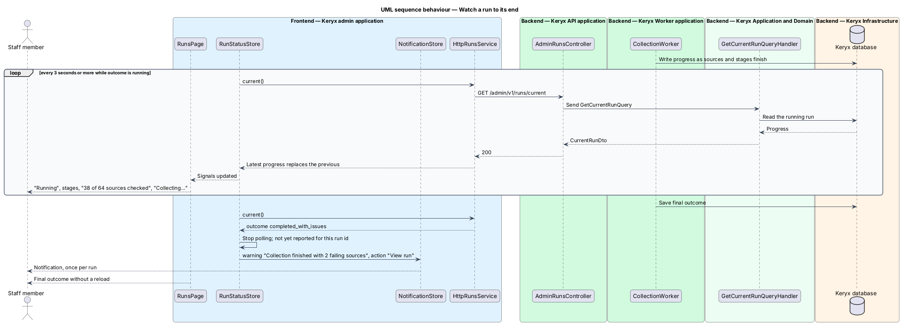

# Watch a running run and report its outcome

## Overview

A collection takes minutes. While a run is in progress the admin application shows it live: the run is first in the Runs list as "Running", its stages move from not run to running to done, its counts advance, and "Run now" is a disabled "Collecting…".

When a run ends while the application is open, on any screen, a notification reports the outcome once per run: success with the number of new articles, a warning that names up to two failing sources with "View run", or a danger notification with "Retry now". This holds for a scheduled run as for one a staff member started.

> **progress** — latest state of a running run: stage statuses, sources checked and counts so far

## Description

The slice is one application-wide store that polls one endpoint. Polling is the transport: the client asks no more often than every 3 seconds and stops when the run ends.

- **`RunStatusStore`** — Angular signal store, application-wide in the Keryx admin application. Polls the current run with an interval of at least 3 seconds while a run is in progress, and at the scheduled time otherwise. It keeps only the latest progress. It remembers the id of the last run it reported, so each run is notified once. Its timer and in-flight request are released when the application is destroyed.
- **`RunsPage, OverviewPage`** — Angular routed components in the Keryx admin application. Render the running state from the store.
- **`NotificationStore`** — Angular signal store, application-wide in the Keryx admin application. Shows the outcome notification.
- **`runOutcomeNotification`** — Pure function, domain library in the frontend libraries. Maps a finished run to a notification: "Collection finished" with "47 new articles from 64 sources."; "Collection finished with 2 failing sources" with "View run"; "Collection failed" with "Retry now".
- **`HttpRunsService`** — Angular service in the Keryx admin application. Calls GET /admin/v1/runs/current.
- **`AdminRunsController`** — ASP.NET Core controller in the Keryx API. Exposes the current-run endpoint.
- **`GetCurrentRunQueryHandler`** — MediatR handler in the Application and Domain layers. Returns the running run, or the latest finished one, with stage statuses, `sources_checked`, `sources_total` and the counts so far.
- **`RunRecorder`** — Application service in the Application and Domain layers. Writes progress as sources and stages finish, so the API reads live values from the database the worker shares.
- **`AppDbContext`** — EF Core DbContext in the Infrastructure layer. Implements IAppDbContext.
- **`CurrentRunDto`** — `id`, `outcome`, `trigger`, `started_at`, `finished_at`, `sources_checked`, `sources_total`, `stages`, the counts and the names of up to two failing sources.

The polling of the selected run's detail on the Runs screen belongs to `RunsStore` and stops when the screen is left; `RunStatusStore` alone outlives a screen (L2-058, L2-089).

## Requirements

The feature realizes the following level-2 (L2) requirements. Each L2 requirement refines a level-1 (L1) requirement, cited by identifier. The acceptance criteria of each requirement are in [`docs/specs/L2.md`](../../../specs/L2.md).

| L2 ID | Refines (L1) | Requirement |
|-------|--------------|-------------|
| [`L2-058`](../../../specs/L2.md#l2-058-running-run) | `L1-013` | **Running run.** The requirement is defined by its 4 acceptance criteria. |
| [`L2-076`](../../../specs/L2.md#l2-076-collection-outcome-notifications) | `L1-017` | **Collection outcome notifications.** The requirement is defined by its 5 acceptance criteria. |

## Diagrams

### System context

A staff member curates the collection through Keryx. Keryx collects published items from publishing sources.

### Containers

The staff member uses the Keryx admin application. The Keryx admin application calls the Keryx API at `/admin/v1`. The Keryx API reads and writes the Keryx database. The Keryx Worker reads and writes the Keryx database. The Keryx Worker fetches the publishing source.

### Components

`RunStatusStore` polls through `HttpRunsService`; the pages render its signals and `runOutcomeNotification` feeds `NotificationStore`. The worker's `RunRecorder` writes the progress that `GetCurrentRunQueryHandler` reads.

### Class structure

`RunStatusStore` exposes `current` and derives `isRunning`; `runOutcomeNotification` returns a `NotificationRequest`.

### Behaviour — watch a run to its end

The store polls at most every 3 seconds, replaces its progress on each answer and stops at the end of the run (`L2-058`), then reports the outcome once (`L2-076`).

