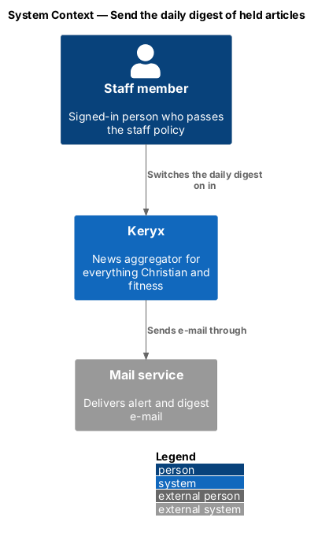
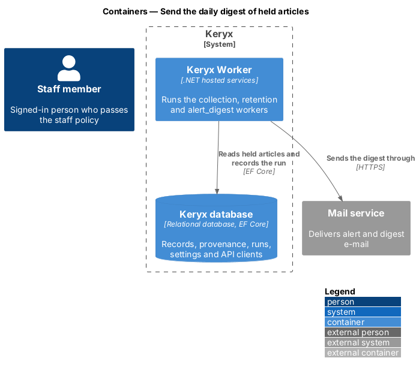
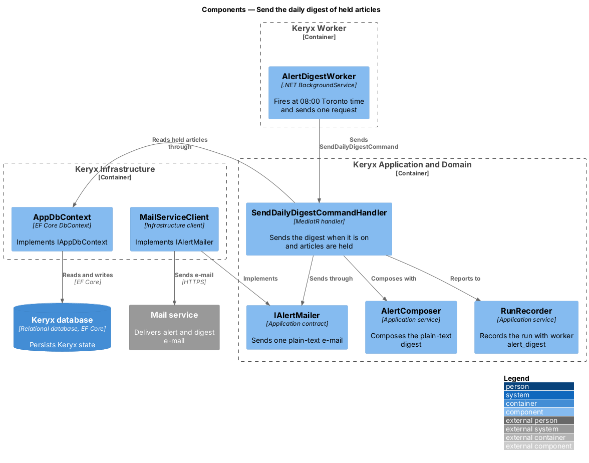
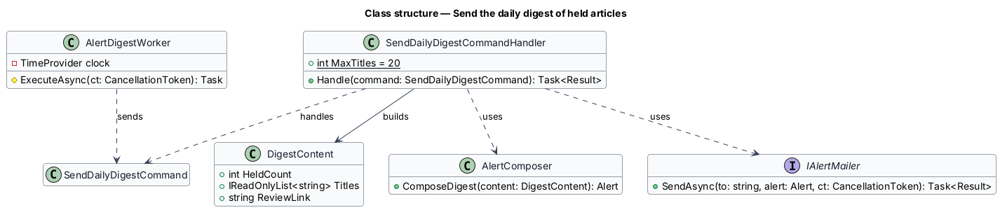
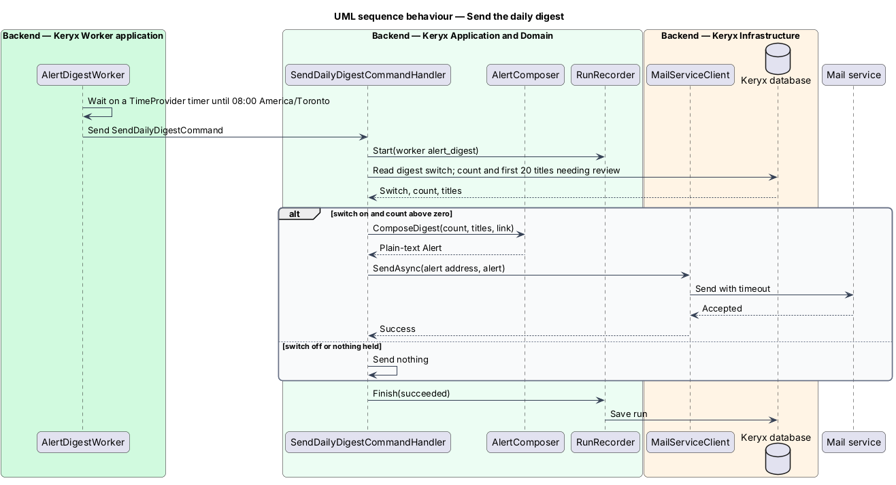

# Send the daily digest of held articles

## Overview

Articles that score between the review floor and the publish threshold wait for a staff decision. When "Daily digest of held articles" is on in Settings, Keryx sends one e-mail each day at 08:00 Toronto time that gives the number of held articles, up to 20 of their titles as text, and a link to the Articles screen filtered to "Needs review".

No e-mail is sent when no article needs review or when the switch is off. The digest is the work of the third worker, `alert_digest`, and each of its runs is recorded like any other run.

## Description

The slice is one hosted service and one handler that reuse the alert mailer contract.

- **`AlertDigestWorker`** — .NET BackgroundService in the Keryx Worker. Fires at 08:00 in `America/Toronto` on `TimeProvider`, so the time holds across a clock change, and sends `SendDailyDigestCommand`.
- **`SendDailyDigestCommandHandler`** — MediatR handler in the Application and Domain layers. Reads the switch and the count of articles with status `needs_review`. It sends one e-mail when the switch is on and the count is above zero, and records its run in each case.
- **`AlertComposer`** — Application service in the Application and Domain layers. Composes the plain-text digest: the count, up to 20 titles as text, and a link to Articles with `?status=needs_review`.
- **`IAlertMailer`** — Application contract in the Application and Domain layers. Sends one plain-text e-mail.
- **`RunRecorder`** — Application service in the Application and Domain layers. Records the run with worker alert_digest.
- **`MailServiceClient`** — Infrastructure client in the Infrastructure layer. Implements IAlertMailer.
- **`AppDbContext`** — EF Core DbContext in the Infrastructure layer. Implements IAppDbContext.
- **`SendDailyDigestCommand`** — MediatR request with no fields.

## Requirements

The feature realizes the following level-2 (L2) requirements. Each L2 requirement refines a level-1 (L1) requirement, cited by identifier. The acceptance criteria of each requirement are in [`docs/specs/L2.md`](../../../specs/L2.md).

| L2 ID | Refines (L1) | Requirement |
|-------|--------------|-------------|
| [`L2-078`](../../../specs/L2.md#l2-078-daily-digest-of-held-articles) | `L1-018` | **Daily digest of held articles.** The requirement is defined by its 4 acceptance criteria. |

## Diagrams

### System context

The staff member switches the daily digest on in Keryx. Keryx sends e-mail through the mail service.

### Containers

The Keryx Worker reads held articles and records the run the Keryx database. The Keryx Worker sends the digest through the mail service.

### Components

`AlertDigestWorker` sends one command; `SendDailyDigestCommandHandler` reads through `IAppDbContext`, composes with `AlertComposer`, sends through `IAlertMailer` and reports to `RunRecorder`.

### Class structure

`SendDailyDigestCommandHandler` builds a `DigestContent` from held articles and passes the composed `Alert` to `IAlertMailer`.

### Behaviour — send the daily digest

The handler sends nothing when the switch is off or nothing is held, and records its run in each case (`L2-078`).

