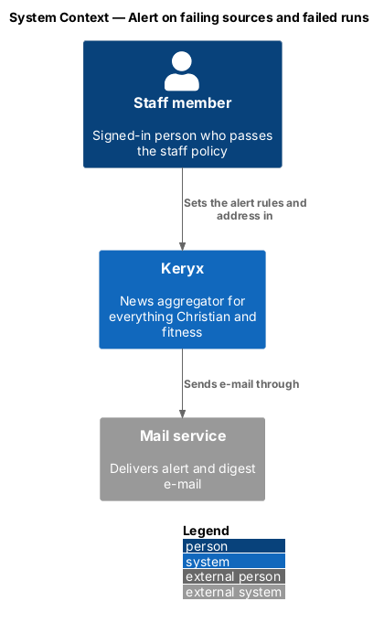
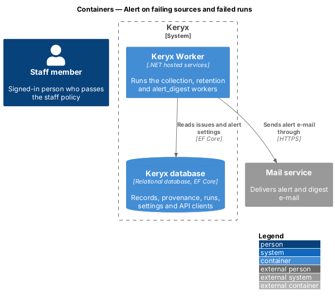
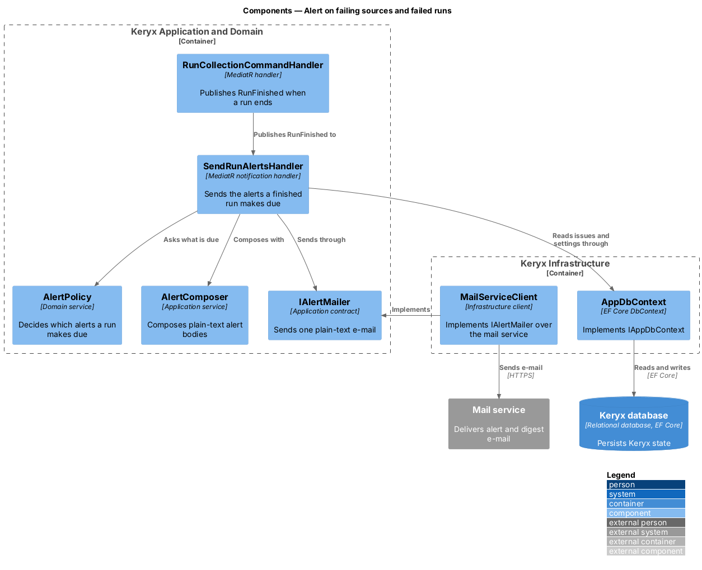
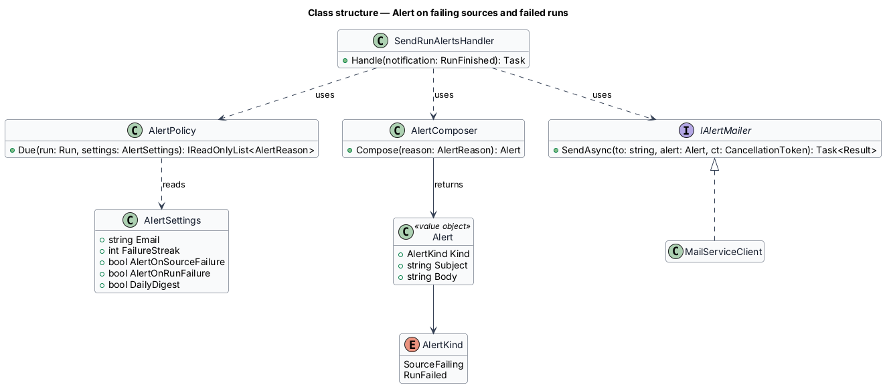
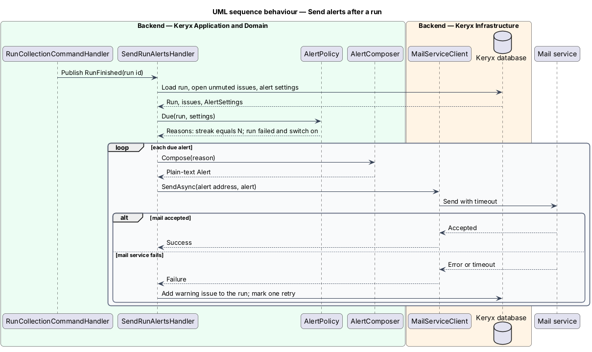

# Alert on failing sources and failed runs

## Overview

Keryx tells the people who run it when collection needs attention. Settings holds an alert address and two rules: "Alert when a source fails N runs in a row" (N from 1 to 20) and "When a whole run fails".

An alert is sent once per streak. With N = 3, the third consecutive failure of a source sends one e-mail that names the source, the reason and the streak; the fourth and later failures of that streak send nothing. A source that recovers and later fails 3 runs in a row again sends a new e-mail. A muted issue sends nothing.

A failure of the mail service does not change the run's outcome. It is recorded as a warning issue on the run and retried on the next run at most.

> **alert** — plain-text e-mail to the alert address about a failing source or a failed run

## Description

The slice runs at the end of each collection run. A domain policy decides which alerts are due; an Application contract sends them, with its client in the Infrastructure layer.

- **`RunCollectionCommandHandler`** — MediatR handler in the Application and Domain layers. Publishes RunFinished when a run ends.
- **`SendRunAlertsHandler`** — MediatR notification handler in the Application and Domain layers. Sends the alerts a finished run makes due. A mailer failure adds a warning issue to the run, marks the alert for one retry on the next run, and leaves the run's outcome unchanged.
- **`AlertPolicy`** — Domain service in the Application and Domain layers. Decides which alerts a run makes due: a source alert when an unmuted issue's `consecutive_runs` equals N exactly, and a run alert when the outcome is `failed` and the switch is on. Equality with N, not at-least, gives one alert per streak.
- **`AlertComposer`** — Application service in the Application and Domain layers. Composes plain-text bodies that name the source, the reason and the streak, or the run, the failed stage and a generic reason. A body links only to the admin application and holds no connection string, key or stack trace.
- **`IAlertMailer`** — Application contract in the Application and Domain layers. Sends one plain-text e-mail.
- **`MailServiceClient`** — Infrastructure client in the Infrastructure layer. Implements `IAlertMailer` over the mail service, with a timeout on each call and credentials from configuration. The mail service product is `<TO SUPPLY>`.
- **`AppDbContext`** — EF Core DbContext in the Infrastructure layer. Implements IAppDbContext.
- **`RunFinished`** — MediatR notification carrying the run id.
- **`Alert`** — value with `Kind` (`SourceFailing`, `RunFailed`), subject line and plain-text body.
- **`AlertSettings`** — alert address, failure streak N, and the two switches.

## Requirements

The feature realizes the following level-2 (L2) requirements. Each L2 requirement refines a level-1 (L1) requirement, cited by identifier. The acceptance criteria of each requirement are in [`docs/specs/L2.md`](../../../specs/L2.md).

| L2 ID | Refines (L1) | Requirement |
|-------|--------------|-------------|
| [`L2-077`](../../../specs/L2.md#l2-077-alerts-for-failing-sources-and-failed-runs) | `L1-018` | **Alerts for failing sources and failed runs.** The requirement is defined by its 6 acceptance criteria. |

## Diagrams

### System context

The staff member sets the alert rules and address in Keryx. Keryx sends e-mail through the mail service.

### Containers

The Keryx Worker reads issues and alert settings the Keryx database. The Keryx Worker sends alert e-mail through the mail service.

### Components

`RunCollectionCommandHandler` publishes `RunFinished`; `SendRunAlertsHandler` asks `AlertPolicy` what is due, composes with `AlertComposer` and sends through `IAlertMailer`, which `MailServiceClient` realizes.

### Class structure

`AlertPolicy` maps a `Run`, its issues and `AlertSettings` to a list of `Alert`. `IAlertMailer` is the only way out of the Application layer.

### Behaviour — send alerts after a run

The policy yields an alert only on the run where the streak reaches N (`L2-077`). A mail failure becomes a warning issue and does not change the outcome.

