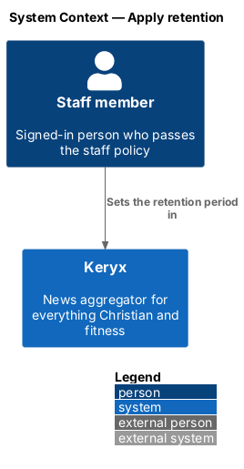
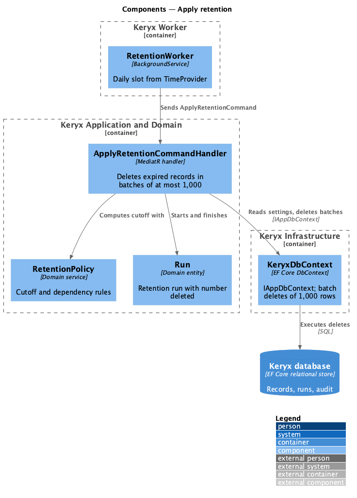
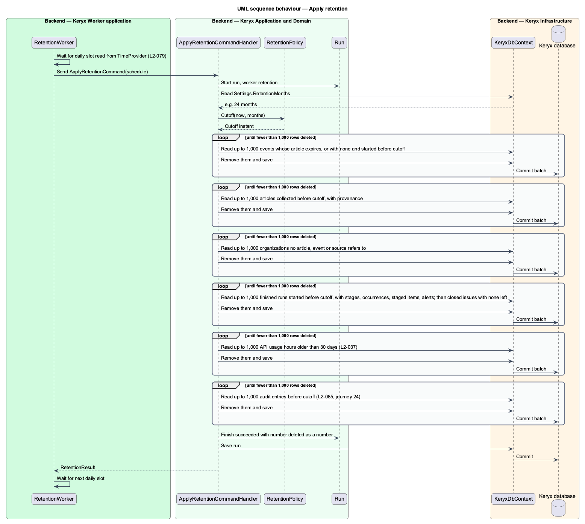
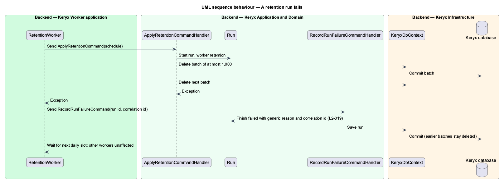

# Apply retention

## Overview

Keryx keeps records only as long as staff decide. Staff set a retention period in Settings
("Keep articles for", 1 to 120 months, `L2-070`). Once a day a background worker deletes every
record older than that period, together with everything that depends only on it. This feature
is that worker and the rule it applies.

- **retention period** — number of months, set in Settings, after which a record is deleted
- **cutoff** — instant before which a record counts as expired: the time read from `TimeProvider` minus the retention period
- **retention run** — one daily execution of the retention worker, recorded like every other worker run with worker `retention`
- **dependent record** — record that exists only because of another one, such as a provenance entry of an article or a stage result of a run
- **batch** — one delete of at most 1,000 rows, committed on its own

An article expires when its collected time is earlier than the cutoff. It is deleted with its
provenance entries, and its public id is never given to another record. An event linked only to
deleted articles is deleted with them. An organization is kept while any article, event or
source refers to it, and is deleted once none does. Run records older than the cutoff are
deleted with their stage results and issues. Audit entries older than the cutoff are deleted
too (`L2-085`, designed in the operations subsystem).

The worker reads the retention period at the start of every run. A shortened period therefore
takes effect at the next run, with no backfill job. The worker is one of three workers
(`collection`, `retention`, `alert_digest`); a failure in one does not stop the others
(`L2-019`).

## Description

The slice runs from a hosted service in the worker through one MediatR command to the database.

**Worker (`Keryx.Worker`)**

- **`RetentionWorker`** — `BackgroundService` that waits for the next daily slot by reading
  `TimeProvider` and sends one `ApplyRetentionCommand` with trigger `schedule`. It checks
  nothing itself. The slot is 03:00 Toronto time, outside the 08:00 digest and the working day;
  03:00 is never skipped or repeated in Toronto, whose clocks change at 02:00. A test proves the schedule by
  advancing `FakeTimeProvider`, never by sleeping. When the command throws, the worker sends
  `RecordRunFailureCommand` (run recording subsystem, `L2-019`) and waits for the next slot. As
  for every worker, the run recording behaviour fails the run its lease names, and the worker
  logs the exception's type alone.

**Application (`Keryx.Application`)**

- **`ApplyRetentionCommand`** — request carrying `RunTrigger Trigger`.
- **`ApplyRetentionCommandHandler`** — opens a `Run` with worker `retention`, reads
  `Settings.RetentionMonths`, computes the cutoff from `TimeProvider`, and deletes expired
  records through `IAppDbContext` in batches of at most 1,000 rows, in this order:
  1. events whose linked article expires, and events with no linked article whose start time
     is earlier than the cutoff (every event is created with the article it was found in; one
     has none only if that article went another way). Events go first because deleting an
     article sets its events' link to null;
  2. articles whose `CollectedAt` is earlier than the cutoff, with their provenance entries;
  3. organizations that no article, event or source refers to (a source refers to the
     organization whose normalized name is its organization name's);
  4. finished runs whose `StartedAt` is earlier than the cutoff, with their stage results, their
     issue occurrences, their staged items and their alert records; then closed issues left
     with no occurrence. A running run is never deleted, and an open or muted issue is kept;
  5. API usage hours older than 30 days, whatever the retention period (`L2-037` AC5);
  6. audit entries whose `OccurredAt` is earlier than the cutoff, added by journey 24 with the
     audit log, which does not exist before it.
  It finishes the run with the number deleted as a number.
- **`RetentionPolicy`** — pure domain service holding `Cutoff(now, months)` and the dependency
  rules above, with a direct unit test per case.
- **`RetentionResult`** — counts per record type and their total `Deleted`.

**Domain (`Keryx.Domain`)**

- **`Settings`** — holds `RetentionMonths` (1 to 120).
- **`Article`**, **`Event`**, **`Organization`**, **`Provenance`**, **`Run`**, **`StageResult`**,
  **`RunIssue`**, **`AuditEntry`** — the entities the worker deletes.
- **`PublicId`** — prefixed public id (`art_`, `run_`, `src_`, `org_`). Generation, designed with
  stable identity (`L2-009`), never derives an id from a value that a delete frees, so a deleted
  record's id is never reused.
- **`Run`** — recorded with worker `retention`, trigger, `started_at`, `finished_at`, outcome and
  the number deleted, in a count named `deleted` beside the collection counts. It is added to
  the run's detail (`GET /admin/v1/runs/{id}`) as a number; every other worker's runs read 0.
  The run list's summaries carry a few collection counts only and are unchanged. An added
  field breaks no client of the admin API.

**Infrastructure (`Keryx.Infrastructure`)**

- **`KeryxDbContext`** — maps the cascade from article to provenance and from run to stage
  result and issue. Each batch reads at most 1,000 expired rows, removes them and saves, so it
  commits on its own and a failure keeps the batches already committed. A tracked delete is
  used rather than a set-based one (`ExecuteDeleteAsync`): it deletes owned provenance and
  stage results with their owner on every provider, and it runs on the EF Core InMemory
  provider, which has no set-based delete. Tests prove the batches by arming a save fault
  through `IAppDbContext` after a number of saves, and count what was kept.

**Admin app and API**

- No screen or endpoint is added. The retention period is edited on Settings (`L2-070`), and a
  retention run is readable through `GET /admin/v1/runs/{id}` (`L2-019`).

## Requirements

The feature realizes the following level-2 (L2) requirements. Each L2 requirement refines a
level-1 (L1) requirement, cited by identifier. Their acceptance criteria are in
[L2.md](../../../specs/L2.md).

| L2 ID | Refines (L1) | Requirement |
|-------|--------------|-------------|
| `L2-079` | `L1-019` | Retention — Records older than the retention period staff set are deleted, together with everything that depends only on them. |

## Diagrams

### System context

Retention involves no external system. Staff set the period through Keryx, and Keryx removes
what has expired.

### Containers

The Keryx Worker deletes expired records in the Keryx database. The Keryx API serves the
retention period to Settings and the retention run to staff.

### Components

`RetentionWorker` sends `ApplyRetentionCommand`; the handler applies `RetentionPolicy` and
deletes in batches through `IAppDbContext`, then records the run.

### Class structure

`ApplyRetentionCommandHandler` reads `Settings`, uses `RetentionPolicy` for the cutoff, and
records a `Run` with a `RetentionResult`.

### Behaviour — apply retention

At the daily slot the worker sends one command. The handler deletes expired articles, dependent
events, orphaned organizations, old runs and old audit entries, at most 1,000 rows per batch,
and records the number deleted.

### Behaviour — a retention run fails

A failure part-way keeps the committed batches, records the run as `failed` with a generic
reason, and leaves the next daily run and the other workers unaffected.

