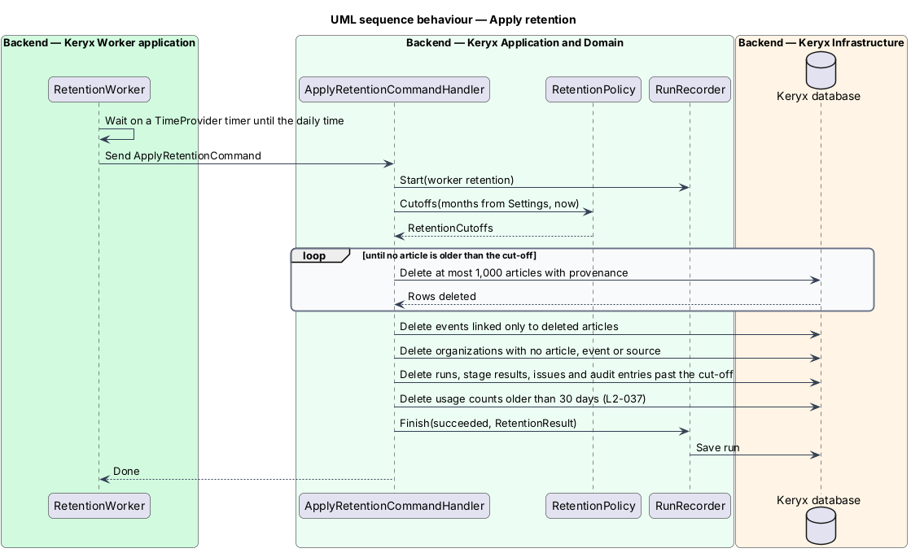

# Apply retention

## Overview

Keryx does not keep records longer than staff decide. Settings holds "Keep articles for" as a number of months, from 1 to 120. The *retention worker* runs once a day and deletes what is older than that period.

An article goes with its provenance entries, and its public id is never reused. An event linked only to a deleted article goes too. An organization is kept while any article, event or source refers to it. Run records older than the period go with their stage results and issues, audit entries older than the period go, and usage counts older than 30 days go.

> **retention period** — number of months after its collected time for which an article is kept

## Description

The slice is one hosted service and one handler. The handler deletes in batches of at most 1,000 and records its own run with the number deleted.

- **`RetentionWorker`** — .NET BackgroundService in the Keryx Worker. Fires once a day on `TimeProvider` and sends `ApplyRetentionCommand`. The time of day is `<TO SUPPLY>`.
- **`ApplyRetentionCommandHandler`** — MediatR handler in the Application and Domain layers. Deletes expired records in dependency order: articles with their provenance, events left with no article, organizations left with no reference, runs with stage results and issues, audit entries, and usage counts. Each delete statement removes at most 1,000 rows and repeats until none is left.
- **`RetentionPolicy`** — Domain service in the Application and Domain layers. Computes the cut-off times from Settings and the clock, so a shortened period takes effect on the next run.
- **`RunRecorder`** — Application service in the Application and Domain layers. Records the run with worker retention.
- **`AppDbContext`** — EF Core DbContext in the Infrastructure layer. Implements IAppDbContext.
- **`ApplyRetentionCommand`** — MediatR request with no fields.
- **`RetentionResult`** — counts of deleted articles, events, organizations, runs, audit entries and usage rows, each a number.

## Requirements

The feature realizes the following level-2 (L2) requirements. Each L2 requirement refines a level-1 (L1) requirement, cited by identifier. The acceptance criteria of each requirement are in [`docs/specs/L2.md`](../../../specs/L2.md).

| L2 ID | Refines (L1) | Requirement |
|-------|--------------|-------------|
| [`L2-079`](../../../specs/L2.md#l2-079-retention) | `L1-019` | **Retention.** The requirement is defined by its 5 acceptance criteria. |

## Diagrams

### System context

The staff member sets the retention period in Keryx.

### Containers

The Keryx Worker deletes expired records in batches the Keryx database.

### Components

`RetentionWorker` sends one command. `ApplyRetentionCommandHandler` asks `RetentionPolicy` for the cut-offs, deletes through `IAppDbContext` and reports to `RunRecorder`.

### Class structure

`RetentionPolicy` returns `RetentionCutoffs`; the handler returns a `RetentionResult` that the run record carries.

### Behaviour — apply retention

The handler deletes each kind of record in batches of at most 1,000 until none older than the cut-off remains (`L2-079`), then records the run.

