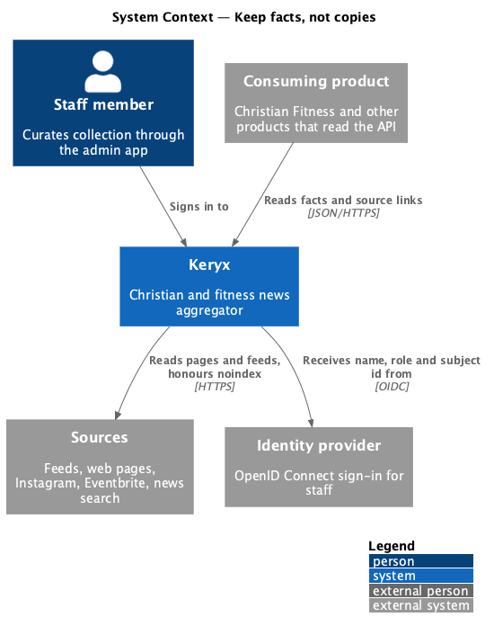
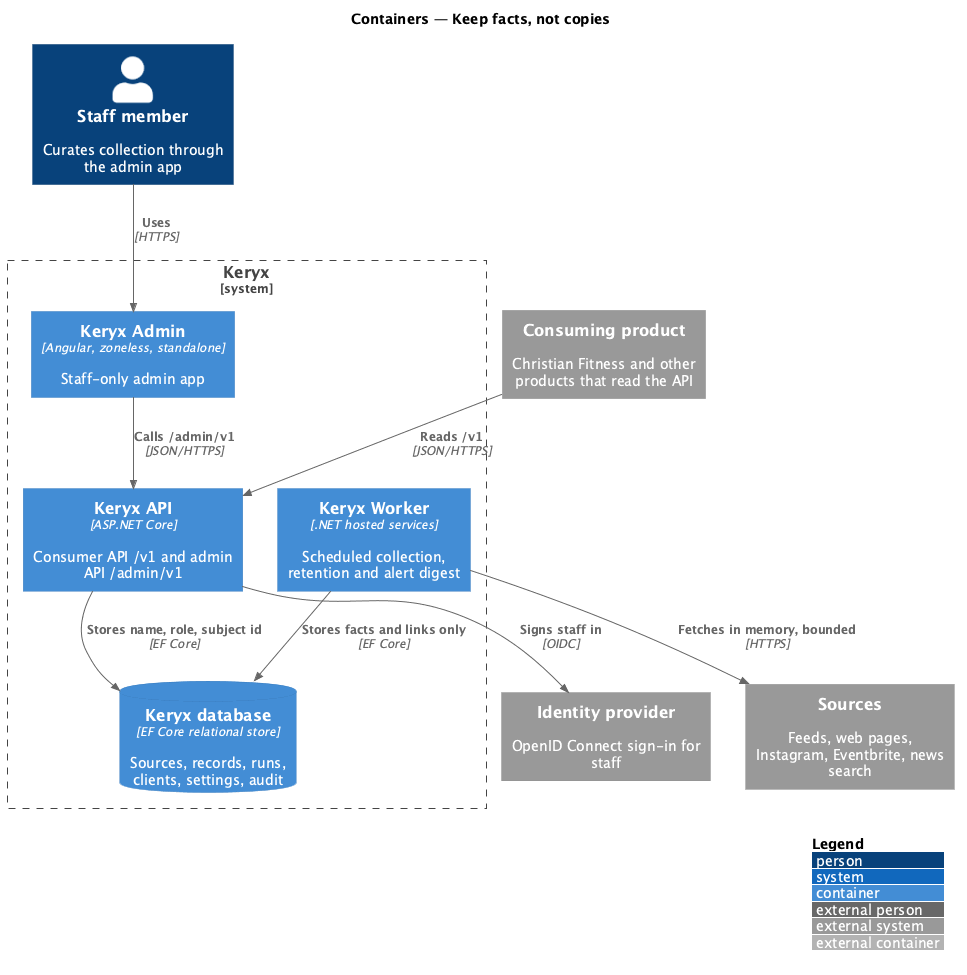
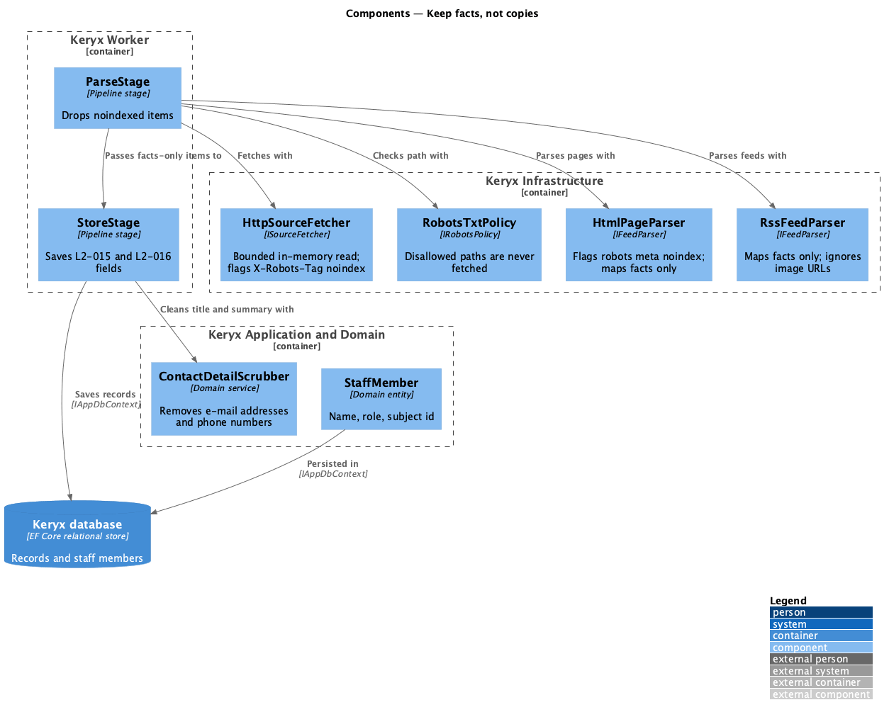
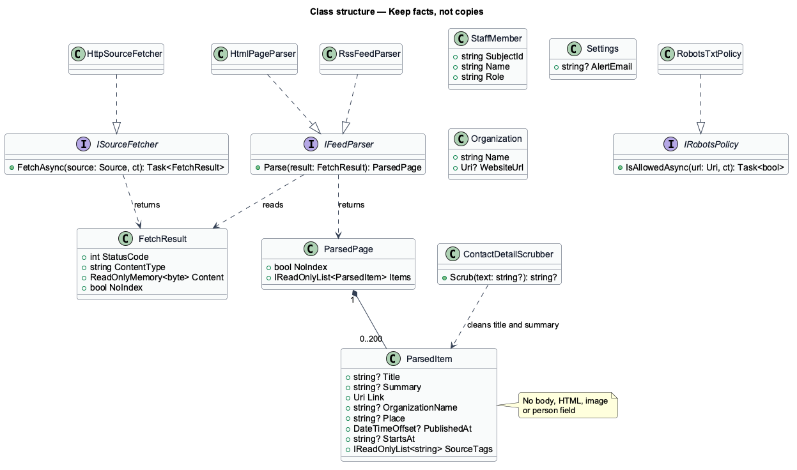
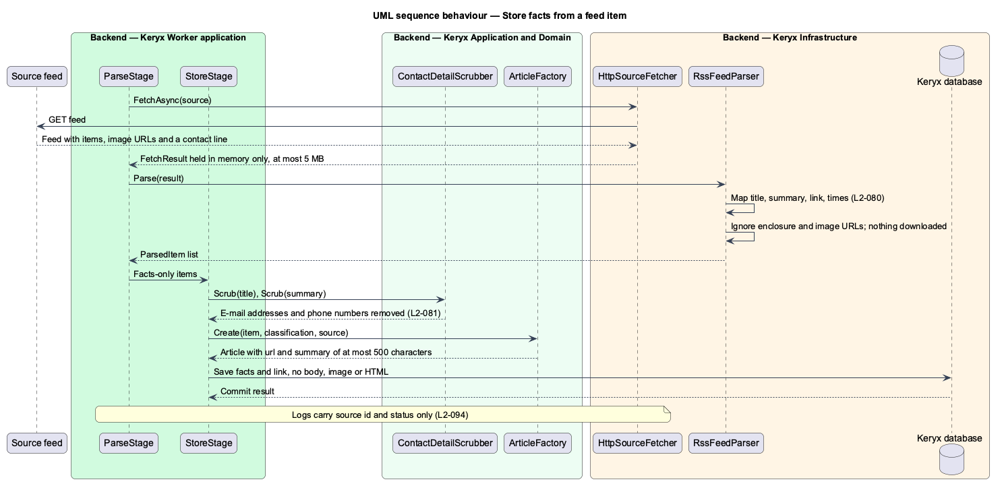
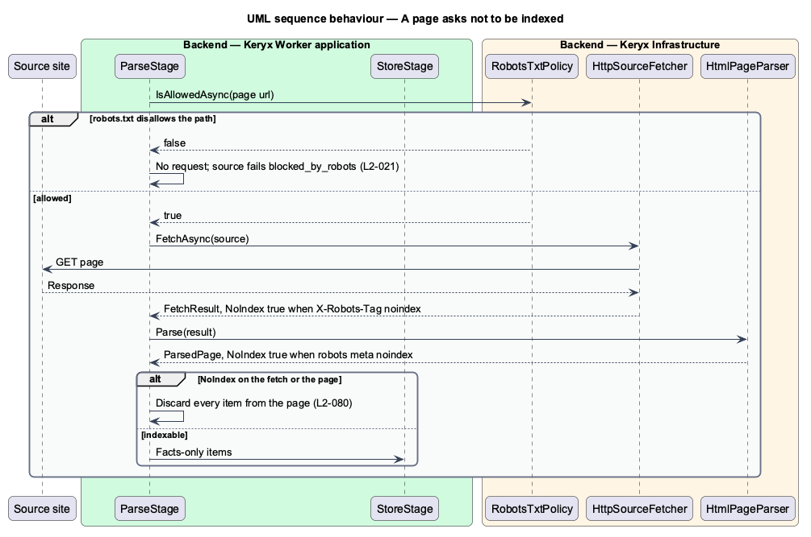
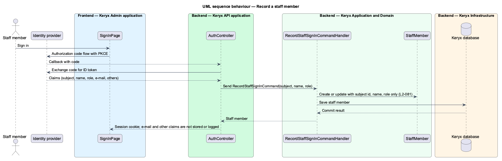

# Keep facts, not copies

## Overview

Keryx aggregates what organizations publish. It points to a story; it does not republish it.
This feature is the cross-cutting rule that keeps Keryx to facts and a link: no article body,
no image and no HTML is stored, logged or cached, and no private individual's contact details
are kept. It has no screen of its own. It is enforced at the points where fetched content
enters the system: the fetch, the parse, and the store stage of a collection run.

- **fact** — bounded field of a record listed by `L2-015`, such as the title, the summary or the canonical link
- **copy** — any stored or logged reproduction of a source's article body, images or HTML
- **noindex signal** — request by a source not to be indexed: a `noindex` robots meta tag, an `X-Robots-Tag: noindex` header, or a `robots.txt` rule
- **contact detail** — e-mail address, phone number or street address
- **personal data** — contact detail or name of a private individual, or staff data beyond name, role, provider subject id and the alert address

A fetched page lives in memory only while it is parsed, bounded to 5 MB (`L2-023`). The parser
reads the fields an article record needs and nothing else. An image URL in a feed item is not
mapped, so it is neither downloaded nor re-hosted. A page that carries a noindex signal yields
nothing at all.

A person named in a title or summary, such as a pastor, a trainer or a host, appears only inside
that text. No field, index, tag or separate record is extracted from the name. E-mail addresses
and phone numbers are removed from a stored summary, and the only contact detail kept for an
organization is its public website. For staff, Keryx keeps only each person's name, role and
identity-provider subject id, plus the alert address in Settings. Telemetry from a run and from
a staff session carries none of these values (`L2-094`, designed in the operations subsystem).

## Description

The rule is enforced by components in the worker's collection pipeline, the domain, and the
staff session.

**Infrastructure (`Keryx.Infrastructure`)**

- **`HttpSourceFetcher`** — implements `ISourceFetcher`. It reads the response into a bounded
  in-memory buffer, sets `FetchResult.NoIndex` when the response carries
  `X-Robots-Tag: noindex`, and writes no response to a disk or HTTP cache. It logs the source id
  and status, never the body.
- **`RobotsTxtPolicy`** — implements `IRobotsPolicy` (`L2-021`). A disallowed path is never
  fetched, so nothing from it exists to store.
- **`HtmlPageParser`** — implements `IFeedParser` for web pages. It sets `ParsedPage.NoIndex`
  for a `<meta name="robots">` tag holding `noindex`, and maps only the title, summary,
  canonical link, publication time, place and start time into `ParsedItem`.
- **`RssFeedParser`** — implements `IFeedParser` for feeds. It does not map enclosure, media or
  inline image URLs; `ParsedItem` has no image field.

**Worker (`Keryx.Worker`)**

- **`ParseStage`** — discards every item from a fetch or page that carries a noindex signal.
  The run bucket that counts those items (`rejected` or another count) is `<TO SUPPLY>`.
- **`StoreStage`** — stores only the `L2-015` and `L2-016` fields built by `ArticleFactory` and
  `EventFactory` (store records feature), after `ContactDetailScrubber` has run.

**Domain (`Keryx.Domain`)**

- **`ParsedItem`** — parser output holding only the candidate facts: title, summary, link,
  organization name, place, times and source tags. It has no body, HTML, image or person field.
- **`ContactDetailScrubber`** — pure domain service with a direct unit test per case. It removes
  e-mail addresses and phone numbers from a title and a summary before they are bounded. The
  rule that recognizes a private person's street address, as opposed to a public venue in an
  event's `place_name`, is `<TO SUPPLY>`.
- **`Organization`** — keeps `WebsiteUrl` as its only contact detail; it has no e-mail, phone
  or address field.
- **`TagSet`** — takes tags only from the source's own tags, never from names found in text.
- **`StaffMember`** — holds `SubjectId`, `Name` and `Role` and nothing else. It is created and
  updated at sign-in (staff authentication subsystem, `L2-039`).
- **`Settings`** — holds the alert address, the only staff contact detail kept.

**API (`Keryx.Api`)**

- **`AuthController`** — on the sign-in callback sends `RecordStaffSignInCommand` with the
  subject id, name and role read from the provider's claims. Its handler,
  `RecordStaffSignInCommandHandler`, creates or updates the `StaffMember`; every other claim,
  including an e-mail address, is neither stored nor logged. Whether the staff authentication
  subsystem names this command differently is `<TO SUPPLY>`.
- **`ArticleDto`** (both APIs) — carries `url`, the link to the source's own page, and a
  `summary` of at most 500 characters. It has no body or image field.

**Telemetry**

- Logs, metrics and traces follow `L2-094`: no fetched content, summary, e-mail address or
  person's name is written. The redaction is designed in the observe-the-system feature.

## Requirements

The feature realizes the following level-2 (L2) requirements. Each L2 requirement refines a
level-1 (L1) requirement, cited by identifier. Their acceptance criteria are in
[L2.md](../../../specs/L2.md).

| L2 ID | Refines (L1) | Requirement |
|-------|--------------|-------------|
| `L2-080` | `L1-019` | Facts and a link, not a copy — Keryx stores the facts of an item and a link to the source's own page, never a copy of its article, images or HTML. |
| `L2-081` | `L1-019` | Personal data — Keryx stores no private individual's contact details, and a person named in a record appears only in the text the source published. |

## Diagrams

### System context

Keryx reads pages and feeds from sources and serves only facts and links to consuming products.
Staff sign in through the identity provider, which supplies the only staff data kept.

### Containers

The Keryx Worker is where fetched content enters and is reduced to facts. The Keryx API keeps
only the staff fields of the session.

### Components

The fetcher and parsers detect noindex signals and map only facts; `ParseStage` drops
noindexed items; `ContactDetailScrubber` cleans text before `StoreStage` saves it.

### Class structure

`ParsedItem` has no body, image or person field, so no stage downstream of the parser can store
one. `StaffMember` holds three fields.

### Behaviour — store facts from a feed item

A feed item with an image and a contact detail in its summary is stored as bounded facts with
its link; the image is not fetched and the contact detail is removed.

### Behaviour — a page asks not to be indexed

A `robots.txt` rule stops the fetch; an `X-Robots-Tag` header or a robots meta tag stops the
page's items before the store stage.

### Behaviour — record a staff member

At sign-in the callback keeps the name, role and subject id from the provider's claims and
drops every other claim.

