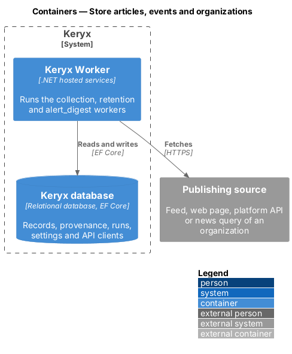
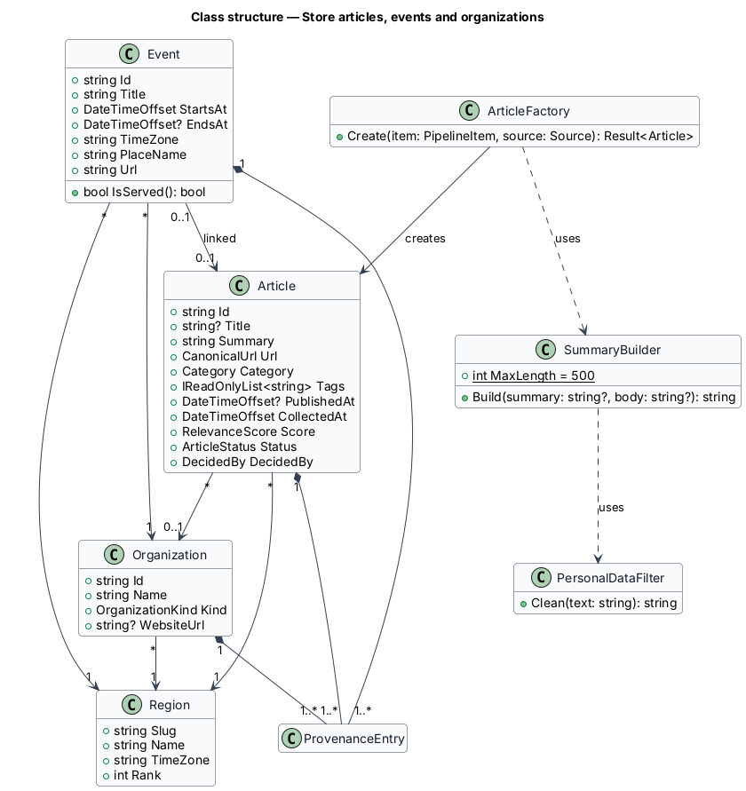
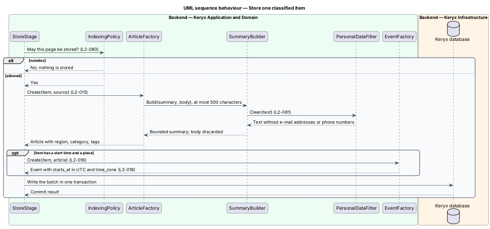

# Store articles, events and organizations

## Overview

The catalogue is everything Keryx knows: *articles* (news), *events* and *organizations*, each carrying a region. An article is a pointer to a story, not a copy of it. An event is something with a start time and a place. An organization is a church, ministry, gym, club, network or business that publishes Christian fitness news.

Keryx aggregates what organizations publish. It stores facts and a link: a title, a summary of at most 500 characters and the canonical link, never the article body, its images or its HTML. It keeps no contact detail of a private individual, and a person named in a record appears only inside the text the source published.

Toronto comes first. Regions are a fixed, ranked list that starts with Toronto and the GTA municipalities and ends with `global`. Each stored time is UTC; where a wall-clock time matters, the IANA zone is stored beside it.

> **article** — pointer to a story: title, bounded summary, canonical link, organization, category, region, tags, times, score and status

> **event** — record with a start time and a place, belonging to an organization and optionally linked to an article

> **region** — entry of the fixed list of places, with a slug, a name, an IANA zone and a rank

## Description

The slice is the domain model that the `store` stage writes. Each bound is enforced where the entity is built, so no caller can store an unbounded or personal value.

- **`StoreStage`** — Pipeline stage in the Application and Domain layers. Builds and persists records from classified items. It downloads and re-hosts no image, and writes no body, image or HTML to a log or a cache.
- **`ArticleFactory`** — Domain service in the Application and Domain layers. Builds an `Article` within its bounds: a title of at most 300 characters or `null`, exactly one of the six categories, and at most 30 tags of at most 40 characters, lower-cased and de-duplicated. An organization that cannot be determined is `null`.
- **`EventFactory`** — Domain service in the Application and Domain layers. Builds an `Event` with `starts_at` in UTC and `time_zone` as an IANA zone. A local time with no zone takes the region's zone (`America/Toronto` for each GTA region). An end time before the start time is dropped.
- **`SummaryBuilder`** — Domain service in the Application and Domain layers. Produces a summary of at most 500 characters that ends on a word boundary. With no summary in the item it takes the first sentence. No more of the body is kept.
- **`PersonalDataFilter`** — Domain service in the Application and Domain layers. Removes e-mail addresses and phone numbers from the stored summary and title. A person's name stays only inside the published text and is never extracted into a field, an index, a tag or a separate record.
- **`RegionResolver`** — Domain service in the Application and Domain layers. Resolves a place to a region. A place that cannot be resolved takes the source's region.
- **`IndexingPolicy`** — Domain service in the Application and Domain layers. Refuses content a source asks not to be indexed (`noindex`, `X-Robots-Tag: noindex` or a robots rule): nothing from that page is stored.
- **`AppDbContext`** — EF Core DbContext in the Infrastructure layer. Implements IAppDbContext.
- **`Article`** — entity with `Id` (`art_`), `Title`, `Summary`, `Url`, `Organization`, `Category`, `Region`, `Tags`, `PublishedAt`, `CollectedAt`, `Score`, `Status`, `DecidedBy`.
- **`Event`** — entity with `Id` (`evt_`), `Title`, `StartsAt`, `EndsAt`, `TimeZone`, `PlaceName`, `Region`, `Organization`, `Url` and an optional `ArticleId`; an event linked to an article is served while that article is published, and an unlinked event follows the thresholds of L2-013 from its own score.
- **`Organization`** — entity with `Id` (`org_`), `Name`, `Kind` (`church`, `ministry`, `gym`, `club`, `network`, `business`, `other`), `Region` and `WebsiteUrl`, the only contact detail kept.
- **`Region`** — entity with `Slug`, `Name`, `TimeZone` and `Rank`; a focus area added in Settings becomes a region with zone `America/Toronto`.

The consumer API never serves an article without a title, and lists an organization only when it has a published article or event (L2-015, L2-017). The admin application shows "Untitled post" and "Unknown" for the `null` values.

## Requirements

The feature realizes the following level-2 (L2) requirements. Each L2 requirement refines a level-1 (L1) requirement, cited by identifier. The acceptance criteria of each requirement are in [`docs/specs/L2.md`](../../../specs/L2.md).

| L2 ID | Refines (L1) | Requirement |
|-------|--------------|-------------|
| [`L2-015`](../../../specs/L2.md#l2-015-article-record) | `L1-005` | **Article record.** An article is a pointer to a story, not a copy of it: a title, a summary of at most 500 characters, the canonical link, the organization, a category, a region, tags, the time the source published it, the time Keryx collected it, a relevance score and a status. |
| [`L2-016`](../../../specs/L2.md#l2-016-event-record) | `L1-005` | **Event record.** An event is something with a start time and a place: a race, a class, a camp, a service project. It is extracted when a source publishes a start time; it belongs to an organization and, where it came from a story, links to that article. |
| [`L2-017`](../../../specs/L2.md#l2-017-organization-record) | `L1-005` | **Organization record.** An organization is a church, ministry, gym, club, network or business that publishes Christian fitness news. It has a name as it publishes it, a kind (`church`, `ministry`, `gym`, `club`, `network`, `business`, `other`), a region, and its public website. |
| [`L2-018`](../../../specs/L2.md#l2-018-regions-and-time) | `L1-005` | **Regions and time.** Every record carries a region. Regions are a fixed list with a slug, a name, a zone and a rank: the GTA municipalities first (Toronto first of all), then `gta`, `ontario`, `canada`, `global`. |
| [`L2-080`](../../../specs/L2.md#l2-080-facts-and-a-link-not-a-copy) | `L1-019` | **Facts and a link, not a copy.** The requirement is defined by its 4 acceptance criteria. |
| [`L2-081`](../../../specs/L2.md#l2-081-personal-data) | `L1-019` | **Personal data.** The requirement is defined by its 5 acceptance criteria. |

## Diagrams

### System context

Keryx collects published items from publishing sources.

### Containers

The Keryx Worker reads and writes the Keryx database. The Keryx Worker fetches the publishing source.

### Components

`StoreStage` calls `IndexingPolicy` first, then `ArticleFactory` and `EventFactory`, which use `SummaryBuilder`, `PersonalDataFilter` and `RegionResolver`, and persists through `IAppDbContext`.

### Class structure

`Article`, `Event` and `Organization` each refer to one `Region`. An `Event` may link to one `Article`; each record owns its provenance entries.

### Behaviour — store one classified item

A page that asks not to be indexed is dropped before any record is built (`L2-080`). The factories bound the text and remove contact details (`L2-015`, `L2-081`) before the batch is written.

