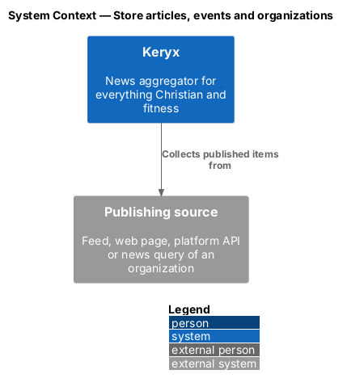
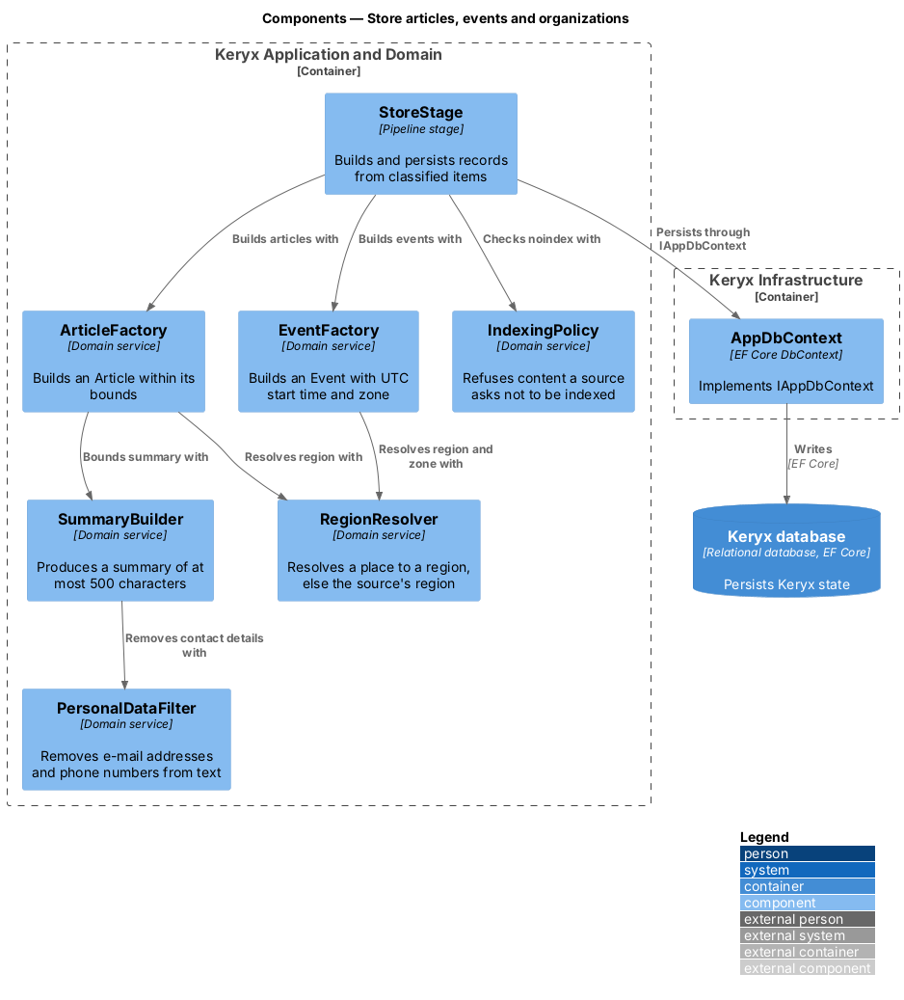
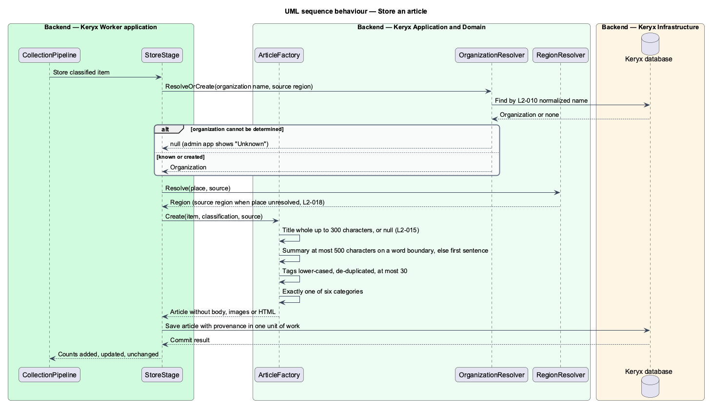
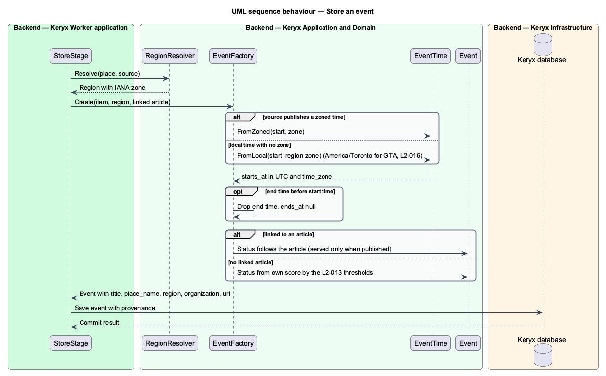
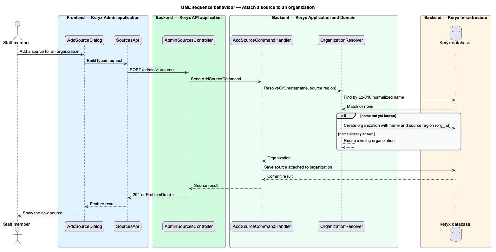
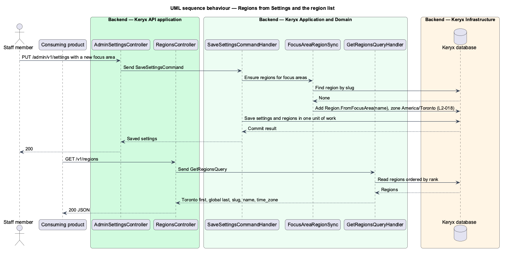

# Store records

## Overview

Keryx is a news aggregator for Christian and fitness news, primarily in Toronto and the Greater
Toronto Area (GTA). The collection worker reads what organizations publish and keeps what it
finds in a catalogue of three record types. This feature defines those records, how the store
stage of a collection run shapes each one from a parsed item, and how every record carries a
region and, where it has a time, that time in UTC with its zone.

- **record** — stored fact set that Keryx serves to consuming products: an article, an event or an organization
- **article** — pointer to a story published by a source, holding its facts and canonical link but not its text
- **event** — record with a start time and a place, such as a race, a class, a camp or a service project
- **organization** — church, ministry, gym, club, network or business that publishes Christian fitness news
- **region** — entry in the ranked list of places Keryx knows, each with a slug, a name, an IANA time zone and a rank
- **parsed item** — single entry read from a source by the parse stage, before it is classified and stored
- **store stage** — fifth stage of the collection pipeline, which turns classified items into records

An article is bounded by construction: a title of at most 300 characters, a summary of at most
500 characters ending on a word boundary, at most 30 tags, and exactly one of six categories.
An event stores its start in UTC with the IANA zone beside it. Where a source publishes a local
time with no zone, the zone is the region's zone, `America/Toronto` for every GTA region. An
event linked to an article follows that article's status; an event with no linked article gets
its status from its own relevance score under the thresholds of `L2-013`.

Regions are ranked: the GTA municipalities first, Toronto first of all, then `gta`, `ontario`,
`canada` and `global`. A focus area added in Settings that is not yet a region becomes one.
Identity, deduplication and provenance of records are designed in the ingestion subsystem
(`L2-009` to `L2-011`); the consumer endpoints that serve the records are designed in the
consumer API subsystem (`L2-026` to `L2-030`). This feature owns the record shapes and the rules
that bound them.

## Description

The slice runs from the store stage of the collection worker through the domain types to the
database, and out through the regions endpoint.

**Worker (`Keryx.Worker`)**

- **`StoreStage`** — store stage of `CollectionPipeline`. For each classified item it calls
  `ArticleFactory` and, when the item carries a start time and a place, `EventFactory`. It
  resolves the organization through `OrganizationResolver` and the region through
  `RegionResolver`, then saves through `IAppDbContext` in one unit of work per source.

**Domain (`Keryx.Domain`)**

- **`Article`** — entity with `PublicId Id` (prefix `art_`), `ArticleTitle? Title`,
  `ArticleSummary Summary`, `CanonicalUrl Url`, `Organization? Organization`, `Category Category`,
  `Region Region`, `TagSet Tags`, `DateTimeOffset? PublishedAt` (UTC),
  `DateTimeOffset CollectedAt` (UTC), `RelevanceScore Score`, `ArticleStatus Status` and its
  `Provenance` entries. It holds no body, image or HTML.
- **`ArticleTitle`** — value object. It keeps the title whole up to 300 characters. A missing
  title is `null`; the admin app shows "Untitled post" and the consumer API never serves an
  article without a title. A title longer than 300 characters is cut on a word boundary and ends
  with "…", within 300 characters; the item is not rejected.
- **`ArticleSummary`** — value object. It takes the source's summary, or the item's first
  sentence when there is none, and bounds it to 500 characters ending on a word boundary. No
  more of the body is kept.
- **`TagSet`** — value object holding at most 30 tags, each at most 40 characters, lower-cased
  and de-duplicated; tags beyond 30 are dropped. A single tag longer than 40 characters is
  dropped, not cut.
- **`Category`** — closed set of six slugs: `events`, `races-challenges`, `gyms-studios`,
  `ministry-programs`, `nutrition`, `faith-wellness`. A classified item gets exactly one: a
  source tag naming a category (its slug or name) decides it; otherwise the first category, in
  the order `races-challenges`, `events`, `gyms-studios`, `nutrition`, `ministry-programs`,
  `faith-wellness`, whose words the title or summary mentions; and `faith-wellness` when none
  does.
- **`ArticleFactory`** — domain service that builds an `Article` from a parsed item, its
  classification and its source, applying the bounds above.
- **`Event`** — entity with `PublicId Id` (prefix `<TO SUPPLY>`), `Title`, `EventTime Start`,
  `DateTimeOffset? EndsAt` (UTC), `PlaceName`, `Region`, `Organization`, `CanonicalUrl Url`,
  `Article? LinkedArticle`, `RelevanceScore Score`, `ArticleStatus Status` and its `Provenance`.
  `IsServable()` is true only when the linked article is `published`, or, with no linked
  article, when its own status is `published`.
- **`EventTime`** — value object holding `StartsAtUtc` and `TimeZone` (an IANA zone id). It is
  built from a zoned time, or from a local time plus the region's zone, converted to UTC. The
  rule for a local time that falls in a daylight-saving gap or overlap is `<TO SUPPLY>`.
- **`EventFactory`** — domain service that builds an `Event` from a parsed item with a start
  time and a place. It drops an end time earlier than the start and stores `EndsAt` as `null`.
  With no linked article it sets the status from the event's own score by the `L2-013` rule.
- **`Organization`** — entity with `PublicId Id` (prefix `org_`), `Name` as published,
  `NormalizedName` (the `L2-010` match key), `OrganizationKind Kind`, `Region` and
  `WebsiteUrl`. It holds no personal e-mail address, personal phone number or home address.
- **`OrganizationKind`** — `church`, `ministry`, `gym`, `club`, `network`, `business`, `other`.
  `OrganizationKinds.From(name)` gives the first kind, in that order, whose words the published
  name holds (for example "Church", "Ministries", "Fitness", "Club", "Network", "Inc."), and
  `other` when none does. The website is the scheme and host of the first web source that names
  the organization.
- **`Region`** — entity with `Slug`, `Name`, `TimeZone` (IANA) and `Rank`.
  `Region.FromFocusArea(name)` makes a region with zone `America/Toronto` and a slug made from
  the name. The seeded list of GTA municipalities and the rank given to a focus-area region are
  `<TO SUPPLY>`.

**Application (`Keryx.Application`)**

- **`OrganizationResolver`** — finds an organization by the `L2-010` normalized-name match or
  creates one with the source's name and region. It runs in the publish stage
  (`ArticlePublication`), so an organization appears with the first published record that names
  it, never with a source that has yielded nothing; sources are taken in the order they were
  added, so the earliest source's spelling is the name. A source keeps the organization name it
  was saved with, and attaches by that name's match key.
- **`RegionResolver`** — maps an item's place to a region. When the place cannot be resolved, it
  returns the source's region.
- **`FocusAreaRegionSync`** — called by `SaveSettingsCommandHandler` (settings subsystem). It
  creates a `Region` for each saved focus area that is not yet a region.
- **`GetRegionsQuery`** / **`GetRegionsQueryHandler`** — read the region list ordered by rank,
  Toronto first and `global` last, as `RegionDto`.
- **`RegionDto`** — `slug`, `name`, `time_zone`.
- **`OrganizationDto`** — `id` (`org_…`), `name`, `kind`, `region`, `website_url` and
  `article_count` as a number. The consumer list omits an organization with no published
  article and no published event.

**Infrastructure (`Keryx.Infrastructure`)**

- **`KeryxDbContext`** — maps the records with EF Core onto a relational database (PostgreSQL,
  [ADR 0001](../../../adr/0001-postgresql-and-the-backend-packages.md)). A value converter stores every `DateTimeOffset` as UTC. Each wall-clock time
  (event start, schedule) has its IANA zone in a column beside it.

**API (`Keryx.Api`)**

- **`RegionsController`** — `GET /v1/regions` sends `GetRegionsQuery` and returns each region's
  `slug`, `name` and `time_zone`. It requires an API key with any scope; the response envelope
  and caching follow the consumer API designs (`L2-030`, `L2-032`).

**Admin app (`frontend/projects`)**

- The article screens (article review subsystem) show "Untitled post" for a `null` title and
  "Unknown" for a `null` organization; the record carries `null`, not the label.

## Requirements

The feature realizes the following level-2 (L2) requirements. Each L2 requirement refines a
level-1 (L1) requirement, cited by identifier. Their acceptance criteria are in
[L2.md](../../../specs/L2.md).

| L2 ID | Refines (L1) | Requirement |
|-------|--------------|-------------|
| `L2-015` | `L1-005` | Article record — An article is a pointer to a story, not a copy of it: a title, a summary of at most 500 characters, the canonical link, the organization, a category, a region, tags, the time the source published it, the time Keryx collected it, a relevance score and a status. |
| `L2-016` | `L1-005` | Event record — An event is something with a start time and a place: a race, a class, a camp, a service project. It is extracted when a source publishes a start time; it belongs to an organization and, where it came from a story, links to that article. |
| `L2-017` | `L1-005` | Organization record — An organization is a church, ministry, gym, club, network or business that publishes Christian fitness news. It has a name as it publishes it, a kind (`church`, `ministry`, `gym`, `club`, `network`, `business`, `other`), a region, and its public website. |
| `L2-018` | `L1-005` | Regions and time — Every record carries a region. Regions are a fixed list with a slug, a name, a zone and a rank: the GTA municipalities first (Toronto first of all), then `gta`, `ontario`, `canada`, `global`. |

## Diagrams

### System context

Keryx reads sources, keeps records, and serves them to consuming products; staff see the same
records in the admin app.

### Containers

The Keryx Worker writes records to the Keryx database. The Keryx API reads them for consuming
products and for the Keryx Admin app.

### Components

Inside the worker, `StoreStage` builds records through the domain factories and the two
resolvers. Inside the API, `RegionsController` reads the ranked region list through
`GetRegionsQueryHandler`.

### Class structure

`Article`, `Event` and `Organization` each hold a `Region`. An `Event` may link to an `Article`,
and the bounded value objects carry the limits of `L2-015` and `L2-016`.

### Behaviour — store an article

The store stage bounds the title, summary and tags, gives the item one category, resolves its
organization and region, and saves the article.

### Behaviour — store an event

An item with a start time and a place becomes an event. A local time with no zone takes the
region's zone, an end before the start is dropped, and the status follows the linked article
or the event's own score.

### Behaviour — attach a source to an organization

Saving a source for an unknown organization name creates the organization; a known name, by the
`L2-010` match, attaches the source to the existing one.

### Behaviour — regions from Settings and the region list

Saving a new focus area creates a region in `America/Toronto`. Reading `/v1/regions` returns the
list by rank, Toronto first and `global` last.

