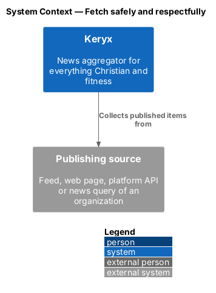
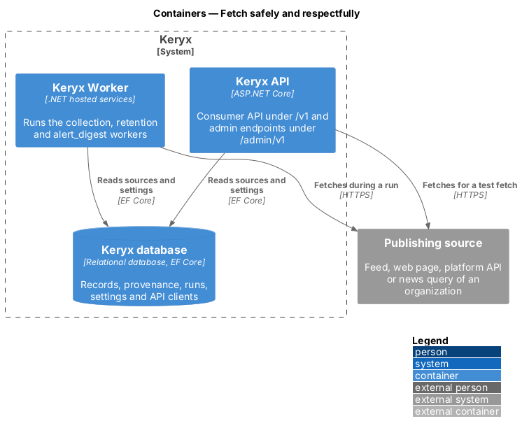
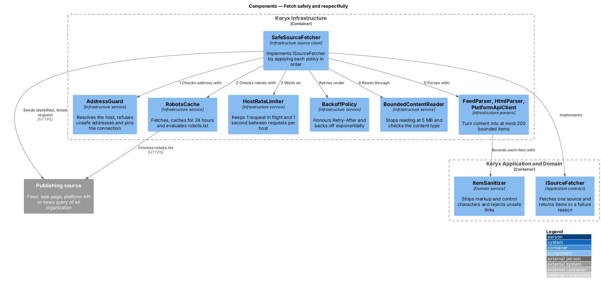
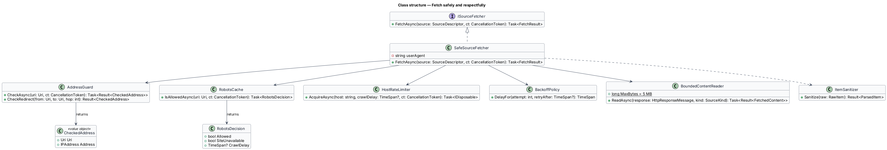
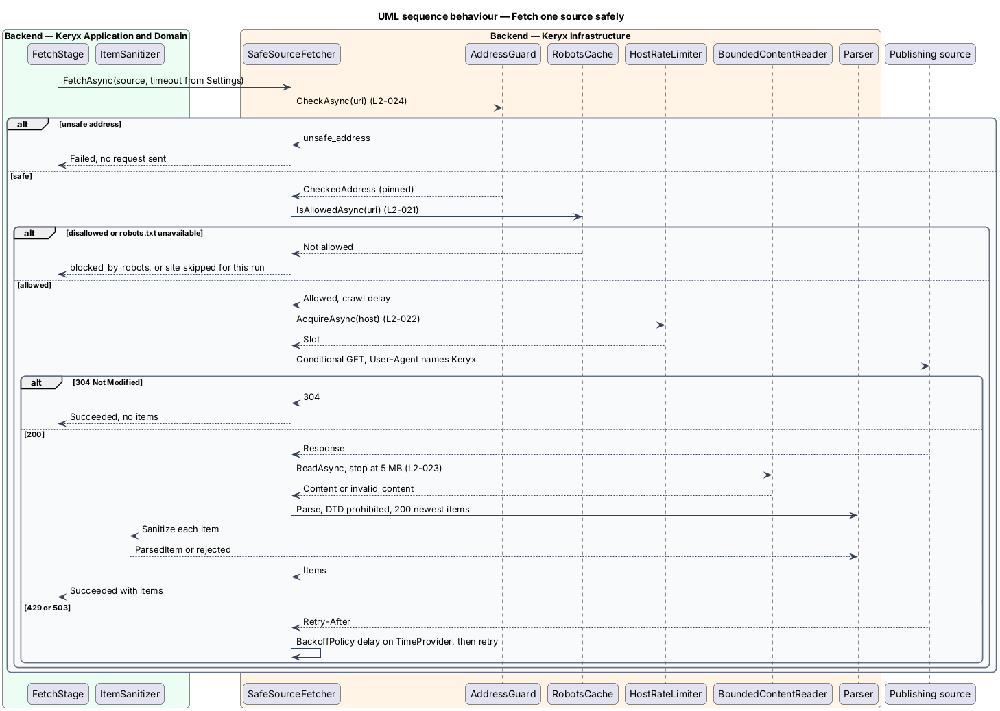

# Fetch safely and respectfully

## Overview

Each request Keryx sends to a source goes through one client. The client makes Keryx a good citizen of each source: it honours `robots.txt` and terms of use, identifies itself, limits its rate, backs off and times out. It also protects Keryx: everything fetched is untrusted input that is validated and bounded, and no request is sent to a private or internal address.

The rules apply to a collection run, to a test fetch and to the save-time test of an edited source alike. A source that breaks a rule fails with a reason from one fixed list: `not_found`, `timeout`, `blocked_by_robots`, `refused`, `invalid_content`, `unsafe_address`.

`instagram` and `eventbrite` sources are read only through each platform's official API with credentials from configuration. With no credentials configured the source fails with `refused` and nothing is scraped.

> **unsafe address** — loopback, link-local, private (RFC 1918), unique-local, multicast or cloud-metadata address

> **pinned connection** — connection made only to the IP address that passed the address check

## Description

The slice is the Infrastructure client behind `ISourceFetcher`, composed of one policy object per rule. A handler never opens its own connection.

- **`SafeSourceFetcher`** — Infrastructure source client in the Infrastructure layer. Implements `ISourceFetcher` by applying each policy in order. It sends a `User-Agent` that names Keryx, its version and a contact URL from configuration, sets the per-source timeout from Settings (5 to 120 seconds, default 30) on each call, and sends a conditional request when an `ETag` or `Last-Modified` is known; a `304` is a successful fetch with no items.
- **`AddressGuard`** — Infrastructure service in the Infrastructure layer. Resolves the host and refuses an unsafe address with `unsafe_address` before any request. It pins the connection to the checked address, checks each redirect target again, follows at most 5 redirects and never follows a redirect from `https` to `http`.
- **`RobotsCache`** — Infrastructure service in the Infrastructure layer. Fetches, caches for 24 hours and evaluates `robots.txt` for Keryx's user agent and for `*`. A disallowed path fails with `blocked_by_robots` and no request to the path. When `robots.txt` answers 5xx or times out, the site is not fetched in the run. A `Crawl-delay` is honoured up to a cap of 30 seconds.
- **`HostRateLimiter`** — Infrastructure service in the Infrastructure layer. Keeps 1 request in flight and at least 1 second between requests per host; a run fetches at most 8 hosts concurrently.
- **`BackoffPolicy`** — Infrastructure service in the Infrastructure layer. Waits at least the `Retry-After` of a `429` or `503`, capped at 60 seconds, and exponentially longer on each further attempt. All delays read `TimeProvider`.
- **`BoundedContentReader`** — Infrastructure service in the Infrastructure layer. Stops reading at 5 MB of content, measured after decompression, and refuses a content type that the source kind does not expect; both fail with `invalid_content`.
- **`FeedParser, HtmlParser, PlatformApiClient`** — Infrastructure parsers in the Infrastructure layer. Turn content into at most 200 bounded items, the newest first. XML is parsed with DTD processing prohibited and no entity resolved.
- **`ItemSanitizer`** — Domain service in the Application and Domain layers. Strips markup to text, removes control characters, and rejects an item whose link is not `http` or `https`; a rejected item counts under `rejected`.
- **`ISourceFetcher`** — Application contract in the Application and Domain layers. Fetches one source and returns items or a failure reason.
- **`FetchResult`** — result with `Succeeded`, `Reason`, `Items`, and the `ETag` and `Last-Modified` to store for the next fetch.
- **`ParsedItem`** — bounded item with title, summary text, link, published time, optional start time and place, tags and the key the source gives it.

A URL that carries a user name or password, or a port other than 80 or 443, is refused when a source is added, with `code` `validation_failed` (L2-024).

## Requirements

The feature realizes the following level-2 (L2) requirements. Each L2 requirement refines a level-1 (L1) requirement, cited by identifier. The acceptance criteria of each requirement are in [`docs/specs/L2.md`](../../../specs/L2.md).

| L2 ID | Refines (L1) | Requirement |
|-------|--------------|-------------|
| [`L2-021`](../../../specs/L2.md#l2-021-robots-terms-and-identification) | `L1-007` | **Robots, terms and identification.** The requirement is defined by its 5 acceptance criteria. |
| [`L2-022`](../../../specs/L2.md#l2-022-rate-limiting-back-off-and-time-outs) | `L1-007` | **Rate limiting, back-off and time-outs.** The requirement is defined by its 5 acceptance criteria. |
| [`L2-023`](../../../specs/L2.md#l2-023-fetched-content-is-untrusted) | `L1-007` | **Fetched content is untrusted.** The requirement is defined by its 7 acceptance criteria. |
| [`L2-024`](../../../specs/L2.md#l2-024-no-requests-to-private-or-internal-addresses) | `L1-007` | **No requests to private or internal addresses.** The requirement is defined by its 5 acceptance criteria. |

## Diagrams

### System context

Keryx collects published items from publishing sources.

### Containers

The Keryx Worker fetches during a run the publishing source. The Keryx API fetches for a test fetch the publishing source. The Keryx Worker reads sources and settings the Keryx database. The Keryx API reads sources and settings the Keryx database.

### Components

`SafeSourceFetcher` realizes `ISourceFetcher` and calls `AddressGuard`, `RobotsCache`, `HostRateLimiter`, `BackoffPolicy` and `BoundedContentReader` before a parser; `ItemSanitizer` bounds each item.

### Class structure

`SafeSourceFetcher` composes the five policy services. `AddressGuard` returns a `CheckedAddress` that the connection is pinned to.

### Behaviour — fetch one source safely

Each check precedes the request, in the order address, robots, rate limit. The response is read under the size bound, parsed without DTD processing, and each item is sanitized.

