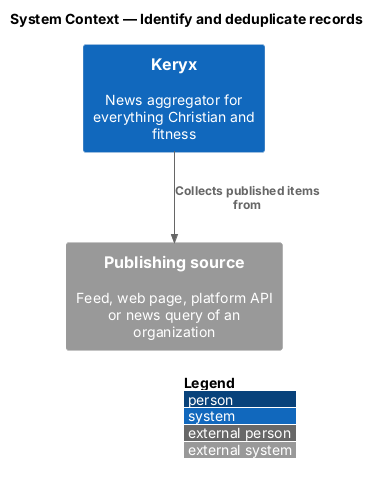
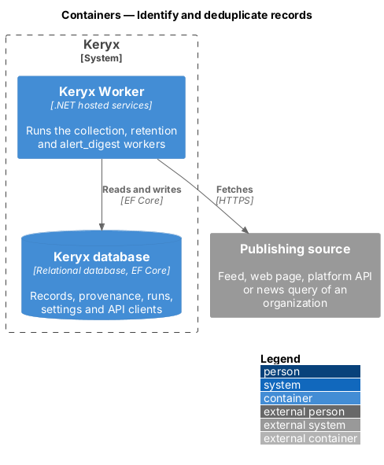
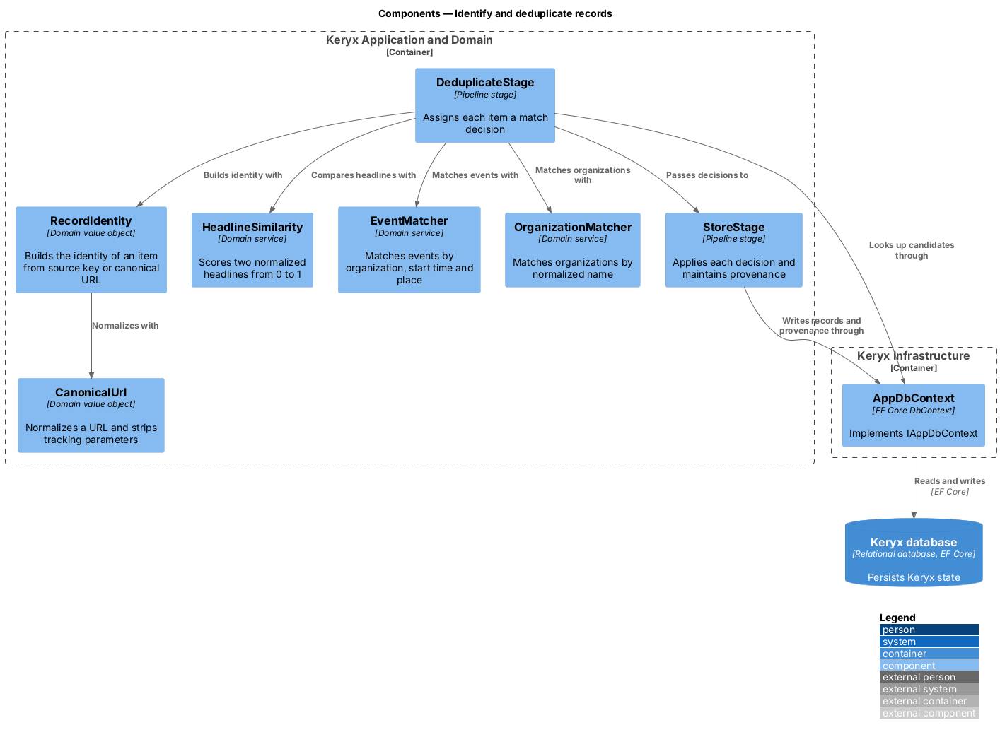
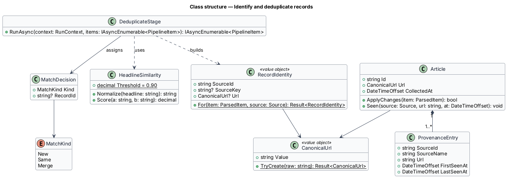
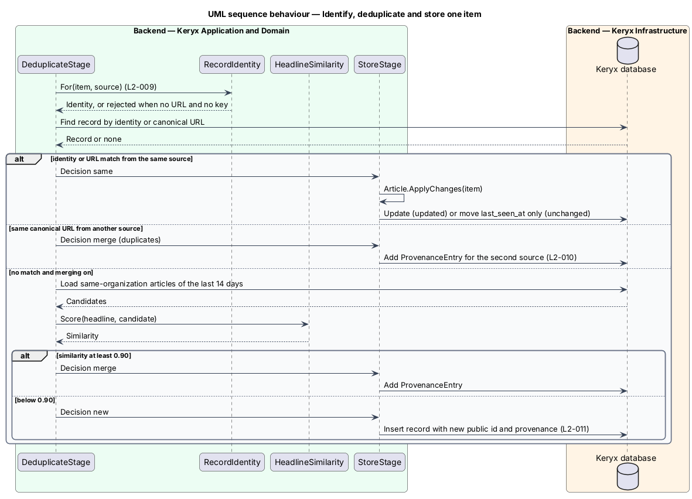

# Identify and deduplicate records

## Overview

Collecting the same thing twice changes nothing. Each record has a *stable identity* that does not depend on when it was collected: the source and the key the source gives the item (a feed GUID, a canonical URL, a platform id), or, where a source gives no key, the normalized canonical URL.

The same story found through two sources is one article. When merging is on in Settings, an item merges into an existing article with the same canonical URL, or with a headline whose normalized similarity is at least 0.90 to an article of the same organization within 14 days. Events and organizations merge by their own rules.

Each stored fact keeps its *provenance*: the source, the URL the fact was read from, and when it was first and last seen. An item with no URL or from no identifiable source is not stored.

> **canonical URL** — item URL with tracking parameters (`utm_*`, `fbclid`, `gclid`) and fragment removed, and scheme and host lower-cased

> **provenance entry** — record of one source having published one fact: source id, source name, URL, first-seen and last-seen times

## Description

The slice is the `deduplicate` and `store` stages of the pipeline. Matching is pure domain logic with case tables; the store stage turns each match decision into an insert, an update or a touch of `last_seen_at`.

- **`DeduplicateStage`** — Pipeline stage in the Application and Domain layers. Assigns each item a match decision: `new`, `same` (identity match), or `merge` (same story from another source). It counts merges under `duplicates`.
- **`RecordIdentity`** — Domain value object in the Application and Domain layers. Builds the identity of an item from source key or canonical URL.
- **`CanonicalUrl`** — Domain value object in the Application and Domain layers. Normalizes a URL and strips tracking parameters.
- **`HeadlineSimilarity`** — Domain service in the Application and Domain layers. Scores two normalized headlines from 0 to 1. Normalization removes case, punctuation and whitespace differences. The threshold is 0.90 inclusive; the algorithm is `<TO SUPPLY>` and is fixed by the shared case table of L2-010.
- **`EventMatcher`** — Domain service in the Application and Domain layers. Matches events with the same organization, the same place and start times within 1 hour.
- **`OrganizationMatcher`** — Domain service in the Application and Domain layers. Matches organizations whose names differ only in case, punctuation, whitespace or a leading "The".
- **`StoreStage`** — Pipeline stage in the Application and Domain layers. Applies each decision. A new item becomes a record with a new public id; a changed item is an update that keeps its id and first-seen time; an unchanged item only moves `last_seen_at` to the run's start time. An item with no URL or no source is counted under `rejected`.
- **`AppDbContext`** — EF Core DbContext in the Infrastructure layer. Implements IAppDbContext.
- **`MatchDecision`** — result with `Kind` (`New`, `Same`, `Merge`) and the id of the matched record.
- **`ProvenanceEntry`** — entity owned by an article, event or organization; one per source that published the fact.
- **`PublicId`** — value object that formats ids as `art_`, `evt_`, `org_`, `src_` or `run_` followed by a number that is never reused.

With merging switched off, two sources that return one story under different URLs produce two articles; items with the same URL still match by identity.

## Requirements

The feature realizes the following level-2 (L2) requirements. Each L2 requirement refines a level-1 (L1) requirement, cited by identifier. The acceptance criteria of each requirement are in [`docs/specs/L2.md`](../../../specs/L2.md).

| L2 ID | Refines (L1) | Requirement |
|-------|--------------|-------------|
| [`L2-009`](../../../specs/L2.md#l2-009-stable-identity) | `L1-003` | **Stable identity.** Every record has an identity that does not depend on when it was collected: the source and the item's key in that source (a feed GUID, a canonical URL, a platform id), or, where a source gives no key, the normalized canonical URL. |
| [`L2-010`](../../../specs/L2.md#l2-010-deduplication-across-sources) | `L1-003` | **Deduplication across sources.** When merging is on (Settings, default on), an item that is the same story as an existing article is merged into it: same canonical URL, or a headline whose normalized similarity to an existing article of the same organization within 14 days is at least 0.90. |
| [`L2-011`](../../../specs/L2.md#l2-011-provenance) | `L1-003` | **Provenance.** The requirement is defined by its 4 acceptance criteria. |

## Diagrams

### System context

Keryx collects published items from publishing sources.

### Containers

The Keryx Worker reads and writes the Keryx database. The Keryx Worker fetches the publishing source.

### Components

`DeduplicateStage` builds a `RecordIdentity` per item and consults `HeadlineSimilarity`, `EventMatcher` and `OrganizationMatcher`; `StoreStage` writes the outcome and its `ProvenanceEntry`.

### Class structure

`RecordIdentity` wraps a source key or a `CanonicalUrl`. Each `Article`, `Event` and `Organization` owns its `ProvenanceEntry` collection.

### Behaviour — identify, deduplicate and store one item

An identity match precedes the similarity match. A second run over unchanged items reports `added` 0, `updated` 0 and the items as `unchanged` (`L2-009`).

