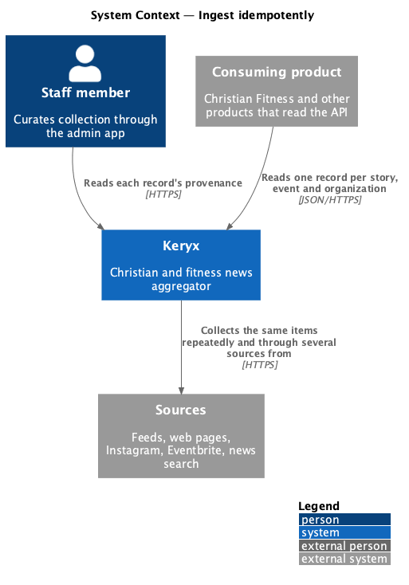
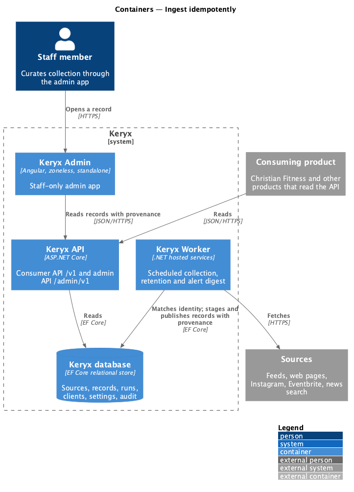
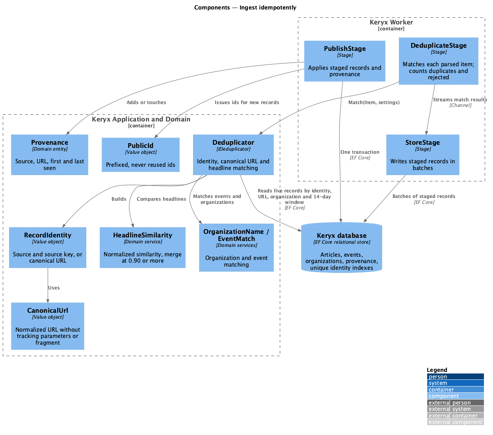
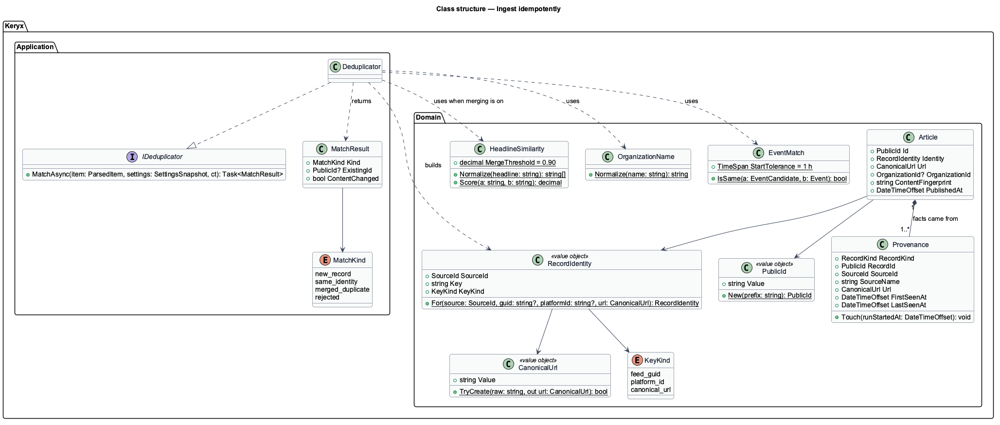
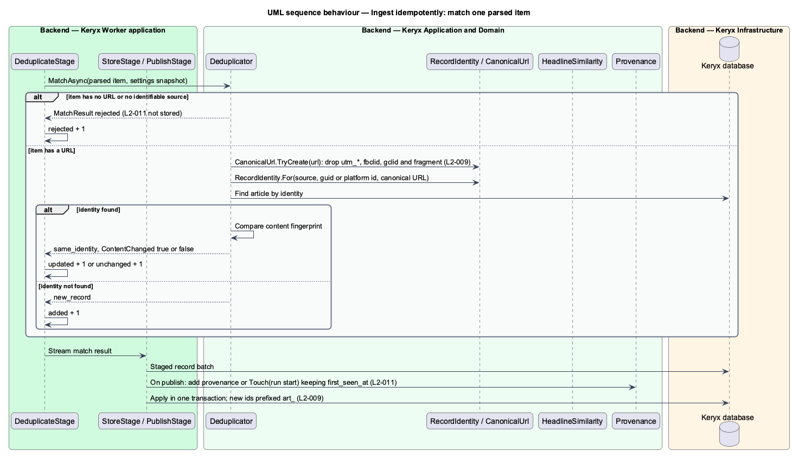
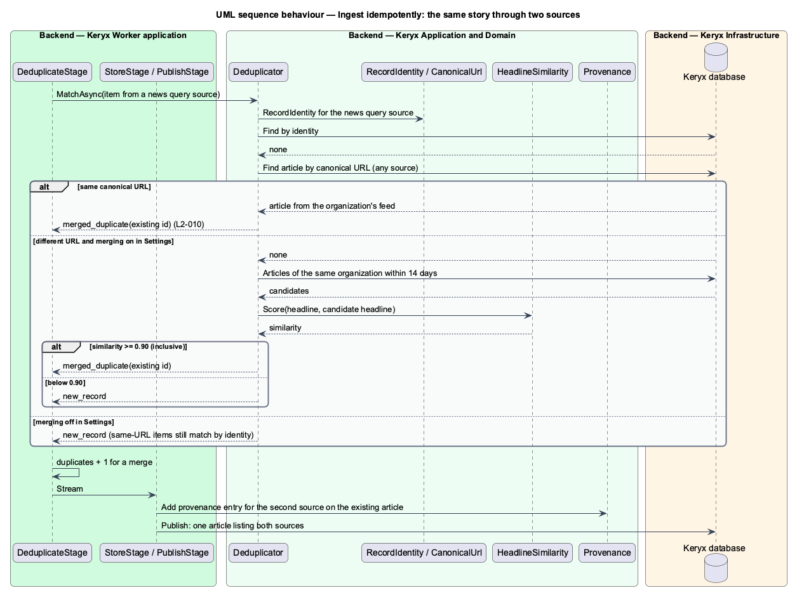
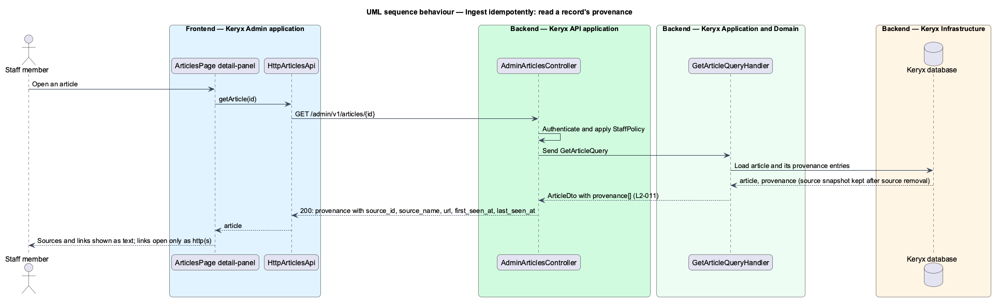

# Ingest idempotently

## Overview

Keryx collects from the same sources every few hours, and the same story often reaches it
through more than one source: an organization's own feed and a news search, for example. If each
collection added what it found, the database would fill with copies and consuming products would
show the same story twice. This feature makes ingestion idempotent: a second run over unchanged
sources changes nothing and counts no update, one story found through two sources is one record,
and every stored record keeps where its facts came from.

The terms below are used throughout:

- **record** — article, event or organization that Keryx stores and serves
- **identity** — key of a record that does not depend on when it was collected: the source and
  the item's key in that source (a feed GUID, a platform id or a canonical URL), or the
  normalized canonical URL where the source gives no key
- **canonical URL** — item URL normalized for matching: tracking parameters (`utm_*`,
  `fbclid`, `gclid`) and the fragment removed
- **duplicate** — item that is the same story as an existing article, found by canonical URL or
  by headline similarity, and merged into that article
- **provenance** — entry on a record naming the source, the source's name, the URL the fact was
  read from, `first_seen_at` and `last_seen_at`

The rules run in the `deduplicate`, `store` and `publish` stages of
[run-collection-pipeline](../run-collection-pipeline/README.md), and their counts appear on the
run ([record-runs-and-issues](../record-runs-and-issues/README.md)).

## Description

The matching rules are pure domain types with unit tests; the pipeline stages call them through
the `IDeduplicator` contract.

- **`CanonicalUrl`** — value object in `Keryx.Domain`. `TryCreate` parses an absolute
  `http(s)` URL, lower-cases the scheme and host, removes the fragment and the `utm_*`,
  `fbclid` and `gclid` parameters, and fails for anything else. Further normalization rules
  (trailing slash, default port, parameter order) are `<TO SUPPLY>`.
- **`RecordIdentity`** — value object: `SourceId` plus `Key`, where `KeyKind` is `feed_guid`,
  `platform_id` or `canonical_url`. The database holds a unique index on (`source_id`,
  `source_key`), so a second insert of the same identity cannot succeed.
- **`PublicId`** — value object for public ids with the prefixes `art_`, `run_`, `src_` (and
  `org_`, `evt_` from L2-017 and L2-028). An id is issued once, never reused, and never changes.
  The generation scheme is `<TO SUPPLY>`; the mocks show `run_2418`.
- **`HeadlineSimilarity`** — domain service. `Normalize` lower-cases, removes punctuation and
  collapses whitespace into words. `Score` is one minus the word-level edit distance divided by
  the longer headline's word count, to two decimals, so one word changed in ten scores exactly
  0.90. Merging happens at 0.90 inclusive. The backend tests hold the shared case table
  (identical; differing only in case, punctuation and whitespace; one word changed in ten;
  unrelated).
- **`OrganizationName`** — `Normalize` ignores case, punctuation, whitespace and a leading
  "The", so two sources naming one organization yield one organization.
- **`EventMatch`** — two events are one when they share an organization, their start times are
  within 1 hour, and they share a place; place normalization is `<TO SUPPLY>`.
- **`IDeduplicator`** / **`Deduplicator`** — contract and implementation in
  `Keryx.Application`. For each parsed item, `MatchAsync` returns a `MatchResult`:
  - `rejected` when the item has no URL or no identifiable source;
  - `same_identity` when the identity exists, with `ContentChanged` from a content fingerprint
    over the stored fields;
  - `merged_duplicate` when another source's article has the same canonical URL, or, with
    merging on in Settings (default on), an article of the same organization within 14 days has
    a headline similarity of at least 0.90;
  - `new_record` otherwise.
  The 14-day window is measured on `<TO SUPPLY>` (the source's publish time or the collection
  time).
- **`DeduplicateStage`** — counts `added`, `updated`, `unchanged`, `duplicates` and `rejected`
  from the match results; an unchanged item counts as neither added nor updated.
- **`StoreStage`** and **`PublishStage`** — stage and apply the changes. A new record gets a
  `PublicId` and one provenance entry; a matched record keeps its id and `first_seen_at`, its
  provenance entry for that source gets `last_seen_at` set to the run's start time, and a merge
  adds a provenance entry for the second source.
- **`Provenance`** — domain entity with `RecordKind`, `RecordId`, `SourceId`, a snapshot of
  `SourceName`, `Url`, `FirstSeenAt` and `LastSeenAt`. The snapshot keeps the source's name and
  URL readable after the source is removed; whether a removed source is soft-deleted or its
  foreign key set to null is `<TO SUPPLY>` (owned by the source catalogue design).
- **Read** — the admin record endpoints (for articles, `GET /admin/v1/articles/{id}`) serve
  `provenance` as a list of `source_id`, `source_name`, `url`, `first_seen_at` and
  `last_seen_at`. The admin app renders those values as text and opens a link only as
  `http(s)`.
- **Tests** — through the API: a fake source returns the same 5 items on two runs; the second
  run reports `added` 0, `updated` 0 and `unchanged` 5, and the articles table holds 5. Direct
  tests of `CanonicalUrl` and `HeadlineSimilarity` use one case per row.

## Requirements

The feature realizes the following level-2 (L2) requirements. Each L2 requirement refines a
level-1 (L1) requirement, cited by identifier. Their acceptance criteria are in
[L2.md](../../../specs/L2.md).

| L2 ID | Refines (L1) | Requirement |
|-------|--------------|-------------|
| `L2-009` | `L1-003` | Stable identity — Every record has an identity that does not depend on when it was collected: the source and the item's key in that source (a feed GUID, a canonical URL, a platform id), or, where a source gives no key, the normalized canonical URL. |
| `L2-010` | `L1-003` | Deduplication across sources — When merging is on (Settings, default on), an item that is the same story as an existing article is merged into it: same canonical URL, or a headline whose normalized similarity to an existing article of the same organization within 14 days is at least 0.90. |
| `L2-011` | `L1-003` | Provenance — Every stored record carries where each of its facts came from; an item with no identifiable source or URL is not stored. |

## Diagrams

### System context

Keryx collects the same items repeatedly and through more than one source, and serves one record per
story, event and organization, with its provenance.

### Containers

The Keryx Worker matches and stores records in the Keryx database; the Keryx API serves them
with their provenance to staff and consuming products.

### Components

`DeduplicateStage` calls `Deduplicator`, which builds a `RecordIdentity` from a `CanonicalUrl`
and compares headlines with `HeadlineSimilarity`; `PublishStage` issues `PublicId` values and
adds or touches `Provenance`.

### Class structure

An `Article` owns its `RecordIdentity` and one or more `Provenance` entries; `Deduplicator`
returns a `MatchResult` of one of four kinds.

### Behaviour — match one parsed item

An item without a URL or source is rejected; otherwise its identity decides between added,
updated and unchanged, and publishing keeps `first_seen_at` while moving `last_seen_at`.

### Behaviour — the same story through two sources

A same-URL item merges whatever the merge setting; a different-URL item merges only with merging
on and a headline similarity of at least 0.90 within 14 days.

### Behaviour — read a record's provenance

Staff read a record's provenance through the admin endpoint, including entries whose source was
removed.

