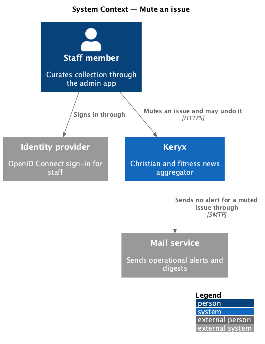
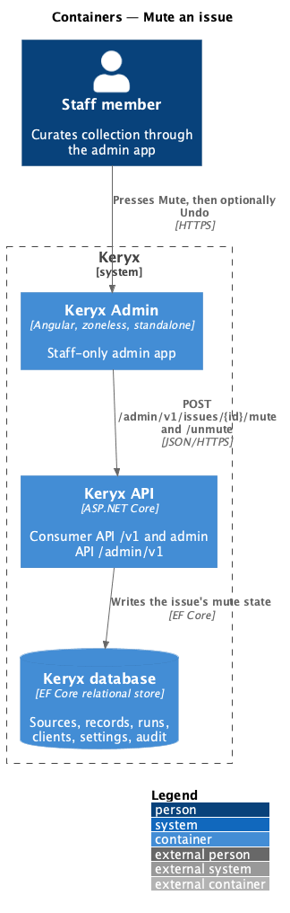
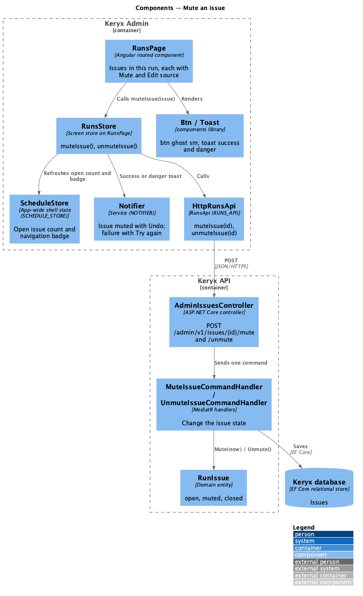
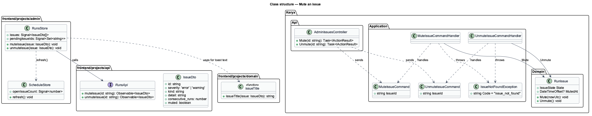
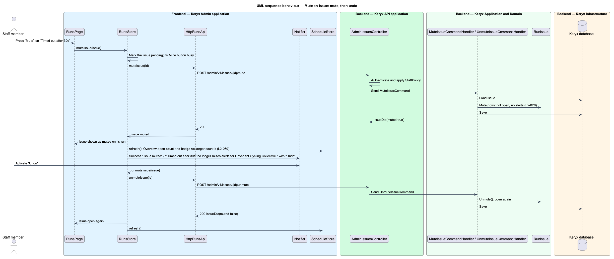
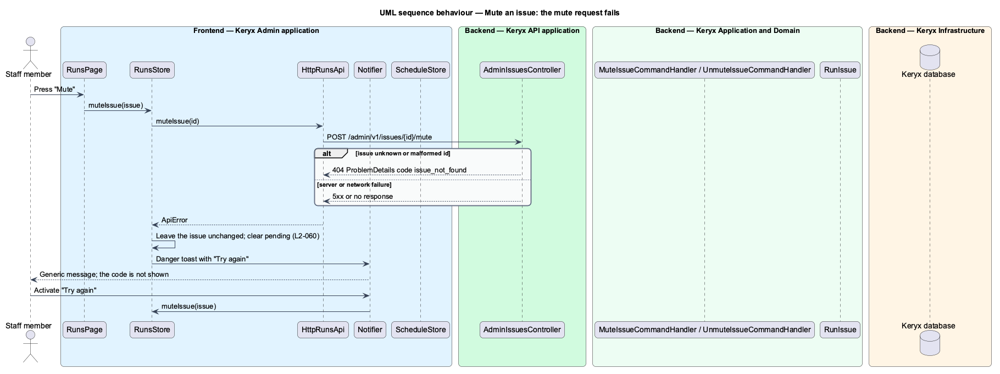

# Mute an issue

## Overview

Some problems a run finds are known and accepted for a while: a source whose site is down for a
week, or a news query that always holds a few articles for review. While such an issue stays
open it keeps counting in Overview's "Needs attention", in the Runs badge, and in the alert
e-mails. This feature lets staff mute one issue from the run detail on the Runs screen, with Undo,
so it stops raising alerts and stops counting as open until its source recovers.

The terms below are used throughout:

- **issue** — problem found during a run, for one source or stage and one kind (defined in
  [record-runs-and-issues](../record-runs-and-issues/README.md))
- **mute** — staff action that marks one issue `muted`: it is not counted as open, raises no
  alerts, and is still listed on its run
- **undo** — action in the confirmation notification that unmutes the issue at once

Each issue in "Issues in this run" on `pages/runs/default.html` has a ghost **Mute** button
beside **Edit source**. Pressing it shows the success notification of
`notifications/run-toast/success.html`. A mute clears itself when the source next succeeds
without that problem, so a later recurrence is a new open issue.

## Description

The slice runs from the run detail's issue list through the admin issue endpoints to the issue
entity.

- **`RunsPage`** — routed component in the `admin` app. Each issue in the run detail `list`
  shows its severity as a word, its title and subject, its detail, and two **`Btn`** actions:
  "Mute" (ghost, small) and "Edit source". While its request is pending, the Mute button is busy.
- **`RunsStore`** — screen store provided on `RunsPage`. `muteIssue(issue)` sends one request
  and changes nothing on screen until the server answers.
  - On `200`, it marks the issue muted and asks the shell's `ScheduleStore` to refresh, so
    Overview's open count and the navigation badge no longer count it. It then asks `Notifier`
    for a success toast titled "Issue muted" with "“Timed out after 30s” no longer raises alerts
    for Covenant Cycling Collective." and the action "Undo".
  - "Undo" calls `unmuteIssue(issue)`, which sends the unmute request and marks the issue open
    again.
  - On failure, the issue stays unchanged and a danger toast offers "Try again". No mock shows
    this toast; its copy is `<TO SUPPLY>`. A `404` `issue_not_found` shows the same generic
    message.
- **`issueTitle`** — pure helper in the `domain` library that turns an issue's `kind` and its
  numeric fields into the title used in the list and the toast ("Timed out after 30s", "Feed
  returned 404"). Which numeric fields carry the status code and the time-out is `<TO SUPPLY>`;
  the source name comes from the issue's subject. Both are rendered as text.
- **`ScheduleStore`** — the app-wide shell state (L2-089). `refresh()` re-reads the open issue
  count that Overview and the navigation badge show. The Overview mock note says the Runs badge
  counts failing sources (2), while L2-060 says it counts open issues; which count the badge shows
  is `<TO SUPPLY>`.
- **`Btn`**, **`Toast`** — presentation components in the `components` library.
- **`RunsApi`** / **`RUNS_API`** — `muteIssue(id)` and `unmuteIssue(id)`, implemented by
  `HttpRunsApi` and bound in `app.config.ts`.
- **`AdminIssuesController`** — under `StaffPolicy`. `POST /admin/v1/issues/{id}/mute` sends
  `MuteIssueCommand`; `POST /admin/v1/issues/{id}/unmute` sends `UnmuteIssueCommand`. Each
  answers `200` with the issue's `IssueDto`, or `404` with `code` `issue_not_found` for an
  unknown or malformed id.
- **`MuteIssueCommandHandler`** and **`UnmuteIssueCommandHandler`** — load the `RunIssue`, call
  `Mute(now)` (time from `TimeProvider`) or `Unmute()`, and save. Muting an already muted issue,
  or unmuting an open one, changes nothing and answers `200`. The answer for a closed issue is
  `<TO SUPPLY>`. Each change is a staff action recorded by the audit design (L2-085).
- **`RunIssue`** — domain entity; `Mute` moves `open` to `muted` and sets `MutedAt`, and
  `Unmute` moves `muted` to `open`. The alert design (L2-077) reads only `open` issues.

## Requirements

The feature realizes the following level-2 (L2) requirements. Each L2 requirement refines a
level-1 (L1) requirement, cited by identifier. Their acceptance criteria are in
[L2.md](../../../specs/L2.md).

| L2 ID | Refines (L1) | Requirement |
|-------|--------------|-------------|
| `L2-020` | `L1-006` | Run issues and muting — A problem found during a run is an issue: a severity (`error`, `warning`), a kind (`source_not_found`, `source_timeout`, `source_blocked`, `source_invalid`, `items_held`, `stage_failed`, `run_skipped`), the source or stage it concerns, a short detail, and how many runs in a row it has occurred. |
| `L2-060` | `L1-013` | Mute an issue from the admin app — Staff can mute an open issue from a run's detail and undo the mute from the notification that reports it. |

## Diagrams

### System context

Staff mute an issue in Keryx; Keryx then sends no alert for it through the mail service.

### Containers

The Keryx Admin app sends mute and unmute to the Keryx API, which stores the issue's state in the
Keryx database.

### Components

`RunsStore` calls the issue endpoints, shows the notification, and refreshes the shell's open
count; `AdminIssuesController` sends one command per request.

### Class structure

The frontend store depends on the `RunsApi` contract and the `issueTitle` helper; the backend
handlers change `RunIssue` and refuse an unknown id with `IssueNotFoundException`.

### Behaviour — mute, then undo

A successful mute updates the issue, the open count and the badge, and offers Undo, which sends
the unmute request.

### Behaviour — the mute request fails

A failed mute leaves the issue unchanged and offers "Try again" with a generic message.

