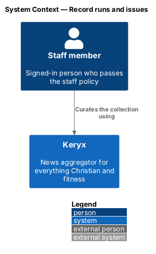
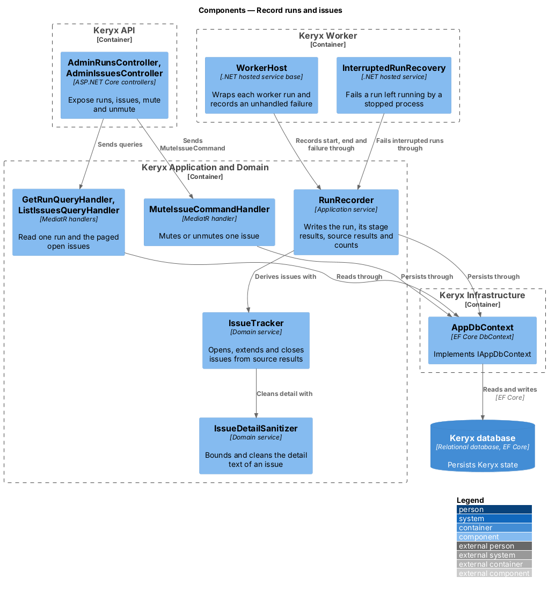
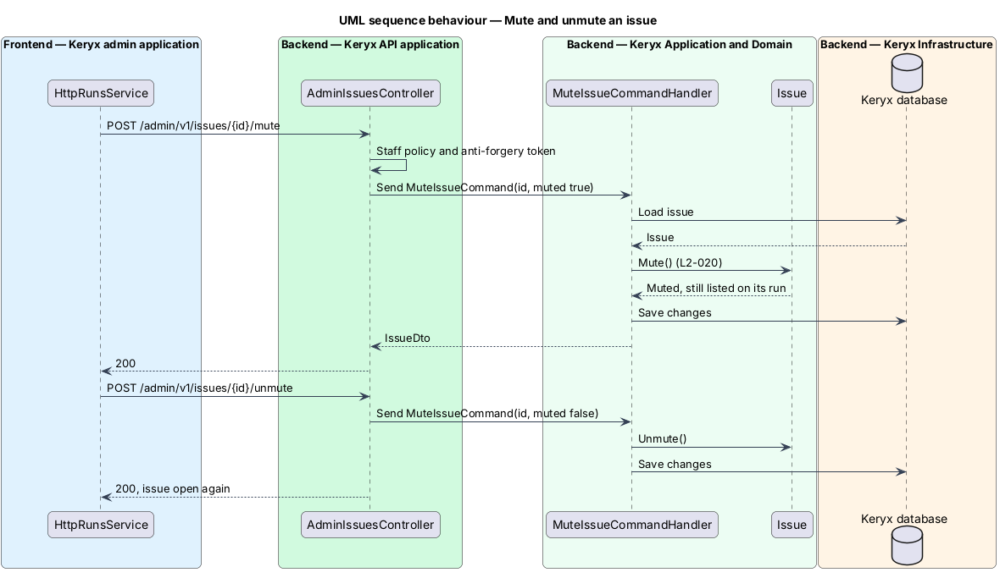

# Record runs and issues

## Overview

Each run of each worker is recorded, however it ends. Keryx has three workers: `collection`, `retention` and `alert_digest`. A run record names the worker, what started it, when it started and finished, its outcome, and counts of what it did. The admin application reads these records, and each count is served as a number.

A problem found during a run is kept as an *issue* that staff can act on. An issue has a severity, a kind, the source or stage it concerns, a short detail, and how many runs in a row it has occurred. A staff member can mute an issue; a muted issue is not counted as open and raises no alert. When the source next succeeds without the problem, the issue closes and the mute clears.

A worker that throws, or a process that stops during a run, still leaves a record: the run is `failed` with a generic reason. One worker failing does not affect the others.

> **issue** — problem found during a run, with a severity, a kind, a subject and a streak

> **streak** — number of consecutive runs in which the same kind of problem occurred on the same source

## Description

The slice has a write side in the worker (the recorder and the host's failure handling) and a read side in the API (run and issue queries, mute and unmute).

- **`RunRecorder`** — Application service in the Application and Domain layers. Writes the run, its stage results, source results and counts.
- **`WorkerHost`** — .NET hosted service base in the Keryx Worker. Wraps each worker run. An unhandled exception is caught, the run is recorded as `failed` with a generic reason and a correlation id, and the worker's next scheduled run still starts.
- **`InterruptedRunRecovery`** — .NET hosted service in the Keryx Worker. Runs before any worker starts. A run still `running` from a stopped process is recorded as `failed` with reason `interrupted`.
- **`IssueTracker`** — Domain service in the Application and Domain layers. Opens an issue when a source fails or holds items, raises `consecutive_runs` when the same kind recurs on the next run and keeps `since` at the first of them, and closes the issue and clears its mute when the source next succeeds without the problem.
- **`IssueDetailSanitizer`** — Domain service in the Application and Domain layers. Bounds the detail to 300 characters and removes any query string, credential, internal host name and IP address.
- **`AdminRunsController, AdminIssuesController`** — ASP.NET Core controllers in the Keryx API. Expose runs, issues, mute and unmute.
- **`GetRunQueryHandler, ListIssuesQueryHandler`** — MediatR handlers in the Application and Domain layers. Read one run and the paged open issues. Open issues are ordered errors before warnings and, within a severity, longest-running first. A run in progress has outcome `running`, `finished_at` `null`, and `sources_checked` and `sources_total` that advance.
- **`MuteIssueCommandHandler`** — MediatR handler in the Application and Domain layers. Mutes or unmutes one issue.
- **`AppDbContext`** — EF Core DbContext in the Infrastructure layer. Implements IAppDbContext.
- **`Run`** — entity with `Worker`, `Trigger`, `StartedAt`, `FinishedAt`, `DurationMs`, `Outcome` and the counts `Added`, `Updated`, `Unchanged`, `Duplicates`, `Held`, `OffTopic`, `Rejected`, `SourcesOk`, `SourcesFailed`.
- **`Issue`** — entity with `Severity` (`error`, `warning`), `Kind` (`source_not_found`, `source_timeout`, `source_blocked`, `source_invalid`, `items_held`, `stage_failed`, `run_skipped`), subject, `Detail`, `ConsecutiveRuns`, `Since` and `State`.

## Requirements

The feature realizes the following level-2 (L2) requirements. Each L2 requirement refines a level-1 (L1) requirement, cited by identifier. The acceptance criteria of each requirement are in [`docs/specs/L2.md`](../../../specs/L2.md).

| L2 ID | Refines (L1) | Requirement |
|-------|--------------|-------------|
| [`L2-019`](../../../specs/L2.md#l2-019-run-record) | `L1-006` | **Run record.** The requirement is defined by its 6 acceptance criteria. |
| [`L2-020`](../../../specs/L2.md#l2-020-run-issues-and-muting) | `L1-006` | **Run issues and muting.** A problem found during a run is an issue: a severity (`error`, `warning`), a kind (`source_not_found`, `source_timeout`, `source_blocked`, `source_invalid`, `items_held`, `stage_failed`, `run_skipped`), the source or stage it concerns, a short detail, and how many runs in a row it has occurred. |

## Diagrams

### System context

A staff member curates the collection through Keryx.

### Containers

The staff member uses the Keryx admin application. The Keryx admin application calls the Keryx API at `/admin/v1`. The Keryx API reads and writes the Keryx database. The Keryx Worker reads and writes the Keryx database.

### Components

In the worker, `WorkerHost` and `RunCollectionCommandHandler` report to `RunRecorder`, which uses `IssueTracker`. In the API, the two controllers send queries and the mute command.

### Class structure

A `Run` owns its `StageResult` and `Issue` collections. `Issue` owns the mute, unmute and close transitions.

### Behaviour — record a run that fails unexpectedly

`WorkerHost` records the start, catches the exception and records the failure with a generic reason and a correlation id (`L2-019`). The next scheduled run of the worker still starts.

### Behaviour — mute and unmute an issue

Muting changes one issue and leaves it listed on its run with `muted: true`. A later successful fetch closes the issue and clears the mute.

