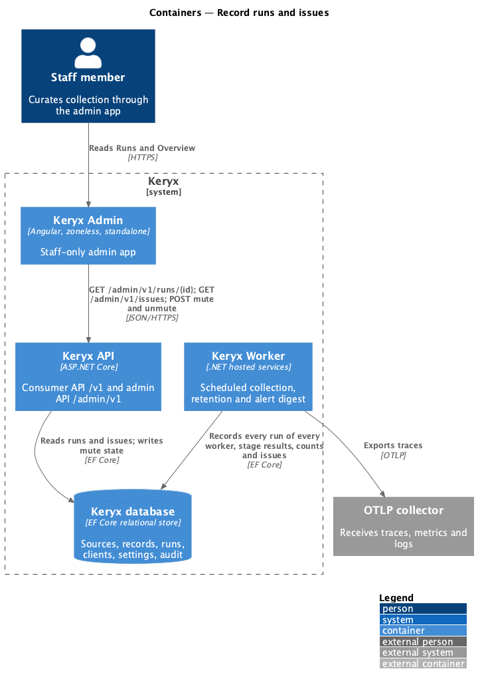
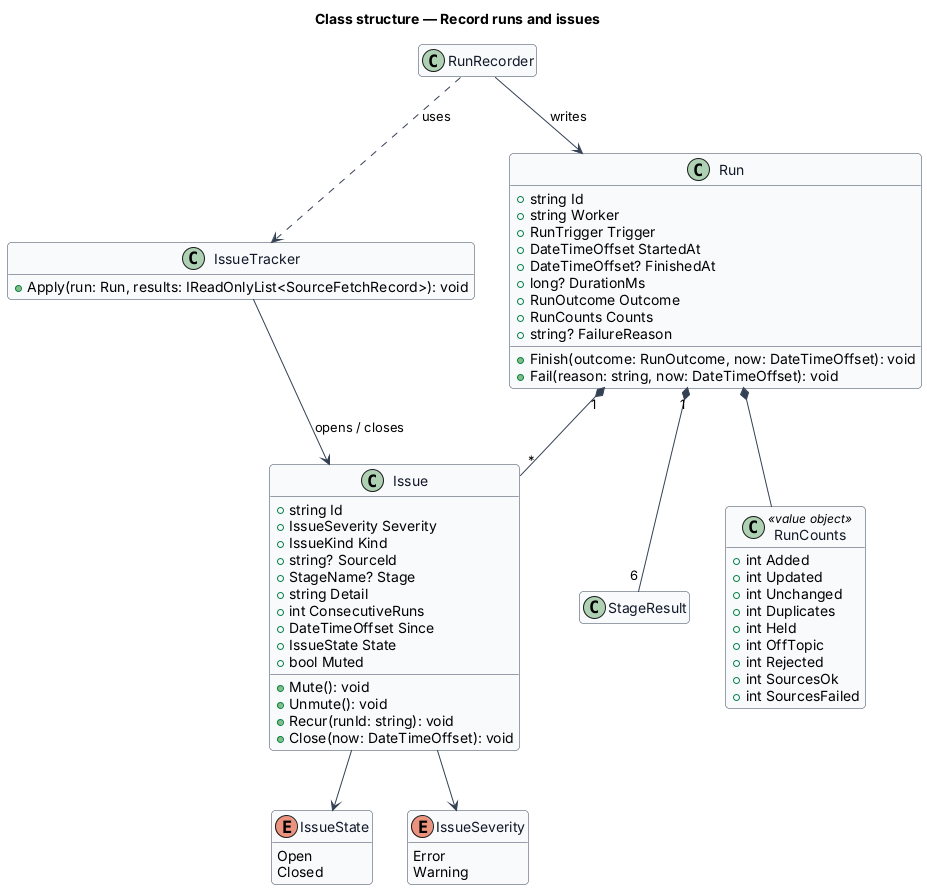
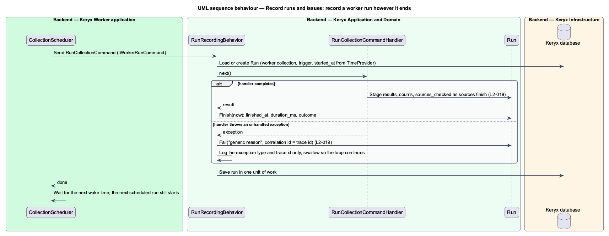
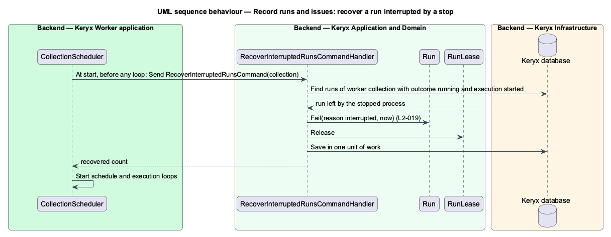
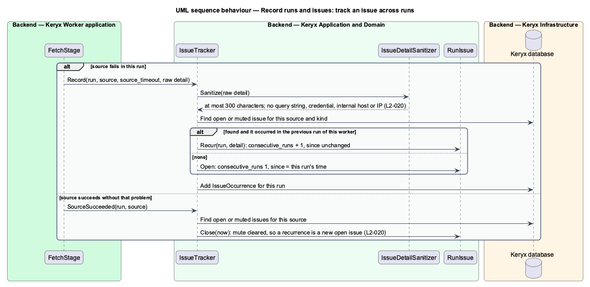
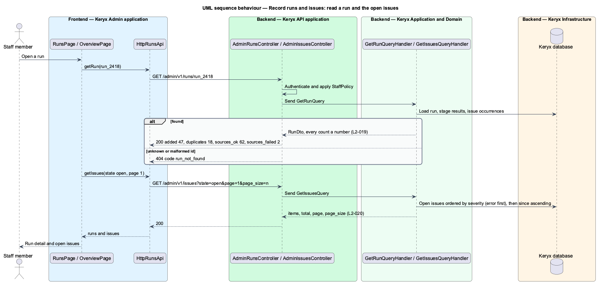

# Record runs and issues

## Overview

Keryx works unattended: its workers collect, prune and send digests on their own schedules.
Staff learn what happened only from what those workers record. This feature records every run of
every worker, whatever its end, and keeps the problems found during runs as issues that staff can
read and mute. The admin app's Overview and Runs screens, the alerts, and the consumer status
endpoint all read these records.

The terms below are used throughout:

- **worker** — background job of the Keryx Worker; there are three: `collection`, `retention`
  and `alert_digest`
- **run record** — row describing one run of one worker: trigger, times, outcome, stage results
  and counts
- **issue** — problem found during a run, with a severity, a kind, the source or stage it
  concerns, a short detail, and how many runs in a row it has occurred
- **issue occurrence** — link between an issue and one run in which it occurred, so an issue is
  listed on every run that raised it
- **muted issue** — issue that staff have silenced: not counted as open and raising no alerts
  until its source recovers
- **interrupted run** — run that was in progress when the worker process stopped

Muting from the admin app is [mute-issue](../mute-issue/README.md); the runs themselves are
produced by [schedule-collection](../schedule-collection/README.md),
[run-collection-now](../run-collection-now/README.md) and
[run-collection-pipeline](../run-collection-pipeline/README.md).

## Description

Recording is a cross-cutting MediatR behaviour, so no worker records its own run and no worker
checks anything itself.

- **`Run`** — domain entity with `PublicId` (`run_`), `Worker`, `Trigger` (`schedule`,
  `manual`), `StartedAt`, `FinishedAt`, `DurationMs`, `Outcome` (`running`, `succeeded`,
  `completed_with_issues`, `failed`), `FailureReason`, `CorrelationId`, six `StageResult`
  entries, `RunCounts` and `SourcesChecked` / `SourcesTotal`. All times are UTC.
- **`RunCounts`** — value object holding `added`, `updated`, `unchanged`, `duplicates`, `held`,
  `off_topic`, `rejected`, `sources_ok` and `sources_failed` as integers.
- **`IWorkerRunCommand`** — marker implemented by `RunCollectionCommand` and by the retention
  and alert digest run commands.
- **`RunRecordingBehavior`** — MediatR pipeline behaviour in `Keryx.Application` for every
  `IWorkerRunCommand`. The handler loads and finishes its own run. When the handler throws, the
  behaviour records the run the worker's lease names as `failed` with the reason "The run
  stopped unexpectedly." and the current trace id (or a new one) as `correlation_id`, in a scope
  of its own, and frees the lease. It logs only the exception type and trace id, and does not
  rethrow, so the worker's next scheduled run still starts.
- **Worker isolation** — `CollectionScheduler`, `RetentionWorker` and `AlertDigestWorker` are
  separate hosted services with their own loops and schedules. A failure in one does not stop the
  others.
- **`RecoverInterruptedRunsCommand`** and its handler — each worker sends it once at start,
  before any new run. It records every run of that worker still `running` with execution started
  as `failed` with reason `interrupted`, and releases the worker's `RunLease`.
- **`RunIssue`** — domain entity with `PublicId` (prefix `iss`), `Severity` (`error`,
  `warning`), `Kind` (`source_not_found`, `source_timeout`, `source_blocked`, `source_invalid`,
  `items_held`, `stage_failed`, `run_skipped`), `SourceId` or `Stage`, `Detail`,
  `ConsecutiveRuns`, `Since` and `State` (`open`, `muted`, `closed`). `Mute`, `Unmute` and
  `Close` change the state; `Close` also clears a mute.
- **`IssueOccurrence`** — one row per issue per run, holding that run's detail, so a muted issue
  is still listed on its run with `muted: true`.
- **`IssueTracker`** — `SourceIssueTracker` in `Keryx.Application`, called by the pipeline for
  each source (it reads the issues through `IAppDbContext`). A fetch failure is an `error`:
  `not_found` is `source_not_found`, `timeout` is `source_timeout`, `invalid_content` is
  `source_invalid`, and `blocked_by_robots`, `refused` and `unsafe_address` are
  `source_blocked`. Its detail is a sentence such as "Nothing was found at
  https://redeemedrun.ca/feed." or "The source did not answer within 30s on 3 attempts.". A
  source with items held for review has an `items_held` `warning`, "6 items held for review:
  their relevance score is between 0.45 and 0.60.". A failure of another kind closes the
  source's other issues. When a source fails, it continues
  the open or muted issue of the same source and kind if that issue occurred in the worker's
  previous run (`consecutive_runs` + 1, `since` unchanged), and otherwise opens a new issue with
  `consecutive_runs` 1. When a source succeeds without that problem, it closes the source's
  issues, so a later recurrence is a new open issue.
- **`IssueDetailSanitizer`** — bounds a detail to 300 characters and removes query strings,
  credentials (user information in URLs, key and token values), internal host names and IP
  addresses before storage.
- **`AdminRunsController`** — `GET /admin/v1/runs/{id}` sends `GetRunQuery`. It returns
  `id`, `worker`, `trigger`, `started_at`, `finished_at`, `duration_ms`, `outcome`,
  `failure_reason`, `correlation_id`, every count as a number, `sources_checked`,
  `sources_total`, the stages (`stage`, `status`, `duration_ms`, `counts` as an object of named
  numbers, `reason`) and the run's issues. A stage not run has `duration_ms` 0 and no counts. A running
  run has `outcome` `running` and `finished_at` `null`. An unknown or malformed id answers `404`
  with `code` `run_not_found`; the code follows the `…_not_found` pattern of L2-083 and is not
  named in L2-019.
- **`AdminIssuesController`** — `GET /admin/v1/issues?state=open&page=&page_size=` sends
  `GetIssuesQuery`. It returns `items`, `total`, `page` and `page_size` as numbers, with errors
  before warnings and, within a severity, the longest-running first (`since` ascending). The
  maximum `page_size` is `<TO SUPPLY>`. Each item has `id`, `severity`, `kind`, the source or
  stage, `detail`, `consecutive_runs`, `since` and `muted`. `POST /admin/v1/issues/{id}/mute`
  and `/unmute` send `MuteIssueCommand` and `UnmuteIssueCommand` and answer `200` with the issue;
  an unknown id answers `404` with `code` `issue_not_found`. The answer for muting a closed issue
  is `<TO SUPPLY>`.
- **Alerts** — the alert design (L2-077) reads only issues in state `open`, so a muted issue
  raises no alert.
- **Tests** — `Keryx.Api.Tests` run each worker's handler directly (no background service in
  the shared host), inject a throwing handler to prove the `failed` record, and create a
  `running` run before starting the host to prove `interrupted`.

## Requirements

The feature realizes the following level-2 (L2) requirements. Each L2 requirement refines a
level-1 (L1) requirement, cited by identifier. Their acceptance criteria are in
[L2.md](../../../specs/L2.md).

| L2 ID | Refines (L1) | Requirement |
|-------|--------------|-------------|
| `L2-019` | `L1-006` | Run record — Every run of every worker is recorded with its trigger, times, outcome, stage results and counts, whether it succeeds or fails. |
| `L2-020` | `L1-006` | Run issues and muting — A problem found during a run is an issue: a severity (`error`, `warning`), a kind (`source_not_found`, `source_timeout`, `source_blocked`, `source_invalid`, `items_held`, `stage_failed`, `run_skipped`), the source or stage it concerns, a short detail, and how many runs in a row it has occurred. |

## Diagrams

### System context

Staff read runs and issues in Keryx; open, unmuted issues drive alerts through the mail service,
and run correlation ids match traces in the OTLP collector.

### Containers

The Keryx Worker records runs and issues in the Keryx database; the Keryx API serves them to the
Keryx Admin app and accepts mute and unmute.

### Components

`RunRecordingBehavior` records every worker run; `IssueTracker` and `IssueDetailSanitizer` keep
issues; two admin controllers serve runs and issues through query and command handlers.

### Class structure

A `Run` holds its counts and six stage results and lists the `IssueOccurrence` rows of the
issues it raised; a `RunIssue` spans the consecutive runs in which it occurred.

### Behaviour — record a worker run however it ends

The behaviour finishes the run on success, and on an unhandled exception records it `failed`
with a generic reason and a correlation id without stopping the worker.

### Behaviour — recover an interrupted run

At start each worker records any run it left `running` as `failed` with reason `interrupted`
before a new run begins.

### Behaviour — track an issue across runs

A repeated failure of the same kind extends the issue's streak; a success closes the issue and
clears its mute.

### Behaviour — read a run and the open issues

Staff read one run with every count as a number, and the open issues ordered errors first and
longest-running first, paged.

