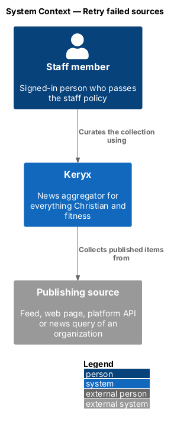
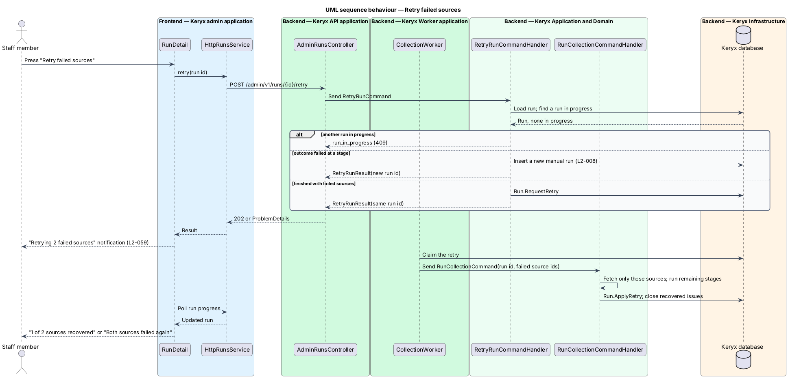

# Retry failed sources

## Overview

A finished run can leave sources that failed to fetch. A staff member retries them from the run's detail on the Runs screen with "Retry failed sources". A retry fetches only the failed sources again, passes their items through the remaining stages, and updates the counts and issues of that same run; it creates no new run.

A run whose outcome is `failed` at a stage has nothing to add to; a retry request for it starts a new manual run and returns its id. A retry while another run is in progress is refused with `409` and `code` `run_in_progress`.

## Description

The slice reuses the pipeline with a source filter. The admin application reports the retry in three notifications: started, partly recovered, and failed again.

- **`RunDetail`** — Angular component in the Keryx admin application. Shows one run and the retry action. "Retry failed sources" is absent for a run with outcome `succeeded` and no failed source. The button is busy while the request is in flight and sends one request.
- **`RunsStore`** — Angular signal store in the Keryx admin application. Holds the run list, the selected run and its progress. On the end of a retry it updates the tiles and raises "1 of 2 sources recovered" or "Both sources failed again".
- **`HttpRunsService`** — Angular service in the Keryx admin application. Calls POST /admin/v1/runs/{id}/retry.
- **`AdminRunsController`** — ASP.NET Core controller in the Keryx API. Exposes the retry endpoint.
- **`RetryRunCommandHandler`** — MediatR handler in the Application and Domain layers. Marks the failed sources of a finished run for retry. For a run with outcome `failed` it starts a new manual run and returns that id. It refuses with `run_in_progress` while any collection run is in progress.
- **`CollectionWorker`** — .NET BackgroundService in the Keryx Worker. Claims the retry and executes it.
- **`RunCollectionCommandHandler`** — MediatR handler in the Application and Domain layers. Runs the pipeline for the named sources. It updates `sources_ok` and `sources_failed` on the same run and closes the issue of each recovered source; the outcome stays `completed_with_issues` while a source still fails.
- **`AppDbContext`** — EF Core DbContext in the Infrastructure layer. Implements IAppDbContext.
- **`RetryRunCommand`** — MediatR request carrying the run id.
- **`RetryRunResult`** — DTO with `run_id` and `new_run`, a boolean that tells the admin application whether a new run was started.

## Requirements

The feature realizes the following level-2 (L2) requirements. Each L2 requirement refines a level-1 (L1) requirement, cited by identifier. The acceptance criteria of each requirement are in [`docs/specs/L2.md`](../../../specs/L2.md).

| L2 ID | Refines (L1) | Requirement |
|-------|--------------|-------------|
| [`L2-008`](../../../specs/L2.md#l2-008-source-isolation-and-retry-within-a-run) | `L1-002` | **Source isolation and retry within a run.** The requirement is defined by its 6 acceptance criteria. |
| [`L2-059`](../../../specs/L2.md#l2-059-retry-failed-sources) | `L1-013` | **Retry failed sources.** The requirement is defined by its 5 acceptance criteria. |

## Diagrams

### System context

A staff member curates the collection through Keryx. Keryx collects published items from publishing sources.

### Containers

The staff member uses the Keryx admin application. The Keryx admin application calls the Keryx API at `/admin/v1`. The Keryx API reads and writes the Keryx database. The Keryx Worker reads and writes the Keryx database. The Keryx Worker fetches the publishing source.

### Components

`RunDetail` requests the retry through `HttpRunsService`. `RetryRunCommandHandler` records the request; `CollectionWorker` claims it and `RunCollectionCommandHandler` runs the pipeline for those sources.

### Class structure

`RetryRunCommandHandler` loads a `Run` and calls `RequestRetry`; `Run.ApplyRetry` updates the counts and closes recovered issues.

### Behaviour — retry failed sources

The request is recorded and answered at once; the worker performs the fetches. The same run is updated, and the admin application learns of the end through its progress polling.

