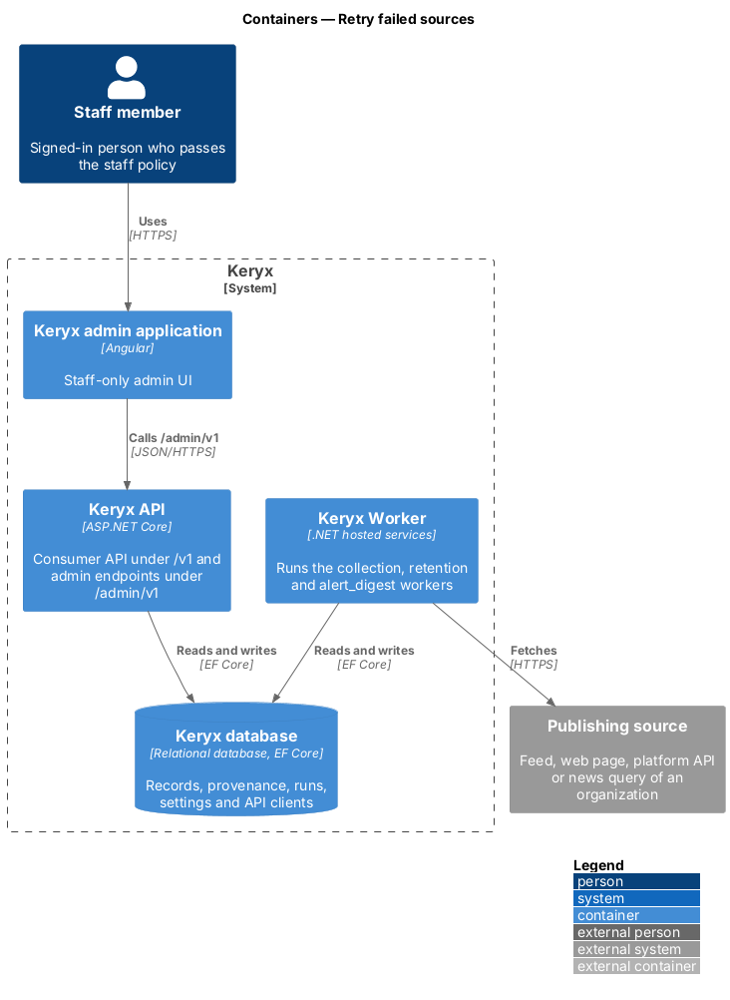
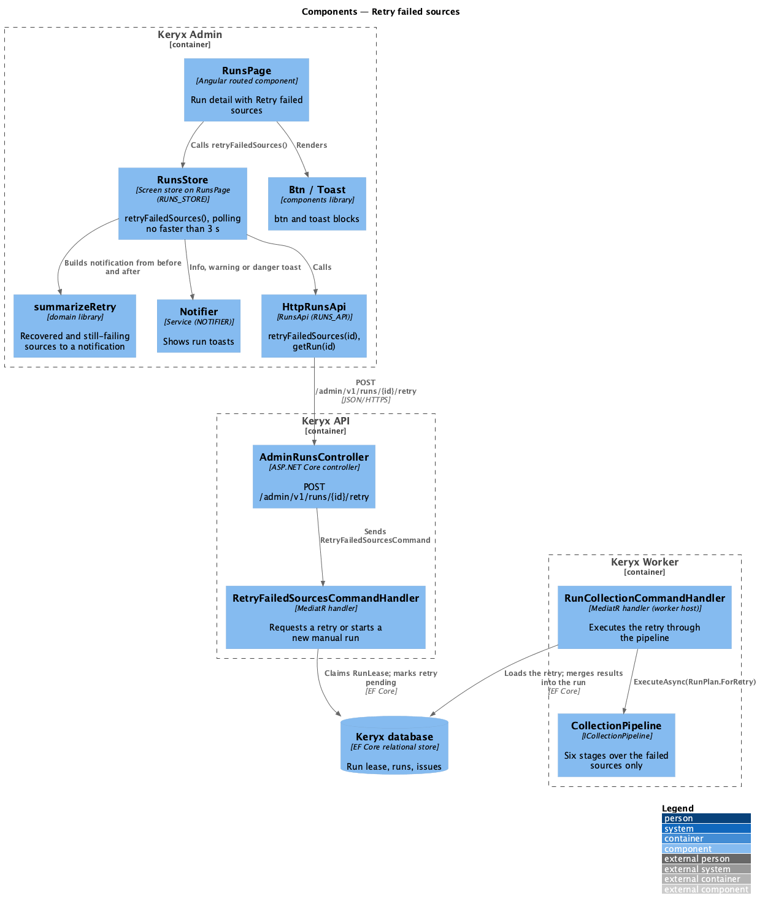
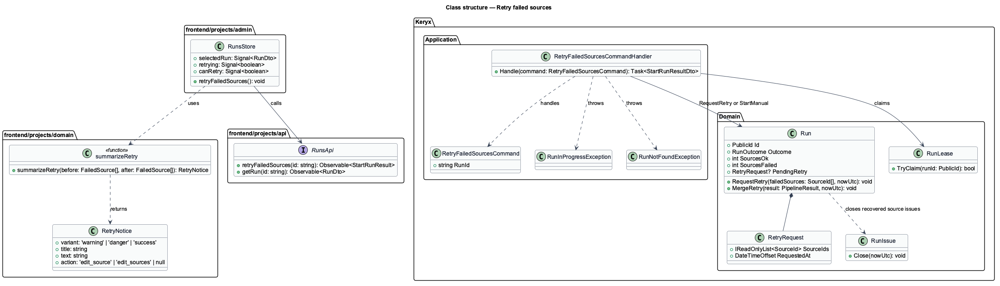
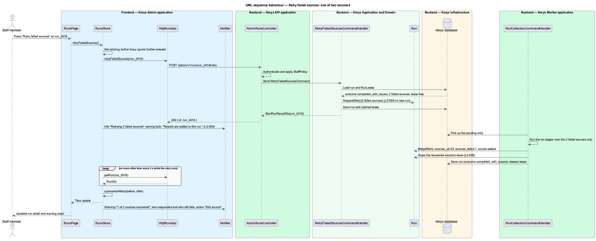
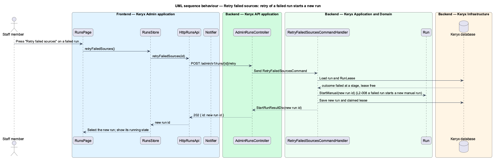
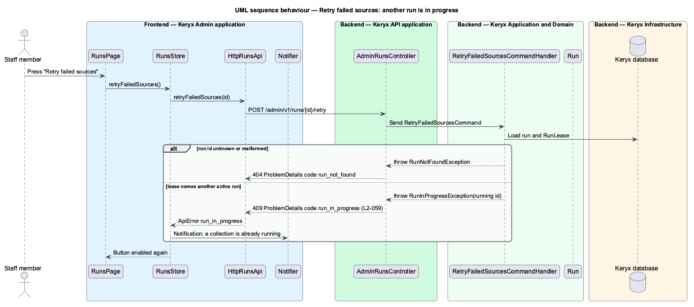

# Retry failed sources

## Overview

A collection run can finish with some sources failed: a feed answers `404`, or a page times out
after every attempt. Waiting for the next scheduled run to try them again can mean hours with
nothing from those sources. This feature lets staff fetch only a run's failed sources again from
the run's detail on the Runs screen, adds the results to that same run, and tells staff which
sources recovered.

The terms below are used throughout:

- **failed source** — source whose fetch failed in a run after its last attempt, recorded with
  its reason and an open issue
- **retry** — second pass of the pipeline over a finished run's failed sources only, whose counts
  and issues are merged into that same run; no new run is created
- **recovered source** — failed source that answers during a retry; its issue is closed

The button **Retry failed sources** sits in the run detail card of `pages/runs/default.html`.
The notifications are the run toasts: `notifications/run-toast/info.html` when the retry starts,
`warning.html` when some recover and `danger.html` when none do. A run whose outcome is `failed`
at a stage has no useful partial result, so retrying it starts a new manual run instead.

## Description

The slice runs from the run detail through the admin API to the worker, which executes the retry
with the same pipeline as any run ([run-collection-pipeline](../run-collection-pipeline/README.md)).

- **`RunsPage`** — routed component in the `admin` app. The run detail `card` shows a **`Btn`**
  "Retry failed sources" unless the run has no failed source and an outcome of `succeeded`. The
  button is busy while the request is pending.
- **`RunsStore`** — screen store provided on `RunsPage`'s routed component, behind a contract
  and token in the `api` library. `retryFailedSources()` sends the request once while
  `retrying` is set.
  - On `202`, it asks `Notifier` for an info toast "Retrying 2 failed sources" with the source
    names and "Results are added to this run."
  - It then polls `RunsApi.getRun(id)` no more often than every 3 seconds (L2-058), stops when
    the retry ends or the screen is left (`takeUntilDestroyed`), updates the tiles, and passes
    the failed sources before and after to `summarizeRetry`.
  - When the response carries a different run id (a failed run was retried), it selects that new
    run.
  - On `409` `run_in_progress`, an info notification reads "Collection already running" and
    "Retry failed sources once it has finished.", and the watcher follows the run named by
    `run_id`. No mock shows this notification; its copy is decided here (journey 16).
  - As built (journey 16): the button shows while `canRetryFailedSources(run)` holds (domain
    library, case table): a run that `failed`, or a finished run with `sources_failed` above 0.
    A run completed with issues but no failed source (held items only) shows none, matching
    the server's `nothing_to_retry`. The info notification's names are the run's `error`
    issues about a source, up to two and then "and N more" (`namedFew`, shared with the
    collection outcome notice). When the answer names a new run (the original failed), the
    notification reads "Collection started" and "The run failed, so a new run checks every
    source.", and Runs opens that run. Any other refusal reads "Retry didn’t start" with the
    reference and "Try again". The store does not poll: `CollectionWatcher` follows the run in
    progress (Run collection now design), which Runs' list now finds wherever it is listed,
    since a retried run need not be the newest.
- **`summarizeRetry`** — pure helper in the `domain` library with unit tests. One of two
  recovered gives a warning titled "1 of 2 sources recovered" naming which responded and which
  still fails, with the action "Edit source". None recovered gives a danger notification "Both
  sources failed again" with the reasons and "Edit sources".
  - As built (journey 16): `summarizeRetry(before, after)` takes the failed sources before and
    after the retry (`failedSources(issues)`: a run's `error` issues about a named source).
    Partial recovery reads "k of n sources recovered", naming up to two of each side; none
    recovered reads "The source failed again", "Both sources failed again" or "All n sources
    failed again" with each source's failure ("returned 404", "timed out", "was blocked",
    "answered with nothing Keryx can read"); all recovered is a success, "The source
    recovered" or "All n sources recovered", with no action. "Edit source" (one still fails)
    and "Edit sources" (more) open Sources until journey 17 builds the edit dialog (ADR 0012).
  - The summary is raised by the shell, not `RunsStore`: the store tells `CollectionWatcher`
    the run is a retry of those sources (`expectRetry`), and `ScheduleStore` announces that
    run's end with `summarizeRetry` in place of the collection outcome notice, once. So the
    summary arrives on any screen, and the run's tiles update through the watcher's reads.
- **`Btn`**, **`Toast`** — presentation components from the `components` library.
- **`RunsApi`** / **`RUNS_API`** — `retryFailedSources(id)` and `getRun(id)`, implemented by
  `HttpRunsApi` and bound in `app.config.ts`.
- **`AdminRunsController`** — `POST /admin/v1/runs/{id}/retry` under `StaffPolicy`; sends one
  `RetryFailedSourcesCommand`.
- **`RetryFailedSourcesCommandHandler`** — loads the run and the `RunLease`.
  - It throws `RunNotFoundException` (`404`, `code` `run_not_found`) for an unknown or malformed
    id.
  - It throws `RunInProgressException` (`409`, `code` `run_in_progress`, `run_id`) when another
    run holds the lease.
  - For a run whose outcome is `failed`, it starts a new manual run exactly as
    [run-collection-now](../run-collection-now/README.md) does and returns its id.
  - Otherwise it claims the lease for the same run and calls `Run.RequestRetry` with the failed
    source ids, then returns the same id.
  - A request for a run with no failed source, or for a run of another worker, answers `409`
    `nothing_to_retry` (`NothingToRetryException`).
  - A run's failed sources are worked out from what is stored, not kept on the run: the sources
    whose fetch issue (`source_not_found`, `source_timeout`, `source_blocked`,
    `source_invalid`), still open or muted, occurred in that run. A source that has recovered
    since, in a later run, is not retried; a failure first seen in a later run is not that run's.
- **`Run.RequestRetry(failedSources)`** — records the pending retry (`RetryPending`, one
  boolean column; no `RetryRequest` type). Until the retry is merged, the run reads `outcome`
  `running`, and `sources_checked` and `sources_total` count the retried sources.
- **`RunCollectionCommandHandler`** — in the worker, picks up the pending retry, builds
  `RunPlan.ForRetry` over the failed sources only, and runs the pipeline.
  - As built (journey 16): there is no `RunPlan`. The handler takes the run's `RetryBaseline`
    (its counts and each stage's status, duration and counts) before the pipeline runs, and
    `CollectionPipeline` fetches only `RetryableSources.Of(run)` while `RetryPending` is set.
    `Run.MergeRetry(baseline, retryCounts)` adds every count and stage duration, keeps a stage's
    warning if either pass warned, sets `sources_failed` (run and fetch stage) to the sources
    still failing, restores `sources_checked` and `sources_total` to the whole run, keeps the
    original `finished_at` and `duration_ms`, and clears `RetryPending`, which is persisted and
    so is kept true only while a retry is pending.
  - A source that answers the retry has its occurrence in that run removed and its fetch issue
    closed, so the run lists only what still fails; one that fails again keeps its occurrence and
    streak, with no new occurrence. A retry whose store stage fails ends the run `failed`, as any
    run's would. **`Run.MergeRetry`** adds
  the new counts to the run, recomputes `sources_ok` and `sources_failed`, updates the `fetch`
  stage summary, closes the issue of each recovered source (which also clears any mute, see
  [record-runs-and-issues](../record-runs-and-issues/README.md)), and restores the final outcome:
  `completed_with_issues` while any source still fails.
- **Endpoint** — `POST /admin/v1/runs/{id}/retry`: `202` with `{ "id": "run_…" }` (the same
  run, or a new run when the original failed); `404` `run_not_found`; `409` `run_in_progress`
  with `run_id`; `409` `nothing_to_retry`. It is an admin endpoint, outside the consumer API's
  OpenAPI document.

## Requirements

The feature realizes the following level-2 (L2) requirements. Each L2 requirement refines a
level-1 (L1) requirement, cited by identifier. Their acceptance criteria are in
[L2.md](../../../specs/L2.md).

| L2 ID | Refines (L1) | Requirement |
|-------|--------------|-------------|
| `L2-008` | `L1-002` | Source isolation and retry within a run — One source failing must not stop a run: its failure is recorded, the other sources are processed, and staff can fetch only the failed sources again. |
| `L2-059` | `L1-013` | Retry failed sources — Staff can fetch a run's failed sources again from its detail and are told which recovered. |

## Diagrams

### System context

Staff ask Keryx to retry a run's failed sources; Keryx fetches only those sources again.

### Containers

The Keryx Admin app requests the retry through the Keryx API; the Keryx Worker executes it and
updates the same run in the Keryx database.

### Components

`RunsStore` calls the retry endpoint and turns the before and after failed sources into a
notification with `summarizeRetry`; the worker's `RunCollectionCommandHandler` runs the pipeline
over the failed sources only.

### Class structure

`RetryFailedSourcesCommandHandler` claims the `RunLease` and records a `RetryRequest` on the
`Run`; `Run.MergeRetry` closes the issues of recovered sources.

### Behaviour — one of two recovers

The retry adds its results to `run_2418`; the client polls no faster than every 3 seconds and
reports "1 of 2 sources recovered".

### Behaviour — retry of a failed run

A run that failed at a stage is not patched; the retry starts a new manual run and returns its
id.

### Behaviour — another run is in progress

The server refuses with `409` `run_in_progress` and the client says a collection is already
running; an unknown run answers `404` `run_not_found`.

