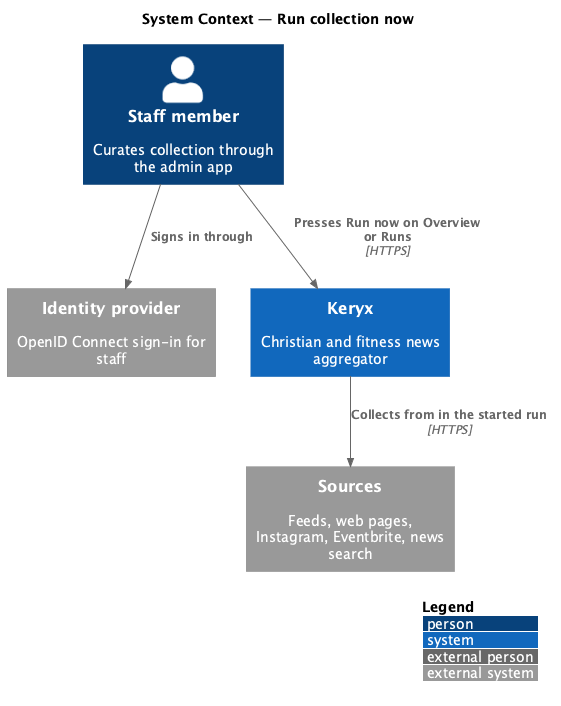
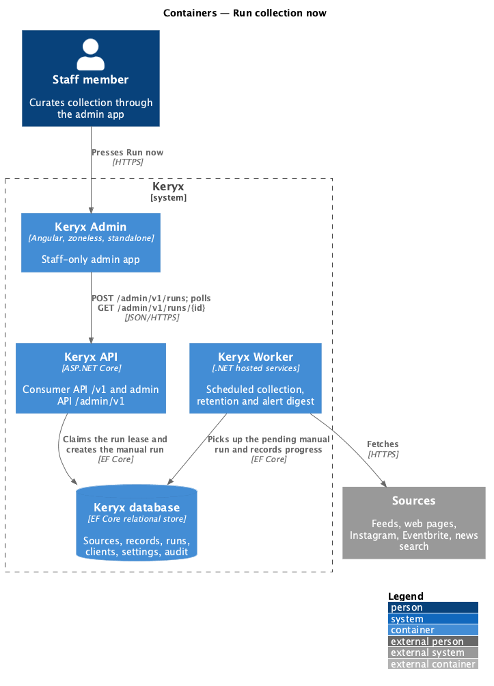
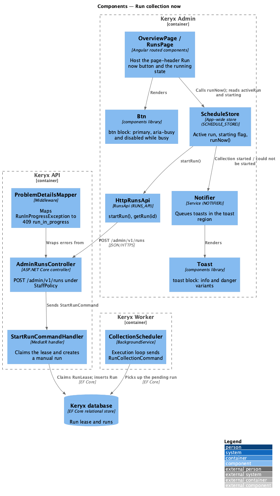
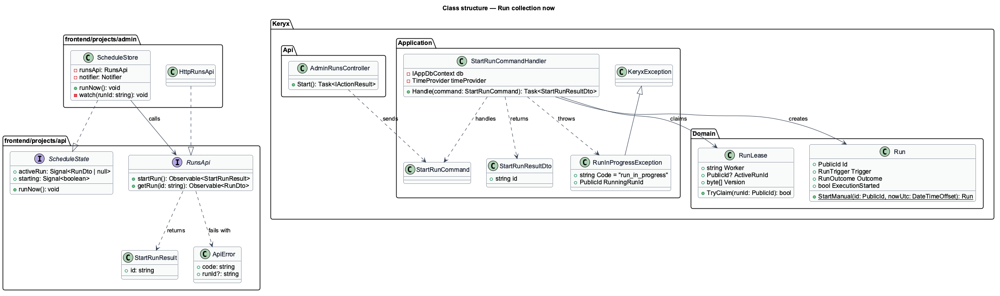
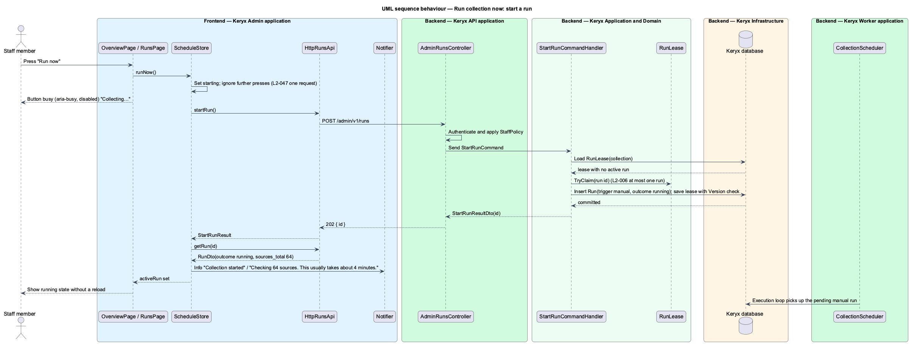
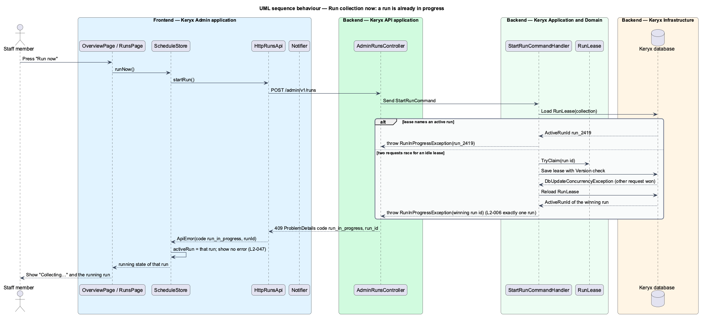
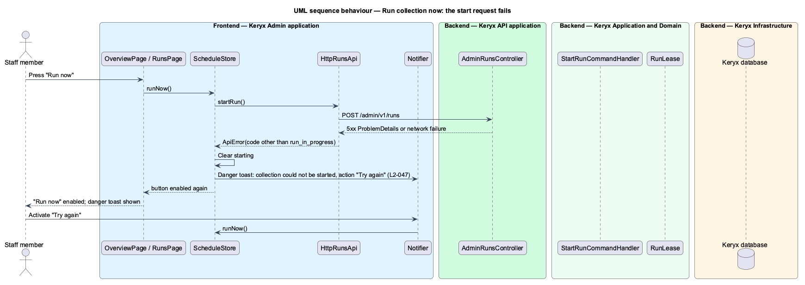

# Run collection now

## Overview

Keryx starts most collection runs on its schedule, but staff sometimes want fresh results at
once: after adding a source, or after fixing one that failed. This feature lets staff start a
collection run from the admin app at any time, and guarantees that at most one collection run
is in progress at once.

The terms below are used throughout:

- **manual run** — collection run started by staff, recorded with trigger `manual`
- **run lease** — single database row per worker that names the run in progress; claiming it is
  what starts a run, and only one claim can hold it
- **running state** — form of Overview and Runs while a run is in progress: the status card or
  run detail shows progress, and the header button reads "Collecting…"

Staff press **Run now** in the page header of Overview (`pages/overview/default.html`) or Runs
(`pages/runs/default.html`). The screen switches to the running state of
`pages/overview/running.html` without a reload, and an info notification
(`notifications/collection-toast/info.html`) confirms the start. The Keryx API only records the
request; the Keryx Worker executes the run exactly as it executes a scheduled one (see
[run-collection-pipeline](../run-collection-pipeline/README.md)). A manual run does not move the
schedule ([schedule-collection](../schedule-collection/README.md)).

## Description

The slice runs from the admin app's page header through the admin API to the run lease, and
hands execution to the worker.

- **`OverviewPage`** and **`RunsPage`** — routed components in the `admin` app (`loadComponent`).
  Each renders the `page-header` with a primary **`Btn`** labelled "Run now". While a start is
  pending or a run is active the button reads "Collecting…" with `aria-busy="true"` and
  `disabled`, as in the running mocks. The pages call `ScheduleState.runNow()` and read its
  signals; they hold no logic.
- **`ScheduleStore`** — app-wide store in the `admin` app, behind the `ScheduleState` contract
  and `SCHEDULE_STORE` token in the `api` library. It is the shell's schedule state that L2-089
  allows to be app-wide, and it is shared by the sidebar, Overview and Runs. `runNow()` sends
  nothing while `starting` is set or a run is active, so two quick presses send one request.
  - On `202`, it reads the new run through `RunsApi.getRun(id)` and asks `Notifier` for an info
    toast titled "Collection started" with "Checking 64 sources. This usually takes about 4
    minutes." The 64 is the run's `sources_total`; the source of the minute estimate is
    `<TO SUPPLY>`.
  - On `409` with `code` `run_in_progress`, it takes `run_id` from the problem, sets that run
    as active and shows no error.
  - On any other failure, it clears `starting` and asks for a danger toast saying the
    collection could not be started, with the action "Try again", which calls `runNow()` again.
    No mock shows this toast; its exact copy is `<TO SUPPLY>`.
  - Progress polling of the active run belongs to the running-run design (L2-058); its timers
    are released when their owner is destroyed.
- **`Btn`** and **`Toast`** — presentation components in the `components` library
  (`components/src/btn/`, `components/src/toast/`), named by the mocks' `btn` and `toast`
  blocks; inputs and outputs only.
- **`RunsApi`** / **`RUNS_API`** — contract in the `api` library with `startRun()` and
  `getRun(id)`; **`HttpRunsApi`** implements it and is bound in `app.config.ts`. A failed call
  surfaces as `ApiError` with the ProblemDetails `code` and, for `run_in_progress`, `runId`.
- **`AdminRunsController`** — admin controller under `StaffPolicy`. `POST /admin/v1/runs`
  takes no body, sends one `StartRunCommand` and checks nothing.
- **`StartRunCommand`** and **`StartRunCommandHandler`** — the handler reads now from
  `TimeProvider`, loads the `RunLease` for worker `collection`, claims it, and inserts a `Run`
  with a new `run_` id, trigger `manual`, outcome `running`, `started_at` now and every stage
  `not_run`. It saves the run and the lease in one unit of work, guarded by the lease's
  concurrency token. When the lease already names a run, or the save loses a concurrent race,
  it throws `RunInProgressException` carrying the running run's id. It never changes
  `RunLease.LastScheduledSlotAt`, so the next scheduled time is unchanged by a manual run.
- **`RunInProgressException`** — `KeryxException` with `code` `run_in_progress`;
  `ProblemDetailsMapper` maps it to `409` with a `run_id` extension.
- **`CollectionScheduler`** — the worker's execution loop sends `RunCollectionCommand` on a
  pickup interval (`<TO SUPPLY>` seconds) read from `TimeProvider`; the handler finds the
  pending manual run and executes it.
- **Endpoint** — `POST /admin/v1/runs`: `202` with `{ "id": "run_…" }`; `409` ProblemDetails
  with `code` `run_in_progress` and `run_id`; `401`/`403` from the staff policy.
- **Open point** — the Runs running mock reads "started 9:46 AM by Daniel Adeyemi", but the run
  record of L2-019 names no starter field; whether `Run` stores the staff member is
  `<TO SUPPLY>`.

## Requirements

The feature realizes the following level-2 (L2) requirements. Each L2 requirement refines a
level-1 (L1) requirement, cited by identifier. Their acceptance criteria are in
[L2.md](../../../specs/L2.md).

| L2 ID | Refines (L1) | Requirement |
|-------|--------------|-------------|
| `L2-006` | `L1-002` | Run on demand — Staff must be able to start a collection run at any time; at most one collection run is in progress at once. |
| `L2-047` | `L1-011` | Run now from the admin app — Staff can start a collection from Overview or Runs, and the screen reflects it without a reload. |

## Diagrams

### System context

Staff start a collection through Keryx after signing in; Keryx collects from the sources in the
run it starts.

### Containers

The Keryx Admin app calls the Keryx API, which records the manual run in the Keryx database; the
Keryx Worker picks it up and executes it.

### Components

`ScheduleStore` owns the start logic for both pages; `AdminRunsController` sends
`StartRunCommand`, whose handler claims the `RunLease`.

### Class structure

The frontend depends on the `RunsApi` and `ScheduleState` contracts; the backend handler claims
`RunLease`, creates `Run`, and refuses with `RunInProgressException`.

### Behaviour — start a run

A press sets the store busy, one request creates a manual run, and the info notification and the
running state follow without a reload.

### Behaviour — a run is already in progress

When the lease is held, or two requests race for it, exactly one run exists; the losing request
answers `409` `run_in_progress`, and the screen shows that run's running state with no error.

### Behaviour — the start request fails

A failed start leaves no run, re-enables the button and offers "Try again" in a danger
notification.

