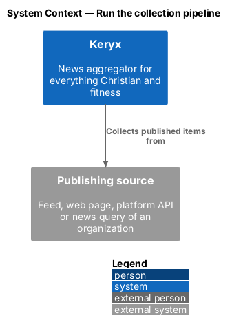
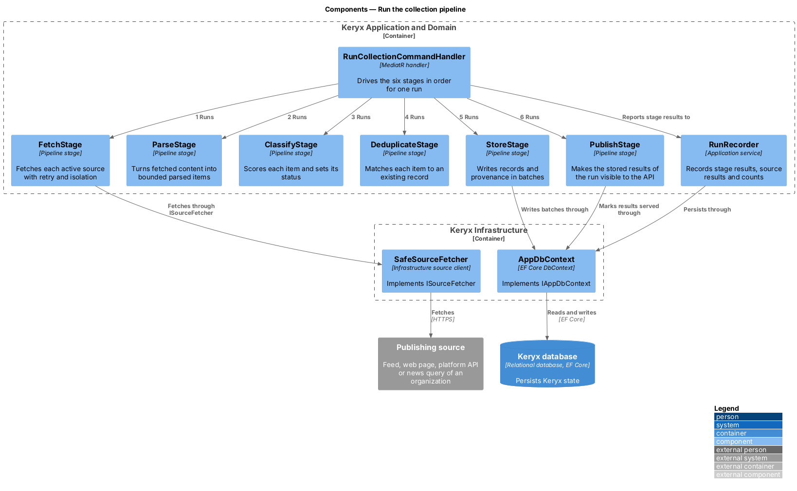
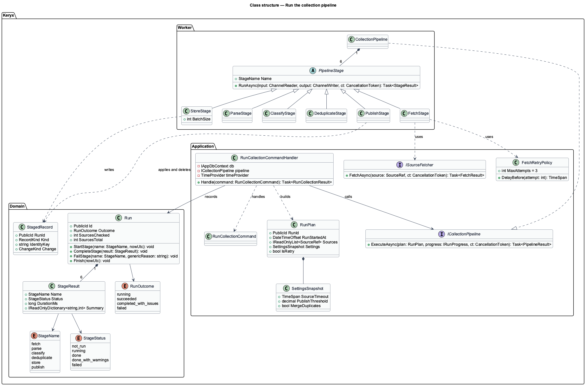
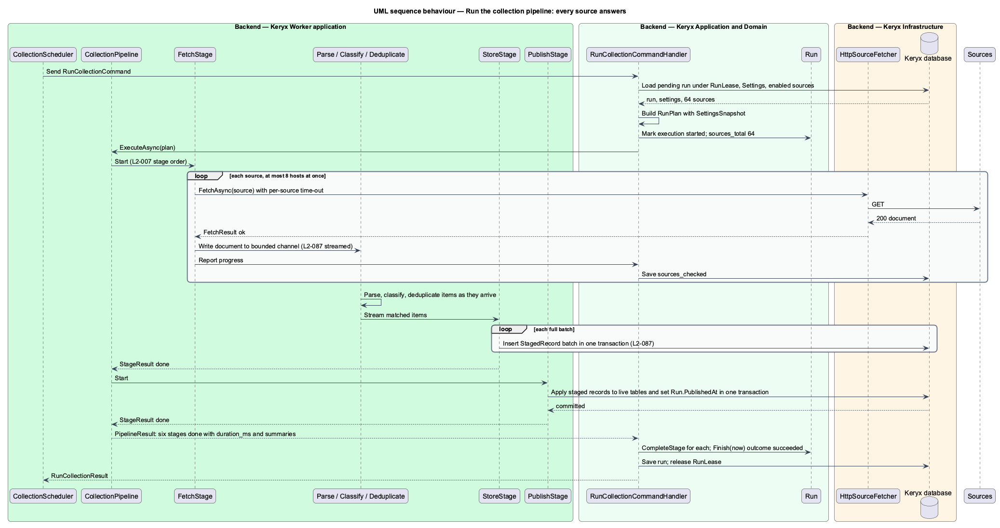
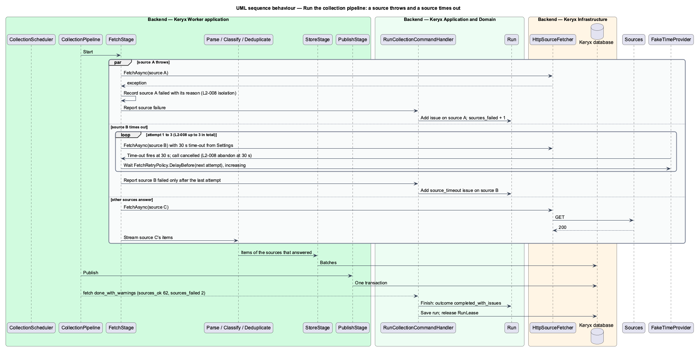
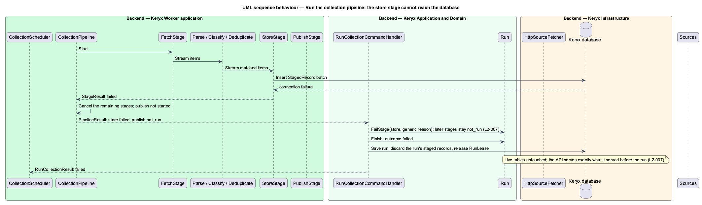

# Run the collection pipeline

## Overview

A collection run is how Keryx learns what sources have published. It reads every enabled
source, turns what it reads into candidate items, decides how relevant each is, matches each
against what Keryx already holds, stores the result and makes it visible to consuming products.
This feature is that pipeline: the six stages, how each records its result, how one failing
source is kept from stopping the run, and how the run stays fast and bounded in memory.

The terms below are used throughout:

- **stage** — one step of the pipeline, in this fixed order: `fetch`, `parse`, `classify`,
  `deduplicate`, `store`, `publish`
- **stage result** — record of one stage in one run: a status (`not_run`, `running`, `done`,
  `done_with_warnings`, `failed`), `duration_ms` and a count summary
- **source isolation** — rule that a failure fetching one source is recorded against that source
  and does not stop the other sources or the later stages
- **staged record** — row that holds a record change produced by a run but not yet visible to
  the API; the `publish` stage applies staged records to the live tables
- **attempt** — one call to a source; a timed-out source gets up to 3 attempts in total

Runs are started by [schedule-collection](../schedule-collection/README.md) and
[run-collection-now](../run-collection-now/README.md), and recorded as described in
[record-runs-and-issues](../record-runs-and-issues/README.md). The rules applied inside the
`classify` and `deduplicate` stages are described in
[score-and-publish](../score-and-publish/README.md) and
[ingest-idempotently](../ingest-idempotently/README.md); fetching only the failed sources again
is [retry-failed-sources](../retry-failed-sources/README.md).

## Description

The pipeline runs in the Keryx Worker. Every fetch and rule sits behind a contract in
`Keryx.Application`, with its client in `Keryx.Infrastructure`.

- **`CollectionRunner`** — hosted service with its own loop, separate from the schedule's, so a
  slot arriving during a long run is still seen. Once the database is ready it sends
  `RecoverInterruptedRuns`, then one `RunCollectionCommand` every 10 seconds (waited on
  `TimeProvider`), and checks nothing itself.
- **`RunCollectionCommand`** and **`RunCollectionCommandHandler`** — the handler loads the
  pending run named by the `RunLease` (a new run or a retry), returns at once when there is none,
  and otherwise marks execution started, sets `sources_total`, and builds a `RunPlan`. The plan
  carries a `SettingsSnapshot` taken at run start (source time-out, publish threshold, merge
  switch, topics, exclusions, geography), so a settings change applies from the next run. It
  calls `ICollectionPipeline.ExecuteAsync`, records each `StageResult` on the `Run`, sets the
  outcome, saves, and releases the lease.
- **`CollectionPipeline`** — class in `Keryx.Application` that reaches sources and the database
  only through contracts, so the API test host runs it as the worker does (ADR 0010). Fetched
  sources stream to one reader through a bounded `System.Threading.Channels` channel of capacity
  16, so memory does not grow with the number of sources. Until journey 5 the `deduplicate`,
  `store` and `publish` stages finish `done` with zero counts (ADR 0010).
- **`FetchStage`** — fetches each source through `ISourceFetcher` (`HttpSourceFetcher`), with at
  most 8 hosts at once and one request in flight per host (L2-022). Each attempt has the
  per-source time-out from Settings (default 30 seconds), enforced by a cancellation timer created
  from `TimeProvider`; at 30 seconds the attempt is abandoned. A timed-out or transient failure is
  retried up to 3 attempts in total by the fetcher itself, 1 then 2 seconds apart or as
  `Retry-After` says (fetch-respectfully-and-safely), so the stage adds no retry of its own. Any
  exception from one source is caught in that source's task, recorded as a failed source with
  reason `refused` and an issue, and never propagates; the other
  sources continue. The stage reports `sources_checked` as each source finishes, and its summary
  gives `sources_ok` and `sources_failed`; it is `done_with_warnings` when any source failed.
- **`ParseStage`** — turns each fetched document into bounded `ParsedItem` values through
  `IFeedParser` (`RssFeedParser`, `HtmlPageParser`); its summary gives the items parsed.
- **`ClassifyStage`** — scores and sets publication status for each item; its summary gives
  `relevant`, `held` and `off_topic` as numbers that sum to the items parsed, and it is
  `done_with_warnings` when any item is held.
- **`DeduplicateStage`** — matches each item by identity and merges duplicates through
  `IDeduplicator`; its summary gives `duplicates` and `rejected`.
- **`StoreStage`** — writes `StagedRecord` rows in batches (batch size `<TO SUPPLY>`), one
  transaction per batch.
- **`PublishStage`** — applies the run's staged records to the live `Article`, `Event`,
  `Organization` and `Provenance` rows and sets `Run.PublishedAt` in one transaction, then
  deletes the staged rows. Before this commit the API serves exactly what it served before the
  run began.
- **`Run`** and **`StageResult`** — domain types. `Run.FailStage` sets the stage `failed` with a
  generic reason (never a host, address, connection string or exception text), leaves every later
  stage `not_run`, and sets the outcome `failed`; the handler then discards the run's staged
  records. Outcome rules: `succeeded` when every stage is `done`; `completed_with_issues` when
  any source failed; `failed` when a stage failed. A run whose only warning is held items has
  `succeeded`: holding items for review is the `classify` stage's warning, not a fault of the run.
- **Performance** — with 64 sources each answering within 2 seconds a run finishes within 5
  minutes. With 500 sources a run finishes within 30 minutes (half the shortest interval) or the
  next slot records a `run_skipped` issue. Short store and publish transactions keep API response
  times within L2-086 while a run is storing; the worker is a separate process from the API.
- **Telemetry** — one span per run and per stage, with counts as metrics; no span carries a
  source URL's query string or a fetched body.
- **Tests** — `Keryx.Application.Tests` run the handler directly against fake sources behind
  `ISourceFetcher` (one that throws, one that delays past 30 seconds on `FakeTimeProvider`, 62
  that answer) and a database fault injected through `IAppDbContext` for the `store` case.

## Requirements

The feature realizes the following level-2 (L2) requirements. Each L2 requirement refines a
level-1 (L1) requirement, cited by identifier. Their acceptance criteria are in
[L2.md](../../../specs/L2.md).

| L2 ID | Refines (L1) | Requirement |
|-------|--------------|-------------|
| `L2-007` | `L1-002` | Collection pipeline stages — A collection run has six stages in this order: `fetch`, `parse`, `classify`, `deduplicate`, `store`, `publish`. Each stage records a status (`not_run`, `running`, `done`, `done_with_warnings`, `failed`), a duration and a count summary. |
| `L2-008` | `L1-002` | Source isolation and retry within a run — One source failing must not stop a run: its failure is recorded, the other sources are processed, and staff can fetch only the failed sources again. |
| `L2-087` | `L1-021` | Collection performance — A collection run must finish well inside its interval, in memory that does not grow with the number of sources. |

## Diagrams

### System context

Keryx fetches from sources and serves consuming products only what a finished run published; it
exports run telemetry to the OTLP collector.

### Containers

The Keryx Worker runs the pipeline and writes to the Keryx database; the Keryx API reads only
published records from the same database.

### Components

`RunCollectionCommandHandler` drives `CollectionPipeline`, whose six stages stream items through
channels and reach sources and the database only through contracts.

### Class structure

`CollectionPipeline` composes six `PipelineStage` subclasses; the handler records each
`StageResult` on the `Run`, and the store and publish stages write and apply `StagedRecord`
rows.

### Behaviour — every source answers

Items stream from fetch to store, the store stage writes in batches, and publish makes the
run's records visible in one transaction; every stage ends `done` and the run `succeeded`.

### Behaviour — a source throws and a source times out

The throwing source is recorded as failed while the others continue; the timed-out source gets 3
attempts with increasing delay, each abandoned at 30 seconds, before it is recorded as failed.

### Behaviour — the store stage cannot reach the database

The store stage fails with a generic reason, publish never starts, staged records are discarded,
and the API keeps serving the previous run.

