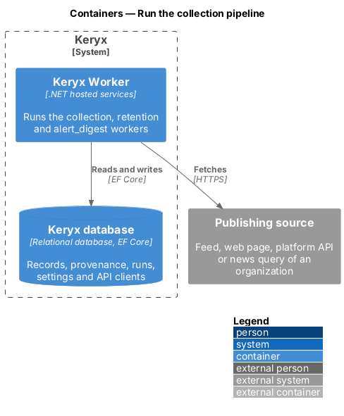

# Run the collection pipeline

## Overview

A collection run moves each item through six stages in a fixed order: `fetch`, `parse`, `classify`, `deduplicate`, `store`, `publish`. Each stage records a status, a duration and a count summary. The statuses are `not_run`, `running`, `done`, `done_with_warnings` and `failed`.

One source failing does not stop the others. A source that fails to fetch is retried up to 3 times in total with increasing delay and is then recorded as failed with its reason; the later stages process the items of the sources that answered. A stage that fails as a whole stops the run: later stages are `not_run`, the outcome is `failed`, and the API serves exactly what it served before the run began.

Items stream from stage to stage, so memory use does not grow with the number of sources. The store stage writes in batches, one transaction per batch.

> **stage** — one of the six ordered steps of a collection run

> **parsed item** — bounded, validated item read from a source, not yet a record

## Description

The slice is one handler that drives six stage objects over an asynchronous stream of items. Each stage sits behind the same contract and reports to a run recorder.

- **`RunCollectionCommandHandler`** — MediatR handler in the Application and Domain layers. Drives the six stages in order for one run. It sets the outcome: `succeeded` when each stage is `done`, `completed_with_issues` when a stage is `done_with_warnings`, and `failed` when a stage fails.
- **`FetchStage`** — Pipeline stage in the Application and Domain layers. Fetches each active source through `ISourceFetcher` with at most 8 hosts concurrently. A failure or a time-out is retried up to 3 attempts in total with increasing delay on `TimeProvider`; the source is recorded as failed only after the last attempt. An exception from one source is caught and recorded for that source.
- **`ParseStage`** — Pipeline stage in the Application and Domain layers. Turns fetched content into bounded parsed items.
- **`ClassifyStage`** — Pipeline stage in the Application and Domain layers. Scores each item and sets its status. The summary gives `relevant`, `held` and `off_topic`, which sum to the items parsed; held items make the stage `done_with_warnings`.
- **`DeduplicateStage`** — Pipeline stage in the Application and Domain layers. Matches each item to an existing record.
- **`StoreStage`** — Pipeline stage in the Application and Domain layers. Writes records and provenance in batches, one transaction per batch. A database failure marks the stage `failed` with a generic reason and stops the run.
- **`PublishStage`** — Pipeline stage in the Application and Domain layers. Makes the stored results of the run visible to the API as the last step. A run that fails before this stage changes nothing a consumer can read.
- **`RunRecorder`** — Application service in the Application and Domain layers. Records stage results, source results and counts.
- **`SafeSourceFetcher`** — Infrastructure source client in the Infrastructure layer. Implements ISourceFetcher.
- **`AppDbContext`** — EF Core DbContext in the Infrastructure layer. Implements IAppDbContext.
- **`IPipelineStage`** — contract with `Name` and `RunAsync(context, items)`; each stage consumes and returns `IAsyncEnumerable<PipelineItem>`.
- **`StageResult`** — entity with `Stage`, `Status`, `DurationMs` and a count summary, one per stage per run.
- **`RunCollectionCommand`** — MediatR request carrying the run id and, for a retry, the ids of the sources to fetch.

With 64 sources that each answer within 2 seconds, a run finishes within 5 minutes. With 500 sources, a run finishes within 30 minutes or the next slot records a `run_skipped` issue (L2-087). The reference deployment on which these figures are measured is `<TO SUPPLY>`.

## Requirements

The feature realizes the following level-2 (L2) requirements. Each L2 requirement refines a level-1 (L1) requirement, cited by identifier. The acceptance criteria of each requirement are in [`docs/specs/L2.md`](../../../specs/L2.md).

| L2 ID | Refines (L1) | Requirement |
|-------|--------------|-------------|
| [`L2-007`](../../../specs/L2.md#l2-007-collection-pipeline-stages) | `L1-002` | **Collection pipeline stages.** A collection run has six stages in this order: `fetch`, `parse`, `classify`, `deduplicate`, `store`, `publish`. Each stage records a status (`not_run`, `running`, `done`, `done_with_warnings`, `failed`), a duration and a count summary. |
| [`L2-008`](../../../specs/L2.md#l2-008-source-isolation-and-retry-within-a-run) | `L1-002` | **Source isolation and retry within a run.** The requirement is defined by its 6 acceptance criteria. |
| [`L2-087`](../../../specs/L2.md#l2-087-collection-performance) | `L1-021` | **Collection performance.** The requirement is defined by its 4 acceptance criteria. |

## Diagrams

### System context

Keryx collects published items from publishing sources.

### Containers

The Keryx Worker reads and writes the Keryx database. The Keryx Worker fetches the publishing source.

### Components

`RunCollectionCommandHandler` chains the six stages and reports through `RunRecorder`. Only `FetchStage` reaches a source, through `SafeSourceFetcher`; only `StoreStage` and `PublishStage` write records.

### Class structure

Each of the six stages realizes `IPipelineStage`. `RunCollectionCommandHandler` owns their order and records one `StageResult` per stage on the `Run`.

### Behaviour — run the collection pipeline

The handler runs the stages in order and records each result. A failed source is isolated in `fetch` (`L2-008`); a failed stage stops the run before `publish`, so the API keeps serving the earlier data (`L2-007`).

