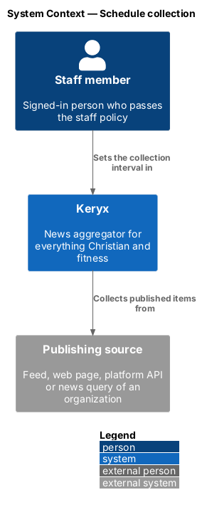
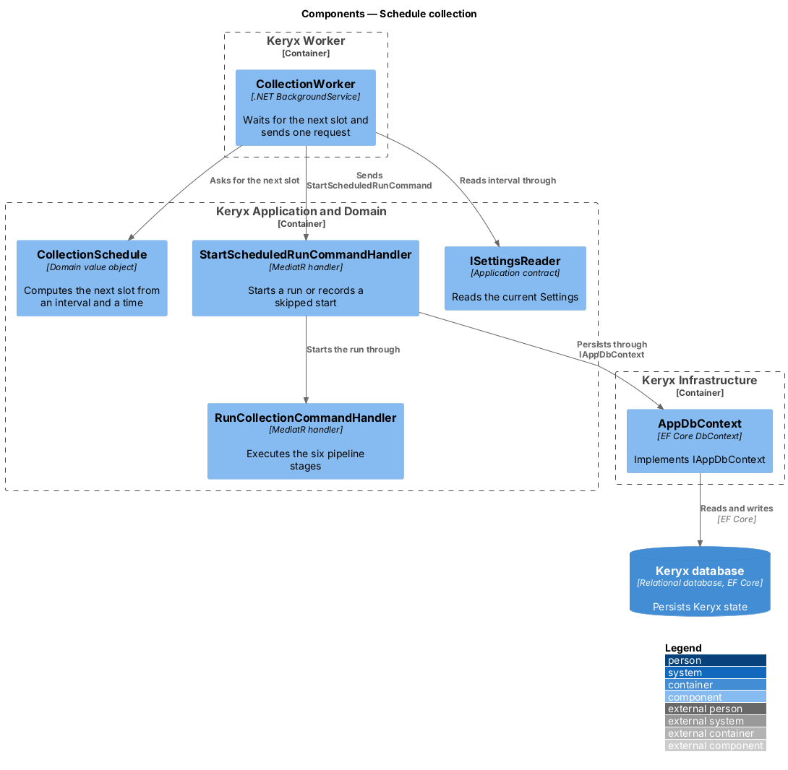
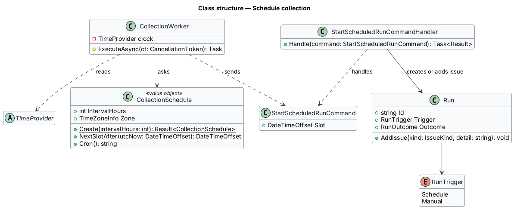
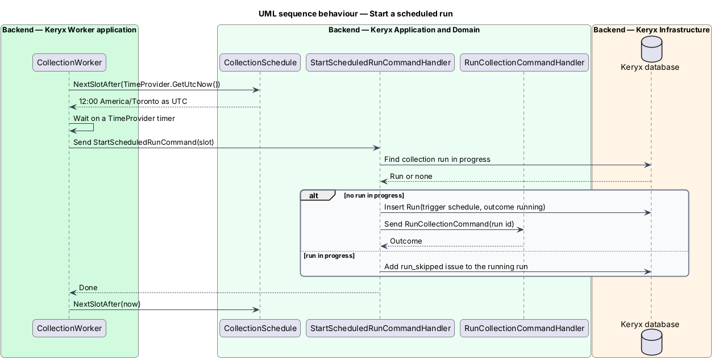

# Schedule collection

## Overview

Keryx collects without a person watching. The *collection worker* starts a *run* at fixed intervals aligned to midnight Toronto time. The interval is one of 1, 3, 6, 12 or 24 hours, defaults to 6, and comes from Settings. With the default, runs start at 00:00, 06:00, 12:00 and 18:00 Toronto time.

The schedule is wall-clock time in the zone `America/Toronto`. On a day when Toronto's clocks change, runs start at the wall-clock times of the interval and none is skipped or doubled. A scheduled time that arrives while a run is still in progress starts no second run; the skipped start is recorded as an issue on the running run.

> **run** — one execution of a worker, recorded with its trigger, times, outcome and counts

> **slot** — wall-clock time in `America/Toronto` at which a scheduled run starts

## Description

The slice is a hosted service that waits for the next slot on `TimeProvider` and sends one MediatR request. The slot arithmetic is a pure domain type with a table of cases.

- **`CollectionWorker`** — .NET BackgroundService in the Keryx Worker. Waits for the next slot with a timer created from `TimeProvider` and sends `StartScheduledRunCommand`. It checks nothing itself. It reads the interval again before each wait, so a saved change applies to the next slot.
- **`CollectionSchedule`** — Domain value object in the Application and Domain layers. Computes the next slot from an interval and a time. Slots are multiples of the interval counted from local midnight, converted to UTC through the IANA zone, so a clock change neither skips nor doubles a slot.
- **`StartScheduledRunCommandHandler`** — MediatR handler in the Application and Domain layers. Starts a run with trigger `schedule` when no collection run is in progress. Otherwise it adds a `run_skipped` issue to the running run and starts nothing.
- **`RunCollectionCommandHandler`** — MediatR handler in the Application and Domain layers. Executes the six pipeline stages.
- **`ISettingsReader`** — Application contract in the Application and Domain layers. Reads the current Settings.
- **`AppDbContext`** — EF Core DbContext in the Infrastructure layer. Implements IAppDbContext.
- **`StartScheduledRunCommand`** — MediatR request carrying the slot that fired.
- **`NextRun`** — DTO with `next_run_at` in UTC and `time_zone` `America/Toronto`, served to the admin shell and to `/v1/status`.

A test proves each schedule case by advancing `FakeTimeProvider`; no test sleeps. The handler runs directly in tests, outside the shared host.

## Requirements

The feature realizes the following level-2 (L2) requirements. Each L2 requirement refines a level-1 (L1) requirement, cited by identifier. The acceptance criteria of each requirement are in [`docs/specs/L2.md`](../../../specs/L2.md).

| L2 ID | Refines (L1) | Requirement |
|-------|--------------|-------------|
| [`L2-005`](../../../specs/L2.md#l2-005-collection-schedule) | `L1-002` | **Collection schedule.** The collection worker starts a run at fixed intervals aligned to midnight Toronto time. The interval is one of 1, 3, 6, 12 or 24 hours (default 6) and comes from Settings. |

## Diagrams

### System context

The staff member sets the collection interval in Keryx. Keryx collects published items from publishing sources.

### Containers

The Keryx Worker reads settings and writes runs the Keryx database. The Keryx Worker fetches on each scheduled run the publishing source.

### Components

`CollectionWorker` asks `CollectionSchedule` for the next slot, waits on `TimeProvider`, and sends `StartScheduledRunCommand`. The handler starts `RunCollectionCommandHandler` or records the skipped start.

### Class structure

`CollectionSchedule` is built from an interval and a zone and returns slots. `CollectionWorker` depends on `TimeProvider`, never on the system clock.

### Behaviour — start a scheduled run

The worker waits on `TimeProvider` until the slot. The handler starts one run, or records `run_skipped` on the run already in progress (`L2-005`).

