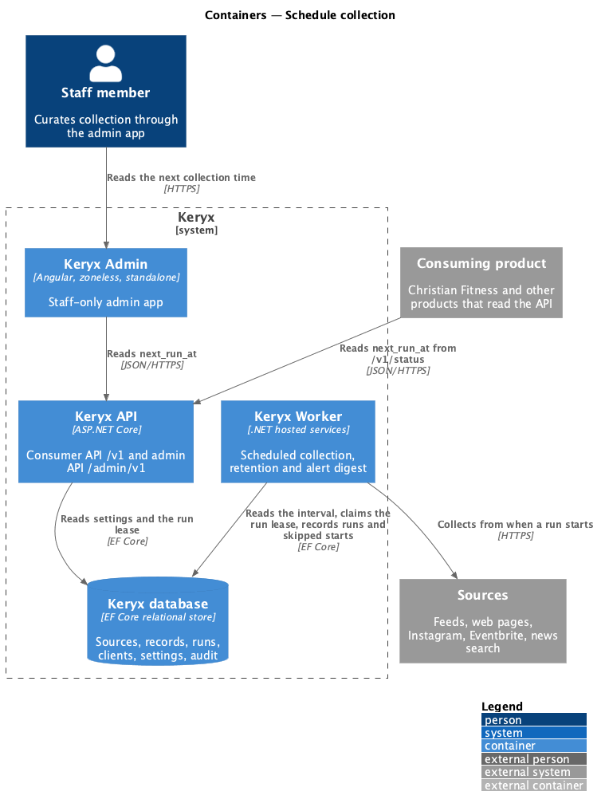
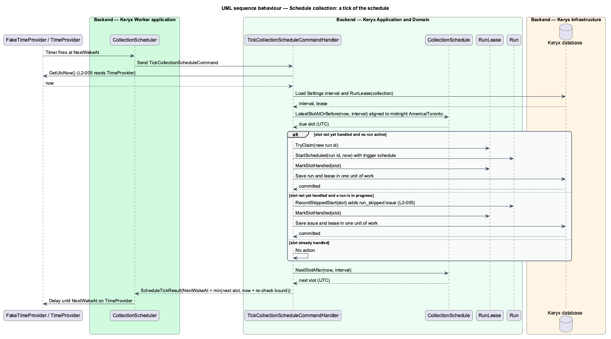
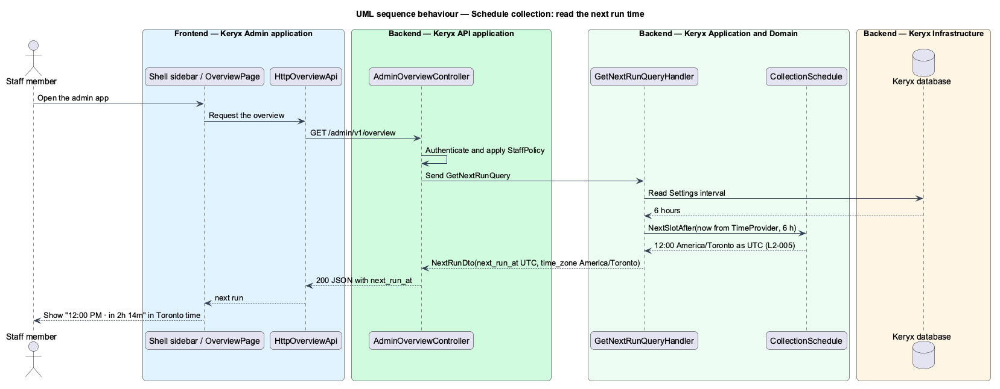

# Schedule collection

## Overview

Keryx gathers Christian and fitness news by running a *collection run* — one pass of the
collection pipeline over every enabled source, recorded as a run. Most runs are started by the
schedule rather than by staff. This feature is the schedule: it decides when a scheduled run
starts, what happens when a run is still in progress at that moment, and what next run time the
admin app and consuming products see.

The schedule works in Toronto wall-clock time, because Toronto and the GTA come first for Keryx.
The terms below are used throughout:

- **interval** — number of hours between scheduled runs, one of 1, 3, 6, 12 or 24, default 6,
  read from Settings
- **schedule slot** — Toronto wall-clock time at which a scheduled run is due, a whole multiple
  of the interval after local midnight
- **skipped start** — schedule slot that arrives while a run is still in progress, recorded as a
  `run_skipped` issue on the running run instead of starting a second run
- **run lease** — single database row per worker that names the run in progress and the last
  schedule slot handled, so at most one collection run is active

The feature sits at the front of the `collection` subsystem. It starts runs; the pipeline that
executes them is described in [run-collection-pipeline](../run-collection-pipeline/README.md), the
manual start in [run-collection-now](../run-collection-now/README.md) and the run record in
[record-runs-and-issues](../record-runs-and-issues/README.md).

## Description

The slice runs in the Keryx Worker and reads its decisions from the Application and Domain
layers. All time is read from `TimeProvider`; no code reads `DateTime.Now`.

- **`CollectionScheduler`** — hosted service (`BackgroundService`) in `Keryx.Worker`. Its
  schedule loop sends one `TickCollectionScheduleCommand`, then waits on `TimeProvider` until the
  `NextWakeAt` the handler returns. It checks nothing itself. A tick that throws is caught and
  logged without its message body, and the loop continues, so the next slot still fires.
- **`TickCollectionScheduleCommand`** and **`TickCollectionScheduleCommandHandler`** — MediatR
  request and handler in `Keryx.Application`. The handler reads now from `TimeProvider`, the
  interval from `Settings`, and the `RunLease` for worker `collection`. It asks
  `CollectionSchedule` for the latest slot at or before now. When that slot is later than
  `RunLease.LastScheduledSlotAt`, the handler either claims the lease and creates a `Run` with
  trigger `schedule`, or, when the lease already names an active run, adds a `run_skipped` issue
  to that run. It marks the slot handled in the same unit of work, so a slot never starts two
  runs. It returns `ScheduleTickResult` with `NextWakeAt`, the earlier of the next slot and now
  plus a re-check bound (`<TO SUPPLY>` seconds), so an interval saved in Settings takes effect
  at the next slot of the new interval.
- **`CollectionSchedule`** — pure domain service in `Keryx.Domain`. It converts now to
  `America/Toronto` with `TimeZoneInfo`, finds local midnight, and lists slots at each whole
  multiple of the interval. It returns slots as UTC instants. On the days Toronto's clocks
  change, slots follow the wall clock: with a 6-hour interval the 06:00 slot is 06:00 local time
  on both sides of the change. Only the 1-hour interval meets a local time that does not exist
  (02:00 on the spring change) or occurs twice (01:00 on the autumn change). The design yields
  no slot for the missing time and one slot, at the first occurrence, for the repeated time; the
  intended reading of "none is skipped or doubled" for those two hours is `<TO SUPPLY>`.
- **`ScheduleInterval`** — value object that accepts 1, 3, 6, 12 or 24 hours; `Default` is 6.
- **`RunLease`** — domain entity, one row per worker, with `ActiveRunId`,
  `LastScheduledSlotAt` and a concurrency token `Version`. A second claim made concurrently
  fails with a concurrency conflict, so exactly one run starts. A manual run claims the same
  lease but never changes `LastScheduledSlotAt`, so a manual run does not move the schedule.
- **`Run`** and **`RunIssue`** — domain types owned by
  [record-runs-and-issues](../record-runs-and-issues/README.md). `Run.StartScheduled` creates a
  run with trigger `schedule`; `Run.RecordSkippedStart` adds an issue of kind `run_skipped`
  whose severity is `<TO SUPPLY>` (the specification names the kind only).
- **`GetNextRunQuery`** and **`GetNextRunQueryHandler`** — read the interval and return
  `NextRunDto` with `next_run_at` (UTC, ISO 8601) and `time_zone` (`America/Toronto`). At
  09:46 Toronto time with a 6-hour interval, `next_run_at` is 12:00 the same day; after the
  interval is saved as 3 hours at 09:46, it is 12:00 and the one after is 15:00.
- **Endpoints** — the query is served as `next_run_at` on `GET /v1/status` (consumer, L2-030)
  and on the admin overview read by the shell and Overview (`GET /admin/v1/overview`, owned by the
  admin Overview design). This feature adds no endpoint of its own.
- **Tests** — `Keryx.Application.Tests` prove each case by advancing `FakeTimeProvider`: from
  05:59:59 by one second (exactly one run starts), across the spring and autumn clock changes,
  and with a run held open across a slot (one `run_skipped` issue, no second run). No test
  sleeps.

## Requirements

The feature realizes the following level-2 (L2) requirements. Each L2 requirement refines a
level-1 (L1) requirement, cited by identifier. Their acceptance criteria are in
[L2.md](../../../specs/L2.md).

| L2 ID | Refines (L1) | Requirement |
|-------|--------------|-------------|
| `L2-005` | `L1-002` | Collection schedule — The collection worker starts a run at fixed intervals aligned to midnight Toronto time. The interval is one of 1, 3, 6, 12 or 24 hours (default 6) and comes from Settings. |

## Diagrams

### System context

Staff set the interval through Keryx; Keryx collects from sources at each slot and tells
consuming products when the next run is due.

### Containers

The Keryx Worker owns the schedule and writes runs to the Keryx database; the Keryx API reads the
same settings to serve `next_run_at`.

### Components

`CollectionScheduler` sends a tick to `TickCollectionScheduleCommandHandler`, which consults
`CollectionSchedule` and the `RunLease`; both API controllers read the next slot through
`GetNextRunQueryHandler`.

### Class structure

The handler depends on the pure `CollectionSchedule` and mutates `RunLease` and `Run`; the
scheduler depends only on the command and its `ScheduleTickResult`.

### Behaviour — a tick of the schedule

At each wake time the handler reads the clock from `TimeProvider`, finds the due slot, and
either starts a scheduled run, records a skipped start on the running run, or does nothing; it
returns the next wake time.

### Behaviour — read the next run time

The admin app reads `next_run_at` in UTC with zone `America/Toronto` and formats it in Toronto
time.

