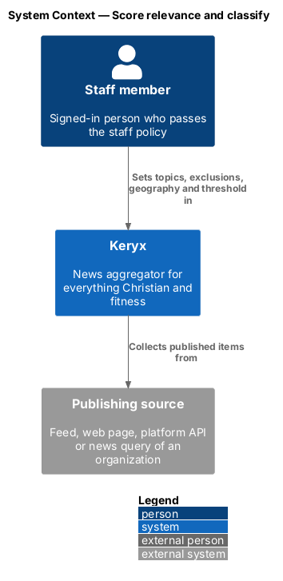
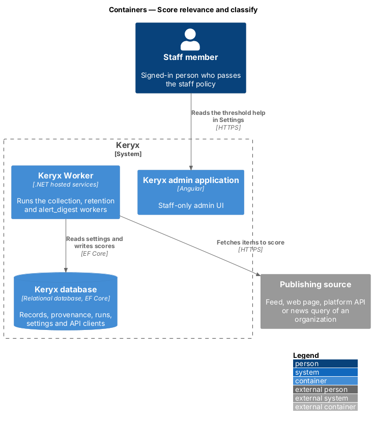
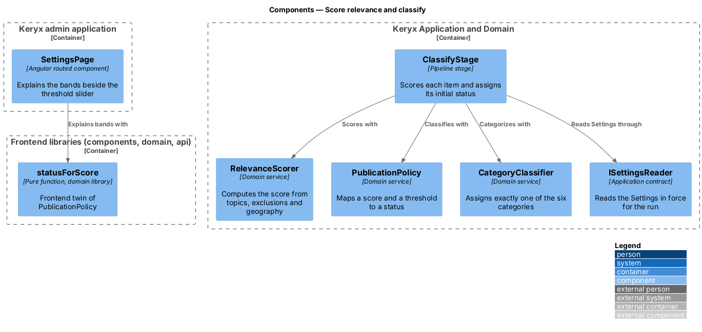
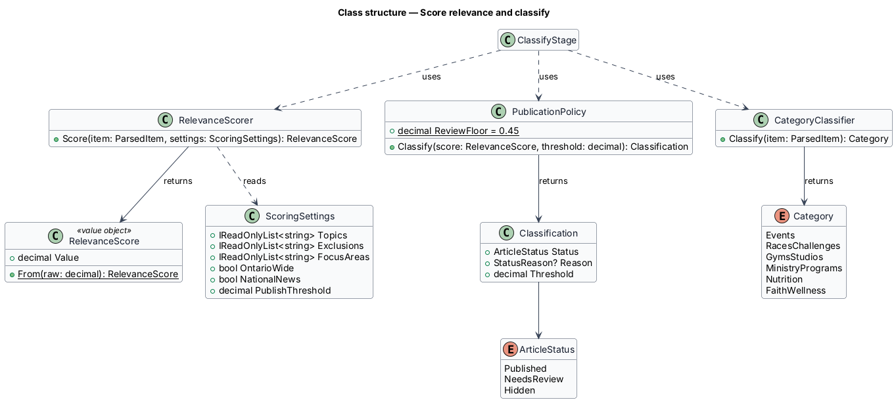
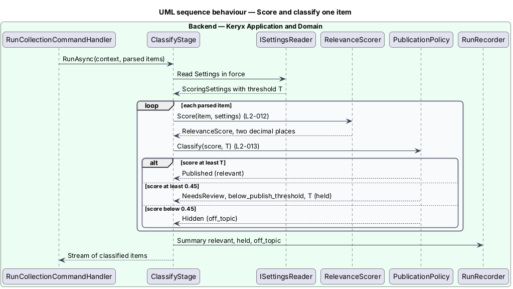

# Score relevance and classify

## Overview

Keryx scores each collected item for Christian-fitness and geographic relevance. The *relevance score* runs from 0.00 to 1.00 with two decimal places and comes from the topics, the exclusions and the geography in Settings. The rule is deterministic: the same item and the same settings give the same score.

The score sets the status of an article when it is collected. At or above the *publish threshold* T (default 0.60) the article is `published`. From the *review floor* 0.45 up to but not including T it is `needs_review`. Below 0.45 it is `hidden`. When T is at or below 0.45 nothing is held.

A change to Settings applies to items collected afterwards. Scores and statuses of stored articles are not recomputed. The rule is computed in both stacks, because the Settings screen explains the bands as the slider moves; one inline case table drives both test suites.

> **publish threshold** — score at or above which a collected article is published; a setting from 0.30 to 0.90 in steps of 0.05

> **review floor** — fixed score 0.45 below which a collected article is hidden

## Description

The slice is the `classify` stage and two pure domain types. The frontend `domain` library holds the same status rule as a pure function.

- **`ClassifyStage`** — Pipeline stage in the Application and Domain layers. Scores each item and assigns its initial status. It reads Settings once per run, so one run uses one threshold.
- **`RelevanceScorer`** — Domain service in the Application and Domain layers. Computes the score from topics, exclusions and geography. An item that matches an exclusion or no topic scores below 0.45. An item in a focus area scores higher than one outside; "Ontario-wide organisations" raises the score of an Ontario item outside the focus areas. The result is rounded half away from zero to two decimal places, so 0.585 is stored and served as 0.59. The weights are `<TO SUPPLY>` and are fixed by the case table of L2-012.
- **`PublicationPolicy`** — Domain service in the Application and Domain layers. Maps a score and a threshold to a status and records `status_reason` `below_publish_threshold` and the threshold in force on a held article.
- **`CategoryClassifier`** — Domain service in the Application and Domain layers. Assigns exactly one of the six categories.
- **`ISettingsReader`** — Application contract in the Application and Domain layers. Reads the Settings in force for the run.
- **`statusForScore`** — Pure function, domain library in the frontend libraries. Frontend twin of `PublicationPolicy`. Both suites run the case table: with T = 0.60 the scores 1.00, 0.60, 0.59, 0.45, 0.44, 0.00 give published, published, needs review, needs review, hidden, hidden; with T = 0.40 the scores 0.44, 0.40, 0.39 give published, published, hidden.
- **`SettingsPage`** — Angular routed component in the Keryx admin application. Explains the bands beside the threshold slider.
- **`RelevanceScore`** — value object holding a decimal from 0.00 to 1.00 with two decimal places.
- **`ArticleStatus`** — enumeration `Published`, `NeedsReview`, `Hidden`.
- **`ScoringSettings`** — topics, exclusions, focus areas, the two geography switches and the publish threshold.

## Requirements

The feature realizes the following level-2 (L2) requirements. Each L2 requirement refines a level-1 (L1) requirement, cited by identifier. The acceptance criteria of each requirement are in [`docs/specs/L2.md`](../../../specs/L2.md).

| L2 ID | Refines (L1) | Requirement |
|-------|--------------|-------------|
| [`L2-012`](../../../specs/L2.md#l2-012-relevance-scoring) | `L1-004` | **Relevance scoring.** Each item gets a relevance score from 0.00 to 1.00, to two decimal places, from the topics, the exclusions and the geography in Settings. The scoring rule is deterministic: the same item and the same settings always give the same score. |
| [`L2-013`](../../../specs/L2.md#l2-013-publication-status-from-thresholds) | `L1-004` | **Publication status from thresholds.** An article's status is `published`, `needs_review` or `hidden`. On collection it is set from its score: at or above the publish threshold *T* (Settings, default 0.60) it is published; from the review floor 0.45 up to but not including *T* it needs review; below 0.45 it is hidden. |

## Diagrams

### System context

The staff member sets topics, exclusions, geography and threshold in Keryx. Keryx collects published items from publishing sources.

### Containers

The staff member reads the threshold help in Settings the Keryx admin application. The Keryx Worker reads settings and writes scores the Keryx database. The Keryx Worker fetches items to score the publishing source.

### Components

`ClassifyStage` calls `RelevanceScorer`, `PublicationPolicy` and `CategoryClassifier` with the Settings read through `ISettingsReader`. `SettingsPage` uses `statusForScore` for the slider's help text.

### Class structure

`RelevanceScorer` returns a `RelevanceScore`; `PublicationPolicy` turns it into an `ArticleStatus` with a `StatusReason`.

### Behaviour — score and classify one item

The stage reads Settings once, scores the item (`L2-012`) and applies the threshold bands (`L2-013`). The counts `relevant`, `held` and `off_topic` sum to the items parsed.

