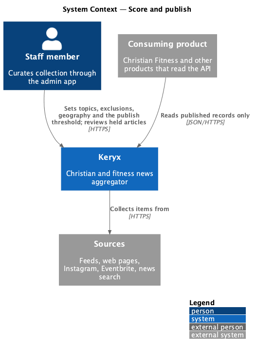
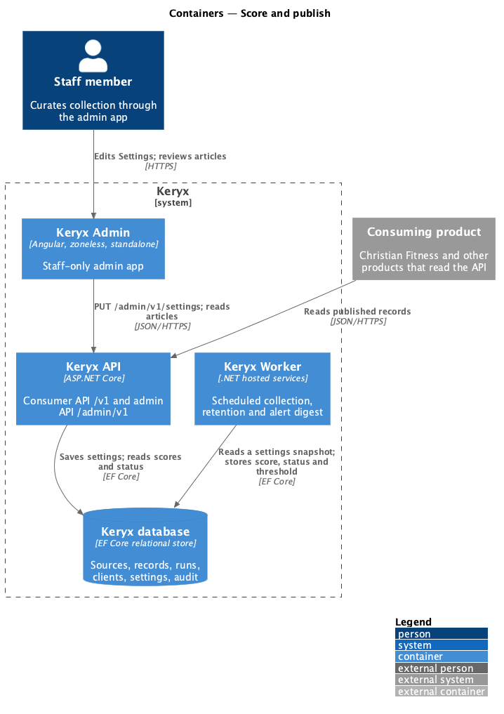
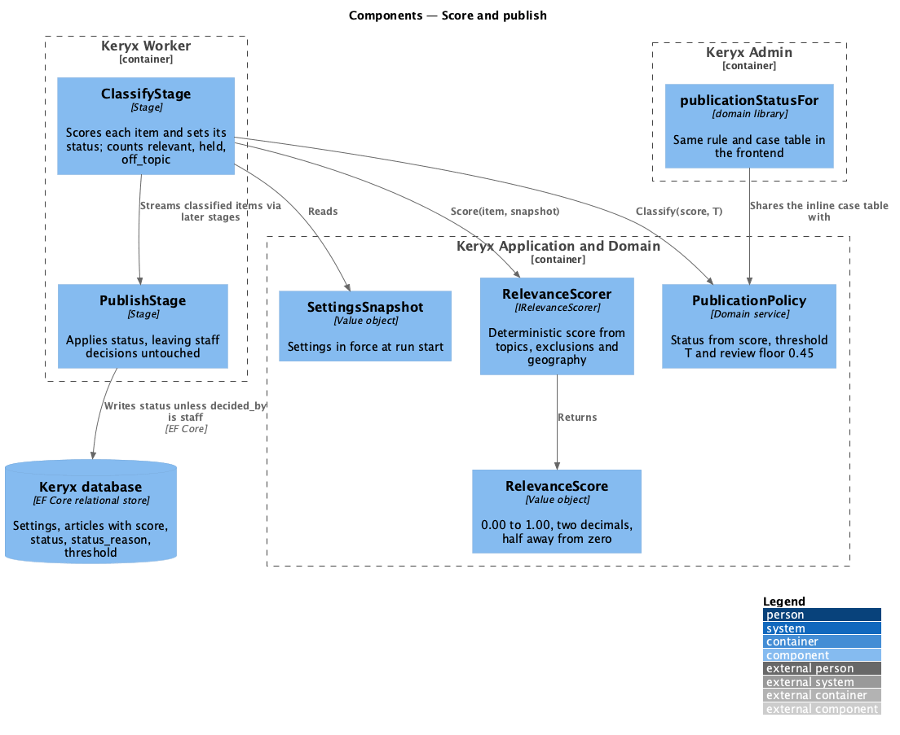
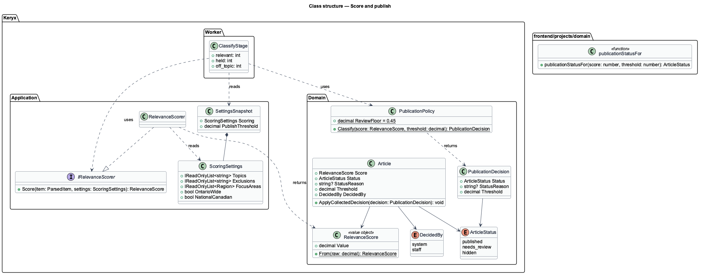
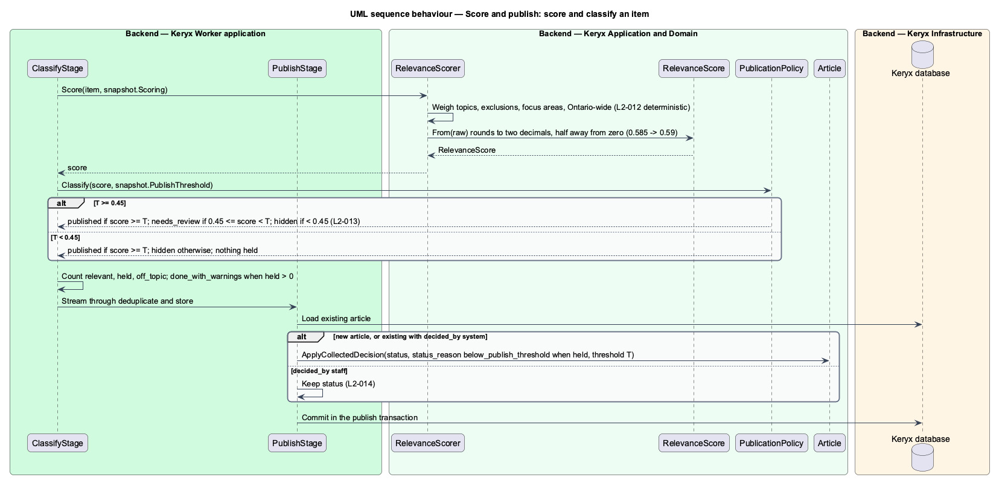
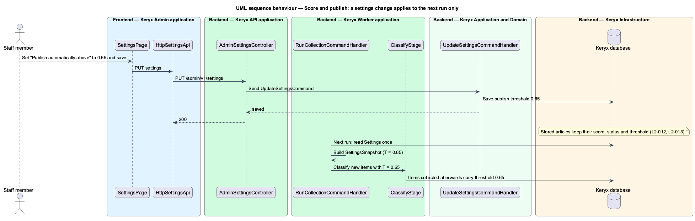

# Score and publish

## Overview

Keryx collects far more than it should publish: a news search for "Toronto church fitness"
returns stories about church fundraisers and gym openings alike. This feature decides, for each
collected item, how relevant it is to Christian fitness and to the geography Keryx serves, and
from that score whether the item is published to consuming products, held for staff review, or
hidden.

The terms below are used throughout:

- **relevance score** — number from 0.00 to 1.00, to two decimal places, computed from the
  topics, exclusions and geography in Settings
- **publish threshold** — score *T* at or above which a collected item is published; a setting,
  default 0.60
- **review floor** — fixed score 0.45 below which a collected item is hidden
- **held article** — article whose status is `needs_review` because its score is at least 0.45
  and below *T*
- **settings snapshot** — copy of the settings taken when a run starts and used for every item
  of that run

The rules run in the `classify` stage of
[run-collection-pipeline](../run-collection-pipeline/README.md) and are written by its `publish`
stage. Staff decisions on an article (L2-014) are outside this feature, but the `publish` stage
never overwrites them.

## Description

The score and the status are pure, deterministic rules with case-table tests in both stacks.

- **`IRelevanceScorer`** / **`RelevanceScorer`** — contract and pure implementation in
  `Keryx.Application`. `Score(item, settings)` reads the item's title, summary, tags, place and
  organization, and the `ScoringSettings` topics, exclusions, focus areas and the "Ontario-wide
  organisations" and "National Canadian news" switches. The same item with the same settings
  always gives the same score. An exclusion scores 0.10. Otherwise the score is 0.6 × the topic
  share (distinct topics matched, at most 3, over 3) plus 0.4 × the geography, and an item with
  no topic scores 0.3 × the geography. Geography is 1.0 in a focus area, 0.6 in Ontario with
  "Ontario-wide organisations" on, 0.5 in Canada with "National Canadian news" on, and 0.2
  elsewhere. Words match whole, ignoring case. These weights satisfy the scoring case table:
  - an item matching several topics in a focus area scores highest;
  - an item matching topics outside every focus area scores lower;
  - an item matching an exclusion, and one matching no topic, score lower still and below 0.45;
  - an item in Ontario outside the focus areas scores higher with "Ontario-wide organisations"
    on than with it off.
- **`RelevanceScore`** — value object holding a `decimal` clamped to 0 to 1 and rounded to two
  decimal places with `MidpointRounding.AwayFromZero`, so 0.585 is stored and served as `0.59`.
  The design uses `decimal` because a binary `double` holds 0.585 as slightly less than 0.585
  and would round it to 0.58.
- **`PublicationPolicy`** — domain service. `Classify(score, T)` returns `published` at or above
  *T*, `needs_review` from 0.45 up to but not including *T*, and `hidden` below 0.45. When *T*
  is below 0.45, it returns `published` at or above *T* and `hidden` below it, and holds
  nothing. A held decision carries `status_reason` `below_publish_threshold`, a hidden one
  `below_review_floor`, and a published one `null`. The decision records the *T* in force.
- **`SettingsSnapshot`** — taken by `RunCollectionCommandHandler` at run start. A threshold or
  topic saved during a run applies from the next run; scores and statuses already stored are
  never recomputed.
- **`ClassifyStage`** — in `Keryx.Worker`; scores and classifies each item, and counts
  `relevant` (published), `held` (needs review) and `off_topic` (hidden) as numbers that sum to
  the items parsed. It is `done_with_warnings` when any item is held, and raises an `items_held`
  warning issue per source.
- **`PublishStage`** — writes `score`, `status`, `status_reason` and `threshold` for a new
  article, and for an existing article whose `decided_by` is `system` when its source changed it.
  An article whose `decided_by` is `staff` takes its new facts and score and keeps its status,
  reason and threshold. An article collected again unchanged is not rescored.
- **`Article`** — domain entity with `Score`, `Status`, `StatusReason`, `Threshold` and
  `DecidedBy`. The admin article endpoints serve `relevance_score` as a number with at most two
  decimals, `status`, `status_reason` and `threshold`; the consumer API serves only
  `published` records. An event with no linked article follows the same thresholds from its own
  score (L2-016).
- **`publicationStatusFor`** — pure helper in the frontend `domain` library, used where the
  admin app explains thresholds (Settings help text, article detail). Its unit tests and the
  backend tests of `PublicationPolicy` use the same inline case table: with *T* = 0.60, scores
  1.00, 0.60, 0.59, 0.45, 0.44 and 0.00 give published, published, needs review, needs review,
  hidden, hidden; with *T* = 0.40, scores 0.44, 0.40 and 0.39 give published, published, hidden.

## Requirements

The feature realizes the following level-2 (L2) requirements. Each L2 requirement refines a
level-1 (L1) requirement, cited by identifier. Their acceptance criteria are in
[L2.md](../../../specs/L2.md).

| L2 ID | Refines (L1) | Requirement |
|-------|--------------|-------------|
| `L2-012` | `L1-004` | Relevance scoring — Each item gets a relevance score from 0.00 to 1.00, to two decimal places, from the topics, the exclusions and the geography in Settings. The scoring rule is deterministic: the same item and the same settings always give the same score. |
| `L2-013` | `L1-004` | Publication status from thresholds — An article's status is `published`, `needs_review` or `hidden`. On collection it is set from its score: at or above the publish threshold *T* (Settings, default 0.60) it is published; from the review floor 0.45 up to but not including *T* it needs review; below 0.45 it is hidden. |

## Diagrams

### System context

Staff set what counts as relevant and review held articles; consuming products read only what
Keryx published.

### Containers

Settings saved through the Keryx API are read by the Keryx Worker as a snapshot at the start of
each run; the worker stores each article's score, status and threshold.

### Components

`ClassifyStage` asks `RelevanceScorer` for a `RelevanceScore` and `PublicationPolicy` for a
status; the frontend helper `publicationStatusFor` shares the policy's case table.

### Class structure

`RelevanceScorer` reads `ScoringSettings` from the snapshot and returns a `RelevanceScore`;
`PublicationPolicy` turns it into a `PublicationDecision` that an `Article` applies unless staff
decided it.

### Behaviour — score and classify an item

The score is rounded half away from zero, the status follows *T* and the review floor, and a
staff decision is left untouched.

### Behaviour — a settings change applies to the next run only

A threshold saved in Settings is read into the next run's snapshot; articles already stored keep
their score, status and threshold.

