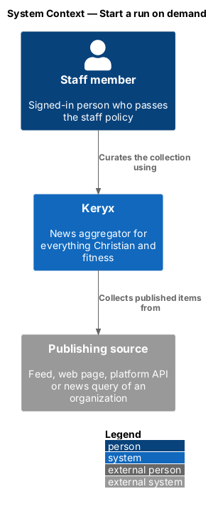
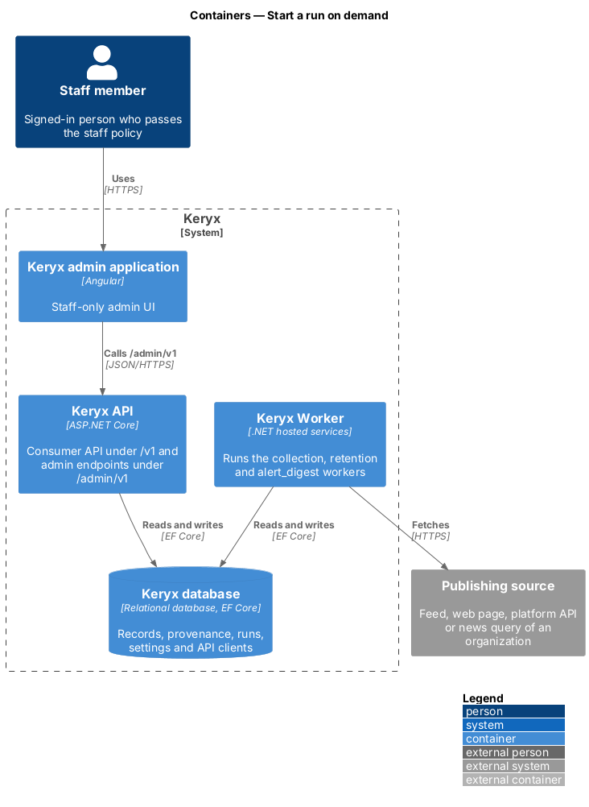
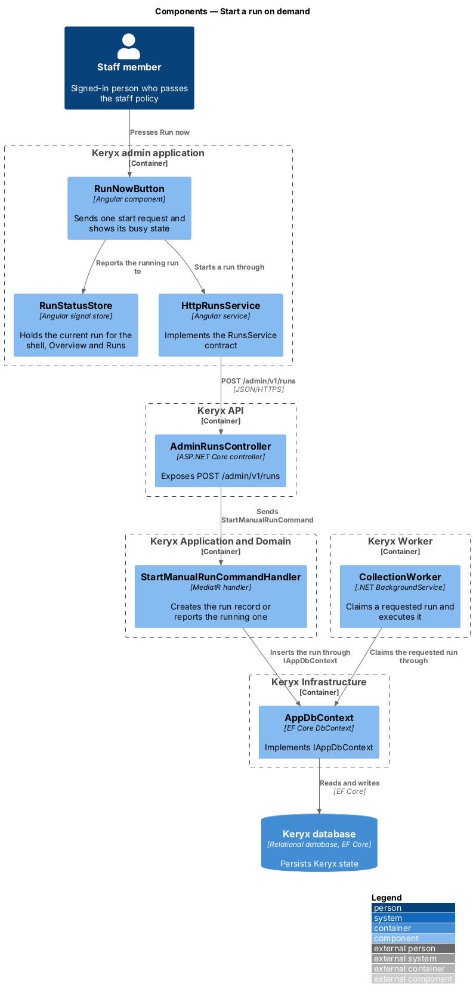
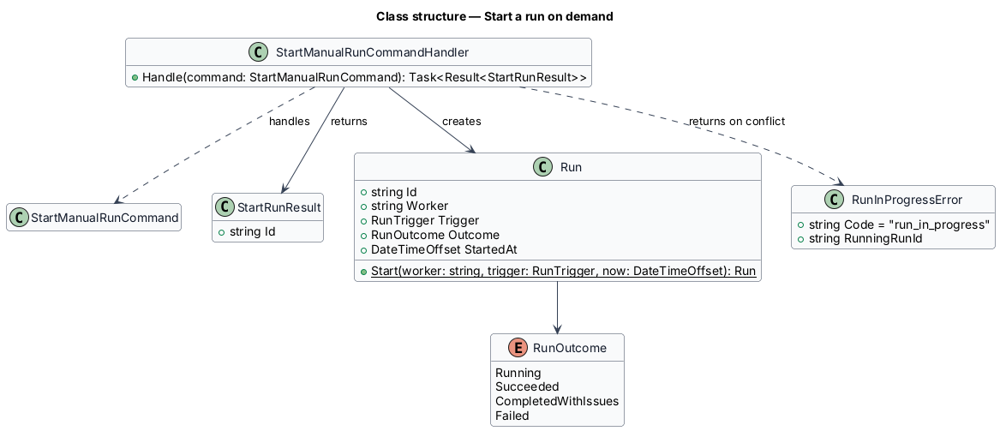
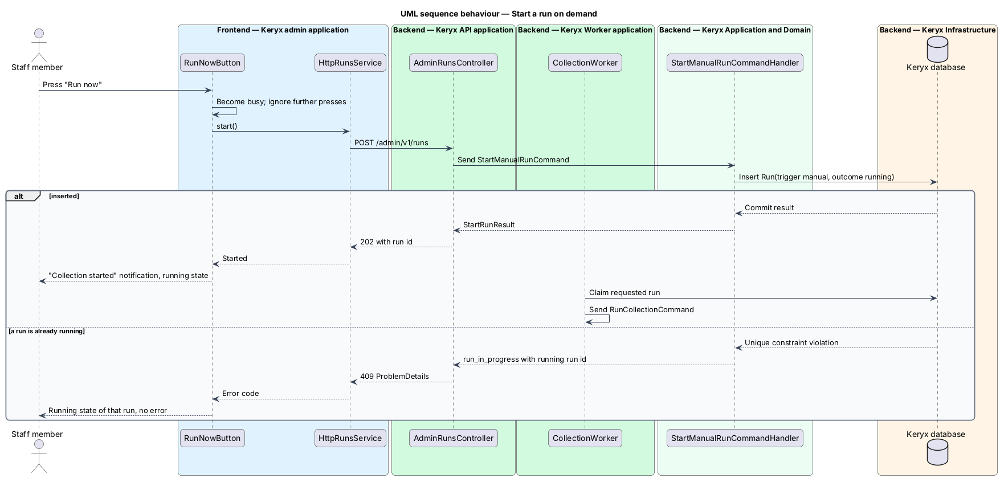

# Start a run on demand

## Overview

A staff member can start a collection run without waiting for the schedule. The "Run now" button appears on the Overview and Runs screens. A manual run proceeds exactly as a scheduled run and leaves the next scheduled time unchanged.

One collection run executes at a time. A request that arrives while a run is in progress creates no run; the server answers `409` with `code` `run_in_progress` and the id of the running run, and the admin application shows that run instead of an error. Two requests that arrive together create exactly one run.

## Description

The API records the requested run and the worker executes it. The API and the worker are separate processes that share the database, so the request is handed over through the run record.

- **`RunNowButton`** — Angular component in the Keryx admin application. Sends one start request and shows its busy state. A second press while the request is in flight sends nothing. On failure it is enabled again and a danger notification offers "Try again".
- **`RunStatusStore`** — Angular signal store in the Keryx admin application. Holds the current run for the shell, Overview and Runs. It is one of the three application-wide stores named by L2-089.
- **`HttpRunsService`** — Angular service in the Keryx admin application. Implements the RunsService contract.
- **`AdminRunsController`** — ASP.NET Core controller in the Keryx API. Exposes POST /admin/v1/runs.
- **`StartManualRunCommandHandler`** — MediatR handler in the Application and Domain layers. Inserts a `Run` with trigger `manual` and outcome `running`. A unique constraint allows one running collection run; a violation is reported as `run_in_progress` with the id of the running run.
- **`CollectionWorker`** — .NET BackgroundService in the Keryx Worker. Claims a requested manual run and sends `RunCollectionCommand` for it. The polling interval for requested runs is `<TO SUPPLY>`.
- **`AppDbContext`** — EF Core DbContext in the Infrastructure layer. Implements IAppDbContext.
- **`StartManualRunCommand`** — MediatR request with no fields; the staff member comes from the request context.
- **`StartRunResult`** — DTO with the run `id`; the `202` response carries it.

## Requirements

The feature realizes the following level-2 (L2) requirements. Each L2 requirement refines a level-1 (L1) requirement, cited by identifier. The acceptance criteria of each requirement are in [`docs/specs/L2.md`](../../../specs/L2.md).

| L2 ID | Refines (L1) | Requirement |
|-------|--------------|-------------|
| [`L2-006`](../../../specs/L2.md#l2-006-run-on-demand) | `L1-002` | **Run on demand.** The requirement is defined by its 4 acceptance criteria. |
| [`L2-047`](../../../specs/L2.md#l2-047-run-now-from-the-admin-app) | `L1-011` | **Run now from the admin app.** The requirement is defined by its 4 acceptance criteria. |

## Diagrams

### System context

A staff member curates the collection through Keryx. Keryx collects published items from publishing sources.

### Containers

The staff member uses the Keryx admin application. The Keryx admin application calls the Keryx API at `/admin/v1`. The Keryx API reads and writes the Keryx database. The Keryx Worker reads and writes the Keryx database. The Keryx Worker fetches the publishing source.

### Components

`RunNowButton` calls `HttpRunsService`; `StartManualRunCommandHandler` writes the run record that `CollectionWorker` claims.

### Class structure

`StartManualRunCommandHandler` creates a `Run` with trigger `Manual`; the unique running-run constraint lives in the EF Core model.

### Behaviour — start a run on demand

The handler inserts the run under the unique running-run constraint (`L2-006`). Either answer leads the screen to its running state (`L2-047`).

