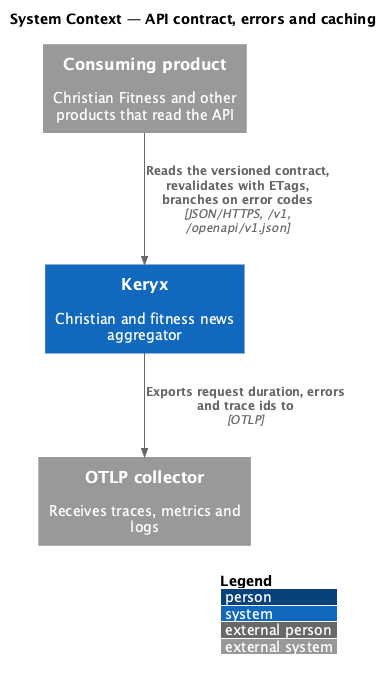
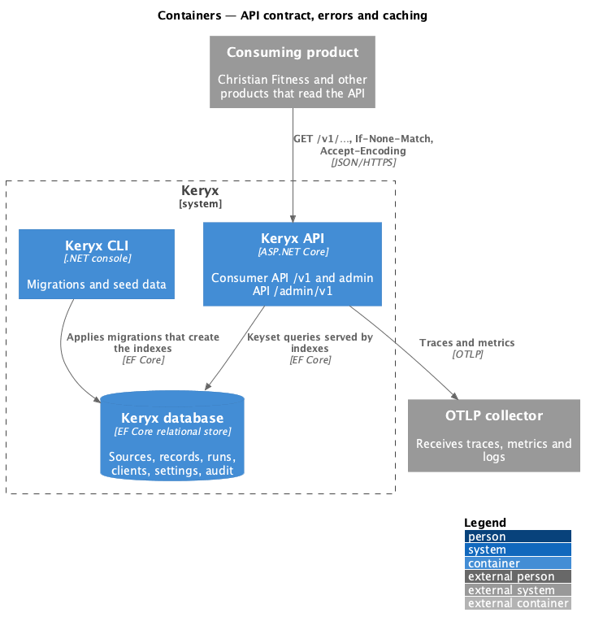
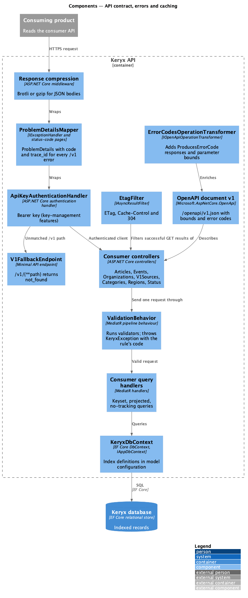
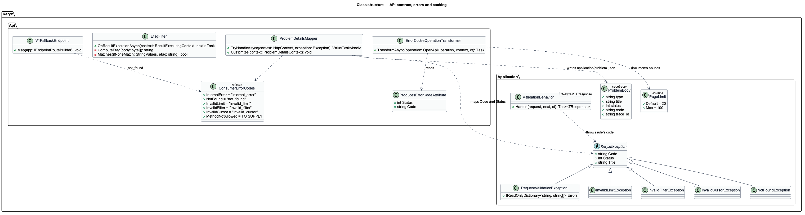
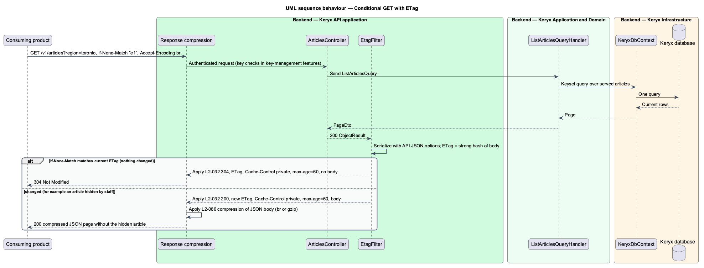
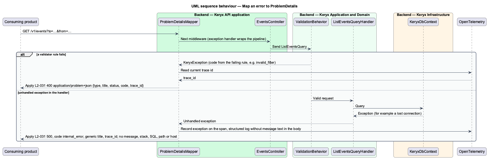
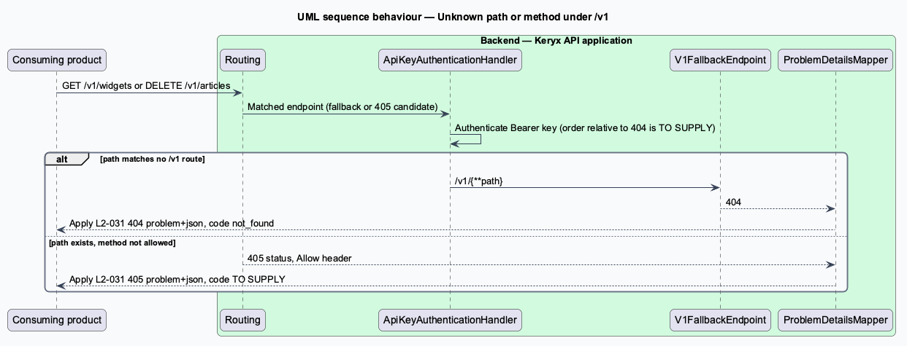
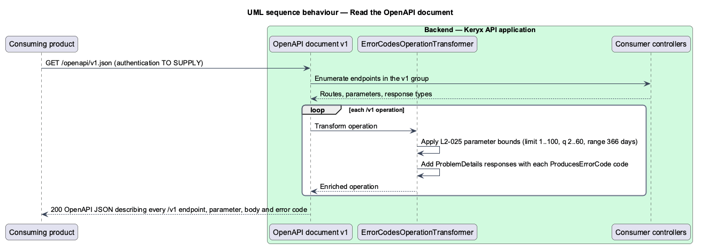
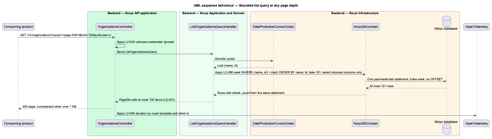

# API contract, errors and caching

## Overview

Keryx is an API first. Other products, Christian Fitness first, build their websites on the
consumer API under `/v1`, so the API is a product contract: a change that breaks it breaks
someone else's product. This feature holds the rules every `/v1` endpoint shares, whatever
resource it serves: the version prefix and the published description of the contract, the shape
of every error, conditional caching, and the performance of every list and detail read.

**consumer API** — the read-only HTTP API under `/v1` that consuming products call with an API
key

**contract** — the paths, parameters with their bounds, response bodies and error `code`s of
the consumer API, as described by its OpenAPI document

**breaking change** — change that removes or renames a field, changes a type or tightens a
bound in a published version

**ProblemDetails** — RFC 9457 error body with `type`, `title` and `status`, served as
`application/problem+json`

**error code** — stable `code` extension on a ProblemDetails body that a client branches on

**ETag** — opaque validator of a response's content that a client returns in `If-None-Match` to
ask whether the content has changed

**keyset paging** — paging that seeks past the last row's sort key instead of skipping rows, so
every page costs the same

The resource features of the `consumer-api` subsystem (serve articles, serve events, serve
organizations and sources, serve reference data and status) build on this feature. The API key,
scopes and rate limits belong to the subsystem's key-management features; their error codes
(`invalid_api_key`, `insufficient_scope`, `rate_limited`) pass through the same
`ProblemDetailsMapper`.

## Description

The feature is cross-cutting: it adds parts of the Keryx API's request pipeline, the OpenAPI
document, the shared error types, and the database indexes created by the Keryx CLI `migrate`
command. It has no admin app part.

**Versioning and contract (L2-025)**

- **`/v1` prefix** — every consumer controller (`ArticlesController`, `EventsController`,
  `OrganizationsController`, `V1SourcesController`, `CategoriesController`,
  `RegionsController`, `StatusController`) carries a route beginning `v1/` and belongs to the
  `v1` OpenAPI document group. A breaking change appears only under a new prefix such as `/v2`,
  with an ADR; adding a field to a `v1` body is allowed and keeps every existing field's name,
  type and meaning.
- **OpenAPI document v1** — produced by `Microsoft.AspNetCore.OpenApi` and served at
  `/openapi/v1.json`. It describes every `/v1` endpoint, parameter, response body and error
  `code`, and it changes in the same pull request as the endpoint it describes. Whether the
  document requires an API key is `<TO SUPPLY>`; L2-025 and L2-033 do not say, and the fallback
  policy requires authentication unless `[AllowAnonymous]` is explicit.
- **`ErrorCodesOperationTransformer`** — OpenAPI operation transformer that reads each
  action's `ProducesErrorCodeAttribute` (status and `code`) and adds a ProblemDetails response
  listing those codes. It also writes parameter bounds from the validators' constants:
  `limit` 1 to 100 (default 20), `q` 2 to 60 characters, and the 366-day event range.
- **Unknown query parameters** — model binding binds only declared parameters, so an undefined
  parameter is ignored and leaves the response unchanged. `limit` binds as a string, so a
  non-number reaches `ListArticlesQueryValidator` and gives `invalid_limit` rather than the
  framework's automatic `400`.
- **Christian Fitness check** — a change the Christian Fitness repository would notice is
  checked against that repository's use of the API before it merges. The mechanism (a review
  checklist item, a contract test in that repository, or both) and the repository location
  are `<TO SUPPLY>`.

**Errors (L2-031)**

- **`KeryxException`** (`Keryx.Application`) — abstract base carrying `Code`, `Status` and a
  generic `Title`. Subclasses: `InvalidLimitException` (`400`, `invalid_limit`),
  `InvalidFilterException` (`400`, `invalid_filter`), `InvalidCursorException` (`400`,
  `invalid_cursor`), `NotFoundException` (`404`, a resource's `…_not_found` code) and
  `RequestValidationException` (`400`, `validation_failed`, with field `errors`).
- **`ValidationBehavior<TRequest, TResponse>`** — MediatR pipeline behaviour that runs every
  FluentValidation validator for a request. It throws a `KeryxException` with the error code set
  on the failing rule, or `validation_failed` when the rule sets none.
- **`ProblemDetailsMapper`** (`Keryx.Api`) — an `IExceptionHandler` plus the
  `AddProblemDetails` customization, so exceptions, status-code pages and framework responses
  share one writer. Every `/v1` error has content type `application/problem+json` with `type`,
  `title`, `status`, `code` and `trace_id`; `trace_id` is the current OpenTelemetry trace id
  (L2-094). An unhandled exception gives `500` with `code` `internal_error` and a generic title;
  the body holds no exception message, stack trace, SQL, file path or host name. The exception
  is recorded on the request's span. The base URI of `type` is `<TO SUPPLY>`.
- **`V1FallbackEndpoint`** — maps `/v1/{**path}` at the lowest route order. A path that matches
  no `/v1` endpoint gives `404` with `code` `not_found`. A path that exists, requested with a
  method it does not allow, gives `405` with an `Allow` header through the status-code pages.
  The `code` for `405` is `<TO SUPPLY>`; L2-031 acceptance criterion 1 requires a `code` on
  every error but names none for `405`. Whether an unknown path without a valid key gives `401`
  or `404` is `<TO SUPPLY>`.
- **`ConsumerErrorCodes`** — constants for the codes this feature owns: `internal_error`,
  `not_found`, `invalid_limit`, `invalid_filter`, `invalid_cursor`.
- **Bounds** — `PageLimit.Default` (20) and `PageLimit.Max` (100) are the only page sizes.
  Every list handler takes at most `limit + 1` rows, so no list returns more than 100 items or
  loads an unbounded set.

**Caching (L2-032)**

- **`EtagFilter`** — `IAsyncResultFilter` on every consumer `GET`. For a successful result it
  serializes the body with the API's JSON options and computes a strong ETag from a SHA-256
  hash of those bytes. It sets `ETag` and `Cache-Control: private, max-age=60`. When
  `If-None-Match` matches the current ETag, it answers `304` with the same `ETag` and
  `Cache-Control` and no body. Because the ETag hashes the content itself, any change, such as
  an article hidden by staff, gives a new ETag and a `200`. Error responses carry no ETag. A
  `304` still runs the query; it saves the client's bandwidth, not the server's work.

**Performance (L2-086)**

- **Keyset queries** — every list handler seeks by its sort key (`published_at, id`;
  `starts_at, id`; `name, id`) through a cursor and never uses `OFFSET`, so page 500 costs the
  same as page 1.
- **Projection** — every handler uses `AsNoTracking` and projects with `Select` into its DTO,
  reading only the columns it returns. Counts such as `article_count` come from a grouped
  subquery in the same statement, so the query count does not depend on page size.
- **Indexes** — defined in `KeryxDbContext` model configuration and created by the Keryx CLI
  `migrate` command, never on API startup:
  - articles: (`status`, `published_at` desc, `id` desc), plus `region`, `category` and
    `organization_id` each leading that key.
  - events: (`starts_at`, `id`), plus `region` and `organization_id` each leading that key, and
    the linked `article_id`.
  - organizations: (`name`, `id`), normalized name for the `q` prefix, `region`, `kind`.
  - sources: the sources list's sort key; admin list filters are indexed by their own designs.
  The exact definitions depend on the database engine, which is `<TO SUPPLY>`.
- **Response compression** — ASP.NET Core response compression with Brotli and gzip for
  `application/json` and `application/problem+json`, enabled for HTTPS. Bodies over 1 KB are
  compressed when the client accepts it; smaller bodies may also be compressed. Response bodies
  carry no secret, which keeps the HTTPS compression risk (BREACH) low.
- **Measurement** — the targets are a 95th-percentile response time of at most 200 ms and a
  99th of at most 500 ms, measured at the server, with 20,000 published articles and 50
  concurrent clients. The server-side duration histogram of L2-094 measures them. The reference
  deployment and the load-test tool are `<TO SUPPLY>`. The load test runs on request, not in CI.
  Backend tests use EF Core InMemory, which issues no SQL and has no query plan. The proof of
  acceptance criteria 2 and 4 (query count and index use) therefore needs a relational engine
  outside the standard suite; how it is run is `<TO SUPPLY>`.

Shared response rules:

| Situation | Status | `code` | Headers |
|-----------|--------|--------|---------|
| Successful `GET` | `200` | — | `ETag`, `Cache-Control: private, max-age=60`, `Content-Encoding` when compressed |
| `If-None-Match` matches | `304` | — | `ETag`, `Cache-Control` |
| Bad `limit`, filter or cursor | `400` | `invalid_limit`, `invalid_filter`, `invalid_cursor` | `Content-Type: application/problem+json` |
| Unknown `/v1` path | `404` | `not_found` | same |
| Method not allowed | `405` | `<TO SUPPLY>` | `Allow` |
| Unhandled exception | `500` | `internal_error` | same |

## Requirements

The feature realizes the following level-2 (L2) requirements. Each L2 requirement refines a
level-1 (L1) requirement, cited by identifier. Their acceptance criteria are in
[L2.md](../../../specs/L2.md).

| L2 ID | Refines (L1) | Requirement |
|-------|--------------|-------------|
| `L2-025` | `L1-008` | API versioning and contract — The consumer API is versioned under `/v1`, documented by OpenAPI in the same change as the code, and never broken in place. |
| `L2-031` | `L1-008` | Consumer API errors — Every consumer API error is a ProblemDetails body with a `code` the client can branch on, and reveals nothing about the system's internals. |
| `L2-032` | `L1-008` | Caching for consumers — Successful consumer reads carry an `ETag` and a short private cache lifetime, so clients can revalidate cheaply. |
| `L2-086` | `L1-021` | API performance — The consumer API must answer quickly under concurrent load, at any page depth. |

## Diagrams

### System context

The consuming product reads the versioned contract, revalidates with ETags and branches on error
codes. Keryx exports request durations and trace ids to the OTLP collector.

### Containers

The Keryx API serves every `/v1` request from indexed keyset queries. The Keryx CLI creates
those indexes through migrations.

### Components

Compression and `ProblemDetailsMapper` wrap the whole pipeline. `EtagFilter` wraps each
successful consumer result, and `V1FallbackEndpoint` catches unmatched `/v1` paths. The OpenAPI
document describes the consumer controllers, enriched by `ErrorCodesOperationTransformer`.

### Class structure

Every refusal is a `KeryxException` subclass with a `code`, and `ProblemDetailsMapper` writes
each one as the same ProblemDetails body. `ErrorCodesOperationTransformer` reads
`ProducesErrorCodeAttribute` and `PageLimit` so the document matches the code.

### Behaviour — conditional GET with ETag

The filter hashes the current body. A matching `If-None-Match` gives `304` with no body, and
changed content gives `200` with a new ETag, compressed for the client.

### Behaviour — map an error to ProblemDetails

A failing validator rule and an unhandled exception both end in `ProblemDetailsMapper`. The
unhandled case gives a generic `500` with `internal_error` and the trace id only.

### Behaviour — unknown path or method under /v1

An unmatched path reaches `V1FallbackEndpoint` and gives `404` `not_found`. A disallowed
method gives `405`.

### Behaviour — read the OpenAPI document

The document enumerates the `v1` group and adds bounds and error codes to each operation.

### Behaviour — bounded list query at any page depth

A deep page decodes its cursor and runs one index seek with no offset. The handler reads only
the returned columns and at most 101 rows, then drops the extra row.

