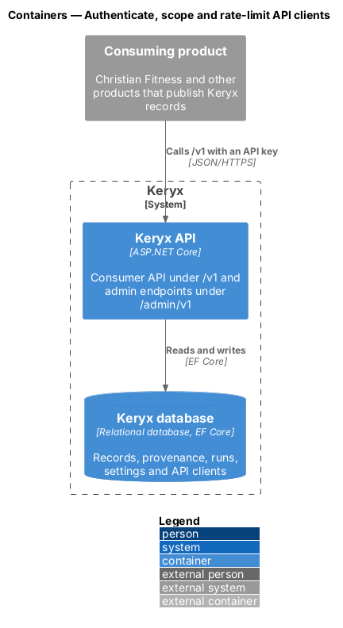
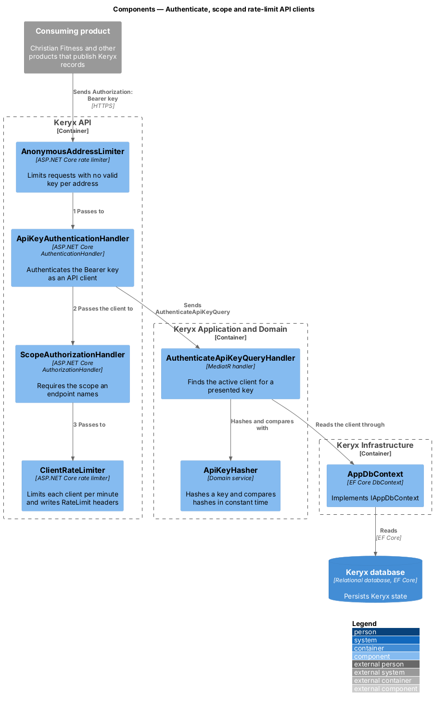
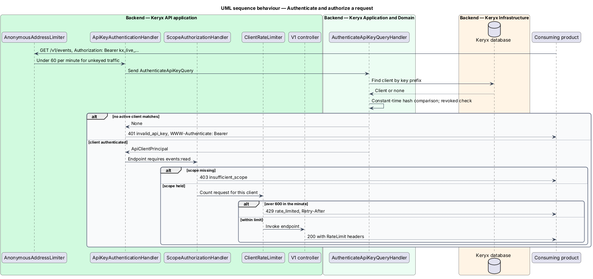

# Authenticate, scope and rate-limit API clients

## Overview

Each consuming product authenticates with its own *API key*, sent as `Authorization: Bearer <key>`. A key carries only the scopes the product needs: `articles:read`, `events:read` and `sources:read`. Categories, regions and status need any valid key.

A request with no key, another scheme, or a key that is unknown, malformed or revoked gets the same `401` with `code` `invalid_api_key`, so a caller learns nothing about which keys exist. A key in a query string is never accepted. A staff session does not open `/v1`, and an API key does not open `/admin/v1`.

Each client is limited to 600 requests per minute, configurable per deployment. Requests with no valid key are limited to 60 per minute per address before any key lookup.

> **API client** — consuming product registered in Keryx, holding one key and a set of scopes

> **key hash** — SHA-256 hash of an API key; the only form in which Keryx stores the key, beside its 12-character prefix

## Description

The slice is an ASP.NET Core authentication scheme, an authorization policy per scope and two rate-limiter partitions. The key lookup goes through one MediatR request.

- **`AnonymousAddressLimiter`** — ASP.NET Core rate limiter in the Keryx API. Limits requests with no valid key to 60 per minute per address and answers `429` before any key lookup.
- **`ApiKeyAuthenticationHandler`** — ASP.NET Core AuthenticationHandler in the Keryx API. Reads only the `Authorization` header. Each failure answers `401` with `code` `invalid_api_key` and `WWW-Authenticate: Bearer`, identically.
- **`ScopeAuthorizationHandler`** — ASP.NET Core AuthorizationHandler in the Keryx API. Requires the scope an endpoint names; a missing scope answers `403` with `code` `insufficient_scope` naming the scope required.
- **`ClientRateLimiter`** — ASP.NET Core rate limiter in the Keryx API. Limits each client per minute on `TimeProvider` and answers `429` with `code` `rate_limited` and `Retry-After` in seconds. Each successful response carries `RateLimit-Limit`, `RateLimit-Remaining` and `RateLimit-Reset`. One client's limit does not affect another.
- **`AuthenticateApiKeyQueryHandler`** — MediatR handler in the Application and Domain layers. Finds the active client for a presented key: it hashes the key, looks the client up by `key_prefix`, and compares the stored hash with the presented hash in constant time. A revoked client does not authenticate.
- **`ApiKeyHasher`** — Domain service in the Application and Domain layers. Hashes a key and compares hashes in constant time.
- **`AppDbContext`** — EF Core DbContext in the Infrastructure layer. Implements IAppDbContext.
- **`ApiClient`** — entity with `Id`, `Name`, `KeyPrefix`, `KeyHash`, `Scopes`, `CreatedAt` and `RevokedAt`.
- **`ApiScope`** — enumeration `ArticlesRead`, `EventsRead`, `SourcesRead`.

The API host registers two authentication schemes. The `/v1` route group accepts only the API-key scheme and the `/admin/v1` route group accepts only the staff session scheme, so neither credential opens the other surface (L2-033).

## Requirements

The feature realizes the following level-2 (L2) requirements. Each L2 requirement refines a level-1 (L1) requirement, cited by identifier. The acceptance criteria of each requirement are in [`docs/specs/L2.md`](../../../specs/L2.md).

| L2 ID | Refines (L1) | Requirement |
|-------|--------------|-------------|
| [`L2-033`](../../../specs/L2.md#l2-033-api-key-authentication) | `L1-009` | **API key authentication.** The requirement is defined by its 5 acceptance criteria. |
| [`L2-034`](../../../specs/L2.md#l2-034-scopes) | `L1-009` | **Scopes.** The scopes are `articles:read` (articles), `events:read` (events) and `sources:read` (organizations and sources). Categories, regions and status need any valid key. |
| [`L2-038`](../../../specs/L2.md#l2-038-rate-limiting-clients) | `L1-009` | **Rate limiting clients.** The requirement is defined by its 5 acceptance criteria. |

## Diagrams

### System context

A consuming product reads published records from Keryx.

### Containers

The consuming product calls the Keryx API at `/v1` with an API key. The Keryx API reads and writes the Keryx database.

### Components

A `/v1` request passes `AnonymousAddressLimiter`, `ApiKeyAuthenticationHandler`, `ScopeAuthorizationHandler` and `ClientRateLimiter` in that order before its controller.

### Class structure

`ApiClient` owns its scopes and its revoked state. `ApiKeyHasher` is the only type that sees a full key.

### Behaviour — authenticate and authorize a request

The request is refused at the first check it fails: `401` for the key (`L2-033`), `403` for the scope (`L2-034`), `429` for the rate (`L2-038`).

