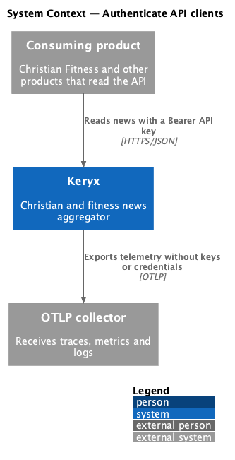
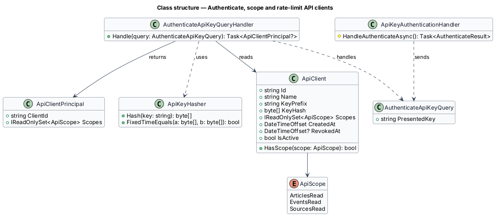
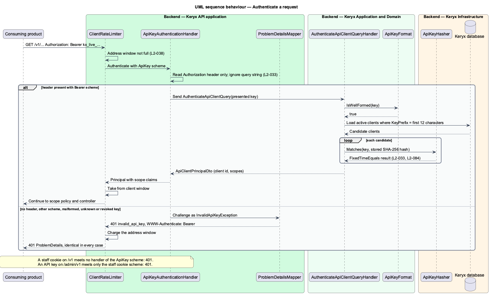
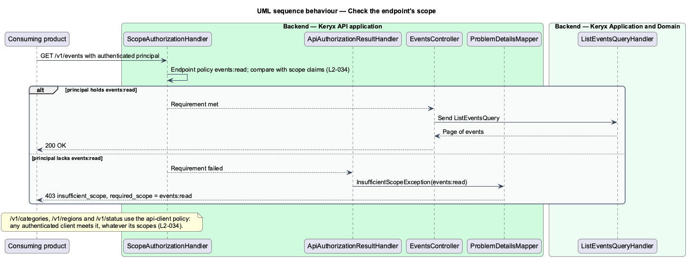
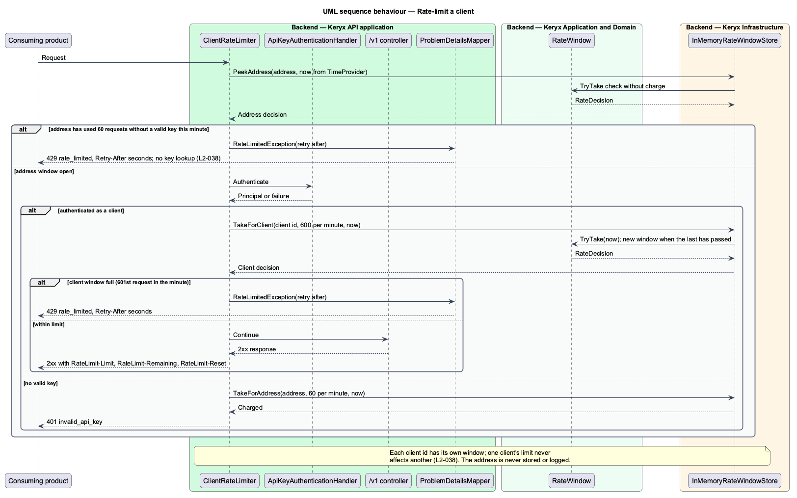

# Authenticate API clients

## Overview

Keryx is a news aggregator for Christian and fitness news, events and organizations, first in
Toronto and the Greater Toronto Area. It has no public website. Other products, Christian
Fitness first, read what Keryx knows through the consumer API under `/v1`. This feature is the
gate in front of every `/v1` endpoint: it decides who is calling, what the caller may read and
how often the caller may ask.

**API client** — record of one consuming product that may call the consumer API, holding the
product name, the scopes granted, the key prefix, the key hash and the revocation time

**API key** — secret string a consuming product presents as a Bearer token; it starts with
`kx_live_` in production or `kx_test_` elsewhere, followed by random characters (L2-035)

**key prefix** — first 12 characters of an API key, stored in clear so staff and the
authentication handler can find a client without the full key

**key hash** — SHA-256 hash of the full API key; the only stored form of the key (L2-084)

**scope** — named permission carried by a client: `articles:read`, `events:read` or
`sources:read`

**rate window** — interval of one minute in which a caller's requests are counted against its
limit

**active client** — API client whose revocation time is not set

The feature authenticates each `/v1` request by its `Authorization: Bearer <key>` header, and
by nothing else. A request with no header, another scheme, or a key that is unknown, malformed
or revoked receives the same `401` response with `code` `invalid_api_key`, so a caller learns
nothing about why the key failed. A staff session cookie is not a credential on `/v1`, and an
API key is not a credential on `/admin/v1`.

Once a request is authenticated, the endpoint's scope policy decides whether the client may read
it. Articles need `articles:read`, events need `events:read`, and organizations and sources need
`sources:read`. Categories, regions and status need any valid key.

Each client is rate-limited on its own, with a default of 600 requests per minute that each
deployment may change. Requests that carry no valid key are limited by address, at 60 per minute,
before any key lookup is made, so guessing keys is slow and each refusal costs Keryx no database read.

The feature also fixes how secrets are held: an API key is stored only as its hash and its
prefix, platform credentials and signing keys come from the environment or a secret store, and
the data-protection keys that protect session cookies are shared across API instances.

The feature sits in the `consumer-api` subsystem. Creating and revoking keys belongs to the
manage-api-keys feature, and counting each client's usage belongs to the report-api-usage
feature. The serve features (articles, events, organizations and sources, reference and status)
declare which scope policy each endpoint uses.

## Description

The slice runs from the consuming product's HTTPS request through the API's middleware to the
relational database (PostgreSQL, [ADR 0001](../../../adr/0001-postgresql-and-the-backend-packages.md)) via EF Core. It has no admin app part.

- **`ClientRateLimiter`** (`Keryx.Api`, middleware) — applies two limits, reading the clock from
  `TimeProvider`. Before authentication, it refuses a request with `429` when the caller's
  address has already used its 60 requests without a valid key in the current rate window, so
  no key lookup is made (L2-038). After authentication, it counts the request against the
  client's own rate window and refuses the request with `429` when the window is full. A
  request that ends without a valid key is charged to its address. It delegates the window
  arithmetic to `RateWindow` and holds no other rule.
- **`ApiKeyAuthenticationHandler`** (`Keryx.Api`) — ASP.NET Core authentication handler for the
  `ApiKey` scheme, the only scheme the `/v1` controllers accept. It reads only the
  `Authorization` header and ignores any key in the query string (L2-033). The scheme word `Bearer` is
  matched without regard to case (RFC 9110). It sends one
  `AuthenticateApiClientQuery` and, on success, builds a principal carrying the client's public
  id and one `scope` claim per granted scope. On every failure it answers the challenge
  identically: `401`, `WWW-Authenticate: Bearer`, ProblemDetails `code` `invalid_api_key`.
- **`AuthenticateApiClientQuery`** (`Keryx.Application`) — the presented key, as read from the
  header.
- **`AuthenticateApiClientQueryHandler`** — checks the key's shape with `ApiKeyFormat`, loads the
  active clients whose `KeyPrefix` equals the key's first 12 characters, and compares the hash of
  the presented key with each stored hash in constant time through `IApiKeyHasher.Matches`. It
  returns an `ApiClientPrincipalDto` or nothing. It reads the database on every request and
  caches no result, so a revocation takes effect on the next request (L2-036).
- **`ApiKeyHash`** (`Keryx.Application`) — `Of(key)` returns the SHA-256 hash of the key as
  lower-case hex; `Matches(key, storedHash)` hashes the key and compares the two hashes with
  `CryptographicOperations.FixedTimeEquals` (L2-033, L2-084). Both are pure, with no I/O, so they
  are a static helper rather than a contract with an infrastructure client.
- **`ApiKeyFormat`** (`Keryx.Domain`) — pure rule for a well-formed key: the prefix `kx_live_` or
  `kx_test_`, then at least 24 ASCII letters and digits, and at most 128 characters in all. A malformed key is refused
  without a database read, with the same response as an unknown key.
- **`ApiClient`** (`Keryx.Domain`) — entity with `Id` (`PublicId`), `ProductName`, `KeyPrefix`,
  `KeyHash`, `Scopes`, `CreatedAt`, `RevokedAt` and `IsActive`. It never holds the full key.
- **`ApiScope`** (`Keryx.Domain`) — the three scopes, `articles:read`, `events:read` and
  `sources:read`, with parsing from their names.
- **Scope policies** (`Keryx.Api`) — the policies `articles:read`, `events:read` and
  `sources:read`, each with a `ScopeRequirement` naming its scope, and the policy `api-client`,
  which any authenticated client meets. `ScopeAuthorizationHandler` meets a `ScopeRequirement`
  when the principal holds that scope's claim. A failure is answered by
  `ApiAuthorizationResultHandler` with `403`, `code` `insufficient_scope`, and the extension
  `required_scope` naming the scope (L2-034).
- **Scheme isolation** — the `/v1` controllers declare the `ApiKey` scheme only, and the
  `/admin/v1` controllers declare the staff cookie scheme only. A staff cookie on `/v1` and an API
  key on `/admin/v1` therefore both receive `401` (L2-033).
- **`RateWindow`** (`Keryx.Domain`) — value type for one caller's fixed window: its start, its
  count and its limit. `TryTake(now)` opens a new window when the previous one has passed and
  returns a `RateDecision` with `Allowed`, `Limit`, `Remaining`, `ResetSeconds` and
  `RetryAfterSeconds`. It has a unit test per row of its case table.
- **`IRateWindowStore`** (`Keryx.Application`) and **`InMemoryRateWindowStore`**
  (`Keryx.Infrastructure`) — keep one `RateWindow` per client id and one per address, evicting
  windows that have passed. The address is held in memory only, for the length of its window,
  and is never stored or logged. Whether the windows shall be shared across API instances is
  `<TO SUPPLY>`; an in-memory store limits each instance on its own.
- **`RateLimitOptions`** — `ClientPermitsPerMinute` (default 600) and
  `UnauthenticatedPermitsPerMinute` (60), bound from configuration and documented in
  `tools/deploy/` (L2-096). The configuration key names are `<TO SUPPLY>`. How the client address
  is read behind a proxy (forwarded-header trust) is `<TO SUPPLY>`.
- **`ProblemDetailsMapper`** (`Keryx.Api`) — maps `KeryxException` subclasses to ProblemDetails
  with their `code` and the trace id. This feature adds `InvalidApiKeyException`
  (`invalid_api_key`, `401`), `InsufficientScopeException` (`insufficient_scope`, `403`) and
  `RateLimitedException` (`rate_limited`, `429`).
- **Secrets configuration** (`Keryx.Api`, `Keryx.Worker`) — connection strings, platform
  credentials (Instagram, Eventbrite, mail, news search) and signing keys are read from the
  environment or a secret store, never from the repository (L2-084). Each platform client sends
  its credential only to its own host over HTTPS. The telemetry and logging configuration
  redacts the `Authorization` header and never records a key, a key prefix or a credential
  (L2-094). The data-protection key ring that protects session cookies is persisted to a store
  shared by every API instance; the store is `<TO SUPPLY>` and is documented as a deployment
  setting.

The responses this feature adds to every `/v1` endpoint:

| Status | `code` | Headers | When |
|---|---|---|---|
| `401` | `invalid_api_key` | `WWW-Authenticate: Bearer` | No `Authorization` header, a scheme other than `Bearer`, or a key that is unknown, malformed or revoked |
| `403` | `insufficient_scope` | — | The key lacks the endpoint's scope; the body's `required_scope` names it |
| `429` | `rate_limited` | `Retry-After` (seconds) | The client's window is full, or the address has used 60 requests without a valid key |
| `2xx` | — | `RateLimit-Limit`, `RateLimit-Remaining`, `RateLimit-Reset` | Every successful response |

Each error body is ProblemDetails with `type`, `title`, `status`, `code` and `trace_id`
(L2-031).

## Requirements

The feature realizes the following level-2 (L2) requirements. Each L2 requirement refines a
level-1 (L1) requirement, cited by identifier. Their acceptance criteria are in
[L2.md](../../../specs/L2.md).

| L2 ID | Refines (L1) | Requirement |
|-------|--------------|-------------|
| `L2-033` | `L1-009` | API key authentication — Every `/v1` request must carry an active API key as a Bearer token; anything else is refused with `401`. |
| `L2-034` | `L1-009` | Scopes — The scopes are `articles:read` (articles), `events:read` (events) and `sources:read` (organizations and sources). Categories, regions and status need any valid key. |
| `L2-038` | `L1-009` | Rate limiting clients — Each client is limited to a configurable number of requests per minute, independently of every other client. |
| `L2-084` | `L1-020` | Secrets — Secrets are never in the repository, stored keys are hashed, and platform credentials never leave the platform's own host. |

## Diagrams

### System context

A consuming product reads Keryx through the consumer API with its own key. Keryx reports traces,
metrics and logs to the OTLP collector, with no key or credential in them.

### Containers

Only the Keryx API takes part. It reads API clients from the Keryx database on each request and
exports telemetry to the collector.

### Components

Inside the Keryx API, the rate limiter runs before and after the authentication handler, the
handler sends one query to the application layer, and the scope policies run before the `/v1`
controllers.

### Class structure

`AuthenticateApiClientQueryHandler` reads `ApiClient` records and compares hashes through
`IApiKeyHasher`. `ClientRateLimiter` keeps one `RateWindow` per caller in `IRateWindowStore`.
The scope policies compare `ScopeRequirement` with the principal's scope claims.

### Behaviour — authenticate a request

The handler reads only the `Authorization` header, refuses a malformed key without a database
read, and compares hashes in constant time. Every failure produces the same `401` response.

### Behaviour — check the endpoint's scope

The scope policy of the endpoint compares its scope with the principal's claims. A missing scope
gives `403` `insufficient_scope` naming the scope; the reference endpoints need any valid key.

### Behaviour — rate-limit a client

The rate limiter refuses an address that has used 60 requests without a valid key before any
lookup, and counts each client's requests in its own window. A full window gives `429` with
`Retry-After`; a successful response carries the three `RateLimit-*` headers.

