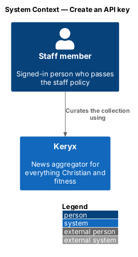
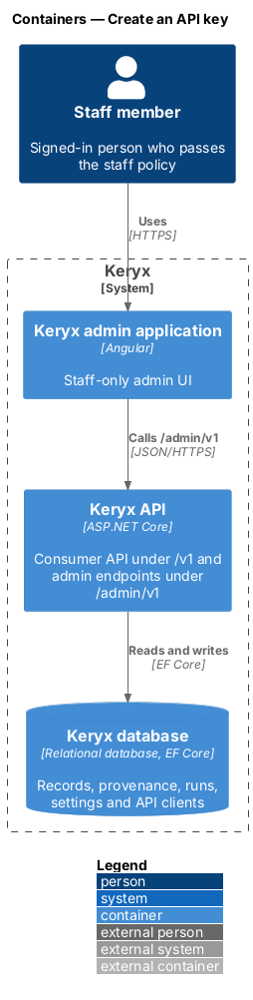
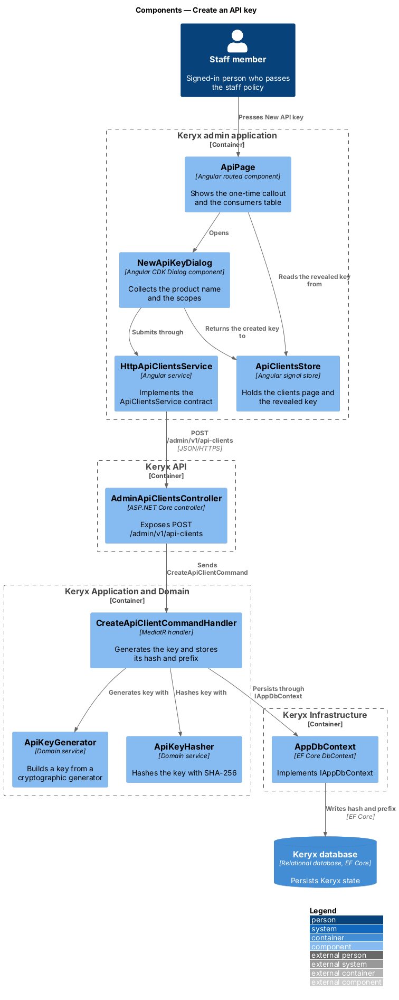
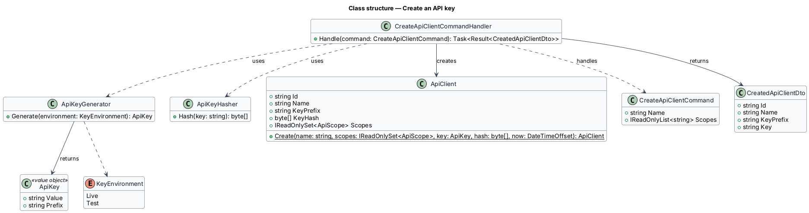
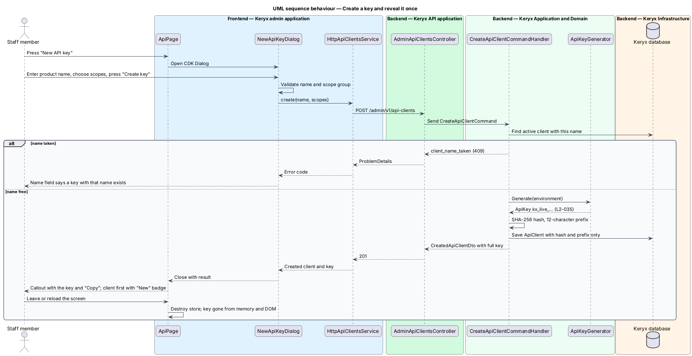

# Create an API key

## Overview

A staff member connects a new consuming product by creating an API key for it on the API screen. The key is shown exactly once, right after it is created. Keryx stores only a hash of the key and its first 12 characters, so the full key cannot be recovered later.

The New API key dialog asks for a product name and at least one scope. After creation the dialog closes and the page shows a callout with the full key and a "Copy" button. Leaving the screen, reloading, or destroying the component removes the key from memory and from the DOM. The key is never written to the URL, storage, a log or telemetry.

## Description

The slice runs from the dialog to the `ApiClient` entity. The server generates the key; the admin application holds it in one signal for the life of the page.

- **`ApiPage`** — Angular routed component in the Keryx admin application. Shows the callout "Key created for …" with the full key as selectable text. "Copy" writes to the clipboard and reports "Key copied", or "Keryx couldn’t copy the key" when the browser blocks the clipboard.
- **`NewApiKeyDialog`** — Angular CDK Dialog component in the Keryx admin application. Collects the product name and the scopes. With no name and no scope it sends nothing, marks the scope group invalid as a group, and moves focus to the name. A `client_name_taken` answer is shown on the name field.
- **`ApiClientsStore`** — Angular signal store in the Keryx admin application. Holds the clients page and the revealed key. It is provided on `ApiPage`, so the key signal is released when the screen is left. It marks the new client with a "New" badge.
- **`HttpApiClientsService`** — Angular service in the Keryx admin application. Implements the ApiClientsService contract.
- **`AdminApiClientsController`** — ASP.NET Core controller in the Keryx API. Exposes POST /admin/v1/api-clients.
- **`CreateApiClientCommandHandler`** — MediatR handler in the Application and Domain layers. Validates the name (1 to 80 characters) and the scopes, refuses a name used by an active client with `409` `client_name_taken`, generates the key, stores the hash and the 12-character prefix, and returns the full key in the `201` response only.
- **`ApiKeyGenerator`** — Domain service in the Application and Domain layers. Builds a key as `kx_live_` followed by at least 24 random characters from a cryptographic generator; a non-production environment uses `kx_test_`.
- **`ApiKeyHasher`** — Domain service in the Application and Domain layers. Hashes the key with SHA-256.
- **`AppDbContext`** — EF Core DbContext in the Infrastructure layer. Implements IAppDbContext.
- **`CreateApiClientCommand`** — MediatR request carrying `Name` and `Scopes`.
- **`CreatedApiClientDto`** — the client fields plus `key`, the full key, present in this response only.

## Requirements

The feature realizes the following level-2 (L2) requirements. Each L2 requirement refines a level-1 (L1) requirement, cited by identifier. The acceptance criteria of each requirement are in [`docs/specs/L2.md`](../../../specs/L2.md).

| L2 ID | Refines (L1) | Requirement |
|-------|--------------|-------------|
| [`L2-035`](../../../specs/L2.md#l2-035-creating-a-key) | `L1-009` | **Creating a key.** The requirement is defined by its 5 acceptance criteria. |
| [`L2-068`](../../../specs/L2.md#l2-068-new-api-key-dialog-and-one-time-reveal) | `L1-015` | **New API key dialog and one-time reveal.** The requirement is defined by its 6 acceptance criteria. |

## Diagrams

### System context

A staff member curates the collection through Keryx.

### Containers

The staff member uses the Keryx admin application. The Keryx admin application calls the Keryx API at `/admin/v1`. The Keryx API reads and writes the Keryx database.

### Components

`NewApiKeyDialog` submits through `HttpApiClientsService`. `CreateApiClientCommandHandler` uses `ApiKeyGenerator` and `ApiKeyHasher` and stores an `ApiClient`; `ApiClientsStore` holds the returned key for the callout.

### Class structure

`ApiKeyGenerator` returns an `ApiKey` value that exists only inside the handler and the response; `ApiClient.Create` keeps the hash and the prefix.

### Behaviour — create a key and reveal it once

The full key travels in one response and lives in one signal (`L2-068`). The database receives only the hash and the prefix (`L2-035`).

