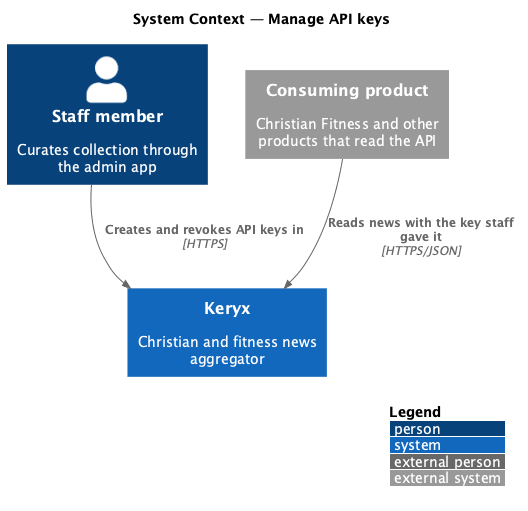
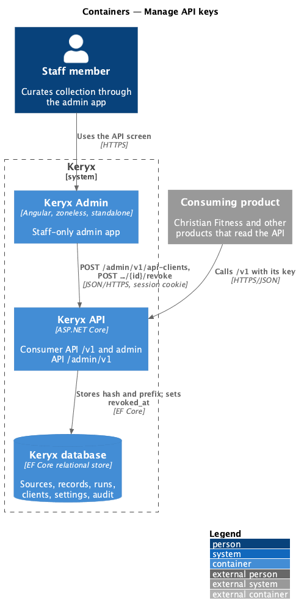
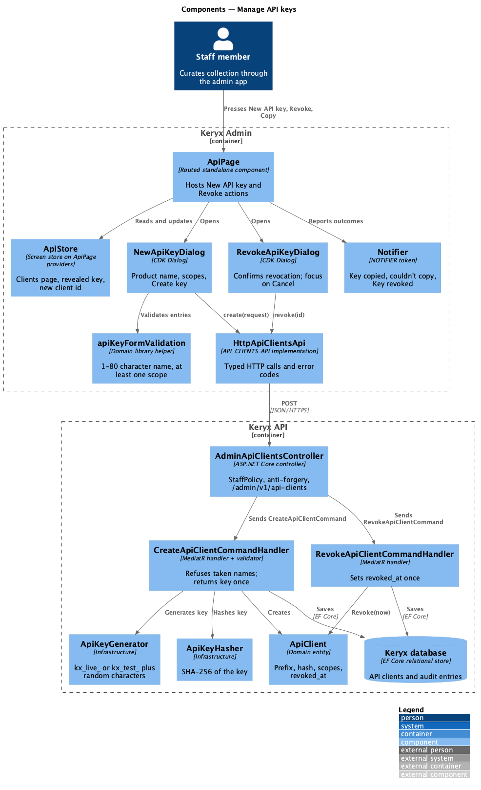
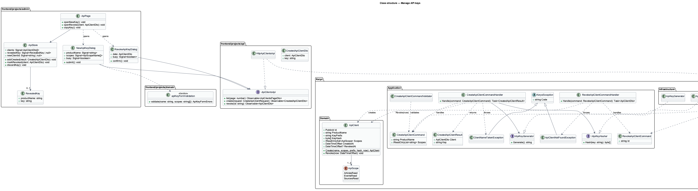
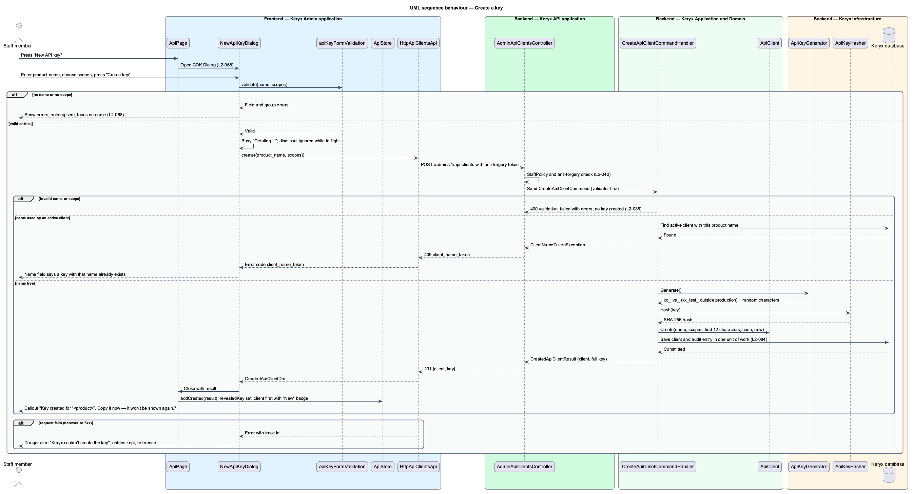
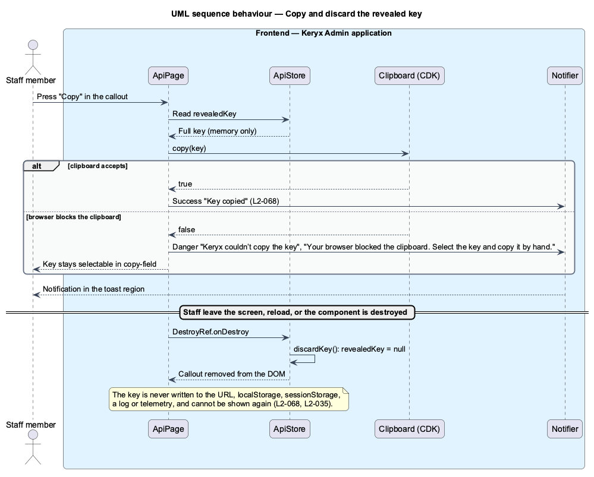
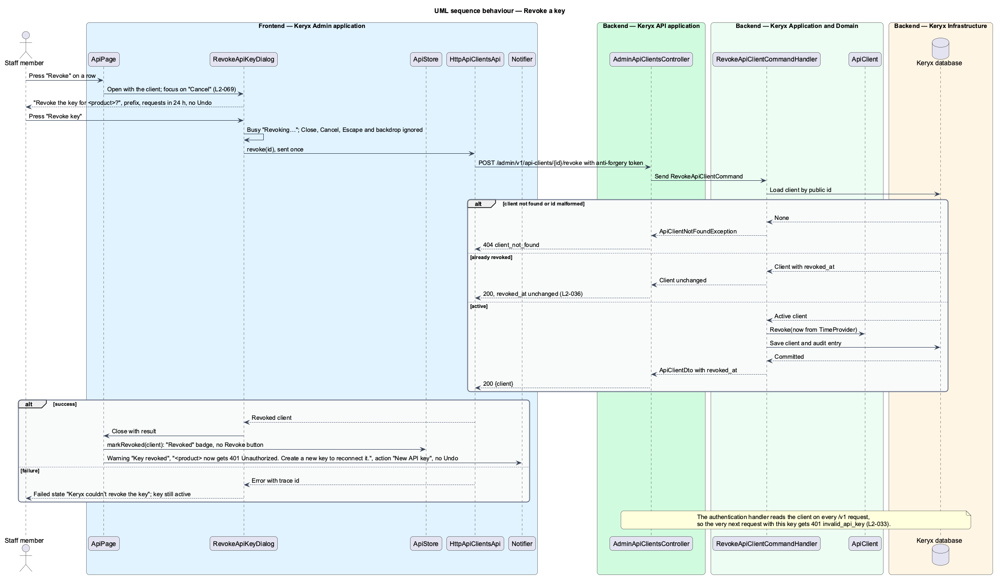

# Manage API keys

## Overview

Keryx is a news aggregator for Christian and fitness news, events and organizations, first in
Toronto and the Greater Toronto Area. Other products, Christian Fitness first, read Keryx through
the consumer API under `/v1`, each with its own API key. This feature lets staff create a key for
a product and revoke a key, from the API screen of the admin app.

**API client** — record of one consuming product that may call the consumer API: product name,
scopes, key prefix, key hash, creation time and revocation time

**API key** — secret Bearer token a product presents on every `/v1` request; `kx_live_` (or
`kx_test_` outside production) followed by at least 24 random characters

**key prefix** — first 12 characters of a key, the only part of it staff ever see again

**one-time reveal** — single display of a newly created full key on the API screen, gone once
the screen is left

**revocation** — permanent end of a key's validity, recorded as the client's `revoked_at` time

Creating a key returns the full key once, in the create response. Keryx stores only the key's
SHA-256 hash and its prefix, so the key cannot be recovered or shown again. The API screen shows
the full key in a callout with a "Copy" button until staff leave the screen, reload it, or the
screen is destroyed.

Revoking a key takes effect on the next request with it, which receives `401`. Revocation
cannot be reversed: a revoked client stays listed, marked "Revoked", with its usage history, and
the product needs a new key to reconnect. Because there is no Undo, the Revoke dialog states the
consequence and starts focus on "Cancel".

The feature sits in the `consumer-api` subsystem. The authenticate-api-clients feature checks the
keys this feature creates and refuses revoked ones. The report-api-usage feature owns the API
screen's tiles, table, endpoints list and page states; this feature adds the "New API key"
action, the New API key and Revoke API key dialogs, the key-created callout, the "New" badge and
the notifications.

## Description

The slice runs from the API screen in the Keryx Admin application through the admin API to the
relational database (engine `<TO SUPPLY>`) via EF Core.

**Admin app (`frontend/projects/admin`)**

- **`ApiPage`** — routed page for `/api`, loaded with `loadComponent`. Its "New API key" button
  (`btn btn--primary` in `page-header__actions`) opens `NewApiKeyDialog`, and each active row's
  "Revoke" button (`btn btn--ghost btn--sm`, accessible name "Revoke the key for <product>")
  opens `RevokeApiKeyDialog`. Both are CDK Dialogs; the page closes any open dialog by its ref
  before navigating (L2-074).
- **`ApiStore`** — screen store provided on `ApiPage`'s `providers`, so it lives only while the
  screen is shown. It holds the current page of clients and, after a create, the
  `revealedKey` signal (product name and full key) and the id of the new client. It puts the new
  client first in the table with a "New" badge (`badge badge--brand`). In `DestroyRef.onDestroy`
  it sets `revealedKey` to `null`, so the key leaves memory and the DOM when staff leave or
  reload (L2-068). It never writes the key to the URL, `localStorage`, `sessionStorage`, a log or
  telemetry.
- **`NewApiKeyDialog`** — CDK Dialog with the title "New API key" and the lead "One key per
  product, so each can be measured and revoked on its own." It holds the field "Product name"
  with the hint "The website, app or newsletter that will call Keryx with this key.", the scope
  group with `articles:read` ("Published articles and their summaries"), `events:read` ("Events
  with dates and places") and `sources:read` ("The list of organisations and sources"), the
  neutral alert "The key is shown once, right after you create it. Keryx stores only its first
  characters.", "Cancel" and "Create key". It validates with `apiKeyFormValidation` before
  sending, shows "Creating…" while busy, ignores Close, Cancel, Escape and the backdrop while a
  request is in flight, and closes with the created result.
- **`RevokeApiKeyDialog`** — CDK Dialog (`dialog__panel--sm`) titled "Revoke the key for
  <product>?", with the lead "Requests with <prefix>… stop working immediately.", a body giving
  the requests in the last 24 hours and stating that the action cannot be undone, "Cancel" (with
  initial focus) and "Revoke key" (`btn--danger-solid`). While busy it reads "Revoking…", sends
  one request, and ignores Close, Cancel, Escape and the backdrop (L2-069).
- **Notifications** — through `NOTIFIER` (`Notifier`): success "Key copied" after a copy; danger
  "Keryx couldn’t copy the key" with "Your browser blocked the clipboard. Select the key and copy
  it by hand." when the clipboard refuses; warning "Key revoked" with "<product> now gets 401
  Unauthorized. Create a new key to reconnect it." and the single action "New API key", with no
  Undo. Product names are bound as text.
- **Copy** — the callout's "Copy" button calls the CDK `Clipboard` service with the key. A
  `false` result from the clipboard gives the danger notification, and the key stays selectable
  in `copy-field__value`.

**Components library (`frontend/projects/components`)** — presentation only, inputs and outputs,
named by the mocks' blocks: `dialog`, `field`, `input`, `check` (and its `check-list` group),
`alert`, `btn`, `icon-btn`, `callout`, `copy-field`, `badge`, `table`, `toast`.

**Domain library (`frontend/projects/domain`)**

- **`apiKeyFormValidation`** — pure rule for the dialog: product name of 1 to 80 characters,
  and at least one scope. An empty name gives "Enter the product’s name so you can recognise its
  key later."; no scope gives "Choose at least one scope." for the group, which is marked invalid
  as a whole, and focus moves to the name. It has a unit test per row of its case table, and the
  backend validator's tests use the same inline case table. Whether surrounding whitespace is
  trimmed before the length check is `<TO SUPPLY>`.

**API library (`frontend/projects/api`)**

- **`API_CLIENTS_API`** / **`ApiClientsApi`** — contract with `list(page)`,
  `create(request)` and `revoke(id)`, returning typed results or an error carrying its `code`.
  `HttpApiClientsApi` implements it and `app.config.ts` binds it. DTOs: `ApiClientDto`,
  `CreateApiClientRequest`, `CreatedApiClientDto`.

**Admin API (`Keryx.Api`, `Keryx.Application`, `Keryx.Domain`, `Keryx.Infrastructure`)**

- **`AdminApiClientsController`** — `/admin/v1/api-clients`, under `StaffPolicy` with the staff
  cookie scheme and the anti-forgery check on state changes (L2-040). Each action sends one
  MediatR request and checks nothing itself.
- **`CreateApiClientCommand`** — `ProductName` and `Scopes`. Properties the endpoint does not
  define are ignored, so no body can set `id`, `revoked_at` or `key_hash` (L2-083).
- **`CreateApiClientCommandValidator`** — product name of 1 to 80 characters; at least one
  scope; each scope known. A failure gives `400` `validation_failed` with an `errors` entry per
  field, and no key is created.
- **`CreateApiClientCommandHandler`** — refuses a product name already used by an active client
  with `ClientNameTakenException` (`409` `client_name_taken`). It asks `IApiKeyGenerator` for a
  key, hashes it through `IApiKeyHasher`, creates the `ApiClient` with the hash and the 12-
  character prefix, saves it, and returns the client with the full key. The full key exists only
  in the handler's result and the response body. Whether the name comparison ignores case is
  `<TO SUPPLY>`. A filtered unique index on the product name of active clients closes the race
  between two creates.
- **`IApiKeyGenerator`** (`Keryx.Application`) and **`ApiKeyGenerator`**
  (`Keryx.Infrastructure`) — draws the random part from `RandomNumberGenerator`: at least 24
  characters from a URL-safe alphabet (the mock shows 24). The prefix is `kx_live_` in
  production and `kx_test_` in every other environment (L2-035). The alphabet is `<TO SUPPLY>`.
- **`RevokeApiClientCommand`** / **`RevokeApiClientCommandHandler`** — loads the client by its
  public id; an unknown or malformed id gives `ApiClientNotFoundException` (`404`
  `client_not_found`). An active client is revoked with `ApiClient.Revoke(now)`, the time read
  from `TimeProvider`. A client already revoked is returned unchanged with `200`.
- **`ApiClient`** (`Keryx.Domain`) — `Revoke(now)` sets `RevokedAt` once and never clears it;
  there is no operation that makes a client active again (L2-036).
- **Audit** — each successful create and revoke stores an `AuditEntry` with the staff member's
  subject id, the action, the client id and the time, and no key (L2-085, designed with the
  audit feature).

**Endpoints**

| Method and path | Request | Success | Errors (`code`) |
|---|---|---|---|
| `POST /admin/v1/api-clients` | `product_name` (1–80 characters), `scopes` (one or more of `articles:read`, `events:read`, `sources:read`) | `201` with `client` (`ApiClientDto`) and `key` (the full key, once) | `400` `validation_failed` with `errors`; `409` `client_name_taken`; `400` `antiforgery_failed` |
| `POST /admin/v1/api-clients/{id}/revoke` | none | `200` with `client` (`ApiClientDto`, `revoked_at` set) | `404` `client_not_found`; `400` `antiforgery_failed` |

`ApiClientDto` holds `id`, `product_name`, `key_prefix`, `scopes`, `created_at`, `revoked_at`
(or `null`), and the usage numbers of the report-api-usage feature. It never holds the full key
or its hash; after the create response, only `key_prefix` is returned by any endpoint (L2-035).

**Screen states taken from the mocks**

- `dialogs/new-api-key/default`, `invalid`, `busy`, `failed`; `pages/api/key-created`;
  `dialogs/revoke-api-key/default`, `busy`, `failed`; `notifications/api-toast/success`,
  `danger`, `warning`.
- On a failed create the dialog stays open with entries kept and the danger alert "Keryx
  couldn’t create the key", "No key was created. Try again in a moment." and "Reference req_…"
  from the response's trace id. On `client_name_taken` the name field states that a key with that
  name already exists; the exact copy and its mock state are `<TO SUPPLY>`.
- On a failed revoke the dialog shows "Keryx couldn’t revoke the key", "Nothing changed. Try
  again in a moment." and the reference, and the key stays active.

## Requirements

The feature realizes the following level-2 (L2) requirements. Each L2 requirement refines a
level-1 (L1) requirement, cited by identifier. Their acceptance criteria are in
[L2.md](../../../specs/L2.md).

| L2 ID | Refines (L1) | Requirement |
|-------|--------------|-------------|
| `L2-035` | `L1-009` | Creating a key — Staff can create an API key for a product with chosen scopes; the full key is returned once and never stored in recoverable form. |
| `L2-036` | `L1-009` | Revoking a key — Staff can revoke an API key; revocation takes effect on the very next request and cannot be reversed. |
| `L2-068` | `L1-015` | New API key dialog and one-time reveal — Staff create an API key through a dialog, and the full key is shown once on the screen to be copied. |
| `L2-069` | `L1-015` | Revoke API key dialog — Staff revoke an API key through a confirmation dialog that states the consequence; revocation has no Undo. |

## Diagrams

### System context

Staff manage keys in Keryx; consuming products then call Keryx with the keys staff give them.

### Containers

The Keryx Admin application calls the admin API of the Keryx API, which stores clients in the
Keryx database. The consumer API reads the same clients when a product calls it.

### Components

On the frontend, `ApiPage` opens the two dialogs and holds the revealed key in `ApiStore`. On the
backend, `AdminApiClientsController` sends one command per action to its handler.

### Class structure

The create handler uses `IApiKeyGenerator` and `IApiKeyHasher` and stores an `ApiClient` with
only the hash and prefix. The frontend store holds the revealed key until it is destroyed.

### Behaviour — create a key

The dialog validates before sending; the handler validates again, refuses a taken name, and
returns the full key once. The page shows the callout and the new row first with a "New" badge.

### Behaviour — copy and discard the revealed key

"Copy" writes the key to the clipboard and reports the result. Leaving, reloading or destroying
the screen discards the key from memory and the DOM.

### Behaviour — revoke a key

The dialog sends one request and cannot be dismissed while it is in flight. The handler sets
`revoked_at` once, and the next request with the key receives `401`.

