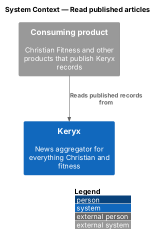
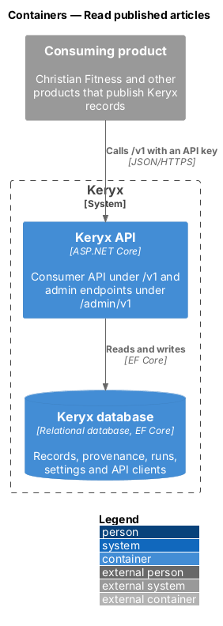
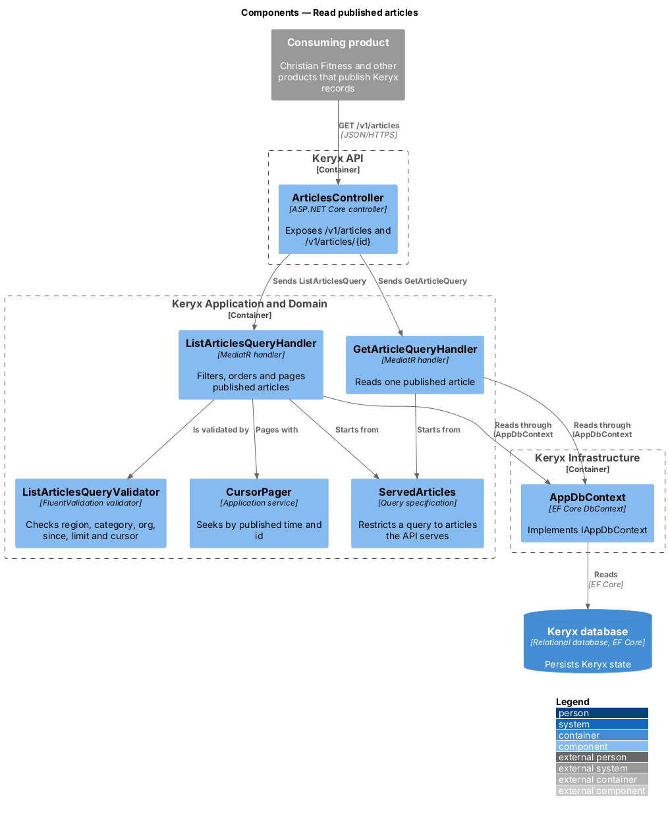
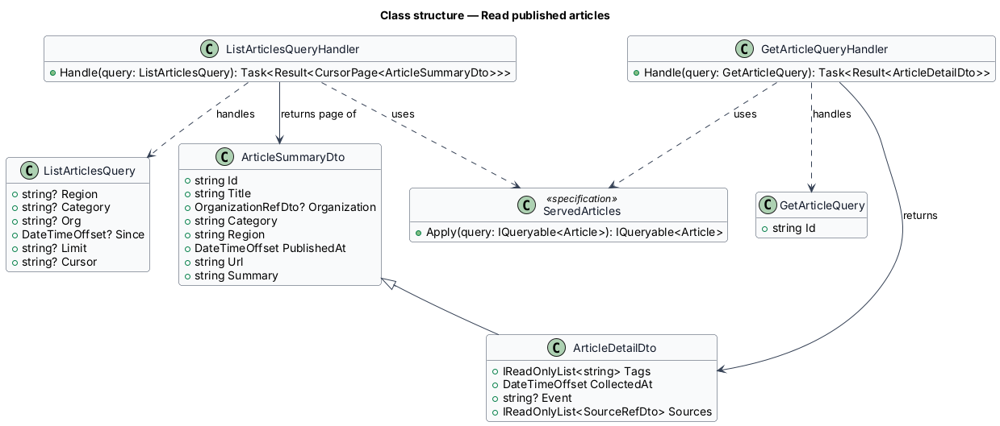
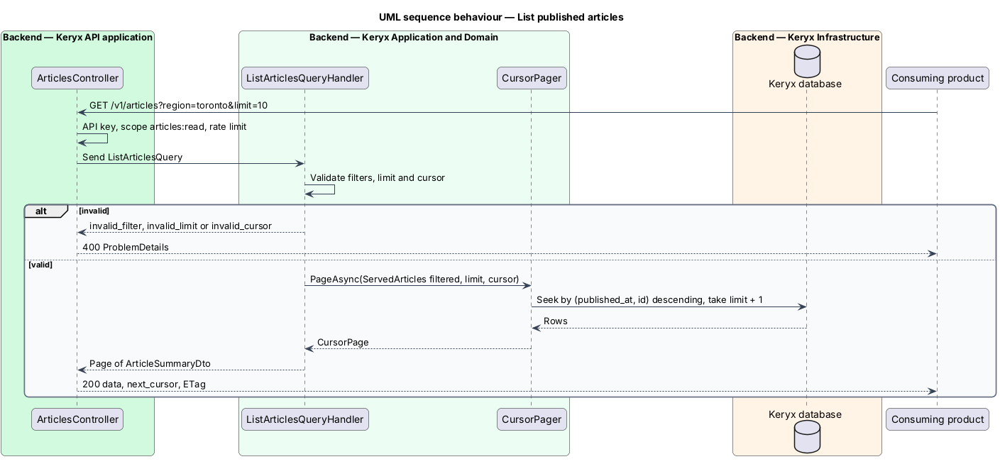

# Read published articles

## Overview

A consuming product reads news through two endpoints. `GET /v1/articles` returns published articles, newest first by the time the source published them, with ties broken by id descending. `GET /v1/articles/{id}` returns one published article with its tags, its sources and its linked event.

Only published articles are served. An article that needs review, is hidden or does not exist answers `404` with `code` `article_not_found`, indistinguishably. A served article carries no relevance score, no status and no internal field.

## Description

The slice is one controller and two query handlers over a projection that reads only served columns. Both endpoints need the scope `articles:read`.

- **`ArticlesController`** — ASP.NET Core controller in the Keryx API. Exposes /v1/articles and /v1/articles/{id}.
- **`ListArticlesQueryHandler`** — MediatR handler in the Application and Domain layers. Filters by `region`, `category`, `org` and `since`, alone or together, orders by `published_at` then `id` descending, and pages with `limit` and `cursor`.
- **`GetArticleQueryHandler`** — MediatR handler in the Application and Domain layers. Reads one published article.
- **`ListArticlesQueryValidator`** — FluentValidation validator in the Application and Domain layers. Checks region, category, org, since, limit and cursor. An unknown slug or a malformed `since` is `invalid_filter`; a foreign cursor is `invalid_cursor`; a bad limit is `invalid_limit`.
- **`ServedArticles`** — Query specification in the Application and Domain layers. Restricts a query to articles the API serves: status `published`, a title, and results made visible by a completed `publish` stage. Each consumer query starts from it, so no count includes a held or hidden article.
- **`CursorPager`** — Application service in the Application and Domain layers. Seeks by published time and id.
- **`AppDbContext`** — EF Core DbContext in the Infrastructure layer. Implements IAppDbContext.
- **`ArticleSummaryDto`** — `id`, `title`, `organization` (`id`, `name`) or `null`, `category`, `region`, `published_at`, `url` and `summary`.
- **`ArticleDetailDto`** — the list fields plus `tags`, `collected_at`, the linked `event` id and `sources` (each a name and a URL).

## Requirements

The feature realizes the following level-2 (L2) requirements. Each L2 requirement refines a level-1 (L1) requirement, cited by identifier. The acceptance criteria of each requirement are in [`docs/specs/L2.md`](../../../specs/L2.md).

| L2 ID | Refines (L1) | Requirement |
|-------|--------------|-------------|
| [`L2-026`](../../../specs/L2.md#l2-026-list-articles) | `L1-008` | **List articles.** `GET /v1/articles` returns published articles, newest first by the time the source published them (ties broken by id, descending). |
| [`L2-027`](../../../specs/L2.md#l2-027-read-one-article) | `L1-008` | **Read one article.** The requirement is defined by its 3 acceptance criteria. |

## Diagrams

### System context

A consuming product reads published records from Keryx.

### Containers

The consuming product calls the Keryx API at `/v1` with an API key. The Keryx API reads and writes the Keryx database.

### Components

`ArticlesController` sends one query per request. Both handlers start from `ServedArticles`; the list handler pages with `CursorPager`.

### Class structure

`ListArticlesQueryHandler` returns a `CursorPage` of `ArticleSummaryDto`; `ArticleDetailDto` extends the summary.

### Behaviour — list published articles

The handler validates the filters, starts from the served set (`L2-026`) and seeks from the cursor. The response holds at most 100 items and a `next_cursor`.

